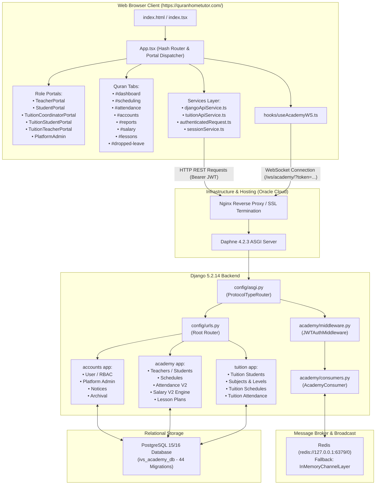

# Project Baseline & Technical Environment

> **Document ID**: `01_PROJECT_BASELINE`  
> **Status**: VERIFIED  
> **Repository Target**: `quran----1-Role-Based-`  
> **Production Target**: [https://quranhometutor.com/](https://quranhometutor.com/)  
> **Audit Date**: 2026-11-03  

---

## 1. System Identity & Monorepo Structure (Task 1.1)

| Attribute | Specification | Verification Evidence |
| :--- | :--- | :--- |
| **System Name** | IVS Qur'an Academy Manager / IVS Schedule Viewer | [package.json](file:///c:/Users/iqrav/Downloads/quran%20---1%20(Role%20Based)/package.json#L2), [PROJECT.md](file:///c:/Users/iqrav/Downloads/quran%20---1%20(Role%20Based)/PROJECT.md#L1) |
| **Live Production Site** | `https://quranhometutor.com/` | User prompt & [settings.py](file:///c:/Users/iqrav/Downloads/quran%20---1%20(Role%20Based)/backend/config/settings.py#L205) |
| **Project Root Path** | `c:\Users\iqrav\Downloads\quran ---1 (Role Based)` | System working directory |
| **Repository Model** | **Monorepo** (Unified Frontend SPA + Django Backend in a single git tree) | Top-level file inspection |
| **Main Frontend Root** | Root directory (`./`), with components in `components/`, services in `services/`, hooks in `hooks/`, public in `public/` | [vite.config.ts](file:///c:/Users/iqrav/Downloads/quran%20---1%20(Role%20Based)/vite.config.ts) |
| **Main Backend Root** | `backend/` (`backend/manage.py`, `backend/config/`, `backend/academy/`, `backend/accounts/`, `backend/tuition/`) | [backend/manage.py](file:///c:/Users/iqrav/Downloads/quran%20---1%20(Role%20Based)/backend/manage.py) |
| **Supporting Script Directories** | Root: `setup_backend.ps1`, `setup_backend.cmd`, `verify_backend.cmd.ps1`, `verify_backend.cmd`, `_update_work/` | Root file listing |
| **Existing Documentation** | `README.md`, `PROJECT.md`, `CODEX_OPTIMIZATION_PROMPT.md`, `ivs_quran_clone_phase2_audit.txt` | Root file listing |
| **Existing Test Directories**| `backend/academy/tests/`, `backend/accounts/tests/`, `backend/accounts/notification_tests.py` | Backend directory listing |
| **CI/CD Configuration** | **NOT FOUND** (No `.github/workflows/`, `.gitlab-ci.yml`, or Jenkinsfile in repository) | Root directory scan |
| **Deployment Files** | **NOT FOUND** (No Dockerfile, `docker-compose.yml`, Procfile, or Nginx configs in repository; managed out-of-band on Oracle Cloud) | Root & backend scan |

---

## 2. Git Metadata & Working Tree State (Task 1.1)

| Parameter | Value | Verification Command / Output |
| :--- | :--- | :--- |
| **Active Git Branch** | `release/ivs-20261020-candidate` | `git status` |
| **Head Commit Hash** | `de92b7606543936eafe52ed66792eedda6d4598e` | `git log -1` |
| **Head Commit Message** | `fix(frontend): prevent localhost API and WebSocket URLs in production` | `git log -1` |
| **Head Commit Author** | `Anonymous Khan <ivsmiansaib@gmail.com>` | `git log -1` |
| **Head Commit Date** | `Wed Oct 21 02:32:25 2026 +05:00` | `git log -1` |
| **Primary Remote (`origin`)** | `https://github.com/mian-saib-git/Quran-Department-V-2.git` | `git remote -v` |
| **Legacy Remote (`old-origin`)**| `https://github.com/mian-saib-git/quran----1-Role-Based-.git` | `git remote -v` |
| **Branch Tracking State** | Behind `origin/release/ivs-20261020-candidate` by 2 commits (unpulled) | `git status` |
| **Pre-existing Working Tree State** | 2 pre-existing unstaged file deletions prior to audit initiation: - `deleted: App.tsx.before_teacher_attendance_v2` - `deleted: services/djangoApiService.ts.before_teacher_session_v2` *(No source code modifications were performed during audit).* | `git status --short` |

---

## 3. Technical Foundations (Task 1.3)

### 3.1 Frameworks, Versions & Toolchains

| Component | Declared / Configured Version | Verified Host Runtime | Verification Evidence |
| :--- | :--- | :--- | :--- |
| **Frontend Framework** | React `^19.2.0` | React 19.2.0 | [package.json](file:///c:/Users/iqrav/Downloads/quran%20---1%20(Role%20Based)/package.json#L22) |
| **Frontend Language** | TypeScript `~5.8.2` | TypeScript 5.8.2 | [package.json](file:///c:/Users/iqrav/Downloads/quran%20---1%20(Role%20Based)/package.json#L34) |
| **Frontend Bundler** | Vite `^6.2.0` | Vite 6.2.0 | [package.json](file:///c:/Users/iqrav/Downloads/quran%20---1%20(Role%20Based)/package.json#L35) |
| **Node.js Environment** | Node.js LTS (18+ / 20+ / 24+) | **v24.12.0** | `node --version` |
| **Node Package Manager**| npm 10+ / 11+ | **11.12.1** | `npm --version` |
| **Backend Framework** | Django `5.2.14` | Python 3.12 Django 5.2.14 | [backend/requirements.txt](file:///c:/Users/iqrav/Downloads/quran%20---1%20(Role%20Based)/backend/requirements.txt#L4) |
| **API Framework** | Django REST Framework `3.17.1` | DRF 3.17.1 | [backend/requirements.txt](file:///c:/Users/iqrav/Downloads/quran%20---1%20(Role%20Based)/backend/requirements.txt#L6) |
| **Python Runtime** | Python 3.12+ | **Python 3.12.10** | `python --version` & `backend/venv/Scripts/python.exe` |
| **Database Engine** | PostgreSQL 15/16 | `psycopg2-binary 2.9.12` | [settings.py:71-80](file:///c:/Users/iqrav/Downloads/quran%20---1%20(Role%20Based)/backend/config/settings.py#L71-L80) |
| **Real-time Engine** | Daphne `4.2.3` / Channels `4.3.2` | Channels 4.3.2 | [backend/requirements.txt](file:///c:/Users/iqrav/Downloads/quran%20---1%20(Role%20Based)/backend/requirements.txt#L17-L19) |

### 3.2 Core Architectural Conventions

- **Dependency Management**:
  - Frontend: `npm` with `package.json` and locked dependencies in `package-lock.json`.
  - Backend: `pip` with `backend/requirements.txt` managed within isolated virtual environment `backend/venv/`.
- **Database Configuration**:
  - Default engine: `django.db.backends.postgresql`.
  - Target database parameters loaded via environment variables: `POSTGRES_DB` (default `ivs_academy_db`), `POSTGRES_USER` (`ivs_admin`), `POSTGRES_PASSWORD`, `POSTGRES_HOST` (`localhost`), `POSTGRES_PORT` (`5432`).
- **Authentication Libraries**:
  - `djangorestframework_simplejwt 5.5.1` with `token_blacklist` in `INSTALLED_APPS`.
  - `PyJWT 2.12.1` and `cryptography 46.0.4`.
  - Custom user model: `accounts.User` (`AUTH_USER_MODEL = "accounts.User"`).
- **UI Libraries**:
  - TailwindCSS `^3.4.17` with PostCSS and Autoprefixer.
  - Lucide React `^0.555.0` for interface icons.
  - Framer Motion `^12.34.0` for animations.
  - Three.js `^0.185.1` + `@react-three/fiber` + `@react-three/drei` + `@react-three/rapier` (WebGL 3D lanyard physics).
  - Recharts `^3.8.1` for attendance and insights visualizations.
  - Lottie React `^2.4.1` for assistant bot animations.
  - jsPDF `^4.1.0` + `jspdf-autotable` for client-side PDF document generation.
  - ExcelJS `^4.4.0` for spreadsheet generation.
- **Client Routing Implementation**:
  - **No React Router library installed**.
  - Hash-based navigation (`window.location.hash`, `hashchange` event listener) managed centrally in [`App.tsx:1450-1531`](file:///c:/Users/iqrav/Downloads/quran%20---1%20(Role%20Based)/App.tsx#L1450-L1531).
  - Browser history synchronization via `window.history.replaceState`.
- **State Management Conventions**:
  - Component-level state via `useState`, `useCallback`, `useMemo`, `useRef`.
  - Cross-tab / window synchronization via `BroadcastChannel` (`services/featureAccess.ts`).
  - Persistent auth tokens in browser `localStorage` (`services/sessionService.ts`).
  - Offline fallback state cache in `services/storageService.ts`.
- **HTTP Client Conventions**:
  - Native `fetch` wrapped inside [`services/authenticatedRequest.ts`](file:///c:/Users/iqrav/Downloads/quran%20---1%20(Role%20Based)/services/authenticatedRequest.ts).
  - Automatically attaches `Authorization: Bearer <token>` headers.
  - Handles 401 token refresh cycle and dispatches `SESSION_EXPIRED_EVENT`.
  - Consumed by [`services/djangoApiService.ts`](file:///c:/Users/iqrav/Downloads/quran%20---1%20(Role%20Based)/services/djangoApiService.ts) and [`services/tuitionApiService.ts`](file:///c:/Users/iqrav/Downloads/quran%20---1%20(Role%20Based)/services/tuitionApiService.ts).
- **WebSocket Implementation**:
  - Daphne ASGI server handling WebSocket routing via [`backend/config/asgi.py`](file:///c:/Users/iqrav/Downloads/quran%20---1%20(Role%20Based)/backend/config/asgi.py).
  - Query parameter JWT authentication via [`backend/academy/middleware.py`](file:///c:/Users/iqrav/Downloads/quran%20---1%20(Role%20Based)/backend/academy/middleware.py) (`JWTAuthMiddleware`).
  - Endpoint: `/ws/academy/` routed to `AcademyConsumer` in [`backend/academy/consumers.py`](file:///c:/Users/iqrav/Downloads/quran%20---1%20(Role%20Based)/backend/academy/consumers.py).
  - Client subscription managed via [`hooks/useAcademyWS.ts`](file:///c:/Users/iqrav/Downloads/quran%20---1%20(Role%20Based)/hooks/useAcademyWS.ts).
- **Test Frameworks**:
  - Backend: Django standard test framework (`django.test.TestCase`) with tests in `backend/academy/tests/` and `backend/accounts/tests/`.
  - Frontend: **None installed** (no Jest, Vitest, Cypress, or Playwright in `package.json`).
- **Environment Configuration**:
  - Frontend: `.env.local` loaded via Vite `loadEnv` (`VITE_DJANGO_API_BASE_URL`, `VITE_WS_BASE_URL`).
  - Backend: `.env` loaded via `python-dotenv` in [`backend/config/settings.py`](file:///c:/Users/iqrav/Downloads/quran%20---1%20(Role%20Based)/backend/config/settings.py#L9).

---

## 4. Architectural Entry Points (Task 1.5)

| Subsystem | Entry Point | File Path | Function / Responsibility |
| :--- | :--- | :--- | :--- |
| **Frontend HTML Host** | `index.html` | [index.html](file:///c:/Users/iqrav/Downloads/quran%20---1%20(Role%20Based)/index.html) | Root HTML shell, viewport, root `
`. |
| **Frontend Bootstrap** | `index.tsx` | [index.tsx](file:///c:/Users/iqrav/Downloads/quran%20---1%20(Role%20Based)/index.tsx) | React 19 `createRoot` bootstrap mounting `<App />`. |
| **Main Application Component** | `App.tsx` | [App.tsx](file:///c:/Users/iqrav/Downloads/quran%20---1%20(Role%20Based)/App.tsx) | Top-level state machine, portal dispatcher, hash router, and sidebar shell. |
| **Frontend API Clients** | `djangoApiService.ts` `tuitionApiService.ts` | [services/djangoApiService.ts](file:///c:/Users/iqrav/Downloads/quran%20---1%20(Role%20Based)/services/djangoApiService.ts) [services/tuitionApiService.ts](file:///c:/Users/iqrav/Downloads/quran%20---1%20(Role%20Based)/services/tuitionApiService.ts) | HTTP abstraction layer invoking backend REST endpoints. |
| **Session & Auth Manager** | `sessionService.ts` | [services/sessionService.ts](file:///c:/Users/iqrav/Downloads/quran%20---1%20(Role%20Based)/services/sessionService.ts) | LocalStorage token store, event dispatcher (`SESSION_UPDATED`, `SESSION_EXPIRED`). |
| **Backend Management CLI** | `manage.py` | [backend/manage.py](file:///c:/Users/iqrav/Downloads/quran%20---1%20(Role%20Based)/backend/manage.py) | Django command-line execution entry point. |
| **Backend ASGI Application**| `asgi.py` | [backend/config/asgi.py](file:///c:/Users/iqrav/Downloads/quran%20---1%20(Role%20Based)/backend/config/asgi.py) | Daphne ASGI entry point routing HTTP and WebSocket traffic. |
| **Backend WSGI Application**| `wsgi.py` | [backend/config/wsgi.py](file:///c:/Users/iqrav/Downloads/quran%20---1%20(Role%20Based)/backend/config/wsgi.py) | Synchronous WSGI fallback entry point. |
| **Main URL Configuration** | `urls.py` | [backend/config/urls.py](file:///c:/Users/iqrav/Downloads/quran%20---1%20(Role%20Based)/backend/config/urls.py) | Root URL conf routing `/api/auth/`, `/api/academy/`, `/api/tuition/`, and `/admin/`. |
| **Backend Authentication** | `accounts.urls` | [backend/accounts/urls.py](file:///c:/Users/iqrav/Downloads/quran%20---1%20(Role%20Based)/backend/accounts/urls.py) | JWT login (`TokenObtainPairView`), refresh, profile endpoints. |
| **WebSocket Routing** | `academy.routing` | [backend/academy/routing.py](file:///c:/Users/iqrav/Downloads/quran%20---1%20(Role%20Based)/backend/academy/routing.py) | URL route `ws/academy/` mapped to `AcademyConsumer`. |

---

## 5. High-Level Architecture & Dependency Diagram (Task 1.5)

---

## 6. Existing Documentation Gaps & Deficiencies (Task 1.6)

An in-depth review of existing repository documentation reveals significant architectural drift and omissions:

| Document / Area | Existing State | Documented Reality & Deficiencies | Severity |
| :--- | :--- | :--- | :--- |
| **`README.md`** | Claims the app is a "lightweight dashboard... with SQLite API" and instructs running `npm run server`. | **Obsolete**: `package.json` contains no `npm run server` script. The backend is an enterprise Django 5 + PostgreSQL + Channels platform, not a lightweight SQLite script. | Critical |
| **`backend/.env.example`** | Notes: "For Step 1 we keep SQLite so setup is easy. In the PostgreSQL step, we will replace this..." | **Outdated**: The codebase has fully transitioned to PostgreSQL (`django.db.backends.postgresql`). Keeping SQLite references creates developer confusion. | Medium |
| **`PROJECT.md`** | Comprehensive log of performance checkpoints, CLS fixes, and bundle optimization. | **Narrow Scope**: Strictly records performance patches; contains no architecture overview, API catalog, or schema documentation. | Low |
| **Database Architecture** | **Completely Missing** | No document describes the 44 migrations, table relationships, foreign key constraints, or the Salary V2 schema. | High |
| **API Inventory** | **Completely Missing** | No OpenAPI/Swagger spec or endpoint catalog exists for the 65+ REST endpoints across `accounts`, `academy`, and `tuition`. | High |
| **Deployment Procedures** | **Completely Missing** | No documentation explains how the application is deployed, managed, or restarted on Oracle Cloud Infrastructure. | High |
| **Security & RBAC Model** | **Completely Missing** | No documentation explains role privileges (`platform_admin` vs `coordinator`), feature locking, or token expiration. | High |
| **Test Instructions** | **Completely Missing** | No instructions explain how to run the Django test suites in `backend/academy/tests` and `backend/accounts/tests`. | Medium |
