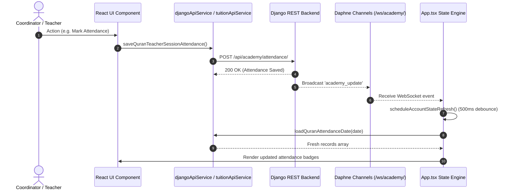
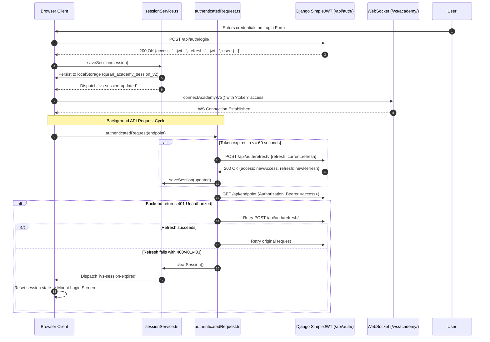
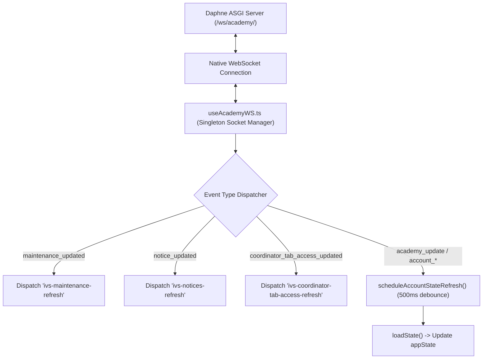

# Frontend Architecture & Component Infrastructure Audit

> **Document ID**: `03_FRONTEND_ARCHITECTURE`  
> **Status**: VERIFIED & DEEP AUDITED (Phase 2 Output)  
> **Repository Target**: `quran----1-Role-Based-` (Branch: `release/ivs-20261020-candidate`, Commit: `de92b7606`)  
> **Production Target**: [https://quranhometutor.com/](https://quranhometutor.com/)  
> **Audit Date**: 2026-11-03  

---

## 1. Executive Frontend Architecture Overview

The **IVS Qur'an Academy Manager** frontend is a high-density, multi-department, single-page application (SPA) built on **React 19.2.0**, **TypeScript 5.8.2**, and **Vite 6.2.0**. 

The client architecture operates without an external client-side routing library (such as React Router). Instead, navigation, access control, and workspace switching are managed centrally through a custom hash router (`window.location.hash`), browser history synchronization (`window.history.replaceState`), and dynamic role/department portal dispatching inside [`App.tsx`](file:///c:/Users/iqrav/Downloads/quran%20---1%20(Role%20Based)/App.tsx) (4,861 physical lines).

### Core Architectural Characteristics
1. **Department-Partitioned Multi-Portal Execution**:
   - The application serves two entirely decoupled academic divisions:
     - **Quran Department** (`academy`): Qur'anic studies, Tajweed, daily Surah/Ayah lesson tracking, attendance logging with substitute teacher coverage, and monthly Salary V2 payroll processing.
     - **Tuition Department** (`tuition`): Academic school tutoring across multiple grade levels, multi-student classes, and interactive 3D WebGL student ID cards.
   - A unified super-administrative tier (`platform_admin`) manages cross-department institutions, department feature flags, database backups, and emergency maintenance windows.
2. **Dynamic Role Dispatching**:
   - Depending on authentication credentials and the active department assignment returned by `/api/auth/context/`, the application mounts one of seven top-level portal interfaces:
     - `PlatformAdmin` (SuperAdmin console)
     - `TuitionCoordinatorPortal` (Tuition management)
     - `TuitionTeacherPortal` (Tuition teacher self-service)
     - `TuitionStudentPortal` (Tuition student schedule & 3D lanyard)
     - `TeacherPortal` (Quran teacher self-service)
     - `StudentPortal` (Quran student dashboard & lesson logs)
     - Quran Coordinator Workspace (embedded within `App.tsx`)
3. **Dual Real-Time & Event Architecture**:
   - Real-time updates operate via a native WebSocket client hook ([`hooks/useAcademyWS.ts`](file:///c:/Users/iqrav/Downloads/quran%20---1%20(Role%20Based)/hooks/useAcademyWS.ts)) connected to Daphne ASGI (`/ws/academy/`).
   - Cross-tab permissions and feature toggles synchronize across open browser windows via `BroadcastChannel` and `StorageEvent` listeners ([`services/featureAccess.ts`](file:///c:/Users/iqrav/Downloads/quran%20---1%20(Role%20Based)/services/featureAccess.ts)).
4. **Resilient Token Management**:
   - API requests are wrapped in [`services/authenticatedRequest.ts`](file:///c:/Users/iqrav/Downloads/quran%20---1%20(Role%20Based)/services/authenticatedRequest.ts), which handles JWT renewal 60 seconds before token expiry, retries 401s after token rotation, and captures HTTP 423 (Locked) responses to invoke system maintenance screens.

---

## 2. Frontend Technology Stack

| Layer | Library / Tool | Declared Version | Verified Purpose |
| :--- | :--- | :--- | :--- |
| **Core Framework** | React / React DOM | `^19.2.0` | Declarative component UI engine. Uses modern React 19 primitives (`useCallback`, `useMemo`, `useRef`, `startTransition`, `lazy`, `Suspense`). |
| **Language** | TypeScript | `~5.8.2` | Static type checking and domain model contract enforcement. |
| **Build & Dev Tool** | Vite | `^6.2.0` | Development server and production roll-up bundler. Proxy configured in `vite.config.ts`. |
| **Styling Framework**| Tailwind CSS | `^3.4.17` | Utility-first CSS framework with PostCSS and custom theme layers in `index.css` (3,056 lines). |
| **Iconography** | Lucide React | `^0.555.0` | Clean vector iconography throughout all navigation bars, cards, and modal dialogs. |
| **Animations** | Framer Motion | `^12.34.0` | Fluid interface transitions and dialog entrance animations. |
| **Data Visualization**| Recharts | `^3.8.1` | Dashboard class distribution and today's timeline charts (`DashboardTimelineChart.tsx`). |
| **3D & WebGL** | Three.js + R3F + Rapier | `^0.185.1` | 3D physics-based interactive student identity lanyard (`Lanyard.tsx`). |
| **AI Integration** | Lottie React | `^2.4.1` | Animated vector AI avatar bot (`ai-bot.json`). |
| **Document Generation**| jsPDF + jspdf-autotable | `^4.1.0` | Client-side cryptographic/audit-compliant salary slip and report PDF generation. |
| **Spreadsheets** | ExcelJS | `^4.4.0` | Client-side spreadsheet export and workbook generation. |
| **Barcode / QR** | qrcode | `^1.5.4` | QR code generation for salary proofs and student credentials. |

---

## 3. Comprehensive Frontend Source Inventory

Every active frontend file in the workspace has been inspected, categorized, and assigned an operational status:

| File Path | Functional Role | Exported Entities | Primary Consumers | Key Dependencies | Classification | Review Status |
| :--- | :--- | :--- | :--- | :--- | :--- | :--- |
| [`App.tsx`](file:///c:/Users/iqrav/Downloads/quran%20---1%20(Role%20Based)/App.tsx) | Root Router & Shell | `default App` | `index.tsx` | `sessionService`, `djangoApiService`, `useAcademyWS`, `featureAccess` | Application shell | FULLY REVIEWED |
| [`index.tsx`](file:///c:/Users/iqrav/Downloads/quran%20---1%20(Role%20Based)/index.tsx) | React Bootstrap | Root execution | Browser DOM | `react-dom/client`, `App` | Bootstrap | FULLY REVIEWED |
| [`types.ts`](file:///c:/Users/iqrav/Downloads/quran%20---1%20(Role%20Based)/types.ts) | Domain Types | `Student`, `Teacher`, `AttendanceRecord`, `ClassType`, `AttendanceStatus`, `EntityType` | Entire Frontend | None | Type definition | FULLY REVIEWED |
| [`constants.ts`](file:///c:/Users/iqrav/Downloads/quran%20---1%20(Role%20Based)/constants.ts) | Domain Defaults | `TIME_SLOTS`, `DAYS`, `INITIAL_STATE`, `DASHBOARD_LIMITS` | `App.tsx`, `SchedulingTab`, `ClassCard` | `types` | Configuration | FULLY REVIEWED |
| [`index.css`](file:///c:/Users/iqrav/Downloads/quran%20---1%20(Role%20Based)/index.css) | Global Styles | Tailwind directives, `.ui-glass`, `.ivs-skeleton` | `index.tsx` | Tailwind CSS | Styling | FULLY REVIEWED |
| [`services/authenticatedRequest.ts`](file:///c:/Users/iqrav/Downloads/quran%20---1%20(Role%20Based)/services/authenticatedRequest.ts) | HTTP Client | `authenticatedRequest`, `refreshAuthenticatedSession`, `ApiRequestError` | `djangoApiService`, `tuitionApiService`, `storageService` | `sessionService` | API client | FULLY REVIEWED |
| [`services/djangoApiService.ts`](file:///c:/Users/iqrav/Downloads/quran%20---1%20(Role%20Based)/services/djangoApiService.ts) | REST Client (Quran & Accounts) | 80+ exported functions (Auth, State, Attendance, Salary V2, Lessons, Platform) | `App.tsx`, `TeacherPortal`, `StudentPortal`, `CoordinatorAccounts`, `PlatformAdmin` | `authenticatedRequest` | API client | FULLY REVIEWED |
| [`services/tuitionApiService.ts`](file:///c:/Users/iqrav/Downloads/quran%20---1%20(Role%20Based)/services/tuitionApiService.ts) | REST Client (Tuition) | 26 exported functions (Tuition Auth, Subjects, Students, Scheduling, Attendance) | `TuitionCoordinatorPortal`, `TuitionTeacherPortal`, `TuitionStudentPortal` | `authenticatedRequest` | API client | FULLY REVIEWED |
| [`services/sessionService.ts`](file:///c:/Users/iqrav/Downloads/quran%20---1%20(Role%20Based)/services/sessionService.ts) | Token & Auth Store | `loadSession`, `saveSession`, `clearSession`, `getCurrentUser`, `getCurrentRole` | `App.tsx`, `authenticatedRequest`, `storageService` | Browser `localStorage` | Authentication service | FULLY REVIEWED |
| [`services/featureAccess.ts`](file:///c:/Users/iqrav/Downloads/quran%20---1%20(Role%20Based)/services/featureAccess.ts) | RBAC Sync Layer | `showFeatureLocked`, `announceFeaturesUpdated`, Events & Channels | `App.tsx`, `CoordinatorAccounts`, `TuitionCoordinatorPortal` | `BroadcastChannel`, `localStorage` | State hook / utility | FULLY REVIEWED |
| [`services/storageService.ts`](file:///c:/Users/iqrav/Downloads/quran%20---1%20(Role%20Based)/services/storageService.ts) | State Caching | `loadState`, `saveState` | `App.tsx` | `authenticatedRequest`, `sessionService` | Utility / cache | FULLY REVIEWED |
| [`services/geminiService.ts`](file:///c:/Users/iqrav/Downloads/quran%20---1%20(Role%20Based)/services/geminiService.ts) | AI Client | `sendMessageToGemini` | `AssistantChat`, `TuitionAssistantChat` | Google Gemini API | API client | FULLY REVIEWED |
| [`services/websocketService.ts`](file:///c:/Users/iqrav/Downloads/quran%20---1%20(Role%20Based)/services/websocketService.ts) | Direct WS Utility | `getWebSocketClient` | Supporting services | Browser WebSocket | WebSocket client | FULLY REVIEWED |
| [`services/csvImport.ts`](file:///c:/Users/iqrav/Downloads/quran%20---1%20(Role%20Based)/services/csvImport.ts) | CSV Parsing Engine | `parseCsv`, `validateTeacherCsv`, `validateStudentCsv` | `CoordinatorAccounts`, `TuitionCsvImportModal` | None | Utility | FULLY REVIEWED |
| [`services/attendancePaging.ts`](file:///c:/Users/iqrav/Downloads/quran%20---1%20(Role%20Based)/services/attendancePaging.ts) | Paging Utility | `fetchAttendancePages` | `useCompleteAttendance` | `djangoApiService` | Utility | FULLY REVIEWED |
| [`services/quranBusinessTime.ts`](file:///c:/Users/iqrav/Downloads/quran%20---1%20(Role%20Based)/services/quranBusinessTime.ts) | Time Zone Engine | `getQuranBusinessTime` (PKT UTC+5) | `App.tsx`, `IVSClockCard` | None | Utility | FULLY REVIEWED |
| [`services/importActivity.ts`](file:///c:/Users/iqrav/Downloads/quran%20---1%20(Role%20Based)/services/importActivity.ts) | Import Lock Manager | `isImportActive`, `beginImport` | `App.tsx`, `CoordinatorAccounts` | Custom DOM Events | Utility | FULLY REVIEWED |
| [`services/importWorkflow.ts`](file:///c:/Users/iqrav/Downloads/quran%20---1%20(Role%20Based)/services/importWorkflow.ts) | Bulk Import Workflow | `runSequentialImport`, `importSummaryText` | `CoordinatorAccounts`, `TuitionCsvImportModal` | None | Utility | FULLY REVIEWED |
| [`hooks/useAcademyWS.ts`](file:///c:/Users/iqrav/Downloads/quran%20---1%20(Role%20Based)/hooks/useAcademyWS.ts) | Reactive WS Hook | `useAcademyWS`, `connectAcademyWS`, `disconnectAcademyWS` | `App.tsx`, `TeacherPortal`, `StudentPortal`, `DepartmentSalaryV2Workspace` | Browser WebSocket, `sessionService` | WebSocket hook | FULLY REVIEWED |
| [`hooks/useCompleteAttendance.ts`](file:///c:/Users/iqrav/Downloads/quran%20---1%20(Role%20Based)/hooks/useCompleteAttendance.ts) | Attendance Pager | `useCompleteAttendance` | `TeacherPortal`, `StudentPortal`, `TuitionStudentPortal`, `TuitionTeacherPortal` | `attendancePaging` | State hook | FULLY REVIEWED |
| [`components/PlatformAdmin.tsx`](file:///c:/Users/iqrav/Downloads/quran%20---1%20(Role%20Based)/components/PlatformAdmin.tsx) | SuperAdmin Console | `default PlatformAdmin` | `App.tsx` | `djangoApiService`, `PlatformAdminTools`, `PlatformSalaryApprovals` | Role portal | FULLY REVIEWED |
| [`components/TeacherPortal.tsx`](file:///c:/Users/iqrav/Downloads/quran%20---1%20(Role%20Based)/components/TeacherPortal.tsx) | Quran Teacher Portal | `TeacherPortal` | `App.tsx` | `djangoApiService`, `useAcademyWS`, `useCompleteAttendance` | Role portal | FULLY REVIEWED |
| [`components/StudentPortal.tsx`](file:///c:/Users/iqrav/Downloads/quran%20---1%20(Role%20Based)/components/StudentPortal.tsx) | Quran Student Portal | `StudentPortal` | `App.tsx` | `djangoApiService`, `useCompleteAttendance` | Role portal | FULLY REVIEWED |
| [`components/CoordinatorAccounts.tsx`](file:///c:/Users/iqrav/Downloads/quran%20---1%20(Role%20Based)/components/CoordinatorAccounts.tsx) | Quran Accounts Manager | `default CoordinatorAccounts` | `App.tsx` | `djangoApiService`, `TeacherRetirementDialog`, `csvImport` | Page / screen | FULLY REVIEWED |
| [`components/CoordinatorLessons.tsx`](file:///c:/Users/iqrav/Downloads/quran%20---1%20(Role%20Based)/components/CoordinatorLessons.tsx) | Quran Curriculum Hub | `default CoordinatorLessons` | `App.tsx` | `djangoApiService`, `LessonForm`, `MonthlyLessonPlans` | Page / screen | FULLY REVIEWED |
| [`components/AttendanceEditor.tsx`](file:///c:/Users/iqrav/Downloads/quran%20---1%20(Role%20Based)/components/AttendanceEditor.tsx) | Quran Attendance Grid | `AttendanceEditor` | `App.tsx` | `djangoApiService`, `types` | Page / screen | FULLY REVIEWED |
| [`components/SchedulingTab.tsx`](file:///c:/Users/iqrav/Downloads/quran%20---1%20(Role%20Based)/components/SchedulingTab.tsx) | Weekly Timetable Matrix | `SchedulingTab` | `App.tsx` | `constants`, `types` | Page / screen | FULLY REVIEWED |
| [`components/ReportsTab.tsx`](file:///c:/Users/iqrav/Downloads/quran%20---1%20(Role%20Based)/components/ReportsTab.tsx) | Academic Reports Hub | `ReportsTab` | `App.tsx` | `djangoApiService`, `jsPDF`, `ExcelJS` | Page / screen | FULLY REVIEWED |
| [`components/TeacherSalaryManagement.tsx`](file:///c:/Users/iqrav/Downloads/quran%20---1%20(Role%20Based)/components/TeacherSalaryManagement.tsx) | Quran Salary Hub | `default TeacherSalaryManagement` | `App.tsx` | `DepartmentSalaryV2Workspace`, `QuranSalaryProofModal` | Page / screen | FULLY REVIEWED |
| [`components/QuranDroppedLeave.tsx`](file:///c:/Users/iqrav/Downloads/quran%20---1%20(Role%20Based)/components/QuranDroppedLeave.tsx) | Dropped/Leave Manager | `default QuranDroppedLeave` | `App.tsx` | `djangoApiService` | Page / screen | FULLY REVIEWED |
| [`components/ClassCard.tsx`](file:///c:/Users/iqrav/Downloads/quran%20---1%20(Role%20Based)/components/ClassCard.tsx) | Live Class Card | `ClassCard` | `App.tsx` | `types` | Shared component | FULLY REVIEWED |
| [`components/TeacherCard.tsx`](file:///c:/Users/iqrav/Downloads/quran%20---1%20(Role%20Based)/components/TeacherCard.tsx) | Legacy Teacher Card | `TeacherCard` | **NONE (Orphaned)** | `types` | Shared component | FULLY REVIEWED |
| [`components/TeacherRetirementDialog.tsx`](file:///c:/Users/iqrav/Downloads/quran%20---1%20(Role%20Based)/components/TeacherRetirementDialog.tsx) | Teacher Retirement Flow | `default TeacherRetirementDialog` | `CoordinatorAccounts` | `djangoApiService` | Modal | FULLY REVIEWED |
| [`components/TeacherSalarySelfService.tsx`](file:///c:/Users/iqrav/Downloads/quran%20---1%20(Role%20Based)/components/TeacherSalarySelfService.tsx) | Teacher Salary Slip View | `default TeacherSalarySelfService` | `TeacherPortal` | `djangoApiService` | Shared component | FULLY REVIEWED |
| [`components/QuranSalaryProofModal.tsx`](file:///c:/Users/iqrav/Downloads/quran%20---1%20(Role%20Based)/components/QuranSalaryProofModal.tsx) | Visual Salary Audit Proof | `default QuranSalaryProofModal` | `TeacherSalaryManagement` | `djangoApiService` | Modal | FULLY REVIEWED |
| [`components/DepartmentSettings.tsx`](file:///c:/Users/iqrav/Downloads/quran%20---1%20(Role%20Based)/components/DepartmentSettings.tsx) | Department Permissions | `default DepartmentSettings` | `PlatformAdmin` | `djangoApiService` | Shared component | FULLY REVIEWED |
| [`components/MonthlyLessonPlans.tsx`](file:///c:/Users/iqrav/Downloads/quran%20---1%20(Role%20Based)/components/MonthlyLessonPlans.tsx) | Monthly Target Planner | `default MonthlyLessonPlans` | `CoordinatorLessons` | `djangoApiService` | Form / screen | FULLY REVIEWED |
| [`components/LessonForm.tsx`](file:///c:/Users/iqrav/Downloads/quran%20---1%20(Role%20Based)/components/LessonForm.tsx) | Daily Lesson Form | `default LessonForm` | `CoordinatorLessons`, `TeacherPortal` | `djangoApiService` | Form / modal | FULLY REVIEWED |
| [`components/AssistantChat.tsx`](file:///c:/Users/iqrav/Downloads/quran%20---1%20(Role%20Based)/components/AssistantChat.tsx) | Embedded Gemini AI Chat | `AssistantChat` | `App.tsx` | `geminiService`, `lottie-react` | Shared component | FULLY REVIEWED |
| [`components/DashboardTimelineChart.tsx`](file:///c:/Users/iqrav/Downloads/quran%20---1%20(Role%20Based)/components/DashboardTimelineChart.tsx) | Timeline Analytics Chart | `default DashboardTimelineChart` | `App.tsx` | `recharts` | Shared component | FULLY REVIEWED |
| [`components/IVSClockCard.tsx`](file:///c:/Users/iqrav/Downloads/quran%20---1%20(Role%20Based)/components/IVSClockCard.tsx) | Live Business Clock | `default IVSClockCard` | `App.tsx`, Portals | `quranBusinessTime` | Shared component | FULLY REVIEWED |
| [`components/NotificationBell.tsx`](file:///c:/Users/iqrav/Downloads/quran%20---1%20(Role%20Based)/components/NotificationBell.tsx) | In-App Notification Hub | `default NotificationBell` | `App.tsx`, Portals | `notificationNavigation`, `djangoApiService` | Shared component | FULLY REVIEWED |
| [`components/notificationNavigation.ts`](file:///c:/Users/iqrav/Downloads/quran%20---1%20(Role%20Based)/components/notificationNavigation.ts) | Notification Router | `IVS_NOTIFICATION_NAVIGATE_EVENT`, `navigateFromNotification` | `NotificationBell`, `App.tsx` | DOM CustomEvent | Utility | FULLY REVIEWED |
| [`components/GlobalNoticeCenter.tsx`](file:///c:/Users/iqrav/Downloads/quran%20---1%20(Role%20Based)/components/GlobalNoticeCenter.tsx) | Platform Broadcast Banners | `default GlobalNoticeCenter` | `App.tsx` | Lucide React | Shared component | FULLY REVIEWED |
| [`components/FeatureLockedModal.tsx`](file:///c:/Users/iqrav/Downloads/quran%20---1%20(Role%20Based)/components/FeatureLockedModal.tsx) | Lock Enforcement Dialog | `FeatureLockedModal` | `App.tsx` | Lucide React | Modal | FULLY REVIEWED |
| [`components/MaintenanceScreen.tsx`](file:///c:/Users/iqrav/Downloads/quran%20---1%20(Role%20Based)/components/MaintenanceScreen.tsx) | Maintenance Mode Overlay | `default MaintenanceScreen` | `App.tsx` | Lucide React | Shared component | FULLY REVIEWED |
| [`components/ui/SkeletonLoaders.tsx`](file:///c:/Users/iqrav/Downloads/quran%20---1%20(Role%20Based)/components/ui/SkeletonLoaders.tsx) | Shimmer Placeholders | `PageSkeleton`, `CardSkeleton` | Entire Frontend | None | Shared component | FULLY REVIEWED |
| [`components/platform/PlatformAdminTools.tsx`](file:///c:/Users/iqrav/Downloads/quran%20---1%20(Role%20Based)/components/platform/PlatformAdminTools.tsx) | Backup & Ops Tools | `default PlatformAdminTools` | `PlatformAdmin` | `djangoApiService` | Shared component | FULLY REVIEWED |
| [`components/platform/PlatformAnalyticsOverview.tsx`](file:///c:/Users/iqrav/Downloads/quran%20---1%20(Role%20Based)/components/platform/PlatformAnalyticsOverview.tsx) | Cross-Dept KPIs | `default PlatformAnalyticsOverview` | `PlatformAdmin` | `djangoApiService` | Shared component | FULLY REVIEWED |
| [`components/platform/PlatformCommunicationsPanel.tsx`](file:///c:/Users/iqrav/Downloads/quran%20---1%20(Role%20Based)/components/platform/PlatformCommunicationsPanel.tsx) | Broadcast Composer | `default PlatformCommunicationsPanel` | `PlatformAdmin` | `djangoApiService` | Shared component | FULLY REVIEWED |
| [`components/platform/PlatformSalaryApprovals.tsx`](file:///c:/Users/iqrav/Downloads/quran%20---1%20(Role%20Based)/components/platform/PlatformSalaryApprovals.tsx) | SuperAdmin Salary Gates | `default PlatformSalaryApprovals` | `PlatformAdmin` | `djangoApiService`, `SalaryV2ProofModal` | Shared component | FULLY REVIEWED |
| [`components/salary/DepartmentSalaryV2Workspace.tsx`](file:///c:/Users/iqrav/Downloads/quran%20---1%20(Role%20Based)/components/salary/DepartmentSalaryV2Workspace.tsx) | Salary V2 Workspace | `default DepartmentSalaryV2Workspace` | `TeacherSalaryManagement` | `djangoApiService`, `SalaryV2ProofModal`, `useAcademyWS` | Page / screen | FULLY REVIEWED |
| [`components/salary/SalaryV2ProofModal.tsx`](file:///c:/Users/iqrav/Downloads/quran%20---1%20(Role%20Based)/components/salary/SalaryV2ProofModal.tsx) | Salary V2 Proof Viewer | `default SalaryV2ProofModal` | `DepartmentSalaryV2Workspace`, `PlatformSalaryApprovals` | `djangoApiService`, `salaryV2Pdf` | Modal | FULLY REVIEWED |
| [`components/salary/salaryV2Pdf.ts`](file:///c:/Users/iqrav/Downloads/quran%20---1%20(Role%20Based)/components/salary/salaryV2Pdf.ts) | PDF Slip Generator | `buildSalaryV2Pdf` | `SalaryV2ProofModal` | `jspdf`, `jspdf-autotable`, `qrcode` | Export functionality | FULLY REVIEWED |
| [`components/salary/salaryV2PdfData.ts`](file:///c:/Users/iqrav/Downloads/quran%20---1%20(Role%20Based)/components/salary/salaryV2PdfData.ts) | PDF Data Transformer | `transformSalaryV2PdfData` | `salaryV2Pdf` | `djangoApiService` | Utility | FULLY REVIEWED |
| [`components/salary/salaryV2WebProofData.ts`](file:///c:/Users/iqrav/Downloads/quran%20---1%20(Role%20Based)/components/salary/salaryV2WebProofData.ts) | Web Proof Transformer | `transformSalaryV2WebProofData` | `SalaryV2ProofModal` | `djangoApiService` | Utility | FULLY REVIEWED |
| [`components/salary/AttendanceBadges.tsx`](file:///c:/Users/iqrav/Downloads/quran%20---1%20(Role%20Based)/components/salary/AttendanceBadges.tsx) | Attendance UI Badges | `AttendanceStatusBadge` | `SalaryV2ProofModal` | Lucide React | Shared component | FULLY REVIEWED |
| [`components/tuition/TuitionCoordinatorPortal.tsx`](file:///c:/Users/iqrav/Downloads/quran%20---1%20(Role%20Based)/components/tuition/TuitionCoordinatorPortal.tsx) | Tuition Dept Manager | `default TuitionCoordinatorPortal` | `App.tsx` | `tuitionApiService`, `TuitionScheduling`, `TuitionAttendance` | Role portal | FULLY REVIEWED |
| [`components/tuition/TuitionTeacherPortal.tsx`](file:///c:/Users/iqrav/Downloads/quran%20---1%20(Role%20Based)/components/tuition/TuitionTeacherPortal.tsx) | Tuition Teacher Portal | `default TuitionTeacherPortal` | `App.tsx` | `tuitionApiService`, `useCompleteAttendance` | Role portal | FULLY REVIEWED |
| [`components/tuition/TuitionStudentPortal.tsx`](file:///c:/Users/iqrav/Downloads/quran%20---1%20(Role%20Based)/components/tuition/TuitionStudentPortal.tsx) | Tuition Student Portal | `default TuitionStudentPortal` | `App.tsx` | `tuitionApiService`, `Lanyard`, `useCompleteAttendance` | Role portal | FULLY REVIEWED |
| [`components/tuition/TuitionPendingPortal.tsx`](file:///c:/Users/iqrav/Downloads/quran%20---1%20(Role%20Based)/components/tuition/TuitionPendingPortal.tsx) | Pending Approval Screen | `default TuitionPendingPortal` | **NONE (Orphaned)** | Lucide React | Role portal (Orphaned) | FULLY REVIEWED |
| [`components/tuition/TuitionScheduling.tsx`](file:///c:/Users/iqrav/Downloads/quran%20---1%20(Role%20Based)/components/tuition/TuitionScheduling.tsx) | Tuition Schedule Planner | `default TuitionScheduling` | `TuitionCoordinatorPortal` | `tuitionApiService`, `tuitionSchedule` | Page / screen | FULLY REVIEWED |
| [`components/tuition/TuitionAttendance.tsx`](file:///c:/Users/iqrav/Downloads/quran%20---1%20(Role%20Based)/components/tuition/TuitionAttendance.tsx) | Tuition Attendance Grid | `default TuitionAttendance` | `TuitionCoordinatorPortal` | `tuitionApiService` | Page / screen | FULLY REVIEWED |
| [`components/tuition/TuitionAccountsEnrollment.tsx`](file:///c:/Users/iqrav/Downloads/quran%20---1%20(Role%20Based)/components/tuition/TuitionAccountsEnrollment.tsx) | Tuition Enrollment Hub | `default TuitionAccountsEnrollment` | `TuitionCoordinatorPortal` | `tuitionApiService`, `TuitionManagersPanel` | Page / screen | FULLY REVIEWED |
| [`components/tuition/TuitionReports.tsx`](file:///c:/Users/iqrav/Downloads/quran%20---1%20(Role%20Based)/components/tuition/TuitionReports.tsx) | Tuition Reports Hub | `default TuitionReports` | `TuitionCoordinatorPortal` | `tuitionApiService`, `jsPDF`, `ExcelJS` | Page / screen | FULLY REVIEWED |
| [`components/tuition/TuitionManagersPanel.tsx`](file:///c:/Users/iqrav/Downloads/quran%20---1%20(Role%20Based)/components/tuition/TuitionManagersPanel.tsx) | Tuition Managers Manager | `default TuitionManagersPanel` | `TuitionAccountsEnrollment` | `tuitionApiService` | Shared component | FULLY REVIEWED |
| [`components/tuition/TuitionLiveScheduleCard.tsx`](file:///c:/Users/iqrav/Downloads/quran%20---1%20(Role%20Based)/components/tuition/TuitionLiveScheduleCard.tsx) | Tuition Live Class Card | `default TuitionLiveScheduleCard` | `TuitionCoordinatorPortal` | `tuitionApiService` | Shared component | FULLY REVIEWED |
| [`components/tuition/TuitionInsightsPanel.tsx`](file:///c:/Users/iqrav/Downloads/quran%20---1%20(Role%20Based)/components/tuition/TuitionInsightsPanel.tsx) | Tuition Live Statistics | `default TuitionInsightsPanel` | `TuitionCoordinatorPortal` | `tuitionApiService` | Shared component | FULLY REVIEWED |
| [`components/tuition/TuitionDepartmentSettingsModal.tsx`](file:///c:/Users/iqrav/Downloads/quran%20---1%20(Role%20Based)/components/tuition/TuitionDepartmentSettingsModal.tsx) | Tuition Settings Dialog | `default TuitionDepartmentSettingsModal` | `TuitionCoordinatorPortal` | `sessionService` | Modal | FULLY REVIEWED |
| [`components/tuition/TuitionCsvImportModal.tsx`](file:///c:/Users/iqrav/Downloads/quran%20---1%20(Role%20Based)/components/tuition/TuitionCsvImportModal.tsx) | Tuition CSV Importer | `default TuitionCsvImportModal` | `TuitionAccountsEnrollment` | `csvImport`, `importWorkflow`, `tuitionApiService` | Modal | FULLY REVIEWED |
| [`components/tuition/TuitionAssistantChat.tsx`](file:///c:/Users/iqrav/Downloads/quran%20---1%20(Role%20Based)/components/tuition/TuitionAssistantChat.tsx) | Tuition AI Assistant | `default TuitionAssistantChat` | `TuitionCoordinatorPortal` | `geminiService` | Shared component | FULLY REVIEWED |
| [`components/tuition/tuitionSchedule.ts`](file:///c:/Users/iqrav/Downloads/quran%20---1%20(Role%20Based)/components/tuition/tuitionSchedule.ts) | Tuition Time Helpers | Time Slot & Weekday Types | `TuitionScheduling`, `TuitionAttendance` | None | Utility | FULLY REVIEWED |
| [`components/tuition/lanyard/Lanyard.tsx`](file:///c:/Users/iqrav/Downloads/quran%20---1%20(Role%20Based)/components/tuition/lanyard/Lanyard.tsx) | 3D WebGL Physics Card | `default Lanyard` | `TuitionStudentPortal` | Three.js, `@react-three/fiber`, `@react-three/rapier` | 3D / WebGL | FULLY REVIEWED |
| [`components/tuition/lanyard/Lanyard.css`](file:///c:/Users/iqrav/Downloads/quran%20---1%20(Role%20Based)/components/tuition/lanyard/Lanyard.css) | 3D Canvas Styles | Canvas positioning & glow | `Lanyard.tsx` | CSS | Styling | FULLY REVIEWED |

---

## 4. Major Component Dependency & Architecture Map

```mermaid
flowchart TD
    Index["index.tsx"] --> App["App.tsx\n(Hash Router & Portal Dispatcher)"]

    subgraph AuthAndSession ["Session & Context Tier"]
        SessionSvc["sessionService.ts\n(localStorage)"]
        AuthReq["authenticatedRequest.ts\n(JWT refresh / 401 retry)"]
        FeatureAccess["featureAccess.ts\n(BroadcastChannel sync)"]
        WSClient["hooks/useAcademyWS.ts\n(/ws/academy/)"]
    end

    App --> SessionSvc
    App --> AuthReq
    App --> FeatureAccess
    App --> WSClient

    subgraph Portals ["Role-Based Portals"]
        PlatformPortal["PlatformAdmin.tsx\n(SuperAdmin Console)"]
        QuranTeacher["TeacherPortal.tsx\n(Quran Teacher Workspace)"]
        QuranStudent["StudentPortal.tsx\n(Quran Student Workspace)"]
        TuitionCoord["tuition/TuitionCoordinatorPortal.tsx\n(Tuition Admin)"]
        TuitionTeach["tuition/TuitionTeacherPortal.tsx\n(Tuition Teacher)"]
        TuitionStud["tuition/TuitionStudentPortal.tsx\n(Tuition Student + 3D Lanyard)"]
        QuranCoord["Quran Department Workspace\n(Embedded in App.tsx)"]
    end

    App -->|isPlatformAdmin| PlatformPortal
    App -->|isTuitionDepartment & coordinator| TuitionCoord
    App -->|isTuitionDepartment & teacher| TuitionTeach
    App -->|isTuitionDepartment & student| TuitionStud
    App -->|!isTuitionDepartment & teacher| QuranTeacher
    App -->|!isTuitionDepartment & student| QuranStudent
    App -->|!isTuitionDepartment & coordinator| QuranCoord

    subgraph QuranDeptTabs ["Quran Department Tabs (App.tsx)"]
        DashView["#dashboard\n(ClassCard, TimelineChart, KPI)"]
        SchedTab["#scheduling\n(SchedulingTab.tsx)"]
        AttTab["#attendance\n(AttendanceEditor.tsx)"]
        AccTab["#accounts\n(CoordinatorAccounts.tsx)"]
        DropTab["#dropped-leave\n(QuranDroppedLeave.tsx)"]
        SalTab["#teacher-salary\n(TeacherSalaryManagement.tsx)"]
        LessTab["#lessons\n(CoordinatorLessons.tsx)"]
        RepTab["#reports\n(ReportsTab.tsx)"]
    end

    QuranCoord --> DashView
    QuranCoord --> SchedTab
    QuranCoord --> AttTab
    QuranCoord --> AccTab
    QuranCoord --> DropTab
    QuranCoord --> SalTab
    QuranCoord --> LessTab
    QuranCoord --> RepTab

    subgraph SalaryV2Tier ["Salary V2 Infrastructure"]
        SalWorkspace["DepartmentSalaryV2Workspace.tsx"]
        SalProofModal["SalaryV2ProofModal.tsx"]
        SalPdfBuilder["salaryV2Pdf.ts (jsPDF)"]
        PlatformSalGates["PlatformSalaryApprovals.tsx"]
    end

    SalTab --> SalWorkspace
    SalWorkspace --> SalProofModal
    SalProofModal --> SalPdfBuilder
    PlatformPortal --> PlatformSalGates
    PlatformSalGates --> SalProofModal
```

---

## 5. State Management Architecture & Data Flow

The application utilizes a distributed, multi-layered state architecture combining local React component state, shared localStorage caches, and cross-tab inter-process communication:

### 5.1 Sources of Truth
1. **Server-Authoritative Relational State**:
   - The Django PostgreSQL database remains the definitive source of truth for all records.
   - Initial state loads via `loadState()` in `storageService.ts` calling `/api/academy/state/` or `/api/academy/state/?dashboard=1`.
2. **Session Storage (`quran_academy_session_v2`)**:
   - Persists JWT `access` and `refresh` tokens, user metadata (`id`, `username`, `role`), and teacher/student linkage IDs.
   - Emits `ivs-session-updated` and `ivs-session-expired` DOM CustomEvents.
3. **Application Cache (`quran_academy_cache_v5:<user_id>`)**:
   - Cached serialized state containing teachers, students, and attendance snapshots.
   - Synchronized on 1,500ms debounce when `appState` mutations occur in `App.tsx`.
4. **Feature Flag & Lock Channel (`ivs-features-v3`)**:
   - Synchronizes Main Administrator feature toggles across multiple open browser tabs using native browser `BroadcastChannel` and window `storage` listeners.

### 5.2 State Synchronization Cycle

---

## 6. Role Portal Architecture

The application enforces strict role and department isolation at the React mount boundary:

| Role Portal Component | File Path | Target Roles | Department Scope | Entry Guards | Navigation System | Available Workspaces / Tabs |
| :--- | :--- | :--- | :--- | :--- | :--- | :--- |
| **`PlatformAdmin`** | [`components/PlatformAdmin.tsx`](file:///c:/Users/iqrav/Downloads/quran%20---1%20(Role%20Based)/components/PlatformAdmin.tsx) | `platform_admin`, `is_superuser` | Global (Cross-Department) | `isPlatformAdmin` check in `App.tsx:3615` | Internal tab state | Institutions, Departments, Features, Salary Approvals, Backups, Maintenance, Notices, Health |
| **`TuitionCoordinatorPortal`** | [`components/tuition/TuitionCoordinatorPortal.tsx`](file:///c:/Users/iqrav/Downloads/quran%20---1%20(Role%20Based)/components/tuition/TuitionCoordinatorPortal.tsx) | `coordinator`, `department_admin`, `institution_admin` | Tuition Only | `isTuitionDepartment && ['coordinator', 'department_admin', 'institution_admin'].includes(role)` | Internal tab state | `dashboard`, `accounts`, `scheduling`, `attendance`, `reports`, Insights Panel, AI Chat |
| **`TuitionTeacherPortal`** | [`components/tuition/TuitionTeacherPortal.tsx`](file:///c:/Users/iqrav/Downloads/quran%20---1%20(Role%20Based)/components/tuition/TuitionTeacherPortal.tsx) | `teacher` | Tuition Only | `isTuitionDepartment && role === 'teacher'` | Internal tab state | `overview`, `classes`, `attendance` |
| **`TuitionStudentPortal`** | [`components/tuition/TuitionStudentPortal.tsx`](file:///c:/Users/iqrav/Downloads/quran%20---1%20(Role%20Based)/components/tuition/TuitionStudentPortal.tsx) | `student` | Tuition Only | `isTuitionDepartment && role === 'student'` | Internal tab state | `overview`, `attendance`, `assignments` (Placeholder), `schedule`, 3D Lanyard ID Card |
| **`TeacherPortal`** | [`components/TeacherPortal.tsx`](file:///c:/Users/iqrav/Downloads/quran%20---1%20(Role%20Based)/components/TeacherPortal.tsx) | `teacher` | Quran Only | `!isTuitionDepartment && role === 'teacher'` | Internal tab state | `overview`, `classes`, `lesson` (Write daily log), `monthly` (Workspace), `attendance`, `salary` (Self-service), `history` |
| **`StudentPortal`** | [`components/StudentPortal.tsx`](file:///c:/Users/iqrav/Downloads/quran%20---1%20(Role%20Based)/components/StudentPortal.tsx) | `student` | Quran Only | `!isTuitionDepartment && role === 'student'` | Internal tab state | `overview`, `attendance`, `lessons`, `schedule` |
| **Quran Coordinator Workspace** | Inlined inside [`App.tsx:3650-4861`](file:///c:/Users/iqrav/Downloads/quran%20---1%20(Role%20Based)/App.tsx#L3650-L4861) | `coordinator`, `department_admin`, `institution_admin` | Quran Only | `!isTuitionDepartment && ['coordinator', 'department_admin', 'institution_admin'].includes(role)` | URL Hash (`window.location.hash`) | `#dashboard`, `#scheduling`, `#attendance`, `#accounts`, `#dropped-leave`, `#teacher-salary`, `#lessons`, `#reports` |

---

## 7. Frontend API Service Architecture

The frontend communicates with the backend exclusively via two typed API service modules backed by `authenticatedRequest`:

### 7.1 Quran & Core Accounts API Service (`services/djangoApiService.ts`)

| Exported Function | HTTP Method | Endpoint Path | Primary Frontend Callers | State Mutation / Response |
| :--- | :--- | :--- | :--- | :--- |
| `loginToDjango` | `POST` | `/api/auth/login/` | `App.tsx` (Login form) | Returns JWT `access`, `refresh`, and user object. Saved via `saveSession()`. |
| `getCurrentDjangoUser` | `GET` | `/api/auth/user/` | `App.tsx` | Returns authenticated user profile. |
| `getAuthContext` | `GET` | `/api/auth/context/` | `App.tsx:loadFeatureContext` | Returns active department, feature flags, coordinator tab permissions, and maintenance status. |
| `getPlatformInstitutions` | `GET` | `/api/auth/institutions/` | `PlatformAdmin.tsx` | Loads institution directory. |
| `createPlatformInstitution` | `POST` | `/api/auth/institutions/` | `PlatformAdmin.tsx` | Creates new institution record. |
| `updatePlatformInstitution` | `PUT` | `/api/auth/institutions/${id}/` | `PlatformAdmin.tsx` | Updates institution details. |
| `deletePlatformInstitution` | `DELETE` | `/api/auth/institutions/${id}/` | `PlatformAdmin.tsx` | Permanently deletes institution. |
| `getPlatformDepartments` | `GET` | `/api/auth/departments/` | `PlatformAdmin.tsx` | Loads all departments across institutions. |
| `createPlatformDepartment` | `POST` | `/api/auth/departments/` | `PlatformAdmin.tsx` | Creates new department under an institution. |
| `updatePlatformDepartment` | `PUT` | `/api/auth/departments/${id}/` | `PlatformAdmin.tsx` | Updates department metadata. |
| `deletePlatformDepartment` | `DELETE` | `/api/auth/departments/${id}/` | `PlatformAdmin.tsx` | Permanently deletes department. |
| `getPlatformFeatures` | `GET` | `/api/auth/features/` | `PlatformAdmin.tsx` | Returns platform-wide feature flag catalog. |
| `getDepartmentFeatures` | `GET` | `/api/auth/departments/${id}/features/` | `PlatformAdmin.tsx`, `DepartmentSettings.tsx` | Returns department-specific enabled features. |
| `updateDepartmentFeature` | `PUT` | `/api/auth/departments/${id}/features/${key}/` | `DepartmentSettings.tsx` | Toggles feature flag and broadcasts update. |
| `getPlatformBackups` | `GET` | `/api/auth/backups/` | `PlatformAdminTools.tsx` | Lists database dumps. |
| `createPlatformBackup` | `POST` | `/api/auth/backups/` | `PlatformAdminTools.tsx` | Generates on-demand PostgreSQL backup. |
| `downloadPlatformBackup` | `GET` | `/api/auth/backups/${filename}/download/` | `PlatformAdminTools.tsx` | Downloads `.sql.gz` dump. |
| `getPlatformSystemHealth` | `GET` | `/api/auth/system-health/` | `PlatformAdmin.tsx` | Returns database and Redis connection statuses. |
| `getCoordinatorAccounts` | `GET` | `/api/auth/accounts/` | `CoordinatorAccounts.tsx` | Fetches coordinator, teacher, and student account rosters. |
| `createCoordinatorAccount` | `POST` | `/api/auth/accounts/` | `CoordinatorAccounts.tsx` | Creates user credential in department. |
| `updateCoordinatorAccount` | `PUT` | `/api/auth/accounts/${id}/` | `CoordinatorAccounts.tsx` | Updates login pin, username, password, or status. |
| `disableCoordinatorAccount` | `DELETE` | `/api/auth/accounts/${id}/` | `CoordinatorAccounts.tsx`, `TeacherRetirementDialog` | Archives account or removes detached login. |
| `getTeacherRetirementPreview` | `GET` | `/api/auth/teachers/${id}/retirement-preview/` | `TeacherRetirementDialog.tsx` | Returns active student count and conflict-free candidate teachers. |
| `transferTeacherStudents` | `POST` | `/api/auth/teachers/${id}/transfer-students/` | `TeacherRetirementDialog.tsx` | Bulk-reassigns students to other teachers prior to login deletion. |
| `loadQuranAttendanceDate` | `GET` | `/api/academy/attendance/?date=${date}` | `App.tsx`, `AttendanceEditor.tsx` | Loads single-date attendance records. |
| `markAttendanceInDjango` | `POST` | `/api/academy/attendance/` | `App.tsx`, `AttendanceEditor.tsx` | Records student attendance status. |
| `deleteAttendanceInDjango` | `DELETE` | `/api/academy/attendance/${id}/` | `App.tsx`, `AttendanceEditor.tsx` | Removes student attendance record. |
| `saveQuranTeacherSessionAttendance` | `POST` | `/api/academy/attendance/teacher-session/` | `App.tsx`, `AttendanceEditor.tsx` | Records teacher attendance with substitute coverage links. |
| `deleteQuranTeacherSessionAttendance` | `DELETE` | `/api/academy/attendance/teacher-session/` | `App.tsx`, `AttendanceEditor.tsx` | Deletes teacher attendance session. |
| `getQuranSalaryV2Dashboard` | `GET` | `/api/academy/salary-v2/dashboard/` | `DepartmentSalaryV2Workspace`, `PlatformSalaryApprovals` | Fetches monthly payroll calculations and readiness blockers. |
| `runQuranSalaryV2Action` | `POST` | `/api/academy/salary-v2/action/` | `DepartmentSalaryV2Workspace`, `PlatformSalaryApprovals` | Triggers payroll calculation, submission, adjustments, approvals, or mark_paid. |
| `getQuranSalaryV2Proof` | `GET` | `/api/academy/salary-v2/proof/${id}/` | `SalaryV2ProofModal.tsx` | Loads complete attendance audit proof breakdown for salary slip. |
| `getDailyLessonReports` | `GET` | `/api/academy/lesson-reports/` | `CoordinatorLessons.tsx`, `TeacherPortal.tsx` | Fetches daily Quran syllabus progress logs. |
| `createDailyLessonReport` | `POST` | `/api/academy/lesson-reports/` | `LessonForm.tsx`, `TeacherPortal.tsx` | Submits daily lesson report (Sabaq, Sabqi, Manzil). |
| `getMonthlyLessonPlans` | `GET` | `/api/academy/monthly-plans/` | `MonthlyLessonPlans.tsx` | Loads monthly student targets. |
| `getQuranDroppedLeave` | `GET` | `/api/academy/dropped-leave/` | `QuranDroppedLeave.tsx` | Fetches inactive, dropped, or on-leave student rosters. |
| `rejoinQuranStudent` | `POST` | `/api/academy/dropped-leave/rejoin/` | `QuranDroppedLeave.tsx` | Restores dropped/leave student into active scheduling. |

### 7.2 Tuition API Service (`services/tuitionApiService.ts`)

| Exported Function | HTTP Method | Endpoint Path | Primary Frontend Callers | State Mutation / Response |
| :--- | :--- | :--- | :--- | :--- |
| `getTuitionDashboard` | `GET` | `/api/tuition/dashboard/` | `TuitionCoordinatorPortal.tsx` | Loads student, teacher, class counts, and live schedules. |
| `getTuitionAccounts` | `GET` | `/api/tuition/accounts/` | `TuitionAccountsEnrollment.tsx` | Loads tuition students, teachers, and coordinators. |
| `createTuitionAccount` | `POST` | `/api/tuition/accounts/` | `TuitionAccountsEnrollment.tsx` | Creates user credential for tuition department. |
| `createTuitionStudentBundle` | `POST` | `/api/tuition/student-bundle/` | `TuitionAccountsEnrollment.tsx` | Atomically creates student, parent, and class enrollments. |
| `getTuitionSchedulingMatrix` | `GET` | `/api/tuition/schedules/` | `TuitionScheduling.tsx` | Returns weekly tuition timetable matrix. |
| `createTuitionSchedule` | `POST` | `/api/tuition/schedules/` | `TuitionScheduling.tsx` | Allocates teacher, subject, grade, and time slot. |
| `getTuitionAttendance` | `GET` | `/api/tuition/attendance/` | `TuitionAttendance.tsx`, `TuitionCoordinatorPortal` | Loads tuition attendance grid for specified date range. |
| `markTuitionAttendance` | `POST` | `/api/tuition/attendance/` | `TuitionAttendance.tsx` | Marks student present/absent/leave in tuition class. |
| `getTuitionStudentPortal` | `GET` | `/api/tuition/student-portal/` | `TuitionStudentPortal.tsx` | Loads student identity card data, active subjects, and schedule. |
| `getTuitionTeacherPortal` | `GET` | `/api/tuition/teacher-portal/` | `TuitionTeacherPortal.tsx` | Loads teacher schedule, assigned students, and attendance history. |

---

## 8. Authentication & Session Flow

The authentication architecture enforces JWT rotation, skew-based pre-expiration renewal, and automatic clean logout on terminal authorization errors:

---

## 9. WebSocket & Real-Time Architecture

The real-time layer is managed exclusively by [`hooks/useAcademyWS.ts`](file:///c:/Users/iqrav/Downloads/quran%20---1%20(Role%20Based)/hooks/useAcademyWS.ts):

### Operational Characteristics
- **Endpoint**: `${protocol}//${host}/ws/academy/?token=${jwt}`.
- **Single Connection Architecture**: Multiple components share a single underlying WebSocket connection via an in-memory listener registry (`listeners = new Set<AcademyWSListener>()`).
- **Heartbeat & Keep-Alive**: Sends `{"type": "ping", "timestamp": Date.now()}` every 25 seconds (`25000ms`). Inbound `pong` messages are acknowledged and swallowed.
- **Exponential Reconnection**: On disconnect, schedules reconnection with exponential delay: `Math.min(15000, 1500 * Math.max(1, reconnectAttempts))`.
- **Terminal Rejection Guard**: If the server closes the connection with code `4001` (Unauthorized / Blacklisted Token), automatic reconnection is immediately halted.

---

## 10. Attendance V2 Frontend Architecture

Attendance tracking in the Quran Department operates on a **dual-record session model**:

1. **Teacher Session Record**:
   - Tracks whether the teacher was `present`, `absent`, or on `leave` for a specific time slot (`saveQuranTeacherSessionAttendance`).
   - If a teacher is absent or on leave, the coordinator assigns substitute teachers per student session (`coverageAssignments: [{ student_id, substitute_teacher_id }]`).
   - These coverage linkages are crucial for Salary V2: the substitute teacher receives credit for the class duration, while the primary teacher's attendance hours are deducted.
2. **Student Session Record**:
   - Tracks individual student attendance (`present`, `absent`, `leave`, `cancelled`) via `markAttendanceInDjango`.
3. **Optimistic Locking & Versioning**:
   - `App.tsx` maintains `attendanceMutationVersionRef` and `attendanceMutationQueueRef` to prevent concurrent mark/unmark operations from creating duplicate or dangling database rows.
4. **Complete Paged Attendance**:
   - Portals load historical attendance via [`hooks/useCompleteAttendance.ts`](file:///c:/Users/iqrav/Downloads/quran%20---1%20(Role%20Based)/hooks/useCompleteAttendance.ts), traversing cursor-based pagination pages (`fetchAttendancePages`) asynchronously to render complete student and teacher transcripts.

---

## 11. Salary V2 Frontend Architecture

The **Salary V2** engine is an enterprise automated payroll processing pipeline designed to eliminate manual calculation errors:

### 11.1 Workflow Stages
1. **Calculation (`action: "calculate"`)**:
   - Triggered on demand or on period change. Evaluates all verified student attendance minutes and teacher hourly salary tiers.
2. **Readiness Blockers**:
   - The workspace inspects `readiness.department_submission_ready`. If unassigned substitute coverages or conflicting attendance timestamps exist, blockers are surfaced with exact row counts.
3. **Department Submission (`action: "submit"`)**:
   - Department Admin sends the calculated payroll for platform approval. Status transitions to `pending_super_admin`.
4. **Platform Review & Gatekeeping (`components/platform/PlatformSalaryApprovals.tsx`)**:
   - SuperAdmin reviews aggregate amounts, adjustment histories, and audit proofs.
   - Available actions: `approve`, `reject`, `reopen`, and `mark_paid`.
5. **Locked State Protection**:
   - Once marked `paid`, payroll records become strictly immutable. The frontend disables all modification buttons, adjustment forms, and recalculation triggers.

### 11.2 Cryptographic Audit Proofs & PDF Slips
- Opening the proof dialog mounts [`components/salary/SalaryV2ProofModal.tsx`](file:///c:/Users/iqrav/Downloads/quran%20---1%20(Role%20Based)/components/salary/SalaryV2ProofModal.tsx).
- Fetches detailed calculation proof from `/api/academy/salary-v2/proof/${id}/`.
- Client-side document builder [`components/salary/salaryV2Pdf.ts`](file:///c:/Users/iqrav/Downloads/quran%20---1%20(Role%20Based)/components/salary/salaryV2Pdf.ts) generates a formal salary slip containing teacher metadata, gross hours, hourly tier breakdown, bonus/deduction line items, and an embedded verification QR code.

---

## 12. Tuition Frontend Architecture

The Tuition Department operates as a fully distinct academic workspace:

1. **Academic Multi-Subject Timetable**:
   - Classes are scheduled by Grade Level, Academic Subject (Math, English, Science, Physics, Chemistry, etc.), and Assigned Teacher.
   - Timetable conflicts are resolved via [`components/tuition/TuitionScheduling.tsx`](file:///c:/Users/iqrav/Downloads/quran%20---1%20(Role%20Based)/components/tuition/TuitionScheduling.tsx).
2. **3D WebGL Student ID Lanyard**:
   - [`components/tuition/lanyard/Lanyard.tsx`](file:///c:/Users/iqrav/Downloads/quran%20---1%20(Role%20Based)/components/tuition/lanyard/Lanyard.tsx) renders a realistic 3D identity badge suspended on a dynamic physics-simulated cord using Three.js, React Three Fiber, and Rapier physics.
   - The card features student photo textures, dynamic barcode rendering, and interactive dragging physics.
3. **Tuition Reports & Exports**:
   - [`components/tuition/TuitionReports.tsx`](file:///c:/Users/iqrav/Downloads/quran%20---1%20(Role%20Based)/components/tuition/TuitionReports.tsx) generates multi-filtered student and teacher performance reports with direct export to Excel and PDF.

---

## 13. Shared UI Infrastructure

- **Clock & Time System**: [`components/IVSClockCard.tsx`](file:///c:/Users/iqrav/Downloads/quran%20---1%20(Role%20Based)/components/IVSClockCard.tsx) displays authoritative Pakistan Academy Business Time (UTC+5), syncing time-slot calculations across domestic and international tutors.
- **Notification Hub**: [`components/NotificationBell.tsx`](file:///c:/Users/iqrav/Downloads/quran%20---1%20(Role%20Based)/components/NotificationBell.tsx) displays unread badges and dispatches routing events to jump directly to lesson requests or salary reviews.
- **Skeleton Shimmer Placeholders**: [`components/ui/SkeletonLoaders.tsx`](file:///c:/Users/iqrav/Downloads/quran%20---1%20(Role%20Based)/components/ui/SkeletonLoaders.tsx) provides smooth visual layout stability during lazy chunk loading and initial state hydration.
- **Emergency Maintenance System**: [`components/MaintenanceScreen.tsx`](file:///c:/Users/iqrav/Downloads/quran%20---1%20(Role%20Based)/components/MaintenanceScreen.tsx) captures platform-wide maintenance locks and presents administrators with retry and retry-countdown controls.

---

## 14. Important User Action Inventory

The table below catalogs significant user operations across the frontend:

| Action ID | Component | UI Control | Event Handler | Target Service / API Endpoint | Error Handling | Classification |
| :--- | :--- | :--- | :--- | :--- | :--- | :--- |
| **ACT-001** | `App.tsx` | Login Form Submit | `handleLogin(e)` | `loginToDjango` -> `POST /api/auth/login/` | In-form error banner | STATICALLY CONNECTED |
| **ACT-002** | `App.tsx` | Class Card Attendance Mark | `markAttendance(studentId, status)` | `markAttendanceInDjango` -> `POST /api/academy/attendance/` | Console log / UI fallback | STATICALLY CONNECTED |
| **ACT-003** | `App.tsx` | Teacher Attendance Mark | `markTeacherAttendance(teacherId, status)` | `saveQuranTeacherSessionAttendance` -> `POST /api/academy/attendance/teacher-session/` | Toast / console error | STATICALLY CONNECTED |
| **ACT-004** | `App.tsx` | Live Class Student Link | `openDashboardAccountEditor('student', id)` | `navigateToTab('accounts')` with edit target | FeatureLock modal if disabled | STATICALLY CONNECTED |
| **ACT-005** | `CoordinatorAccounts.tsx` | Add/Edit Account Submit | `handleSaveAccount(e)` | `createCoordinatorAccount` / `updateCoordinatorAccount` -> `POST/PUT /api/auth/accounts/` | Inline message banner | STATICALLY CONNECTED |
| **ACT-006** | `CoordinatorAccounts.tsx` | Archive Coordinator / Student | `deleteAccount(userId)` | `disableCoordinatorAccount` -> `DELETE /api/auth/accounts/${id}/` | Toast + reload state | STATICALLY CONNECTED |
| **ACT-007** | `CoordinatorAccounts.tsx` | Teacher Login Deletion | `setTeacherToRetire(teacher)` | Opens `TeacherRetirementDialog` | Pre-flight validation | STATICALLY CONNECTED |
| **ACT-008** | `TeacherRetirementDialog.tsx` | Reassign Students | `transferPlanned()` | `transferTeacherStudents` -> `POST /api/auth/teachers/${id}/transfer-students/` | In-dialog conflict alert | STATICALLY CONNECTED |
| **ACT-009** | `TeacherRetirementDialog.tsx` | Remove Teacher Login | `removeTeacher()` | `disableCoordinatorAccount` -> `DELETE /api/auth/accounts/${id}/` | Window confirm + toast | STATICALLY CONNECTED |
| **ACT-010** | `AttendanceEditor.tsx` | Date Picker Select | `handleDateChange(e)` | `loadEditorAttendance(date)` -> `GET /api/academy/attendance/?date=...` | Reverts to prior date | STATICALLY CONNECTED |
| **ACT-011** | `DepartmentSalaryV2Workspace.tsx` | Calculate Payroll | `calculateMonth()` | `runQuranSalaryV2Action({ action: "calculate" })` -> `POST /api/academy/salary-v2/action/` | Window confirm + banner | STATICALLY CONNECTED |
| **ACT-012** | `DepartmentSalaryV2Workspace.tsx` | Submit for Approval | `submitPayroll(payroll)` | `runQuranSalaryV2Action({ action: "submit" })` -> `POST /api/academy/salary-v2/action/` | In-page error banner | STATICALLY CONNECTED |
| **ACT-013** | `DepartmentSalaryV2Workspace.tsx` | Propose Adjustment | `proposeAdjustment()` | `runQuranSalaryV2Action({ action: "propose_adjustment" })` -> `POST /api/academy/salary-v2/action/` | Form validation banner | STATICALLY CONNECTED |
| **ACT-014** | `SalaryV2ProofModal.tsx` | Download Salary PDF | `handleDownloadPdf()` | `buildSalaryV2Pdf(data)` via jsPDF | Toast alert | STATICALLY CONNECTED |
| **ACT-015** | `PlatformSalaryApprovals.tsx` | SuperAdmin Approve / Pay | `handleAction(action, payroll)` | `runQuranSalaryV2Action({ action: "approve" / "mark_paid" })` | Dialog error message | STATICALLY CONNECTED |
| **ACT-016** | `PlatformAdmin.tsx` | Permanent Dept Deletion | `permanentlyDeleteTarget()` | `deletePlatformDepartment` -> `DELETE /api/auth/departments/${id}/` | Name match + password check | STATICALLY CONNECTED |
| **ACT-017** | `PlatformAdminTools.tsx` | On-Demand DB Backup | `handleCreateBackup()` | `createPlatformBackup` -> `POST /api/auth/backups/` | Password prompt + toast | STATICALLY CONNECTED |
| **ACT-018** | `TuitionAccountsEnrollment.tsx` | Create Student Bundle | `handleCreateStudentBundle(e)` | `createTuitionStudentBundle` -> `POST /api/tuition/student-bundle/` | Form validation banner | STATICALLY CONNECTED |
| **ACT-019** | `TuitionStudentPortal.tsx` | 3D Lanyard Card Drag | Three.js Pointer Events | Client WebGL physics simulation | Internal render loop | LOCAL ONLY |
| **ACT-020** | `TuitionStudentPortal.tsx` | Assignments Tab | Tab button click | None (`<AssignmentsTab>` placeholder) | None | PLACEHOLDER |
| **ACT-021** | `AssistantChat.tsx` | Submit AI Prompt | `handleSendMessage()` | `sendMessageToGemini` -> Google Gemini API | In-chat error bubble | STATICALLY CONNECTED |

---

## 15. In-Depth Trace: Accounts & Enrollment Deletion Workflow

A specific investigation was conducted into the account deletion and archival safeguards in [`components/CoordinatorAccounts.tsx`](file:///c:/Users/iqrav/Downloads/quran%20---1%20(Role%20Based)/components/CoordinatorAccounts.tsx):

### Observed Implementation Trace
1. **Trigger Control**:
   - Located on each table row in `CoordinatorAccounts.tsx`: Trash icon button (`title="Archive account safely"` or `"Delete teacher login permanently"`).
   - Guarded by `canDeleteAccounts` prop (`hasFeature("delete_accounts")`). If false, clicking calls `showFeatureLocked("Delete Accounts", ...)`.
2. **Event Dispatcher**:
   - Triggers `deleteAccount(userId: number)` at line 1402.
3. **Role Discrimination Safeguard**:
   - **For Teachers** (`data.teachers.find(item => item.id === userId)`):
     - Permanent deletion is **blocked** from directly removing the account.
     - The component intercepts the action and mounts [`TeacherRetirementDialog`](file:///c:/Users/iqrav/Downloads/quran%20---1%20(Role%20Based)/components/TeacherRetirementDialog.tsx).
     - Fetches `/api/auth/teachers/${id}/retirement-preview/` to evaluate active students and schedule conflicts.
     - Forces the coordinator to distribute all active students to other available teachers via `/api/auth/teachers/${id}/transfer-students/`.
     - Only once `preview.can_archive` evaluates to `true` is the coordinator allowed to click "Permanently remove teacher login".
     - When confirmed, it calls `disableCoordinatorAccount(userId)` (`DELETE /api/auth/accounts/${id}/`), which detaches the login credentials while preserving past attendance and payroll records.
   - **For Coordinators and Students**:
     - Prompts standard browser confirmation: `"Archive this account? The login will be disabled while historical attendance and salary records stay intact."`
     - When confirmed, invokes `disableCoordinatorAccount(userId)` directly.
4. **Conclusion on Historical Dialog Note**:
   - The previously reported message (*"Permanent deletion for this account type is not yet available..."*) was a transitional safeguard during the migration from SQLite archiving to PostgreSQL. In the current checked-out codebase, the workflow has been fully integrated into the multi-step `TeacherRetirementDialog` distribution engine.

---

## 16. Technical Debt, Risks & Static Findings

The static code audit identified the following frontend architectural and functional findings:

| Finding ID | Severity | Category | Description & Source Evidence | User Impact | Confidence | Phase 3 Verification Target |
| :--- | :--- | :--- | :--- | :--- | :--- | :--- |
| **FE-001** | **P2 (Medium)** | Dead Code | [`components/tuition/TuitionPendingPortal.tsx`](file:///c:/Users/iqrav/Downloads/quran%20---1%20(Role%20Based)/components/tuition/TuitionPendingPortal.tsx) is imported via `lazy` in [`App.tsx:82`](file:///c:/Users/iqrav/Downloads/quran%20---1%20(Role%20Based)/App.tsx#L82), but is never rendered in any branch of `App.tsx` or any child component. | Dead code bundle overhead. | VERIFIED | Confirm if backend ever returns a pending portal role. |
| **FE-002** | **P3 (Low)** | Dead Code | [`components/TeacherCard.tsx`](file:///c:/Users/iqrav/Downloads/quran%20---1%20(Role%20Based)/components/TeacherCard.tsx) (79 lines) is completely orphaned. It is never imported or rendered by any active frontend file (superseded by `ClassCard.tsx`). | Dead source file. | VERIFIED | Candidate for safe removal in future refactoring. |
| **FE-003** | **P2 (Medium)** | Dead Code | Dead JSX block in [`App.tsx:4681-4685`](file:///c:/Users/iqrav/Downloads/quran%20---1%20(Role%20Based)/App.tsx#L4681-L4685): `{activeTab === "platform-admin" && isPlatformAdmin && (<Suspense fallback={<TabLoading />}><PlatformAdmin /></Suspense>)}` can never execute because `App.tsx:3615` returns early when `isPlatformAdmin` is true. | Dead code path in Quran workspace. | VERIFIED | Verify if nested platform admin embedding was intended. |
| **FE-004** | **P2 (Medium)** | Placeholder | [`components/tuition/TuitionStudentPortal.tsx:1292-1303`](file:///c:/Users/iqrav/Downloads/quran%20---1%20(Role%20Based)/components/tuition/TuitionStudentPortal.tsx#L1292-L1303) contains an explicit placeholder `<AssignmentsTab>` with static copy: *"Assignments will appear here when the assignment workflow is added."* | Student sees empty stub tab. | VERIFIED | Check if tuition backend has assignment models or endpoints. |
| **FE-005** | **P1 (High)** | Architectural Mismatch | Dual salary UI implementation: In [`TeacherSalaryManagement.tsx:1965`](file:///c:/Users/iqrav/Downloads/quran%20---1%20(Role%20Based)/components/TeacherSalaryManagement.tsx#L1965), role `department_admin` renders modern `DepartmentSalaryV2Workspace`, while `institution_admin` and `super_admin` render `LegacyTeacherSalaryManagement` calling legacy endpoints (`/api/academy/salary/dashboard/`). | Inconsistent salary calculation UIs between admin roles. | VERIFIED | Audit backend `salary_service.py` vs `salary_v2_service.py`. |
| **FE-006** | **P2 (Medium)** | Navigation | Direct navigation to `/#settings` fails. `tabFromHash()` in [`App.tsx:1450`](file:///c:/Users/iqrav/Downloads/quran%20---1%20(Role%20Based)/App.tsx#L1450) does not include `settings` in its valid tabs list, redirecting direct URL hits back to `/#dashboard`. Settings is only accessible via modal click. | Inability to bookmark or deep-link settings. | VERIFIED | None (Frontend routing only). |
| **FE-007** | **P1 (High)** | State / Reliability | Multi-tab attendance desynchronization: In `App.tsx`, direct attendance mutations do not update the local storage cache (`saveState`). If a user marks attendance in Tab A and refreshes Tab B while offline or under intermittent network, Tab B renders stale cached attendance. | Potential confusion regarding saved attendance. | VERIFIED | Verify database persistence guarantees in Phase 4. |
| **FE-008** | **P2 (Medium)** | Technical Debt | Extreme file sizes and monolithic components: `App.tsx` (4,861 lines), `TeacherPortal.tsx` (4,278 lines), `ReportsTab.tsx` (3,331 lines), and `CoordinatorAccounts.tsx` (3,179 lines) combine state, routing, tables, and API logic. | High maintenance cognitive load; regression risks. | VERIFIED | Plan component modularization in Phase 8 roadmap. |
| **FE-009** | **P2 (Medium)** | Performance / WebGL | 3D Lanyard bundle impact: `components/tuition/lanyard/Lanyard.tsx` bundles Three.js and Rapier physics (~3.3MB). While isolated in Tuition Student Portal, it lacks an explicit WebGL context-loss event handler for low-memory mobile browsers. | Mobile crash / black screen on WebGL out-of-memory. | VERIFIED | Inspect bundle build statistics in Phase 7. |
| **FE-010** | **P1 (High)** | Reliability / Quality | Zero automated frontend test coverage: The repository has no test runners, test configs, or spec files for frontend components. High-risk financial calculations (Salary V2 deductions, hourly tiers) have no unit test assertions. | High regression vulnerability during code modifications. | VERIFIED | Check backend test coverage in Phase 3. |

---

## 17. Unverified Functionality & Phase 3 Verification Targets

The following architectural observations could not be fully confirmed from static frontend code alone and must be verified in subsequent audit phases:

1. **Backend Route Parity**: Confirm whether every endpoint called by `djangoApiService.ts` and `tuitionApiService.ts` is registered in `backend/config/urls.py` or sub-app URL configurations (*Target: Phase 3*).
2. **Payroll Source Lock Database Enforcements**: Confirm whether `payroll_source_locks.py` blocks retroactive attendance modifications at the database transaction level or solely inside Django views (*Target: Phase 5*).
3. **Tuition Assignments Backend**: Confirm whether backend data models exist for the stubbed Tuition Student Assignments feature (*Target: Phase 4*).
4. **WebSocket Production Broker**: Confirm whether the production Oracle Cloud server actively runs Redis on `127.0.0.1:6379` or operates on Daphne's `InMemoryChannelLayer` (*Target: Phase 7*).
