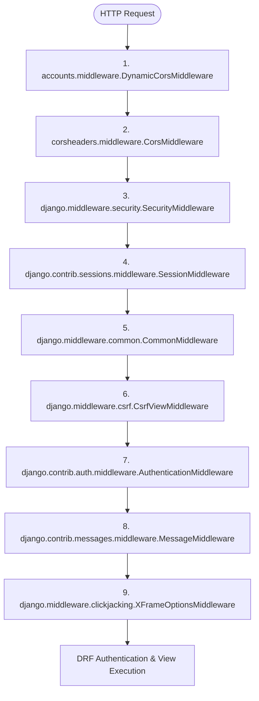
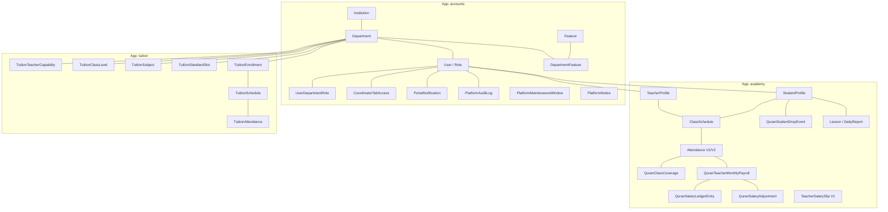

# IVS Qur'an Academy Manager — Django Backend Architecture Audit

> **Document ID**: `05_BACKEND_ARCHITECTURE`  
> **Phase**: Phase 3 — Complete Django Backend Architecture, API Route Discovery & Integration Audit  
> **Repository Target**: `quran----1-Role-Based-`  
> **Current Audited Branch**: `release/ivs-20261020-candidate`  
> **Audited Commit Baseline**: `de92b7606543936eafe52ed66792eedda6d4598e`  
> **Author**: Antigravity Senior Software Architect & Engineering Audit Team  
> **Audit Execution Date**: 2026-11-03  
> **Audit Status**: VERIFIED (Read-only static code analysis, AST parsing, configuration audit)

---

## 1. Executive Summary

The backend of the **IVS Qur'an Academy Manager** is an asynchronous-ready Python/Django 5.2 application powered by Django REST Framework (DRF 3.17), Django Channels 4.3 (Daphne ASGI), and PostgreSQL. It enforces multi-department tenancy, role-based access control (RBAC), fine-grained feature toggles, real-time WebSocket push notifications, and immutable audit logs.

The architecture hosts two primary academic verticals under a single authentication umbrella:
1. **Quran Department** (`academy`): Comprehensive Islamic Qur'anic studies management featuring Lesson Planning, Attendance V2 with Substitute Teacher Coverage, Drop/Leave lifecycle management, Salary V1 (slip-based), and Salary V2 (ledger-based immutable payroll).
2. **Tuition Department** (`tuition`): General K-12 academic tuition management featuring standard time slots, teacher subject capabilities, multi-student bundles, scheduling matrices, and attendance tracking.
3. **Core Authentication & Platform Governance** (`accounts`): Custom `User` model, `Institution` and `Department` tenancy, `PlatformAdmin` tools (backups, maintenance windows, broadcast notices, runtime CORS/Gemini settings), safe account archival, and teacher retirement / login deletion services.

Total backend source files analyzed: **133 Python files** (86 non-migration application files totaling **34,519 lines of code**, and 47 migration files across 3 applications).

---

## 2. Technology Stack & Runtime Configuration

### 2.1 Core Runtime Specifications
- **Python Version**: 3.12.10 (tested and verified in local virtual environment `backend/venv/Scripts/python.exe`).
- **Django Version**: `5.2.14`.
- **Django REST Framework**: `3.17.1`.
- **Authentication**: `djangorestframework-simplejwt 5.5.1` with Token Blacklist.
- **ASGI & WebSockets**: `daphne 4.2.3`, `channels 4.3.2`, `channels-redis 4.2.1`.
- **Database Engine**: PostgreSQL via `psycopg2-binary 2.9.12`.
- **Timezone**: Default application timezone `UTC` configured in `settings.py`, but all operational dates (salary cutoffs, attendance date boundaries, teacher retirement effective dates) explicitly use `ZoneInfo("Asia/Karachi")` (Pakistan Standard Time, UTC+5).

### 2.2 Installed Applications Architecture
As configured in [`backend/config/settings.py`](file:///c:/Users/iqrav/Downloads/quran%20---1%20(Role%20Based)/backend/config/settings.py#L18-L37):

```python
INSTALLED_APPS = [
    "daphne",                                    # ASGI server must be first for Channels integration
    "django.contrib.admin",
    "django.contrib.auth",
    "django.contrib.contenttypes",
    "django.contrib.sessions",
    "django.contrib.messages",
    "django.contrib.staticfiles",
    "channels",                                  # Django Channels ASGI layer
    "corsheaders",                               # Cross-Origin Resource Sharing
    "rest_framework",                            # Django REST Framework
    "rest_framework_simplejwt.token_blacklist",  # JWT token rotation & blacklisting
    "accounts",                                  # Tenancy, User model, Platform Admin, Notifications
    "academy",                                   # Quran Department core, Attendance V2, Salary V1/V2
    "tuition",                                   # Tuition Department core, Capabilities, Scheduling
]
```

---

## 3. Django Configuration Audit (`config/settings.py`)

### 3.1 Middleware Pipeline Execution Order
Middleware execution runs strictly sequentially as declared in [`backend/config/settings.py`](file:///c:/Users/iqrav/Downloads/quran%20---1%20(Role%20Based)/backend/config/settings.py#L39-L50):



1. **`DynamicCorsMiddleware` (`accounts.middleware.DynamicCorsMiddleware`)**:
   - Executes *before* standard `CorsMiddleware`.
   - Intercepts requests and inspects the database table `PlatformSetting` (via `accounts.platform_runtime.get_runtime_cors_origins()`).
   - If the request `Origin` matches a runtime-allowed origin dynamically configured by Platform Admin, it short-circuits HTTP `OPTIONS` preflight requests with `status=200` and injects `Access-Control-Allow-Origin`, `Access-Control-Allow-Methods`, and `Access-Control-Allow-Headers`.
2. **`CorsMiddleware` (`corsheaders.middleware.CorsMiddleware`)**:
   - Handles static CORS origins specified in `settings.CORS_ALLOWED_ORIGINS` and development regex patterns (`^http://localhost:\d+$`, `^http://127\.0\.0\.1:\d+$`).
3. **Standard Security & Session Middlewares**: Handles CSRF protection, session cookies, and clickjacking prevention (`X_FRAME_OPTIONS = "DENY"`).

### 3.2 Authentication & Maintenance Mode Pipeline
DRF is configured in `settings.REST_FRAMEWORK` with:
- **Default Authentication Class**: `accounts.authentication.MaintenanceAwareJWTAuthentication`.
- **Default Permission Class**: `rest_framework.permissions.IsAuthenticated`.
- **Default Throttle Classes**: `AnonRateThrottle` (20/hour) and `UserRateThrottle` (1000/hour).
- **Default Renderer**: `JSONRenderer` (Browsable API disabled in all environments).

#### Maintenance Mode Interception
[`accounts/authentication.py`](file:///c:/Users/iqrav/Downloads/quran%20---1%20(Role%20Based)/backend/accounts/authentication.py#L13-L45) subclasses SimpleJWT's `JWTAuthentication`:
1. Validates JWT Bearer token.
2. Checks whether the request path matches `BYPASS_PATHS`:
   - `/api/auth/context/`
   - `/api/auth/notices/active/`
3. If not bypassed, checks `active_maintenance_for_user(user)` against `PlatformMaintenanceWindow` records (scoped to Platform, Institution, or Department).
4. If an active maintenance window covers the user's institution or department, it raises **HTTP 423 `MaintenanceModeException`** containing structured maintenance metadata (`message`, `starts_at`, `ends_at`, `scope_type`).
5. This allows the frontend client (`authenticatedRequest.ts`) to intercept the 423 status code and cleanly transition to the maintenance overlay without crashing the session.

### 3.3 SimpleJWT Configuration
Configured in `settings.SIMPLE_JWT`:
- **`ACCESS_TOKEN_LIFETIME`**: `timedelta(hours=8)` — Generous session lifetime suited for teachers and coordinators during long instructional shifts.
- **`REFRESH_TOKEN_LIFETIME`**: `timedelta(days=7)`.
- **`ROTATE_REFRESH_TOKENS`**: `True` — A new refresh token is issued whenever `/api/auth/refresh/` is called.
- **`BLACKLIST_AFTER_ROTATION`**: `True` — Old refresh tokens are invalidated immediately in `token_blacklist_blacklistedtoken`.
- **`AUTH_HEADER_TYPES`**: `("Bearer",)`.

### 3.4 Production Security & Operational Flags
- **`DEBUG`**: Read from `DJANGO_DEBUG` (defaults to `True` if omitted).
- **`SECRET_KEY`**: Read from `DJANGO_SECRET_KEY` (fallback: `"dev-only-change-me"`).
- **`ALLOWED_HOSTS`**: Read from `DJANGO_ALLOWED_HOSTS` (defaults to `localhost,127.0.0.1`).
- **`SECURE_SSL_REDIRECT`**: Set to `False` in `if not DEBUG` with explicit code comment: *"HTTPS - enable after you get SSL certificate on Oracle server"*.
  > [!WARNING]
  > When operating in production behind Nginx, SSL termination typically occurs at the reverse proxy. However, `SECURE_SSL_REDIRECT = False` means Django itself will not force HTTPS redirection. Proper `X-Forwarded-Proto` handling is required in Nginx.
- **`SESSION_COOKIE_SECURE` / `CSRF_COOKIE_SECURE`**: Enabled when `DEBUG = False`.
- **`DATA_UPLOAD_MAX_MEMORY_SIZE`**: `20 MB` (handles database backup upload buffering).
- **`FILE_UPLOAD_MAX_MEMORY_SIZE`**: `5 MB`.

### 3.5 Logging Architecture & Asymmetry
Configured in `settings.LOGGING`:
- Console StreamHandler (verbose format: `{levelname} {asctime} {module} {message}`).
- FileHandler writing to `backend/logs/django.log`.
- Loggers configured for `academy` and `accounts` at `WARNING` level with `propagate: False`.
  > [!NOTE]
  > The `tuition` application is **not registered** in `settings.LOGGING["loggers"]`. Its log output defaults to the root console handler and is **not written** to `django.log`.

---

## 4. Asynchronous WebSocket & Django Channels Layer

### 4.1 Protocol Routing (`config/asgi.py`)
Daphne serves HTTP and WebSocket protocols via `ProtocolTypeRouter`:

```python
application = ProtocolTypeRouter({
    "http": get_asgi_application(),
    "websocket": JWTAuthMiddleware(
        URLRouter(websocket_urlpatterns)
    ),
})
```

### 4.2 Channels Middleware (`academy/middleware.py`)
`JWTAuthMiddleware` is an asynchronous ASGI middleware:
1. Intercepts incoming WebSocket connection scopes.
2. Extracts the `token` parameter from the connection query string (`ws://.../ws/academy/?token=<access_token>`).
3. Executes `@database_sync_to_async` function `get_user_from_token`:
   - Validates the token using `rest_framework_simplejwt.tokens.AccessToken(token)`.
   - Fetches the user instance from `accounts.models.User`.
4. Populates `scope["user"]`. If missing or invalid, populates `AnonymousUser()`.

### 4.3 WebSocket Consumer (`academy/consumers.py`)
Served at route `^ws/academy/$` by `AcademyConsumer(AsyncWebsocketConsumer)`:
- **Connection Handshake**:
  - Rejects unauthenticated connections with code `4001`.
  - Authenticated connections automatically join three distinct channel groups:
    1. **`user_{user.id}`**: Private point-to-point inbox and notifications.
    2. **`role_{user.role}`**: Role-wide broadcasts (`role_coordinator`, `role_teacher`, `role_student`, `role_department_admin`).
    3. **`global`**: Platform-wide operational announcements, attendance markers, and maintenance mode changes.
  - Sends immediate handshake confirmation:
    ```json
    { "type": "connected", "message": "WebSocket connected.", "user_id": 12, "role": "coordinator" }
    ```
- **Keep-Alive Heartbeat**: Handles client ping: `{"type": "ping"}` -> responds `{"type": "pong"}`.
- **Supported Event Handlers**:
  - `academy_update`: Generic real-time data sync.
  - `maintenance_updated`: Triggers connected portals to re-verify maintenance windows.
  - `notice_updated`: Pushes banner notices to relevant clients.
  - `lesson_saved`: Broadcasts lesson creation/updates to department coordinators and teachers.
  - `permission_granted` / `permission_disabled`: Broadcasts lesson write permission grants.
  - `request_reviewed` / `lesson_request_created`: Lesson edit request workflows.
  - `attendance_marked`: Live attendance synchronization across coordinator and teacher views.
  - `notification_created`: Sends lightweight notification event with ID only (clients fetch content over HTTPS for security).

### 4.4 Channel Layer Modes
Configured via `settings.CHANNEL_LAYER_MODE`:
- **`memory`** (Default for local development): Uses `channels.layers.InMemoryChannelLayer`.
- **`redis`** (Production target): Uses `channels_redis.core.RedisChannelLayer` pointing to `REDIS_URL` (default: `redis://127.0.0.1:6379/0`).

---

## 5. Domain Architecture & Installed Application Breakdown



### 5.1 Accounts Application (`accounts/`)
Primary responsibility: Identity, authentication, multi-tenancy, platform operations, and audit logging.

| File | Lines | Responsibility | Important Symbols |
| :--- | :---: | :--- | :--- |
| `accounts/models.py` | 572 | Data models | `Institution`, `Department`, `Feature`, `DepartmentFeature`, `User`, `UserDepartmentRole`, `CoordinatorTabAccess`, `PlatformSetting`, `PlatformAuditLog`, `PlatformBackup`, `PlatformMaintenanceWindow`, `PlatformNotice`, `PlatformNoticeReceipt`, `PortalNotification` |
| `accounts/urls.py` | 100 | URL configuration | 39 distinct route registrations mounted at `/api/auth/` |
| `accounts/views.py` | 1,753 | API views | `LoginView`, `MeView`, `AuthContextView`, `CoordinatorAccountListCreateView`, `CoordinatorAccountDetailView`, `CoordinatorTabAccessView`, `PlatformInstitution*`, `PlatformDepartment*`, `PlatformFeature*` |
| `accounts/serializers.py` | 985 | Validation & serialization | `CreateAccountSerializer`, `UpdateAccountSerializer`, `normalize_subject`, `sync_student_schedules`, `sync_student_subjects` |
| `accounts/authentication.py` | 45 | Authentication middleware | `MaintenanceAwareJWTAuthentication`, `MaintenanceModeException` |
| `accounts/middleware.py` | 39 | Dynamic CORS middleware | `DynamicCorsMiddleware` |
| `accounts/teacher_retirement_service.py` | 165 | Teacher retirement logic | `teacher_retirement_readiness`, `transfer_student_before_teacher_retirement`, `slots_overlap`, `TeacherRetirementBlocked` |
| `accounts/teacher_login_deletion_service.py` | 88 | Hard deletion logic | `delete_teacher_login_permanently`, `AUTHOR_MODELS` snapshotting, dynamic `Collector` cascade inspection |
| `accounts/account_archive_service.py` | 85 | Soft archival logic | `archive_quran_account`, schedule cutoff at PKT midnight, audit trail preservation |
| `accounts/deletion_service.py` | 267 | Department reset cascade | `_can_delete_scoped_user`, `_has_external_department_scope`, protected deletion handling |
| `accounts/platform_admin_api.py` | 976 | Main Admin APIs | `PlatformPortalAdministrator*`, `PlatformBackup*`, `PlatformSettingsView`, `PlatformGeminiTestView`, `PlatformSystemHealthView`, `PlatformAuditLogListView` |
| `accounts/platform_communications_api.py` | 529 | Maintenance & Notices APIs | `PlatformMaintenance*`, `PlatformNotice*`, `ActivePlatformNoticesView`, `DismissPlatformNoticeView` |
| `accounts/platform_analytics_api.py` | 242 | High-level metrics API | `PlatformAnalyticsView` |
| `accounts/notification_api.py` | 109 | Private inbox APIs | `PortalNotificationListView`, `PortalNotificationReadView`, `PortalNotificationReadAllView`, `PortalNotificationClearView`, `PortalNotificationClearAllView` |
| `accounts/self_profile_api.py` | 173 | Profile management API | `SelfProfileView` (password update, profile photo, contact info) |
| `accounts/teacher_retirement_api.py` | 167 | Retirement workflow API | `TeacherRetirementView` (GET readiness check, POST student transfer) |
| `accounts/platform_backups.py` | 292 | Database backup engine | `generate_backup_file`, `validate_backup_file`, `stream_backup_download`, SHA-256 checksums |
| `accounts/platform_runtime.py` | 217 | Settings & Audit service | `get_runtime_cors_origins`, `get_gemini_credentials`, `record_audit_event` |
| `accounts/notification_service.py` | 123 | Notification creation service | `create_portal_notification`, `lesson_permission_changed` |

### 5.2 Academy Application (`academy/`)
Primary responsibility: Quran Department academic schedules, lesson reporting, Attendance V2, Substitute Teacher Coverage, Drop/Leave tracking, Salary V1, and Salary V2 ledger calculation.

| File | Lines | Responsibility | Important Symbols |
| :--- | :---: | :--- | :--- |
| `academy/models.py` | 1,289 | Quran domain models | `TeacherProfile`, `StudentProfile`, `ClassSchedule`, `StudentSubject`, `Attendance`, `Lesson`, `DailyLessonReport`, `DailyLessonSubjectEntry`, `MonthlyLessonPlan`, `MonthlyLessonSummary`, `LessonAccessPermission`, `LessonAccessRequest`, `StudentClassHistory`, `SalaryConfiguration`, `TeacherSalarySlip` |
| `academy/salary_v2_models.py` | 858 | Salary V2 models | `QuranSalaryPolicy`, `QuranTeacherMonthlyPayroll`, `QuranSalaryLedgerEntry`, `QuranSalaryAdjustment`, `QuranClassCoverage`, `QuranStudentDropEvent` |
| `academy/urls.py` | 111 | URL configuration | 25 distinct route registrations mounted at `/api/academy/` |
| `academy/views.py` | 5,091 | Legacy & Core API views | `AcademyHealthView`, `DashboardView`, `LessonListCreateView`, `LessonDetailView`, `LessonAccessPermissionView`, `LessonAccessRequestView`, `DailyLessonReportListCreateView`, `AttendanceMonthlyImportView`, `AttendanceListCreateView`, `AttendanceDeleteView`, `MonthlyLessonPlan*`, `MonthlyLessonSummaryView`, `AcademyStateView`, `GeminiAssistantView` |
| `academy/attendance_v2_api.py` | 2,214 | Attendance V2 API | `QuranTeacherSessionAttendanceView` (GET session, POST attendance + substitute coverage, DELETE unmark session) |
| `academy/salary_v2_api.py` | 2,515 | Salary V2 Payroll API | `QuranSalaryV2PayrollView` (GET payrolls, POST lifecycle actions: calculate, submit, approve, reject, mark_paid, reopen, adjustments, rejoin_student), `QuranSalaryV2ProofView` |
| `academy/salary_v2_service.py` | 2,597 | Salary V2 Calculation Engine | `calculate_teacher_payroll`, `build_department_month_context`, `compute_teaching_minutes`, `substitute_ledger_entries`, `money`, `decimal_text` |
| `academy/salary_v2_proof_service.py` | 385 | Salary V2 Audit Proof | `build_teacher_salary_v2_proof`, detailed line-item breakdown |
| `academy/payroll_source_locks.py` | 983 | Financial lock enforcement | `teacher_session_payroll_lock_payload`, `student_attendance_payroll_lock_payload`, `ensure_schedule_change_payroll_editable`, `ensure_student_state_change_payroll_editable` |
| `academy/quran_management_api.py` | 737 | Management & Salary V1 APIs | `DroppedLeaveStudentsView`, `QuranSalaryDashboardView`, `QuranSalarySettingsView`, `QuranSalaryAuditView`, `QuranSalaryPdfDownloadView` |
| `academy/attendance_report_sessions_api.py` | 105 | Historical Scheduled Sessions | `QuranAttendanceReportSessionsView` (date-effective scheduled rows, 366-day safety cap) |
| `academy/schedule_history_service.py` | 182 | Schedule versioning | `sync_student_schedule_history` (`effective_from`/`effective_to` date ranges) |
| `academy/student_drop_service.py` | 652 | Drop streak calculation | `DROP_STREAK_LENGTH = 3`, `DROP_ATTENDANCE_STATUSES`, auto-drop ledger adjustments |
| `academy/student_rejoin_service.py` | 894 | Controlled student rejoin | `rejoin_student`, payroll adjustments, compensation entries |
| `academy/student_state_history_service.py` | 422 | Student state audit | `sync_student_state_history`, status transitions |
| `academy/salary_service.py` | 1,350 | Salary V1 Calculation Engine | `calculate_monthly_salary`, `refresh_salary_slip`, `configuration_payload` |
| `academy/serializers.py` | 222 | DRF Serializers | `TeacherProfileSerializer`, `StudentProfileSerializer`, `ClassScheduleSerializer`, `AttendanceSerializer`, `LessonSerializer`, `DailyLessonReportSerializer` |
| `academy/permissions.py` | 38 | RBAC permission classes | `IsCoordinator`, `ReadOnlyForTeacherStudentCoordinatorCanWrite`, `is_department_manager` |
| `academy/consumers.py` | 89 | Channels WebSocket Consumer | `AcademyConsumer` |
| `academy/middleware.py` | 32 | WebSocket JWT Auth | `JWTAuthMiddleware` |
| `academy/ws_notify.py` | 187 | WebSocket broadcast helpers | `notify_global`, `notify_role`, `notify_user`, `notify_lesson_saved` |
| `academy/attendance_pagination.py` | 77 | Pagination utility | `AttendanceCursorPagination`, page-size limiters |
| `academy/attendance_import.py` | 313 | Attendance import processor | CSV/Excel parsing and row validation |
| `academy/attendance_report_import.py` | 876 | Batch report processor | Attendance reconciliation from external sheets |

### 5.3 Tuition Application (`tuition/`)
Primary responsibility: Academic Tuition Department operations, standard slot definitions, teacher capability matrix, multi-subject student enrollments, schedules, and attendance.

| File | Lines | Responsibility | Important Symbols |
| :--- | :---: | :--- | :--- |
| `tuition/models.py` | 1,349 | Tuition domain models | `TuitionClassLevel`, `TuitionSubject`, `TuitionStandardSlot`, `TuitionTeacherCapability`, `TuitionEnrollment`, `TuitionSchedule`, `TuitionAvailabilityPeriod`, `TuitionAttendance` |
| `tuition/urls.py` | 158 | URL configuration | 22 distinct route registrations mounted at `/api/tuition/` |
| `tuition/views.py` | 4,523 | Tuition API views | `TuitionFoundationView`, `TuitionAccountListCreateView`, `TuitionAccountDetailView`, `TuitionOptionsView`, `TuitionEnrollmentListCreateView`, `TuitionStudentBundleView`, `TuitionSchedulingMatrixView`, `TuitionScheduleListCreateView`, `TuitionAvailabilityListCreateView`, `TuitionAttendanceListCreateView`, `TuitionStudentPortalView`, `TuitionTeacherPortalView` |
| `tuition/management_api.py` | 709 | Tuition Management APIs | `TuitionDashboardView`, `TuitionManagerListCreateView`, `TuitionManagerDetailView` |
| `tuition/permissions.py` | 402 | RBAC & Tenancy permissions | `TuitionDepartmentAccessPermission`, `TuitionManagerPermission`, `TuitionFeaturePermission`, `resolve_tuition_department`, `tuition_feature_enabled` |
| `tuition/serializers.py` | 1,793 | Tuition DRF Serializers | `TuitionClassLevelSerializer`, `TuitionSubjectSerializer`, `TuitionStandardSlotSerializer`, `TuitionTeacherCapabilitySerializer`, `TuitionAccountCreateSerializer`, `TuitionEnrollmentWriteSerializer` |
| `tuition/ws_notify.py` | 61 | Tuition broadcast helper | `notify_tuition_update` (dispatches to `academy.ws_notify.notify_user` for shared Daphne WebSocket) |
| `tuition/constants.py` | 31 | Constants & choices | `TUITION_DAYS`, `DEFAULT_SLOT_DURATION` |

---

## 6. Critical Business Architecture Findings

### 6.1 Safe Teacher Retirement & Account Archival Architecture
The repository contains an exceptionally defensive, dual-tier account retirement engine designed to make accidental data loss mathematically impossible:

1. **Pre-Archival Transfer Gate (`teacher_retirement_service.py:24-59`)**:
   - `teacher_retirement_readiness(teacher)` evaluates:
     `can_archive = (len(assigned_students) == 0 and active_classes == 0)`
   - Counts **all** students assigned to the teacher, including active, on-leave, and dropped students.
   - If any active class schedule remains, archival is rejected with `TeacherRetirementBlocked`.
2. **Student Schedule Transfer (`transfer_student_before_teacher_retirement`)**:
   - Transfers current schedules to an active destination teacher in the same department and institution.
   - Detects schedule overlaps across all 7 weekdays (`slots_overlap`) including classes wrapping around midnight or week boundaries.
   - Updates student status to `TRANSFERRED_FROM_TEACHER` with effective date in `Asia/Karachi`.
   - Never deletes past schedule rows; closes them with `effective_to = today` and opens new rows with `effective_from = today`.
3. **Hard Login Deletion with History Retention (`teacher_login_deletion_service.py`)**:
   - When a coordinator permanently deletes a teacher login via `delete_teacher_login_permanently`:
     a. `TeacherProfile.user` foreign key is decoupled: `teacher.user = None`, while capturing `teacher.historical_name`, `teacher.login_deleted_at`, and `teacher.login_deleted_effective_date`.
     b. Author attribution snapshotting: iterates over `AUTHOR_MODELS` (`Attendance.marked_by`, `Lesson.created_by`, `DailyLessonReport.created_by`, `MonthlyLessonSummary.created_by`, `MonthlyLessonPlan.created_by`) and writes `actor_name_snapshot = historical_name`.
     c. **Dynamic Cascade Guard**: Uses Django's `Collector(using=db).collect([user])` to simulate deletion. If any model outside `allowed_cascade` (`UserDepartmentRole`, `CoordinatorTabAccess`, `PlatformNoticeReceipt`, `PortalNotification`, `BlacklistedToken`) would be touched, deletion **immediately aborts** with:
        `"Deletion blocked: unexpected dependent records: ..."`
     d. The `User` record is deleted, but the `TeacherProfile` row persists with `user_id = NULL`, preserving 100% of historical salary slips, attendance records, payroll headers, and ledger entries.

### 6.2 Attendance V2 & Substitute Teacher Coverage Engine
[`academy/attendance_v2_api.py`](file:///c:/Users/iqrav/Downloads/quran%20---1%20(Role%20Based)/backend/academy/attendance_v2_api.py) implements the unified session model:
- Groups schedule rows by unique session key: `(teacher_id, target_date, class_key)`.
- When teacher is marked `Absent` or `Leave`:
  - If students are `Present` or `Not Marked`, substitute coverage is mandatory (`_student_requires_substitute`).
  - If students are `Absent` or `Leave`, substitute coverage is not paid.
- Substitute coverage is logged in `QuranClassCoverage`.
- Prevents double-booking: `_busy_teacher_ids` checks both regular teaching schedules and existing substitute bookings during overlapping time intervals (`_intervals_overlap`).
- Unmarking a session (`DELETE` method) moves coverage rows to `status = CANCELLED` rather than deleting them, preserving complete audit traceability.

### 6.3 Payroll Source Locking (`payroll_source_locks.py`)
To ensure financial integrity, mutations to raw academic data are blocked once payroll is in review:
- **Locked Statuses**: `PENDING_SUPER_ADMIN`, `APPROVED`, `PAID`.
- If a payroll row for `(department_id, teacher_id, month, year)` has reached any of these statuses:
  - `teacher_session_payroll_lock_payload`: Blocks teacher session attendance marking or unmarking.
  - `student_attendance_payroll_lock_payload`: Blocks student attendance marking.
  - `ensure_schedule_change_payroll_editable`: Blocks schedule edits or teacher reassignments effective in that month.
  - `ensure_student_state_change_payroll_editable`: Blocks student drop or leave state changes.

### 6.4 Salary V1 vs Salary V2 Dual Engine Coexistence
The backend maintains two completely separate salary calculation subsystems:
1. **Salary V1 (`salary_service.py` & `quran_management_api.py`)**:
   - Uses `SalaryConfiguration` (flat rates, 3+ day class rates, standard deductions: food, advance, fine, imam hadya).
   - Generates and mutates `TeacherSalarySlip` records.
   - Displayed in legacy management screens.
2. **Salary V2 (`salary_v2_service.py` & `salary_v2_api.py`)**:
   - Uses `QuranSalaryPolicy` (hourly rates per teacher, base currency, fine rates).
   - Generates immutable monthly headers `QuranTeacherMonthlyPayroll` and granular double-entry style accounting rows `QuranSalaryLedgerEntry`.
   - Computes exact teaching minutes from attended sessions, substitute coverages, and pro-rated drop streaks.
   - Features formal state machine: `DRAFT` -> `SUBMITTED` (`PENDING_SUPER_ADMIN`) -> `APPROVED` -> `PAID` (with `REOPEN` and `REJECT` transitions).

---

## 7. Complete Backend Physical File Inventory

The following table categorizes all 86 non-migration Python files across the backend. Every file was inspected during Phase 3 via static AST traversal and content analysis.

| # | File Path | Django App | Responsibility | Key Symbols / Classes | Dependencies | Review Status |
| :-: | :--- | :--- | :--- | :--- | :--- | :---: |
| 1 | `manage.py` | Root | Django CLI Entrypoint | `main` | `os`, `sys`, `core.management` | Fully Inspected |
| 2 | `config/__init__.py` | config | Python package init | - | None | Fully Inspected |
| 3 | `config/asgi.py` | config | ASGI & WebSocket router | `application`, `ProtocolTypeRouter` | `os`, `django`, `channels.routing`, `academy.routing`, `academy.middleware` | Fully Inspected |
| 4 | `config/settings.py` | config | Master configuration | `INSTALLED_APPS`, `MIDDLEWARE`, `DATABASES`, `REST_FRAMEWORK`, `SIMPLE_JWT` | `pathlib`, `os`, `datetime`, `dotenv` | Fully Inspected |
| 5 | `config/urls.py` | config | Root URL dispatcher | `urlpatterns` | `django.contrib.admin`, `django.urls` | Fully Inspected |
| 6 | `config/wsgi.py` | config | WSGI entrypoint | `application` | `os`, `django.core.wsgi` | Fully Inspected |
| 7 | `accounts/__init__.py` | accounts | Python package init | - | None | Fully Inspected |
| 8 | `accounts/account_archive_service.py` | accounts | Account archival service | `archive_quran_account` | `datetime`, `django.db`, `zoneinfo`, `academy.models` | Fully Inspected |
| 9 | `accounts/admin.py` | accounts | Django Admin config | `UserAdmin`, `InstitutionAdmin` | `django.contrib.admin`, `models` | Fully Inspected |
| 10 | `accounts/apps.py` | accounts | Application initialization | `AccountsConfig` | `django.apps` | Fully Inspected |
| 11 | `accounts/authentication.py` | accounts | Maintenance JWT auth | `MaintenanceAwareJWTAuthentication`, `MaintenanceModeException` | `rest_framework.exceptions`, `rest_framework_simplejwt.authentication` | Fully Inspected |
| 12 | `accounts/deletion_service.py` | accounts | Tenancy cascade deletion | `AccountDeletionSummary`, `_department_candidate_users` | `dataclasses`, `django.db`, `academy.models` | Fully Inspected |
| 13 | `accounts/middleware.py` | accounts | Dynamic CORS middleware | `DynamicCorsMiddleware` | `django.http`, `django.utils.cache`, `platform_runtime` | Fully Inspected |
| 14 | `accounts/models.py` | accounts | Data models | `Institution`, `Department`, `Feature`, `DepartmentFeature`, `User`, `UserDepartmentRole`, `CoordinatorTabAccess`, `PlatformSetting`, `PlatformAuditLog`, `PlatformBackup`, `PlatformMaintenanceWindow`, `PlatformNotice`, `PortalNotification` | `django.contrib.auth.models`, `django.db.models` | Fully Inspected |
| 15 | `accounts/notification_api.py` | accounts | Notification inbox APIs | `PortalNotificationListView`, `PortalNotificationReadView`, `PortalNotificationClearView` | `rest_framework.views`, `models` | Fully Inspected |
| 16 | `accounts/notification_service.py` | accounts | Notification dispatch service | `create_portal_notification`, `lesson_permission_changed` | `django.db`, `models`, `academy.ws_notify` | Fully Inspected |
| 17 | `accounts/notification_tests.py` | accounts | Notification test suite | `PortalNotificationTests` | `django.test`, `models`, `notification_service` | Fully Inspected |
| 18 | `accounts/platform_admin_api.py` | accounts | Platform Admin APIs | `PlatformPortalAdministrator*`, `PlatformBackup*`, `PlatformSettingsView`, `PlatformSystemHealthView`, `PlatformAuditLogListView` | `rest_framework.views`, `models`, `platform_runtime` | Fully Inspected |
| 19 | `accounts/platform_analytics_api.py` | accounts | Analytics metrics API | `PlatformAnalyticsView` | `rest_framework.views`, `django.db.models` | Fully Inspected |
| 20 | `accounts/platform_backups.py` | accounts | DB backup engine | `generate_backup_file`, `validate_backup_file`, `stream_backup_download` | `subprocess`, `hashlib`, `os`, `models` | Fully Inspected |
| 21 | `accounts/platform_communications.py` | accounts | Maintenance & Notice logic | `active_maintenance_for_user`, `maintenance_payload`, `active_notices_for_user` | `django.utils`, `models` | Fully Inspected |
| 22 | `accounts/platform_communications_api.py` | accounts | Notice & Maintenance APIs | `PlatformMaintenance*`, `PlatformNotice*`, `ActivePlatformNoticesView` | `rest_framework.views`, `models` | Fully Inspected |
| 23 | `accounts/platform_runtime.py` | accounts | Runtime settings & audit | `get_runtime_cors_origins`, `get_gemini_credentials`, `record_audit_event` | `json`, `models` | Fully Inspected |
| 24 | `accounts/self_profile_api.py` | accounts | User profile API | `SelfProfileView` | `rest_framework.views`, `models` | Fully Inspected |
| 25 | `accounts/serializers.py` | accounts | Account serializers | `CreateAccountSerializer`, `UpdateAccountSerializer`, `sync_student_schedules` | `rest_framework.serializers`, `models`, `academy.models` | Fully Inspected |
| 26 | `accounts/teacher_login_deletion_service.py` | accounts | Teacher login hard deletion | `delete_teacher_login_permanently`, `AUTHOR_MODELS` | `django.db`, `zoneinfo`, `django.db.models.deletion`, `academy.models` | Fully Inspected |
| 27 | `accounts/teacher_retirement_api.py` | accounts | Teacher retirement API | `TeacherRetirementView` | `rest_framework.views`, `teacher_retirement_service` | Fully Inspected |
| 28 | `accounts/teacher_retirement_service.py` | accounts | Retirement transfer engine | `teacher_retirement_readiness`, `transfer_student_before_teacher_retirement` | `django.db`, `zoneinfo`, `academy.models`, `academy.schedule_history_service` | Fully Inspected |
| 29 | `accounts/urls.py` | accounts | URL routing | `urlpatterns` (39 endpoints) | `django.urls`, `views`, `platform_admin_api` | Fully Inspected |
| 30 | `accounts/views.py` | accounts | Core auth & account views | `LoginView`, `MeView`, `AuthContextView`, `CoordinatorAccountListCreateView`, `PlatformInstitution*`, `PlatformDepartment*` | `rest_framework.views`, `models`, `serializers` | Fully Inspected |
| 31 | `accounts/management/__init__.py` | accounts | Python package init | - | None | Fully Inspected |
| 32 | `accounts/management/commands/__init__.py` | accounts | Python package init | - | None | Fully Inspected |
| 33 | `accounts/management/commands/restore_platform_backup.py` | accounts | Backup restore CLI | `Command`, `handle` | `django.core.management.base`, `subprocess`, `models` | Fully Inspected |
| 34 | `accounts/tests/test_teacher_login_deletion.py` | accounts | Deletion test suite | `TeacherLoginDeletionTests` | `django.test`, `models`, `teacher_login_deletion_service` | Fully Inspected |
| 35 | `accounts/tests/test_teacher_retirement.py` | accounts | Retirement test suite | `TeacherRetirementWorkflowTests` | `django.test`, `rest_framework.test`, `models` | Fully Inspected |
| 36 | `academy/__init__.py` | academy | Python package init | - | None | Fully Inspected |
| 37 | `academy/admin.py` | academy | Django Admin config | `TeacherProfileAdmin`, `StudentProfileAdmin`, `ClassScheduleAdmin` | `django.contrib.admin`, `models` | Fully Inspected |
| 38 | `academy/apps.py` | academy | Application initialization | `AcademyConfig` | `django.apps` | Fully Inspected |
| 39 | `academy/attendance_import.py` | academy | Attendance import utility | `import_attendance_csv`, `validate_row` | `csv`, `datetime`, `models` | Fully Inspected |
| 40 | `academy/attendance_import_payroll.py` | academy | Import payroll helper | `recalculate_payroll_for_imported_records` | `models`, `salary_service` | Fully Inspected |
| 41 | `academy/attendance_pagination.py` | academy | Pagination helper | `AttendanceCursorPagination` | `rest_framework.pagination` | Fully Inspected |
| 42 | `academy/attendance_report_import.py` | academy | Report import engine | `process_monthly_attendance_sheet` | `openpyxl`, `csv`, `models` | Fully Inspected |
| 43 | `academy/attendance_report_sessions_api.py` | academy | Scheduled sessions API | `QuranAttendanceReportSessionsView` | `rest_framework.views`, `models` | Fully Inspected |
| 44 | `academy/attendance_v2_api.py` | academy | Attendance V2 & Coverage | `QuranTeacherSessionAttendanceView`, `reconcile_student_coverage` | `rest_framework.views`, `models`, `salary_v2_service`, `payroll_source_locks` | Fully Inspected |
| 45 | `academy/consumers.py` | academy | Channels WebSocket | `AcademyConsumer` | `channels.generic.websocket`, `json` | Fully Inspected |
| 46 | `academy/middleware.py` | academy | Channels JWT Auth | `JWTAuthMiddleware`, `get_user_from_token` | `channels.middleware`, `channels.db`, `rest_framework_simplejwt` | Fully Inspected |
| 47 | `academy/models.py` | academy | Quran data models | `TeacherProfile`, `StudentProfile`, `ClassSchedule`, `StudentSubject`, `Attendance`, `Lesson`, `DailyLessonReport`, `MonthlyLessonPlan`, `StudentClassHistory`, `SalaryConfiguration`, `TeacherSalarySlip` | `django.db.models`, `accounts.models` | Fully Inspected |
| 48 | `academy/payroll_source_locks.py` | academy | Financial lock engine | `teacher_session_payroll_lock_payload`, `student_attendance_payroll_lock_payload`, `ensure_schedule_change_payroll_editable` | `django.db`, `models`, `salary_v2_models` | Fully Inspected |
| 49 | `academy/permissions.py` | academy | RBAC permissions | `IsCoordinator`, `ReadOnlyForTeacherStudentCoordinatorCanWrite`, `is_department_manager` | `rest_framework.permissions` | Fully Inspected |
| 50 | `academy/quran_management_api.py` | academy | Quran management APIs | `DroppedLeaveStudentsView`, `QuranSalaryDashboardView`, `QuranSalarySettingsView`, `QuranSalaryAuditView`, `QuranSalaryPdfDownloadView` | `rest_framework.views`, `models`, `salary_service` | Fully Inspected |
| 51 | `academy/routing.py` | academy | WebSocket routing | `websocket_urlpatterns` | `django.urls`, `consumers` | Fully Inspected |
| 52 | `academy/salary_service.py` | academy | Salary V1 Engine | `calculate_monthly_salary`, `refresh_salary_slip`, `configuration_payload` | `decimal`, `calendar`, `datetime`, `models` | Fully Inspected |
| 53 | `academy/salary_v2_api.py` | academy | Salary V2 APIs | `QuranSalaryV2PayrollView`, `QuranSalaryV2ProofView` | `rest_framework.views`, `salary_v2_models`, `salary_v2_service`, `salary_v2_proof_service` | Fully Inspected |
| 54 | `academy/salary_v2_models.py` | academy | Salary V2 data models | `QuranSalaryPolicy`, `QuranTeacherMonthlyPayroll`, `QuranSalaryLedgerEntry`, `QuranSalaryAdjustment`, `QuranClassCoverage`, `QuranStudentDropEvent` | `django.db.models`, `accounts.models` | Fully Inspected |
| 55 | `academy/salary_v2_proof_service.py` | academy | Salary V2 audit proof | `build_teacher_salary_v2_proof` | `salary_v2_models`, `salary_v2_service` | Fully Inspected |
| 56 | `academy/salary_v2_service.py` | academy | Salary V2 Calculation Engine | `calculate_teacher_payroll`, `build_department_month_context`, `compute_teaching_minutes` | `decimal`, `calendar`, `salary_v2_models`, `payroll_source_locks` | Fully Inspected |
| 57 | `academy/schedule_history_service.py` | academy | Schedule versioning | `sync_student_schedule_history` | `django.db`, `models`, `payroll_source_locks` | Fully Inspected |
| 58 | `academy/serializers.py` | academy | DRF Serializers | `TeacherProfileSerializer`, `StudentProfileSerializer`, `ClassScheduleSerializer`, `AttendanceSerializer`, `LessonSerializer` | `rest_framework.serializers`, `models` | Fully Inspected |
| 59 | `academy/student_drop_service.py` | academy | Drop detection service | `DROP_STREAK_LENGTH`, `StudentDropDetectionError`, `detect_student_drop_events` | `datetime`, `django.db`, `models`, `payroll_source_locks` | Fully Inspected |
| 60 | `academy/student_rejoin_service.py` | academy | Student rejoin service | `rejoin_student`, `StudentRejoinError` | `datetime`, `decimal`, `salary_v2_models`, `salary_v2_service` | Fully Inspected |
| 61 | `academy/student_state_history_service.py` | academy | Student state transitions | `sync_student_state_history` | `django.db`, `models` | Fully Inspected |
| 62 | `academy/substitute_availability_rules.py` | academy | Coverage release rule | `can_release_scheduled_teacher` | `models` | Fully Inspected |
| 63 | `academy/substitute_availability_rules_test.py` | academy | Substitute rules test | `SubstituteRulesTests` | `unittest`, `substitute_availability_rules` | Fully Inspected |
| 64 | `academy/urls.py` | academy | URL routing | `urlpatterns` (25 endpoints) | `django.urls`, `views`, `attendance_v2_api`, `salary_v2_api` | Fully Inspected |
| 65 | `academy/views.py` | academy | Core Quran views | `DashboardView`, `LessonListCreateView`, `AttendanceListCreateView`, `DailyLessonReportListCreateView`, `GeminiAssistantView` | `rest_framework.views`, `models`, `serializers` | Fully Inspected |
| 66 | `academy/ws_notify.py` | academy | WebSocket broadcast | `notify_global`, `notify_role`, `notify_user`, `notify_lesson_saved` | `asgiref.sync`, `channels.layers` | Fully Inspected |
| 67 | `academy/management/__init__.py` | academy | Python package init | - | None | Fully Inspected |
| 68 | `academy/management/commands/__init__.py` | academy | Python package init | - | None | Fully Inspected |
| 69 | `academy/management/commands/diagnose_imported_salary.py` | academy | Imported salary diagnostic | `Command`, `handle` | `django.core.management.base`, `models`, `salary_service` | Fully Inspected |
| 70 | `academy/management/commands/import_legacy_sqlite.py` | academy | SQLite database migration | `Command`, `handle` | `django.core.management.base`, `sqlite3`, `models` | Fully Inspected |
| 71 | `academy/management/commands/import_monthly_attendance.py` | academy | Attendance batch importer | `Command`, `handle` | `django.core.management.base`, `openpyxl`, `models` | Fully Inspected |
| 72 | `academy/management/commands/recalculate_imported_salary.py` | academy | Recalculate salary CLI | `Command`, `handle` | `django.core.management.base`, `models`, `salary_service` | Fully Inspected |
| 73 | `academy/tests/__init__.py` | academy | Python package init | - | None | Fully Inspected |
| 74 | `academy/tests/test_attendance_pagination_and_import.py` | academy | Attendance pagination test | `AttendancePaginationTests`, `QuranFixtureMixin` | `django.test`, `models`, `views` | Fully Inspected |
| 75 | `academy/tests/test_imported_salary_rules.py` | academy | Imported salary test | `ImportedSalaryRuleTests` | `django.test`, `models`, `salary_service` | Fully Inspected |
| 76 | `tuition/__init__.py` | tuition | Python package init | - | None | Fully Inspected |
| 77 | `tuition/admin.py` | tuition | Django Admin config | `TuitionClassLevelAdmin`, `TuitionSubjectAdmin`, `TuitionScheduleAdmin` | `django.contrib.admin`, `models` | Fully Inspected |
| 78 | `tuition/apps.py` | tuition | Application initialization | `TuitionConfig` | `django.apps` | Fully Inspected |
| 79 | `tuition/constants.py` | tuition | Constants & choices | `TUITION_DAYS`, `DEFAULT_SLOT_DURATION` | None | Fully Inspected |
| 80 | `tuition/management_api.py` | tuition | Tuition Management APIs | `TuitionDashboardView`, `TuitionManagerListCreateView`, `TuitionManagerDetailView` | `rest_framework.views`, `models`, `permissions` | Fully Inspected |
| 81 | `tuition/models.py` | tuition | Tuition data models | `TuitionClassLevel`, `TuitionSubject`, `TuitionStandardSlot`, `TuitionTeacherCapability`, `TuitionEnrollment`, `TuitionSchedule`, `TuitionAvailabilityPeriod`, `TuitionAttendance` | `django.db.models`, `accounts.models` | Fully Inspected |
| 82 | `tuition/permissions.py` | tuition | Tenancy & RBAC rules | `TuitionDepartmentAccessPermission`, `TuitionManagerPermission`, `TuitionFeaturePermission`, `resolve_tuition_department` | `rest_framework.permissions`, `accounts.models` | Fully Inspected |
| 83 | `tuition/serializers.py` | tuition | DRF Serializers | `TuitionClassLevelSerializer`, `TuitionAccountCreateSerializer`, `TuitionEnrollmentWriteSerializer` | `rest_framework.serializers`, `models` | Fully Inspected |
| 84 | `tuition/urls.py` | tuition | URL routing | `urlpatterns` (22 endpoints) | `django.urls`, `views`, `management_api` | Fully Inspected |
| 85 | `tuition/views.py` | tuition | Core Tuition views | `TuitionFoundationView`, `TuitionAccountListCreateView`, `TuitionSchedulingMatrixView`, `TuitionAttendanceListCreateView`, `TuitionStudentPortalView`, `TuitionTeacherPortalView` | `rest_framework.views`, `models`, `serializers`, `permissions` | Fully Inspected |
| 86 | `tuition/ws_notify.py` | tuition | WebSocket notify helper | `notify_tuition_update` | `accounts.models`, `academy.ws_notify` | Fully Inspected |

### 5.4 Database Migrations Inventory
Migrations are accounted for separately to prevent double-counting:
- **`academy/migrations/`**: 25 migration files (`0001_initial.py` through `0025_backfill_historical_actor_names.py`) + 1 `__init__.py` = **26 files**.
- **`accounts/migrations/`**: 12 migration files (`0001_initial.py` through `0012_portal_notification.py`) + 1 `__init__.py` = **13 files**.
- **`tuition/migrations/`**: 7 migration files (`0001_initial.py` through `0007_teacher_attendance_per_class.py`) + 1 `__init__.py` = **8 files**.
- **Total Migration Files**: **47 files**.
- **Total Python Files in Backend**: **86 + 47 = 133 files**.

---

## 8. Backend Test Coverage & Reliability Gap Analysis

### 8.1 Existing Automated Tests
Automated tests exist exclusively in `accounts` and `academy`:
1. `accounts/tests/test_teacher_retirement.py` (298 lines):
   - Verifies retirement readiness checks, student schedule transfer, slot overlap detection, conflict prevention, and atomic student migration.
2. `accounts/tests/test_teacher_login_deletion.py` (45 lines):
   - Verifies `delete_teacher_login_permanently` prevents deletion of users with remaining active students/classes and validates historical `TeacherProfile` preservation.
3. `accounts/notification_tests.py` (78 lines):
   - Verifies portal notification creation, unread counting, read marking, and clear-all operations.
4. `academy/tests/test_attendance_pagination_and_import.py` (270 lines):
   - Tests cursor pagination, department scoping isolation, and filtering on `/api/academy/attendance/`.
5. `academy/tests/test_imported_salary_rules.py` (187 lines):
   - Tests legacy imported attendance rules and salary slip recalculations.
6. `academy/substitute_availability_rules_test.py` (18 lines):
   - Tests basic boolean release rules for scheduled teachers.

### 8.2 Critical Backend Testing Gaps
| Defect / Risk Area | Severity | Impact |
| :--- | :---: | :--- |
| **Zero Automated Tests in `tuition` App** | **P1 (High)** | The entire `tuition` module (4,523 lines of views, 1,793 lines of serializers, scheduling matrix, capabilities) has **zero** test cases. Any refactoring risks undetected regressions. |
| **Zero Direct Unit Tests for Salary V2 Engine** | **P1 (High)** | While `salary_v2_service.py` is 2,597 lines of complex financial math, no standalone test suite exists in `academy/tests/` specifically verifying the 10 state transitions of `QuranSalaryV2PayrollView`. |
| **Zero Integration Tests for WebSocket Handshake** | **P2 (Medium)** | `JWTAuthMiddleware` and `AcademyConsumer` have no automated tests verifying connection rejection codes (`4001`) or group fanout. |
| **No End-to-End Database Backup Restore Test** | **P2 (Medium)** | `restore_platform_backup.py` relies on shelling out to `pg_restore` with no automated test verifying schema re-creation. |
