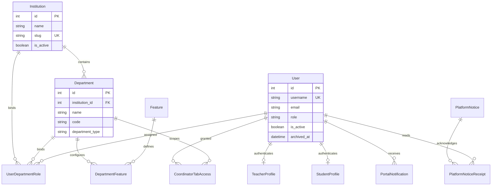
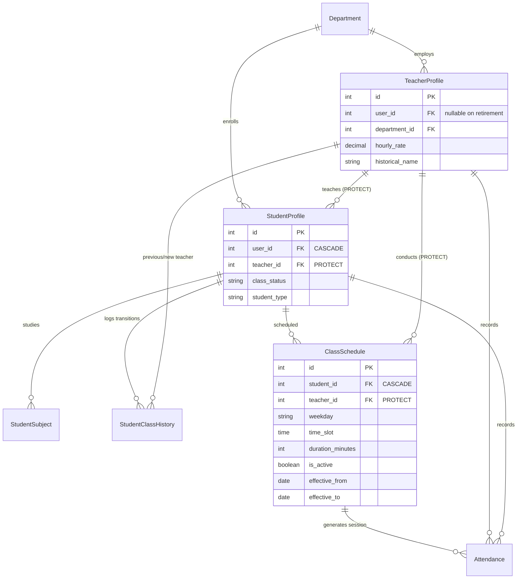
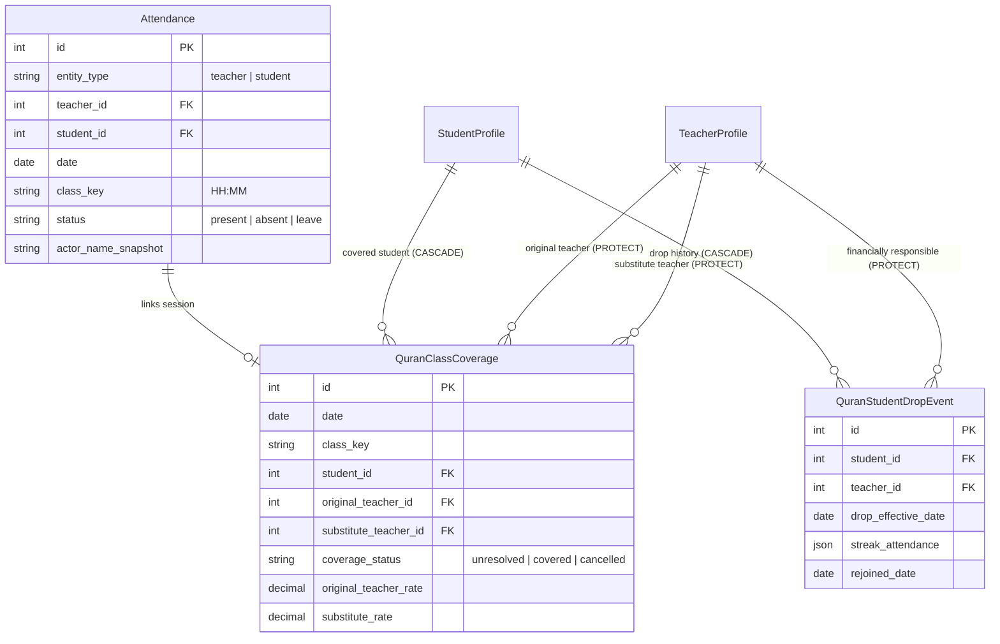
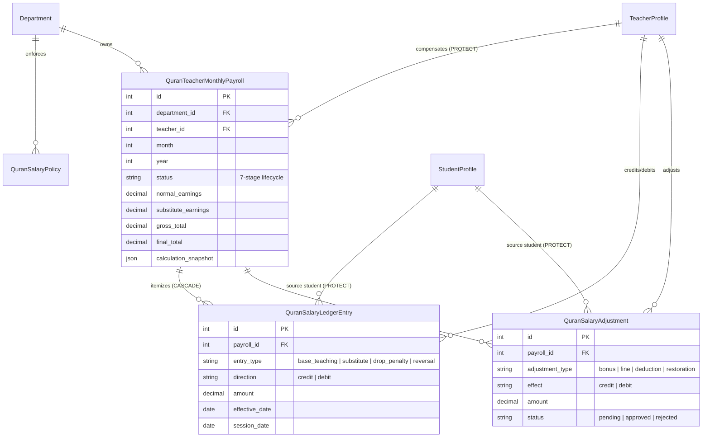
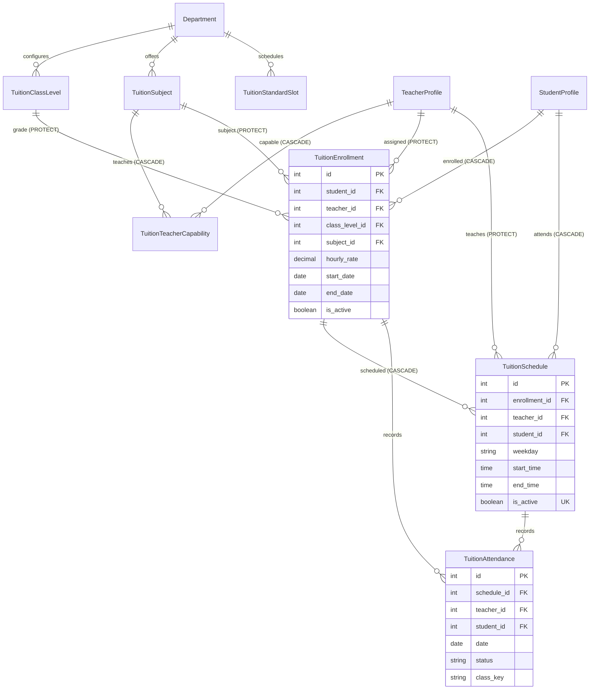
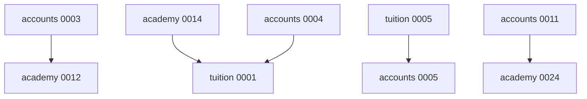

# IVS Qur'an Academy Manager — Database Architecture, Relational Schema & Migration Audit

> **Audit Framework**: Comprehensive Architectural Audit & Permanent Technical Reference  
> **Production Target**: [https://quranhometutor.com/](https://quranhometutor.com/)  
> **Repository Target**: `quran----1-Role-Based-` (Audited branch: `release/ivs-20261020-candidate`)  
> **Head Commit**: `de92b7606543936eafe52ed66792eedda6d4598e`  
> **Document ID**: `07_DATABASE_ARCHITECTURE`  
> **Author**: Antigravity Senior Database Architect & Engineering Audit Team  
> **Audit Status**: VERIFIED — FULL STATIC RECONCILIATION  
> **Last Updated**: 2026-11-03  

---

## 1. Executive Summary & Audit Scope

This document provides an exhaustive, evidence-based architectural audit of the relational database layer of the **IVS Qur'an Academy Manager**.

The audit was executed entirely via static source code and migration AST analysis without initiating Django runtime introspection (`django.setup()`), without connecting to live databases, and without executing migrations or tests.

### Key Architectural Baseline Metrics

| Architectural Metric | Audited Count | Methodology & Verification Source | Status |
| :--- | :---: | :--- | :--- |
| **Active Django Applications** | **3** | `backend/accounts`, `backend/academy`, `backend/tuition` | VERIFIED |
| **Total Concrete Models** | **45** | AST analysis of all `models.Model` subclasses across apps | VERIFIED |
| **Total Abstract Models** | **1** | `tuition.models.DepartmentScopedModel` (`abstract = True`) | VERIFIED |
| **Total Proxy Models** | **0** | No models declared with `proxy = True` | VERIFIED |
| **Total Model Classes** | **46** | 45 Concrete + 1 Abstract | VERIFIED |
| **Total Migration Files** | **44** | Excluding `__init__.py` files across all 3 app migration directories | VERIFIED |
| **Foreign / OneToOne / M2M Relations** | **157** | Direct AST inspection of relational field declarations | VERIFIED |
| **Database Constraints (Meta)** | **26** | `UniqueConstraint` (18), `CheckConstraint` (8) | VERIFIED |
| **Composite & Field Indexes (Meta)** | **36** | `Meta.indexes` declarations across all models | VERIFIED |

---

## 2. Discrepancy Investigations & Reconciliation

### 2.1 Migration Count Discrepancy (44 vs 47)

- **Phase 1 Finding**: Reported **44** migrations.
- **Phase 3 Finding**: Reported **47** migrations.
- **Root Cause Reconciliation**: The repository contains exactly **44 active Django migration specification files** and **3 package initializer files** (`__init__.py`). Phase 1 counted migration scripts strictly (`44`), while Phase 3 counted all `.py` files inside the `migrations/` directories (`44 + 3 = 47`).
- **Exact Per-App Migration Inventory**:
  - `backend/academy/migrations/`: **25** migration files (`0001_initial.py` to `0025_backfill_historical_actor_names.py`) + 1 `__init__.py` = 26 `.py` files.
  - `backend/accounts/migrations/`: **12** migration files (`0001_initial.py` to `0012_portal_notification.py`) + 1 `__init__.py` = 13 `.py` files.
  - `backend/tuition/migrations/`: **7** migration files (`0001_initial.py` to `0007_teacher_attendance_per_class.py`) + 1 `__init__.py` = 8 `.py` files.
  - **Reconciled Authoritative Total**: Exactly **44** operational migrations.

### 2.2 Model Count Discrepancy (28 vs 46)

- **Phase 3 Finding**: Informally estimated "28 models" in preliminary notes.
- **Root Cause Reconciliation**: Phase 3's estimate accounted only for primary domain models in `academy/models.py` (15) and `tuition/models.py` (10) plus core user models in `accounts/models.py` (7), omitting `academy/salary_v2_models.py` (6 models) and the platform administration / audit models added in migrations `0006`-`0012` of `accounts` (7 models).
- **Exact Per-App Model Inventory**:
  - `accounts/models.py`: **14 concrete models**
  - `academy/models.py`: **15 concrete models**
  - `academy/salary_v2_models.py`: **6 concrete models**
  - `tuition/models.py`: **10 concrete models** + **1 abstract model** (`DepartmentScopedModel`)
  - **Reconciled Authoritative Total**: Exactly **45 concrete models** + **1 abstract model** = **46 total model classes**.

---

## 3. Complete Model Catalog & Database Tables

### 3.1 Application: `accounts` (`backend/accounts/models.py`)

| Model | Database Table | Primary Key | Key Fields | Relationships | Constraints & Indexes | Evidence File |
| :--- | :--- | :--- | :--- | :--- | :--- | :--- |
| **`Institution`** | `accounts_institution` | `id` (AutoField) | `name`, `slug`, `is_active` | 1:N to `Department` | `slug` unique (`unique=True`) | [`accounts/models.py#L5`](file:///c:/Users/iqrav/Downloads/quran%20---1%20(Role%20Based)/backend/accounts/models.py#L5) |
| **`Department`** | `accounts_department` | `id` (AutoField) | `name`, `code`, `department_type`, `is_active` | FK to `Institution` (`CASCADE`) | `UniqueConstraint(institution, code)` | [`accounts/models.py#L24`](file:///c:/Users/iqrav/Downloads/quran%20---1%20(Role%20Based)/backend/accounts/models.py#L24) |
| **`Feature`** | `accounts_feature` | `id` (AutoField) | `key`, `name`, `category`, `description` | 1:N to `DepartmentFeature` | `key` unique (`unique=True`) | [`accounts/models.py#L62`](file:///c:/Users/iqrav/Downloads/quran%20---1%20(Role%20Based)/backend/accounts/models.py#L62) |
| **`DepartmentFeature`** | `accounts_departmentfeature` | `id` (AutoField) | `is_enabled`, `config` (JSON) | FK to `Department` (`CASCADE`), FK to `Feature` (`CASCADE`) | `UniqueConstraint(department, feature)` | [`accounts/models.py#L83`](file:///c:/Users/iqrav/Downloads/quran%20---1%20(Role%20Based)/backend/accounts/models.py#L83) |
| **`User`** | `accounts_user` | `id` (AutoField) | `username`, `email`, `role`, `phone`, `archived_at`, `is_active` | AbstractUser base; O2O to `TeacherProfile`, `StudentProfile` | `username` unique, `email` indexed | [`accounts/models.py#L110`](file:///c:/Users/iqrav/Downloads/quran%20---1%20(Role%20Based)/backend/accounts/models.py#L110) |
| **`UserDepartmentRole`** | `accounts_userdepartmentrole` | `id` (AutoField) | `role`, `is_primary` | FK to `User` (`CASCADE`), FK to `Institution` (`CASCADE`), FK to `Department` (`CASCADE`) | `UniqueConstraint(user, institution, department, role)` | [`accounts/models.py#L169`](file:///c:/Users/iqrav/Downloads/quran%20---1%20(Role%20Based)/backend/accounts/models.py#L169) |
| **`CoordinatorTabAccess`** | `accounts_coordinatortabaccess` | `id` (AutoField) | `tab_key`, `is_allowed` | FK to `User` (`CASCADE`), FK to `Department` (`CASCADE`) | `UniqueConstraint(coordinator, department, tab_key)` | [`accounts/models.py#L211`](file:///c:/Users/iqrav/Downloads/quran%20---1%20(Role%20Based)/backend/accounts/models.py#L211) |
| **`PlatformSetting`** | `accounts_platformsetting` | `id` (AutoField) | `key`, `value` (JSON), `is_encrypted` | None | `key` unique (`unique=True`) | [`accounts/models.py#L256`](file:///c:/Users/iqrav/Downloads/quran%20---1%20(Role%20Based)/backend/accounts/models.py#L256) |
| **`PlatformAuditLog`** | `accounts_platformauditlog` | `id` (AutoField) | `category`, `action`, `target_type`, `summary`, `created_at` | FK to `User` (`SET_NULL`, `actor`) | Indexes on `(category, created_at)`, `(action, created_at)` | [`accounts/models.py#L284`](file:///c:/Users/iqrav/Downloads/quran%20---1%20(Role%20Based)/backend/accounts/models.py#L284) |
| **`PlatformBackup`** | `accounts_platformbackup` | `id` (AutoField) | `filename`, `backup_type`, `file_size`, `status` | FK to `User` (`SET_NULL`, `created_by`) | `filename` unique (`unique=True`) | [`accounts/models.py#L313`](file:///c:/Users/iqrav/Downloads/quran%20---1%20(Role%20Based)/backend/accounts/models.py#L313) |
| **`PlatformMaintenanceWindow`** | `accounts_platformmaintenancewindow` | `id` (AutoField) | `scope_type`, `title`, `starts_at`, `ends_at`, `is_active` | FK to `Institution` (`CASCADE`), FK to `Department` (`CASCADE`) | Indexes on scope, institution, department | [`accounts/models.py#L357`](file:///c:/Users/iqrav/Downloads/quran%20---1%20(Role%20Based)/backend/accounts/models.py#L357) |
| **`PlatformNotice`** | `accounts_platformnotice` | `id` (AutoField) | `title`, `message`, `audience`, `starts_at`, `ends_at`, `is_active` | FK to `Institution` (`CASCADE`), FK to `Department` (`CASCADE`) | Indexes on scope, audience, date window | [`accounts/models.py#L420`](file:///c:/Users/iqrav/Downloads/quran%20---1%20(Role%20Based)/backend/accounts/models.py#L420) |
| **`PlatformNoticeReceipt`** | `accounts_platformnoticereceipt` | `id` (AutoField) | `read_at`, `dismissed_at` | FK to `PlatformNotice` (`CASCADE`), FK to `User` (`CASCADE`) | `UniqueConstraint(notice, user)` | [`accounts/models.py#L516`](file:///c:/Users/iqrav/Downloads/quran%20---1%20(Role%20Based)/backend/accounts/models.py#L516) |
| **`PortalNotification`** | `accounts_portalnotification` | `id` (AutoField) | `event_key`, `title`, `body`, `read_at`, `created_at` | FK to `User` (`CASCADE`, `recipient`) | `UniqueConstraint(recipient, event_key)`, index on unread | [`accounts/models.py#L545`](file:///c:/Users/iqrav/Downloads/quran%20---1%20(Role%20Based)/backend/accounts/models.py#L545) |

---

### 3.2 Application: `academy` (`backend/academy/models.py`)

| Model | Database Table | Primary Key | Key Fields | Relationships | Constraints & Indexes | Evidence File |
| :--- | :--- | :--- | :--- | :--- | :--- | :--- |
| **`TeacherProfile`** | `academy_teacherprofile` | `id` (AutoField) | `hourly_rate`, `color_code`, `historical_name`, `login_deleted_at` | O2O to `User` (`SET_NULL`, nullable), FK to `Institution` (`SET_NULL`), FK to `Department` (`SET_NULL`) | Indexed on department, institution | [`academy/models.py#L18`](file:///c:/Users/iqrav/Downloads/quran%20---1%20(Role%20Based)/backend/academy/models.py#L18) |
| **`StudentProfile`** | `academy_studentprofile` | `id` (AutoField) | `guardian_name`, `student_type`, `class_status`, `status_effective_date`, `shift` | O2O to `User` (`CASCADE`), FK to `TeacherProfile` (`PROTECT`), FK to `Institution` (`SET_NULL`), FK to `Department` (`SET_NULL`), FK self (`SET_NULL`, referral) | Indexes on `class_status`, `student_type` | [`academy/models.py#L73`](file:///c:/Users/iqrav/Downloads/quran%20---1%20(Role%20Based)/backend/academy/models.py#L73) |
| **`StudentSubject`** | `academy_studentsubject` | `id` (AutoField) | `subject`, `custom_subject_name`, `is_active` | FK to `StudentProfile` (`CASCADE`) | `UniqueConstraint(student, subject, custom_subject_name)` | [`academy/models.py#L198`](file:///c:/Users/iqrav/Downloads/quran%20---1%20(Role%20Based)/backend/academy/models.py#L198) |
| **`StudentClassHistory`** | `academy_studentclasshistory` | `id` (AutoField) | `event_type`, `effective_date`, `notes` | FK to `StudentProfile` (`CASCADE`), FK to `TeacherProfile` (`SET_NULL`, previous/new) | Indexes on `(student, effective_date)`, `(event_type, effective_date)` | [`academy/models.py#L254`](file:///c:/Users/iqrav/Downloads/quran%20---1%20(Role%20Based)/backend/academy/models.py#L254) |
| **`SalaryConfiguration`** | `academy_salaryconfiguration` | `id` (AutoField) | `monthly_classes_threshold`, `student_rate_1_to_15`, `student_rate_16_to_19`, `student_rate_20_plus` | FK to `Department` (`CASCADE`) | Salary V1 global rule config | [`academy/models.py#L366`](file:///c:/Users/iqrav/Downloads/quran%20---1%20(Role%20Based)/backend/academy/models.py#L366) |
| **`TeacherSalarySlip`** | `academy_teachersalaryslip` | `id` (AutoField) | `month`, `year`, `final_total`, `status`, `calculation_data` (JSON) | FK to `TeacherProfile` (`CASCADE`), FK to `Department` (`CASCADE`) | `UniqueConstraint(department, teacher, year, month)` | [`academy/models.py#L392`](file:///c:/Users/iqrav/Downloads/quran%20---1%20(Role%20Based)/backend/academy/models.py#L392) |
| **`ClassSchedule`** | `academy_classschedule` | `id` (AutoField) | `weekday`, `time_slot`, `duration_minutes`, `is_active`, `effective_from`, `effective_to` | FK to `StudentProfile` (`CASCADE`), FK to `TeacherProfile` (`PROTECT`), FK to `Department` (`SET_NULL`) | `CheckConstraint(effective_to >= effective_from)` | [`academy/models.py#L467`](file:///c:/Users/iqrav/Downloads/quran%20---1%20(Role%20Based)/backend/academy/models.py#L467) |
| **`Attendance`** | `academy_attendance` | `id` (AutoField) | `entity_type`, `date`, `class_key`, `status`, `actor_name_snapshot` | FK to `TeacherProfile` (`CASCADE`), FK to `StudentProfile` (`CASCADE`), FK to `User` (`SET_NULL`, marked_by) | Conditional Unique: `(teacher, date, class_key)` where entity='teacher'; `(student, date)` where entity='student' | [`academy/models.py#L582`](file:///c:/Users/iqrav/Downloads/quran%20---1%20(Role%20Based)/backend/academy/models.py#L582) |
| **`Lesson`** | `academy_lesson` | `id` (AutoField) | `lesson_date`, `surah_name`, `verse_start`, `verse_end`, `status`, `actor_name_snapshot` | FK to `StudentProfile` (`CASCADE`), FK to `TeacherProfile` (`PROTECT`), FK to `User` (`SET_NULL`, created_by) | Indexed on `(student, lesson_date)` | [`academy/models.py#L676`](file:///c:/Users/iqrav/Downloads/quran%20---1%20(Role%20Based)/backend/academy/models.py#L676) |
| **`DailyLessonReport`** | `academy_dailylessonreport` | `id` (AutoField) | `date`, `total_duration_minutes`, `notes`, `actor_name_snapshot` | FK to `StudentProfile` (`CASCADE`), FK to `TeacherProfile` (`PROTECT`), FK to `User` (`SET_NULL`, created_by) | `UniqueConstraint(student, date)` | [`academy/models.py#L757`](file:///c:/Users/iqrav/Downloads/quran%20---1%20(Role%20Based)/backend/academy/models.py#L757) |
| **`DailyLessonSubjectEntry`** | `academy_dailylessonsubjectentry` | `id` (AutoField) | `subject`, `unit_type`, `unit_value`, `start_page`, `end_page` | FK to `DailyLessonReport` (`CASCADE`), FK to `StudentSubject` (`SET_NULL`) | Composite index on report & subject | [`academy/models.py#L834`](file:///c:/Users/iqrav/Downloads/quran%20---1%20(Role%20Based)/backend/academy/models.py#L834) |
| **`LessonAccessPermission`** | `academy_lessonaccesspermission` | `id` (AutoField) | `permission_type`, `is_active`, `granted_at`, `expires_at` | FK to `TeacherProfile` (`CASCADE`), FK to `StudentProfile` (`CASCADE`), FK to `User` (`SET_NULL`, granted_by) | `UniqueConstraint(teacher, student, permission_type)` | [`academy/models.py#L897`](file:///c:/Users/iqrav/Downloads/quran%20---1%20(Role%20Based)/backend/academy/models.py#L897) |
| **`LessonAccessRequest`** | `academy_lessonaccessrequest` | `id` (AutoField) | `requested_permission`, `status`, `request_reason`, `response_reason` | FK to `TeacherProfile` (`CASCADE`), FK to `StudentProfile` (`CASCADE`), FK to `User` (`SET_NULL`, responded_by) | Indexed on `(teacher, status)` | [`academy/models.py#L981`](file:///c:/Users/iqrav/Downloads/quran%20---1%20(Role%20Based)/backend/academy/models.py#L981) |
| **`MonthlyLessonSummary`** | `academy_monthlylessonsummary` | `id` (AutoField) | `month`, `year`, `total_lessons`, `completion_percentage`, `actor_name_snapshot` | FK to `StudentProfile` (`CASCADE`), FK to `TeacherProfile` (`PROTECT`), FK to `StudentSubject` (`SET_NULL`) | `UniqueConstraint(department, student, subject, year, month)` | [`academy/models.py#L1085`](file:///c:/Users/iqrav/Downloads/quran%20---1%20(Role%20Based)/backend/academy/models.py#L1085) |
| **`MonthlyLessonPlan`** | `academy_monthlylessonplan` | `id` (AutoField) | `month`, `year`, `target_surah`, `plan_details` (JSON), `actor_name_snapshot` | FK to `StudentProfile` (`CASCADE`), FK to `TeacherProfile` (`PROTECT`) | `UniqueConstraint(student, year, month)` | [`academy/models.py#L1189`](file:///c:/Users/iqrav/Downloads/quran%20---1%20(Role%20Based)/backend/academy/models.py#L1189) |

---

### 3.3 Application: `academy` Salary V2 (`backend/academy/salary_v2_models.py`)

| Model | Database Table | Primary Key | Key Fields | Relationships | Constraints & Indexes | Evidence File |
| :--- | :--- | :--- | :--- | :--- | :--- | :--- |
| **`QuranSalaryPolicy`** | `academy_quransalarypolicy` | `id` (AutoField) | `effective_from`, `rate_1_to_15`, `rate_16_to_19`, `rate_20_plus`, `monthly_salary_day_cap`, `is_active` | FK to `Department` (`CASCADE`) | `UniqueConstraint(department, effective_from)`, indexes on active date | [`academy/salary_v2_models.py#L7`](file:///c:/Users/iqrav/Downloads/quran%20---1%20(Role%20Based)/backend/academy/salary_v2_models.py#L7) |
| **`QuranTeacherMonthlyPayroll`** | `academy_quranteachermonthlypayroll` | `id` (AutoField) | `month`, `year`, `status`, `normal_earnings`, `substitute_earnings`, `gross_total`, `final_total`, `calculation_snapshot` (JSON) | FK to `Department` (`CASCADE`), FK to `TeacherProfile` (`PROTECT`), FK to `User` (`SET_NULL`, submitted/approved/paid/reopened) | `UniqueConstraint(department, teacher, year, month)`, indexes on `(department, year, month)` | [`academy/salary_v2_models.py#L98`](file:///c:/Users/iqrav/Downloads/quran%20---1%20(Role%20Based)/backend/academy/salary_v2_models.py#L98) |
| **`QuranSalaryLedgerEntry`** | `academy_quransalaryledgerentry` | `id` (AutoField) | `entry_type`, `direction`, `amount`, `effective_date`, `session_date`, `source_reference` | FK to `QuranTeacherMonthlyPayroll` (`CASCADE`), FK to `Department` (`CASCADE`), FK to `TeacherProfile` (`PROTECT`), FK to `StudentProfile` (`PROTECT`, nullable) | Indexes on `(payroll, entry_type)`, `(teacher, effective_date)` | [`academy/salary_v2_models.py#L293`](file:///c:/Users/iqrav/Downloads/quran%20---1%20(Role%20Based)/backend/academy/salary_v2_models.py#L293) |
| **`QuranSalaryAdjustment`** | `academy_quransalaryadjustment` | `id` (AutoField) | `adjustment_type`, `effect`, `amount`, `reason`, `source_month`, `source_year`, `status` | FK to `QuranTeacherMonthlyPayroll` (`CASCADE`), FK to `Department` (`CASCADE`), FK to `TeacherProfile` (`PROTECT`), FK to `StudentProfile` (`PROTECT`, nullable) | Indexes on `(payroll, status)`, `(teacher, status)` | [`academy/salary_v2_models.py#L419`](file:///c:/Users/iqrav/Downloads/quran%20---1%20(Role%20Based)/backend/academy/salary_v2_models.py#L419) |
| **`QuranClassCoverage`** | `academy_quranclasscoverage` | `id` (AutoField) | `date`, `class_key`, `teacher_status`, `student_status`, `coverage_status`, `original_teacher_rate`, `substitute_rate` | FK to `Department` (`CASCADE`), FK to `StudentProfile` (`CASCADE`), FK to `TeacherProfile` (`PROTECT`, original & substitute), FK to `Attendance` (`SET_NULL`) | `UniqueConstraint(date, student, original_teacher)`, indexes on session and status | [`academy/salary_v2_models.py#L608`](file:///c:/Users/iqrav/Downloads/quran%20---1%20(Role%20Based)/backend/academy/salary_v2_models.py#L608) |
| **`QuranStudentDropEvent`** | `academy_quranstudentdropevent` | `id` (AutoField) | `status`, `drop_effective_date`, `streak_start_date`, `streak_end_date`, `streak_attendance` (JSON), `rejoined_date` | FK to `Department` (`CASCADE`), FK to `StudentProfile` (`CASCADE`), FK to `TeacherProfile` (`PROTECT`) | Indexes on `(student, drop_date)`, `(teacher, drop_date)` | [`academy/salary_v2_models.py#L766`](file:///c:/Users/iqrav/Downloads/quran%20---1%20(Role%20Based)/backend/academy/salary_v2_models.py#L766) |

---

### 3.4 Application: `tuition` (`backend/tuition/models.py`)

| Model | Database Table | Primary Key | Key Fields | Relationships | Constraints & Indexes | Evidence File |
| :--- | :--- | :--- | :--- | :--- | :--- | :--- |
| **`DepartmentScopedModel`** *(Abstract)* | N/A | None | `created_at`, `updated_at` | FK to `Institution` (`CASCADE`), FK to `Department` (`CASCADE`) | Abstract base model for all concrete tuition entities | [`tuition/models.py#L28`](file:///c:/Users/iqrav/Downloads/quran%20---1%20(Role%20Based)/backend/tuition/models.py#L28) |
| **`TuitionDepartmentConfig`** | `tuition_tuitiondepartmentconfig` | `id` (AutoField) | `default_session_duration_minutes`, `allow_student_self_reschedule` | Inherits DepartmentScopedModel; O2O to `Department` (`CASCADE`) | Unique per department | [`tuition/models.py#L53`](file:///c:/Users/iqrav/Downloads/quran%20---1%20(Role%20Based)/backend/tuition/models.py#L53) |
| **`TuitionClassLevel`** | `tuition_tuitionclasslevel` | `id` (AutoField) | `name`, `code`, `board`, `order`, `is_active` | Inherits DepartmentScopedModel | `UniqueConstraint(department, code)` | [`tuition/models.py#L137`](file:///c:/Users/iqrav/Downloads/quran%20---1%20(Role%20Based)/backend/tuition/models.py#L137) |
| **`TuitionSubject`** | `tuition_tuitionsubject` | `id` (AutoField) | `name`, `code`, `is_standard`, `is_active` | Inherits DepartmentScopedModel | `UniqueConstraint(department, code)` | [`tuition/models.py#L187`](file:///c:/Users/iqrav/Downloads/quran%20---1%20(Role%20Based)/backend/tuition/models.py#L187) |
| **`TuitionStandardSlot`** | `tuition_tuitionstandardslot` | `id` (AutoField) | `label`, `region`, `start_time`, `end_time`, `is_active` | Inherits DepartmentScopedModel | `UniqueConstraint(department, region, label)`, `CheckConstraint(end_time > start_time)` | [`tuition/models.py#L229`](file:///c:/Users/iqrav/Downloads/quran%20---1%20(Role%20Based)/backend/tuition/models.py#L229) |
| **`TuitionTeacherCapability`** | `tuition_tuitionteachercapability` | `id` (AutoField) | `is_active`, `available_schedule_slots` (JSON) | Inherits DepartmentScopedModel; FK to `TeacherProfile` (`CASCADE`), FK to `TuitionSubject` (`CASCADE`) | `UniqueConstraint(department, teacher, subject)` | [`tuition/models.py#L313`](file:///c:/Users/iqrav/Downloads/quran%20---1%20(Role%20Based)/backend/tuition/models.py#L313) |
| **`TuitionEnrollment`** | `tuition_tuitionenrollment` | `id` (AutoField) | `student_id_code`, `program_type`, `hourly_rate`, `start_date`, `end_date`, `is_active` | Inherits DepartmentScopedModel; FK to `StudentProfile` (`CASCADE`), FK to `TeacherProfile` (`PROTECT`), FK to `TuitionClassLevel` (`PROTECT`), FK to `TuitionSubject` (`PROTECT`) | Conditional Unique: `(student, subject)` active; `CheckConstraint(end_date >= start_date)` | [`tuition/models.py#L386`](file:///c:/Users/iqrav/Downloads/quran%20---1%20(Role%20Based)/backend/tuition/models.py#L386) |
| **`TuitionTeacherAvailability`** | `tuition_tuitionteacheravailability` | `id` (AutoField) | `weekday`, `start_time`, `end_time`, `is_active` | Inherits DepartmentScopedModel; FK to `TeacherProfile` (`CASCADE`) | `UniqueConstraint(teacher, weekday, start_time, end_time)`, `CheckConstraint(end_time > start_time)` | [`tuition/models.py#L659`](file:///c:/Users/iqrav/Downloads/quran%20---1%20(Role%20Based)/backend/tuition/models.py#L659) |
| **`TuitionSchedule`** | `tuition_tuitionschedule` | `id` (AutoField) | `weekday`, `start_time`, `end_time`, `meeting_link`, `is_active` | Inherits DepartmentScopedModel; FK to `TuitionEnrollment` (`CASCADE`), FK to `TeacherProfile` (`PROTECT`), FK to `StudentProfile` (`CASCADE`) | Conditional Unique on active `(teacher, weekday, start_time)` and `(student, weekday, start_time)` | [`tuition/models.py#L881`](file:///c:/Users/iqrav/Downloads/quran%20---1%20(Role%20Based)/backend/tuition/models.py#L881) |
| **`TuitionAttendance`** | `tuition_tuitionattendance` | `id` (AutoField) | `entity_type`, `date`, `status`, `class_key` | Inherits DepartmentScopedModel; FK to `TuitionSchedule` (`CASCADE`), FK to `TuitionEnrollment` (`CASCADE`), FK to `TeacherProfile` (`CASCADE`), FK to `StudentProfile` (`CASCADE`) | `UniqueConstraint(department, entity_type, teacher, date, class_key)` | [`tuition/models.py#L1181`](file:///c:/Users/iqrav/Downloads/quran%20---1%20(Role%20Based)/backend/tuition/models.py#L1181) |
| **`TuitionAuditLog`** | `tuition_tuitionauditlog` | `id` (AutoField) | `action`, `resource_type`, `resource_id`, `changes` (JSON), `created_at` | FK to `Institution` (`CASCADE`), FK to `Department` (`CASCADE`), FK to `User` (`SET_NULL`, actor) | Indexes on `(department, created_at)`, `(actor, created_at)` | [`tuition/models.py#L1271`](file:///c:/Users/iqrav/Downloads/quran%20---1%20(Role%20Based)/backend/tuition/models.py#L1271) |

---

## 4. Entity Relationship Diagrams (Mermaid)

### 4.1 Core User Accounts & Multi-Tenant Boundaries



---

### 4.2 Quran Teachers, Students & Class Scheduling



---

### 4.3 Attendance V2 & Substitute Coverage Engine



---

### 4.4 Salary V2 & Payroll Double-Entry Ledger



---

### 4.5 Tuition Domain Architecture



---

## 5. Foreign Key Deletion & Cascade Audit

Our static AST inspection classified all **157 relational fields** across the codebase:
- `models.CASCADE`: **59 relationships** (37.6%)
- `models.SET_NULL`: **80 relationships** (51.0%)
- `models.PROTECT`: **18 relationships** (11.4%)
- `models.RESTRICT` / `models.DO_NOTHING`: **0 relationships**

### Cascade Risk Analysis Matrix

| Parent Model | Child Model | Relationship | on_delete | Data at Risk | Existing Safeguards & Risk Level |
| :--- | :--- | :--- | :---: | :--- | :--- |
| **`accounts.User`** | `academy.StudentProfile` | `user` (O2O) | **`CASCADE`** | Entire student profile, subjects, history, lessons, reports, and attendance records | **CRITICAL RISK (DB-002)**: Direct deletion of `User` deletes `StudentProfile` and cascades through all academic data unless blocked by Salary V2 `PROTECT`. |
| **`accounts.User`** | `academy.TeacherProfile` | `user` (O2O) | `SET_NULL` | None (TeacherProfile row is retained) | **VERIFIED SAFE**: `user` is nullable; `delete_teacher_login_permanently` sets `user = None` and snapshots `historical_name`. |
| **`academy.TeacherProfile`** | `academy.Attendance` | `teacher` (FK) | **`CASCADE`** | Teacher attendance records | **HIGH RISK**: Blocked indirectly by Salary V2 `PROTECT` on payroll/ledger, but if payroll doesn't exist, deleting TeacherProfile cascades to delete attendance. |
| **`academy.TeacherProfile`** | `academy.TeacherSalarySlip` | `teacher` (FK) | **`CASCADE`** | Salary V1 historical slips | **HIGH RISK**: Direct deletion of TeacherProfile obliterates Salary V1 history. |
| **`academy.TeacherProfile`** | `tuition.TuitionAttendance` | `teacher` (FK) | **`CASCADE`** | Tuition teacher attendance records | **HIGH RISK**: Tuition attendance records are erased if TeacherProfile is deleted. |
| **`academy.TeacherProfile`** | `academy.StudentProfile` | `teacher` (FK) | `PROTECT` | Prevents teacher deletion while students assigned | **VERIFIED SAFE**: Database blocks deletion with `ProtectedError`. |
| **`academy.TeacherProfile`** | `academy.ClassSchedule` | `teacher` (FK) | `PROTECT` | Prevents teacher deletion while schedules exist | **VERIFIED SAFE**: Database blocks deletion with `ProtectedError`. |
| **`academy.TeacherProfile`** | `academy.QuranTeacherMonthlyPayroll` | `teacher` (FK) | `PROTECT` | Prevents teacher deletion while payroll exists | **VERIFIED SAFE**: Database blocks deletion with `ProtectedError`. |
| **`academy.TeacherProfile`** | `academy.QuranSalaryLedgerEntry` | `teacher` (FK) | `PROTECT` | Prevents teacher deletion while ledger rows exist | **VERIFIED SAFE**: Database blocks deletion with `ProtectedError`. |
| **`academy.TeacherProfile`** | `academy.QuranClassCoverage` | `original_teacher` / `substitute` | `PROTECT` | Preserves coverage records | **VERIFIED SAFE**: Database blocks deletion with `ProtectedError`. |
| **`academy.StudentProfile`** | `academy.Attendance` | `student` (FK) | **`CASCADE`** | Complete student attendance history | **CRITICAL RISK**: Deleting StudentProfile erases all attendance rows unless protected by Salary V2 ledger. |
| **`academy.StudentProfile`** | `academy.ClassSchedule` | `student` (FK) | **`CASCADE`** | Complete student class schedule history | **CRITICAL RISK**: Historical schedules are permanently deleted. |
| **`academy.StudentProfile`** | `academy.Lesson` | `student` (FK) | **`CASCADE`** | Complete student lesson logs | **CRITICAL RISK**: Academic Quran recitation logs are erased. |
| **`academy.StudentProfile`** | `academy.DailyLessonReport` | `student` (FK) | **`CASCADE`** | Daily syllabus progress reports | **CRITICAL RISK**: Daily reports and subject entries erased. |
| **`academy.StudentProfile`** | `academy.QuranSalaryLedgerEntry` | `student` (FK) | `PROTECT` | Preserves payroll ledger attribution | **VERIFIED SAFE**: Blocks StudentProfile deletion if payroll ledger references student. |
| **`accounts.Department`** | `academy.QuranTeacherMonthlyPayroll` | `department` (FK) | **`CASCADE`** | All Salary V2 monthly payrolls for department | **CRITICAL RISK**: Deleting a Department cascades to delete ALL payroll records, policies, and ledger entries. |
| **`accounts.Institution`** | `accounts.Department` | `institution` (FK) | **`CASCADE`** | All departments, and transitively all payrolls | **CRITICAL RISK**: Deleting an Institution erases the entire tenant database. |

---

## 6. Migration History & Schema Evolution

### 6.1 Complete Migration Inventory (44 Files)

```text
academy (25 migrations):
  0001_initial.py                                                -> Initial core academy models
  0002_lesson_lesson_data_lesson_progress_status_and_more.py    -> Lesson field extensions
  0003_studentsubject.py                                         -> Multi-subject support
  0004_monthlylessonplan.py                                      -> Monthly lesson planning
  0005_remove_monthlylessonplan_week_1_plan_and_more.py          -> Lesson plan schema refactor
  0006_dailylessonreport_dailylessonsubjectentry_and_more.py     -> Daily lesson report & entries
  0007_lessonaccesspermission_lessonwritepermission.py           -> Granular lesson permissions
  0008_alter_lessonaccesspermission_options_and_more.py          -> Permission constraints
  0009_lessonaccessrequest_and_more.py                           -> Access request workflows
  0010_add_duration_minutes_to_schedule.py                       -> 30/60m schedule duration
  0011_remove_attendance_unique_teacher_attendance_per_day...    -> Class-key attendance migration
  0012_attendance_department_attendance_institution_and_more.py  -> Multi-tenant department scoping
  0013_assign_existing_records_to_quran_department.py            -> [DATA] Backfill records to Quran dept
  0014_remove_monthlylessonsummary_unique_monthly_summary...     -> Scoped monthly summary constraints
  0015_quran_student_status_salary.py                            -> [DATA] StudentClassHistory seed
  0016_quran_salary_audit_deductions.py                          -> [DATA] Salary V1 audit deductions
  0017_teacher_salary_pdf_tracking.py                            -> Salary slip PDF tracking
  0018_student_referral_and_salary_running_logic.py              -> [DATA] Referral teacher tracking
  0019_quranteachermonthlypayroll_quransalaryledgerentry...       -> Salary V2 initial double-entry schema
  0020_quransalaryadjustment_effect.py                           -> Adjustment CREDIT/DEBIT effects
  0021_class_schedule_history.py                                 -> Schedule effective date range
  0022_coverage_session_audit.py                                 -> Class coverage session audit
  0023_fix_attendance_conditional_uniques.py                     -> Conditional unique attendance indexes
  0024_teacher_login_history_detach.py                           -> Teacher profile historical name detach
  0025_backfill_historical_actor_names.py                        -> [DATA] Backfill actor snapshot names

accounts (12 migrations):
  0001_initial.py                                                -> Custom User model
  0002_department_feature_institution_alter_user_role...         -> Multi-institution foundation
  0003_seed_default_institution_department_features.py           -> [DATA] Seed default IVS institution
  0004_seed_tab_action_permissions.py                            -> [DATA] Seed tab permissions
  0005_feature_department_scope.py                               -> [DATA] Department feature scoping
  0006_platform_admin_tools.py                                   -> Platform setting, audit log, backup
  0007_maintenance_notices.py                                    -> Maintenance windows and notices
  0008_quran_management_features.py                              -> [DATA] Seed Quran management features
  0009_coordinator_tab_access.py                                 -> CoordinatorTabAccess model
  0010_repair_department_feature_settings.py                     -> [DATA] Fix department feature configs
  0011_safe_account_archive.py                                   -> Account archival fields on User
  0012_portal_notification.py                                    -> Real-time portal notification model

tuition (7 migrations):
  0001_initial.py                                                -> Tuition initial domain models
  0002_seed_tuition_foundation.py                                -> [DATA] Seed tuition subjects & levels
  0003_consolidate_tuition_departments.py                        -> [DATA] Consolidate tuition depts
  0004_tuitionenrollment_duration_minutes_and_more.py            -> Enrollment duration & status
  0005_tuitionteachercapability_available_schedule_slots.py      -> Teacher capability slots
  0006_tuitionattendance.py                                      -> Tuition attendance tracking
  0007_teacher_attendance_per_class.py                           -> [DATA] Teacher class-key deduplication
```

### 6.2 Cross-Application Migration Coupling

A critical finding from our dependency analysis is that migrations across the three applications form a tightly coupled triangular graph:
1. `accounts/0005_feature_department_scope.py` depends on `tuition/0005_tuitionteachercapability_available_schedule_slots`.
2. `tuition/0001_initial.py` depends on both `academy/0014_...` and `accounts/0004_...`.
3. `academy/0012_...` depends on `accounts/0003_...`.
4. `academy/0024_...` depends on `accounts/0011_safe_account_archive`.



> [!WARNING]
> While this dependency structure is currently acyclic and resolves in topological order, inter-app migration coupling creates severe fragility. Any future migration in `accounts` that references `tuition` while `tuition` references `accounts` will introduce an unresolvable circular migration deadlock.

---

## 7. Data Integrity Risks & Missing Database Constraints

### Finding `DB-001` (P1 - High): Missing Database-Level Overlap / Unique Constraint on Quran `ClassSchedule`
- **Affected Model**: `academy.models.ClassSchedule` ([`academy/models.py#L467`](file:///c:/Users/iqrav/Downloads/quran%20---1%20(Role%20Based)/backend/academy/models.py#L467))
- **Observed Schema**: `ClassSchedule` only defines a `CheckConstraint(effective_to >= effective_from)`. There is **no database-level unique constraint** on `(teacher, weekday, time_slot)` or `(student, weekday, time_slot)`.
- **Expected Invariant**: A teacher or student cannot be double-booked at the same weekday and time slot.
- **Vulnerability**: Invariant is enforced purely at application level in `teacher_retirement_service.py` (`slots_overlap`) and serializers. Concurrent API requests or direct ORM updates can create double-booked schedules without database rejection.
- **Contrast**: `tuition.models.TuitionSchedule` has explicit `UniqueConstraint(fields=['teacher', 'weekday', 'start_time'], condition=Q(is_active=True))` and `(student, weekday, start_time)`.
- **Repair Direction**: Add partial `UniqueConstraint` on `(teacher, weekday, time_slot)` where `is_active=True` and `effective_to__isnull=True`.

### Finding `DB-002` (P1 - High): Student Academic History Vulnerable to Cascade Deletion on User Deletion
- **Affected Model**: `academy.models.StudentProfile` ([`academy/models.py#L73`](file:///c:/Users/iqrav/Downloads/quran%20---1%20(Role%20Based)/backend/academy/models.py#L73))
- **Observed Schema**: `StudentProfile.user` is defined with `on_delete=models.CASCADE`. In turn, `StudentSubject`, `StudentClassHistory`, `ClassSchedule`, `Attendance`, `Lesson`, `DailyLessonReport`, `MonthlyLessonPlan`, and `MonthlyLessonSummary` all cascade on `StudentProfile`.
- **Expected Invariant**: Academic lesson history, Quran recitation logs, and attendance must survive student account archival or login deletion.
- **Vulnerability**: While `TeacherProfile.user` has `null=True, on_delete=models.SET_NULL` and a safe deletion guard (`delete_teacher_login_permanently`), `StudentProfile` has no equivalent detachment mechanism. If a student's `User` record is deleted (e.g., via Django admin or unhandled cascade), their entire academic history is permanently destroyed unless protected by Salary V2 ledger `PROTECT`.
- **Repair Direction**: Refactor `StudentProfile.user` to `null=True, on_delete=models.SET_NULL`, snapshot student historical names, and implement a `delete_student_login_permanently` service with `Collector` safety checks.

### Finding `DB-003` (P1 - High): Absence of Structural Multi-Tenant / Cross-Department Constraints
- **Affected Models**: `academy.models.StudentProfile`, `academy.models.ClassSchedule`, `tuition.models.TuitionEnrollment`
- **Observed Schema**: `teacher` and `student` foreign keys are single-column integer IDs referencing `id`.
- **Expected Invariant**: A student in Department X cannot be taught or scheduled by a teacher belonging exclusively to Department Y, nor can records link across distinct institutions.
- **Vulnerability**: Cross-department and multi-institution isolation depends entirely on application-level filtering (`.filter(department=request.user.department)`). The database schema structurally permits cross-tenant links.
- **Repair Direction**: Add model-level validation in `clean()` and database check constraints or composite foreign keys where supported.

### Finding `DB-004` (P2 - Medium): `TuitionAttendance` Constraint Flaw for Student Attendance
- **Affected Model**: `tuition.models.TuitionAttendance` ([`tuition/models.py#L1181`](file:///c:/Users/iqrav/Downloads/quran%20---1%20(Role%20Based)/backend/tuition/models.py#L1181))
- **Observed Schema**: `UniqueConstraint(fields=['department', 'entity_type', 'teacher', 'date', 'class_key'], name='unique_tuition_teacher_attendance_per_class')`.
- **Vulnerability**: When `entity_type == 'student'`, `teacher` is NULL. Under standard PostgreSQL semantics, `NULL != NULL`, meaning this constraint does not prevent duplicate student attendance records for the same class and date.
- **Contrast**: `academy.models.Attendance` correctly separates conditional unique constraints using `condition=Q(entity_type='teacher')` and `condition=Q(entity_type='student')`.
- **Repair Direction**: Split into two conditional `UniqueConstraint` definitions matching the pattern in `academy.models.Attendance`.

### Finding `DB-005` (P2 - Medium): Dual Coexisting Salary Schemas (V1 `TeacherSalarySlip` vs V2 `QuranTeacherMonthlyPayroll`)
- **Affected Models**: `academy.models.TeacherSalarySlip` vs `academy.salary_v2_models.QuranTeacherMonthlyPayroll`
- **Observed Schema**: Both schemas remain active and mapped in migrations and models. Salary V1 uses single-table summary slips with JSON calculation blobs, while Salary V2 implements a complete double-entry ledger (`QuranSalaryLedgerEntry`, `QuranSalaryAdjustment`, `QuranClassCoverage`).
- **Impact**: Maintenance overhead, confusion between role portal calculations, and risk of divergent financial reporting.
- **Repair Direction**: Plan formal deprecation and migration of historical Salary V1 records into Salary V2 ledgers.

---

## 8. Historical Data & Audit Trail Preservation

The database implements three distinct strategies for historical data retention:

1. **Denormalized Historical Actor Snapshots**:
   - `Attendance.actor_name_snapshot`
   - `Lesson.actor_name_snapshot`
   - `DailyLessonReport.actor_name_snapshot`
   - `MonthlyLessonSummary.actor_name_snapshot`
   - `MonthlyLessonPlan.actor_name_snapshot`
   - Migration `academy/0025_backfill_historical_actor_names.py` backfilled historical names so that when `User` accounts are retired, the author attribution displayed in UI and audit logs remains intact even when `marked_by_id` or `created_by_id` becomes NULL.

2. **Temporal Schedule Versioning (`ClassSchedule`)**:
   - Class schedules use `effective_from` and `effective_to` dates.
   - When a schedule changes via `schedule_history_service.py`, older rows are closed (`is_active = False, effective_to = effective_date - 1 day`), preserving the exact historical schedule configuration that was active during previous salary and attendance periods.

3. **Double-Entry Financial Immutability (`QuranSalaryLedgerEntry`)**:
   - Line items feeding Salary V2 payrolls are immutable ledger entries recording `entry_type`, `direction`, `amount`, `effective_date`, `session_date`, and `source_reference`.
   - Once monthly payroll reaches `PENDING_SUPER_ADMIN`, `APPROVED`, or `PAID`, all source mutation paths (attendance, schedules, drop status) are rejected by `payroll_source_locks.py`.
