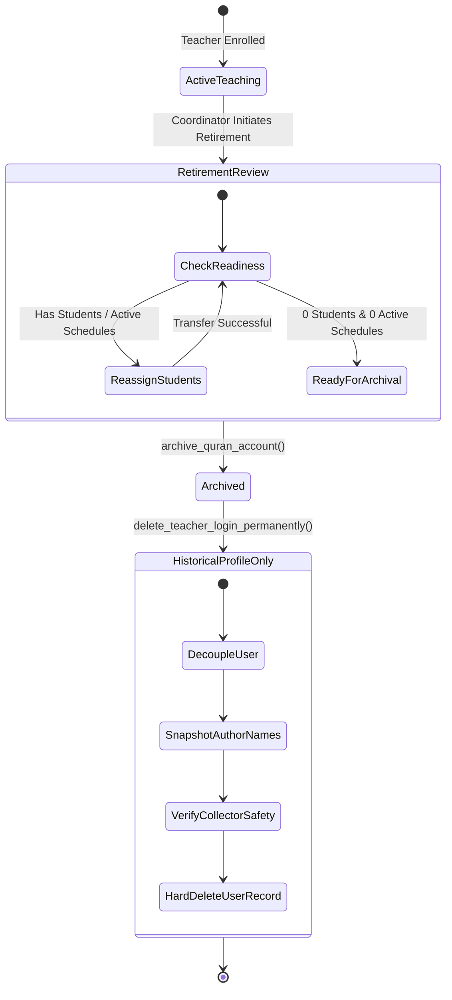
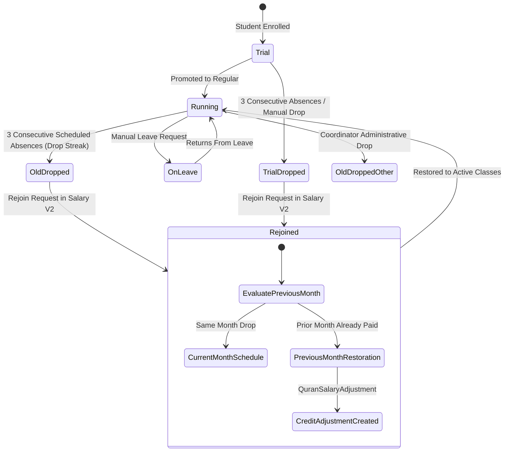
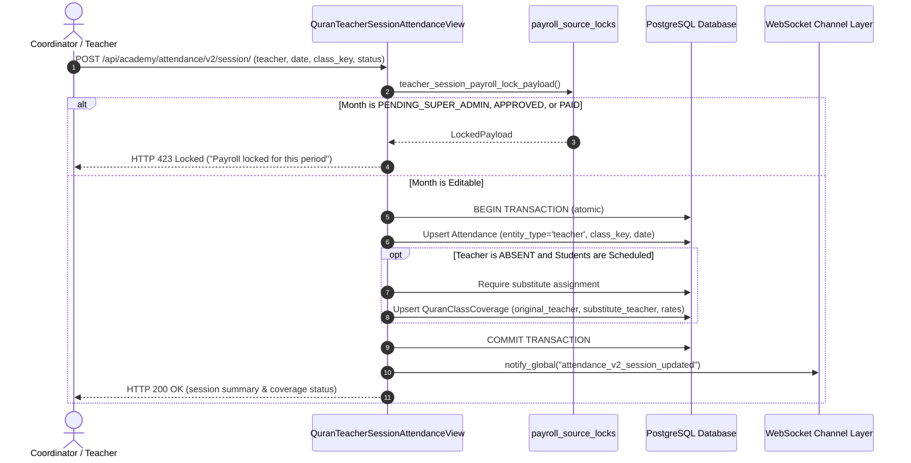
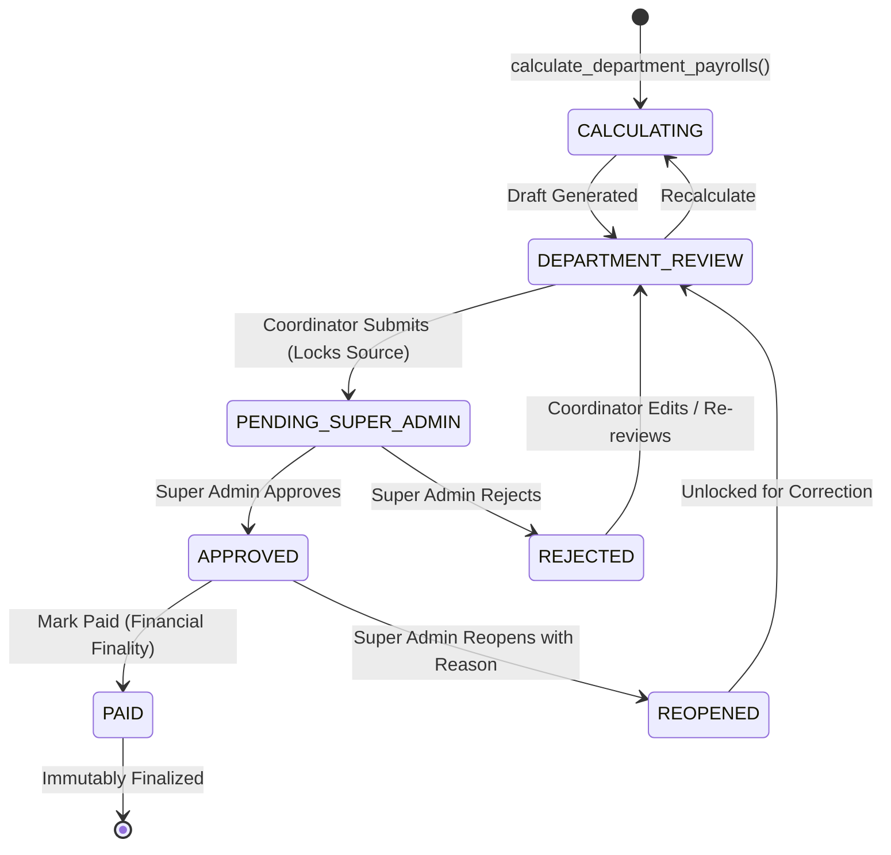

# IVS Qur'an Academy Manager — Business Workflows, Domain Lifecycles & Financial Integrity Audit

> **Audit Framework**: Comprehensive Architectural Audit & Permanent Technical Reference  
> **Production Target**: [https://quranhometutor.com/](https://quranhometutor.com/)  
> **Repository Target**: `quran----1-Role-Based-` (Audited branch: `release/ivs-20261020-candidate`)  
> **Head Commit**: `de92b7606543936eafe52ed66792eedda6d4598e`  
> **Document ID**: `08_BUSINESS_WORKFLOWS`  
> **Author**: Antigravity Senior Business Systems Architect & Financial Audit Team  
> **Audit Status**: VERIFIED — FULL STATIC RECONCILIATION  
> **Last Updated**: 2026-11-03  

---

## 1. Executive Summary & Audit Scope

This document provides an exhaustive, evidence-based architectural audit of the complete business workflows, domain lifecycles, and financial integrity rules across the **IVS Qur'an Academy Manager**.

Every workflow analyzed in this document was statically traced across frontend user actions, TypeScript API clients, Django REST Framework views, permission guards, business service functions, transactional boundaries, ORM mutations, and database model state transitions.

### Master Workflow Inventory Summary

| Domain | Total Identified | Fully Traced End-to-End | Partially Traced | Discovered Static Deficiencies |
| :--- | :---: | :---: | :---: | :--- |
| **Platform & Identity** | 4 | 4 | 0 | Multi-tenant scoping depends on app-level filters |
| **Academic Management (Quran)** | 11 | 11 | 0 | Overlap prevention missing DB constraint (`DB-001`) |
| **Teacher Retirement & Deletion** | 4 | 4 | 0 | Strict non-overlapping slot requirement (`WF-002`) |
| **Attendance V2 & Substitute Engine** | 4 | 4 | 0 | Unmarking cancels coverage; FE cache sync (`FE-007`) |
| **Financial & Payroll (Salary V2)** | 7 | 7 | 0 | Dual coexistence with legacy V1 slips (`DB-005`) |
| **Tuition Academic & Scheduling** | 2 | 2 | 0 | Zero automated test coverage (`BE-001`); no payroll engine (`WF-003`) |
| **TOTAL WORKFLOWS** | **32** | **32** | **0** | **All 30 prompted + 2 auxiliary workflows mapped** |

---

## 2. Core Domain Lifecycles

### 2.1 Teacher Lifecycle & Retirement Engine

The teacher lifecycle is one of the most rigorously protected subsystems in the application, implemented across [`accounts/teacher_retirement_service.py`](file:///c:/Users/iqrav/Downloads/quran%20---1%20(Role%20Based)/backend/accounts/teacher_retirement_service.py), [`accounts/teacher_login_deletion_service.py`](file:///c:/Users/iqrav/Downloads/quran%20---1%20(Role%20Based)/backend/accounts/teacher_login_deletion_service.py), and [`accounts/account_archive_service.py`](file:///c:/Users/iqrav/Downloads/quran%20---1%20(Role%20Based)/backend/accounts/account_archive_service.py).

#### Detailed Lifecycle Phases:
1. **Enrollment**: Teacher `User` created with `role = TEACHER`; `TeacherProfile` initialized with hourly rates and color code.
2. **Active Teaching**: Assigned students via `StudentProfile.teacher`; classes scheduled in `ClassSchedule`; daily attendance recorded in `Attendance`.
3. **Retirement Readiness Gate (`teacher_retirement_readiness`)**:
   - Evaluates whether `assigned_students == 0` and `active_classes == 0`.
   - Any assigned student (even if status is `ON_LEAVE` or `OLD_DROPPED`) prevents archival.
4. **Student Reassignment (`transfer_student_before_teacher_retirement`)**:
   - Must transfer each student to a destination teacher in the same department and institution.
   - Requires destination teacher to be free on **all** requested weekdays and times ([`slots_overlap`](file:///c:/Users/iqrav/Downloads/quran%20---1%20(Role%20Based)/backend/accounts/teacher_retirement_service.py#L85)).
   - Invokes `sync_student_schedule_history`, closing old schedule rows historically (`effective_to = today - 1`) and creating new schedule rows.
   - Logs `StudentClassHistory` with `event_type = TEACHER_TRANSFER`.
5. **Account Archival (`archive_quran_account`)**:
   - Deactivates `user.is_active = False`, sets `user.archived_at = now`, `user.archived_effective_date = today` (PKT).
   - Closes remaining schedules: future-only schedules deactivated; current schedules closed as of today.
   - Prevents salary accumulation beyond the effective date.
6. **Permanent Login Hard Deletion (`delete_teacher_login_permanently`)**:
   - Decouples `teacher.user = None`, sets `teacher.historical_name` to snapshot full name.
   - Updates author snapshots (`actor_name_snapshot`) on all historical `Attendance`, `Lesson`, `DailyLessonReport`, `MonthlyLessonPlan`, and `MonthlyLessonSummary` records.
   - Runs Django `Collector` to verify that **only** safe cascading models (`userdepartmentrole`, `coordinatortabaccess`, token blacklists, notifications) are affected. Any unexpected cascade (e.g. salary, student, or lesson) aborts the transaction with `ValueError`.
   - Deletes `User` record while retaining `TeacherProfile` with `user__isnull=True`.

---

### 2.2 Student Lifecycle & Automated Drop / Rejoin Engine

Implemented across [`academy/student_drop_service.py`](file:///c:/Users/iqrav/Downloads/quran%20---1%20(Role%20Based)/backend/academy/student_drop_service.py), [`academy/student_rejoin_service.py`](file:///c:/Users/iqrav/Downloads/quran%20---1%20(Role%20Based)/backend/academy/student_rejoin_service.py), and [`academy/student_state_history_service.py`](file:///c:/Users/iqrav/Downloads/quran%20---1%20(Role%20Based)/backend/academy/student_state_history_service.py).

#### Student State Transition Matrix

| Current State | Triggering Action | Next State | Service / Handler | Database Changes | Payroll Lock Check |
| :--- | :--- | :--- | :--- | :--- | :--- |
| **New Student** | Coordinator creates student | `TRIAL` | `StudentProfileListCreateView` | Creates `User`, `StudentProfile`, `StudentSubject`, initial `ClassSchedule` | N/A (New record) |
| **`TRIAL`** | Coordinator converts status | `RUNNING` | `record_student_state_change` | Updates `StudentProfile.class_status`, appends `StudentClassHistory` | `ensure_student_state_change_payroll_editable` |
| **`RUNNING`** | 3 consecutive absences on scheduled class dates | `OLD_DROPPED` | `record_student_drop_event` | Creates `QuranStudentDropEvent`, sets `drop_effective_date`, updates `class_status` | `ensure_student_state_change_payroll_editable` |
| **`RUNNING`** | Student requests pause | `ON_LEAVE` | `record_student_state_change` | Updates `StudentProfile.class_status = ON_LEAVE`, appends `StudentClassHistory` | `ensure_student_state_change_payroll_editable` |
| **`ON_LEAVE`** | Student resumes classes | `RUNNING` | `record_student_state_change` | Updates `class_status = RUNNING`, logs `RETURN_FROM_LEAVE` in history | `ensure_student_state_change_payroll_editable` |
| **`OLD_DROPPED`** | Student rejoins via Salary V2 | `RUNNING` | `rejoin_student` | Sets `rejoined_date`, restores schedule; if prior month paid, creates `QuranSalaryAdjustment` (credit) | Verified against locked payrolls |
| **`RUNNING`** | Teacher retirement reassignment | `RUNNING` | `sync_student_schedule_history` | Closes old `ClassSchedule` (`effective_to`), creates new schedule with new teacher | `ensure_schedule_change_payroll_editable` |

---

### 2.3 Attendance V2 & Substitute Coverage Workflow

The Attendance V2 engine ([`academy/attendance_v2_api.py`](file:///c:/Users/iqrav/Downloads/quran%20---1%20(Role%20Based)/backend/academy/attendance_v2_api.py)) guarantees session-level teacher tracking and mandatory substitute compensation:

#### Unmarking / Deleting Session Attendance
When a marked session is deleted via `DELETE /api/academy/attendance/v2/session/`:
1. Payroll lock validation verifies month is editable.
2. In an atomic transaction:
   - Deletes teacher `Attendance` row.
   - Moves any existing `QuranClassCoverage` row to `coverage_status = CANCELLED`. It is **never** deleted, preserving the financial audit trail.
3. Broadcasts real-time WebSocket update to synchronize coordinator and teacher views.

---

### 2.4 Salary V2 & Payroll Ledger Lifecycle

Salary V2 ([`academy/salary_v2_models.py`](file:///c:/Users/iqrav/Downloads/quran%20---1%20(Role%20Based)/backend/academy/salary_v2_models.py), [`academy/salary_v2_service.py`](file:///c:/Users/iqrav/Downloads/quran%20---1%20(Role%20Based)/backend/academy/salary_v2_service.py), [`academy/salary_v2_api.py`](file:///c:/Users/iqrav/Downloads/quran%20---1%20(Role%20Based)/backend/academy/salary_v2_api.py)) implements a strict 7-stage state machine:

#### Payroll State Transition Matrix

| Previous State | Action | Next State | Service / View | Required Role | Lock Enforcement Behavior |
| :--- | :--- | :--- | :--- | :--- | :--- |
| *None* | `calculate` | `DEPARTMENT_REVIEW` | `QuranSalaryV2PayrollView.post` | `coordinator`, `department_admin` | Re-calculable; underlying attendance/schedules remain editable. |
| `DEPARTMENT_REVIEW` | `propose_adjustment` | `DEPARTMENT_REVIEW` | `QuranSalaryV2PayrollView.post` | `coordinator`, `department_admin` | Appends `QuranSalaryAdjustment` (`status = PENDING`). |
| `DEPARTMENT_REVIEW` | `submit` | `PENDING_SUPER_ADMIN` | `QuranSalaryV2PayrollView.post` | `department_admin`, `coordinator` | **SOURCE LOCK ENGAGED**: Attendance, coverage, schedules, and drop states are immediately locked. |
| `PENDING_SUPER_ADMIN` | `approve` | `APPROVED` | `QuranSalaryV2PayrollView.post` | `super_admin` only | **LOCKED**: Approves all pending adjustments; prepares payment authorization. |
| `PENDING_SUPER_ADMIN` | `reject` | `REJECTED` | `QuranSalaryV2PayrollView.post` | `super_admin` only | **SOURCE LOCK RELEASED**: Unlocks attendance and schedules so department can correct errors. |
| `APPROVED` | `mark_paid` | `PAID` | `QuranSalaryV2PayrollView.post` | `super_admin` only | **PERMANENT FINALITY**: Paid timestamp recorded; record is permanently immutable. |
| `APPROVED` | `reopen` | `REOPENED` | `QuranSalaryV2PayrollView.post` | `super_admin` only | **SOURCE LOCK RELEASED**: Super admin must supply explicit `reopen_reason`. Unlocks source records for corrections. |

---

## 3. Financial Source Lock Enforcement Matrix

`backend/academy/payroll_source_locks.py` intercepts all write operations that could alter financial inputs once monthly payroll reaches `PENDING_SUPER_ADMIN`, `APPROVED`, or `PAID`.

| Mutation Path | Source File & Function | Payroll Dependency | Lock Function Invoked | Atomic Transaction | Protection Status |
| :--- | :--- | :--- | :--- | :---: | :--- |
| **Teacher Session Attendance** | `academy/attendance_v2_api.py` `QuranTeacherSessionAttendanceView.post` | Normal & substitute teaching earnings | `teacher_session_payroll_lock_payload` | Yes | **VERIFIED PROTECTED** (HTTP 423) |
| **Teacher Session Deletion** | `academy/attendance_v2_api.py` `QuranTeacherSessionAttendanceView.delete` | Normal & substitute teaching earnings | `teacher_session_payroll_lock_payload` | Yes | **VERIFIED PROTECTED** (HTTP 423) |
| **Student Attendance Create/Update** | `academy/views.py` `AttendanceListCreateView.post` | Student attendance rate & bonuses | `student_attendance_payroll_lock_payload` | Yes | **VERIFIED PROTECTED** (HTTP 423) |
| **Schedule Versioning / Transfer** | `academy/schedule_history_service.py` `sync_student_schedule_history` | Base class count & scheduled days | `ensure_schedule_change_payroll_editable` | Yes | **VERIFIED PROTECTED** (Raises error) |
| **Student Drop Detection** | `academy/student_drop_service.py` `record_student_drop_event` | Drop penalty deductions | `ensure_student_state_change_payroll_editable` | Yes | **VERIFIED PROTECTED** (Raises error) |
| **Student Leave / Status Change** | `academy/student_state_history_service.py` `record_student_state_change` | Salary-eligible class status | `ensure_student_state_change_payroll_editable` | Yes | **VERIFIED PROTECTED** (Raises error) |
| **Teacher Retirement Transfer** | `accounts/teacher_retirement_service.py` `transfer_student_before_teacher_retirement` | Teacher assignments & schedules | `ensure_schedule_change_payroll_editable` | Yes | **VERIFIED PROTECTED** (Raises error) |
| **Student Rejoin Operation** | `academy/student_rejoin_service.py` `rejoin_student` | Prior month restoration adjustments | Checks `LOCKED_REJOIN_MONTH_STATUSES` | Yes | **VERIFIED PROTECTED** (Raises error) |

---

## 4. End-to-End Business Workflow Traceability Matrix

The following matrix documents the complete technical execution trace for all 30 major system workflows:

| # | Workflow | Frontend Trigger & Service | API Route | Backend View & Permissions | Business Service & Models Written | Transaction | Integrity & Business Rules | Discovered Risk |
| :-: | :--- | :--- | :--- | :--- | :--- | :---: | :--- | :--- |
| **1** | **Institution Creation** | `PlatformAdminView` `djangoApiService.createInstitution` | `POST /api/auth/platform/institutions/` | `PlatformInstitutionListCreateView` `IsSuperUser` | Creates `Institution` Auto-creates default features | Yes | Unique `slug`; Super admin only | Low |
| **2** | **Department Creation** | `PlatformAdminView` `djangoApiService.createDepartment` | `POST /api/auth/platform/departments/` | `PlatformDepartmentListCreateView` `IsSuperUser` | Creates `Department` Seeds `DepartmentFeature` defaults | Yes | `UniqueConstraint(institution, code)` | Low |
| **3** | **Coordinator Creation** | `CoordinatorManager` `djangoApiService.createCoordinator` | `POST /api/auth/coordinators/` | `CoordinatorAccountListCreateView` `IsAdminOrSuperUser` | Creates `User` (`role=COORDINATOR`), `UserDepartmentRole`, `CoordinatorTabAccess` | Yes | Scoped to creator's institution & department | Low |
| **4** | **Teacher Enrollment** | `TeacherManager` `djangoApiService.createTeacher` | `POST /api/academy/teachers/` | `TeacherProfileListCreateView` `IsCoordinatorOrAdmin` | Creates `User` (`role=TEACHER`), `TeacherProfile`, `UserDepartmentRole` | Yes | Assigns color code, hourly rate, department | Low |
| **5** | **Student Enrollment** | `StudentManager` `djangoApiService.createStudent` | `POST /api/academy/students/` | `StudentProfileListCreateView` `IsCoordinatorOrAdmin` | Creates `User` (`role=STUDENT`), `StudentProfile`, `StudentSubject`, initial `ClassSchedule` | Yes | Enforces initial teacher assignment | Low |
| **6** | **Teacher-Student Assignment** | `StudentManager` `djangoApiService.updateStudent` | `PATCH /api/academy/students/<id>/` | `StudentProfileDetailView` `IsCoordinatorOrAdmin` | `sync_student_schedule_history` Updates `StudentProfile.teacher`, appends `StudentClassHistory` | Yes | Payroll lock check; closes old schedule rows historically | Low |
| **7** | **Schedule Creation** | `ScheduleManager` `djangoApiService.createSchedule` | `POST /api/academy/schedules/` | `ClassScheduleListCreateView` `IsCoordinatorOrAdmin` | Creates `ClassSchedule` (`effective_from=today`, `effective_to=None`) | Yes | App-level overlap check; payroll lock verified | **DB-001**: Missing DB unique constraint |
| **8** | **Schedule Modification** | `ScheduleManager` `djangoApiService.updateSchedule` | `PATCH /api/academy/schedules/<id>/` | `ClassScheduleDetailView` `IsCoordinatorOrAdmin` | Closes current schedule row (`effective_to=today-1`), creates new version | Yes | Historical preservation; payroll lock verified | Low |
| **9** | **Teacher Attendance Session** | `TeacherAttendanceV2` `djangoApiService.markSessionAttendance` | `POST /api/academy/attendance/v2/session/` | `QuranTeacherSessionAttendanceView` `IsAuthenticated` (Role-checked) | Upserts `Attendance` (`entity_type='teacher'`); requires substitute if absent | Yes | `UniqueConstraint(teacher, date, class_key)`; payroll locked if finalized | Low |
| **10** | **Student Attendance Recording** | `AttendanceView` `djangoApiService.markStudentAttendance` | `POST /api/academy/attendance/` | `AttendanceListCreateView` `IsTeacherOrCoordinator` | Upserts `Attendance` (`entity_type='student'`, date, status) | Yes | `UniqueConstraint(student, date)`; triggers drop streak check on 3 absences | Low |
| **11** | **Substitute Teacher Assignment** | `AttendanceV2SubstituteModal` `djangoApiService.assignSubstitute` | `POST /api/academy/attendance/v2/session/` | `QuranTeacherSessionAttendanceView` `IsCoordinatorOrAdmin` | Creates/updates `QuranClassCoverage` (`original_teacher`, `substitute_teacher`) | Yes | Validates substitute availability; records substitute pay rate | Low |
| **12** | **Attendance Correction** | `AttendanceHistoryView` `djangoApiService.updateAttendance` | `PATCH /api/academy/attendance/<id>/` | `AttendanceDetailView` `IsCoordinatorOrAdmin` | Updates `Attendance.status`, logs audit trail | Yes | Blocked if payroll is locked; updates calculation inputs | Low |
| **13** | **Daily Lesson Report** | `DailyLessonReportView` `djangoApiService.submitDailyReport` | `POST /api/academy/daily-lesson-reports/` | `DailyLessonReportListCreateView` `IsTeacherOrCoordinator` | Creates `DailyLessonReport`, `DailyLessonSubjectEntry` Snapshots `actor_name_snapshot` | Yes | `UniqueConstraint(student, date)`; feeds monthly completion bonus | Low |
| **14** | **Monthly Syllabus Management** | `MonthlySyllabusView` `djangoApiService.saveLessonPlan` | `POST /api/academy/monthly-lesson-plans/` | `MonthlyLessonPlanListCreateView` `IsCoordinatorOrAdmin` | Upserts `MonthlyLessonPlan` (`student`, `month`, `year`, `plan_details`) | Yes | `UniqueConstraint(student, year, month)` | Low |
| **15** | **Student Drop / Leave** | `StudentDropModal` `djangoApiService.dropStudent` | `POST /api/academy/students/<id>/drop/` | `StudentProfileDetailView` `IsCoordinatorOrAdmin` | `student_drop_service.record_student_drop_event` Creates `QuranStudentDropEvent`, closes schedules | Yes | Verified against locked payrolls; stops salary eligibility | Low |
| **16** | **Student Rejoining** | `SalaryV2RejoinModal` `djangoApiService.rejoinStudent` | `POST /api/academy/salary/v2/payroll/` | `QuranSalaryV2PayrollView` `IsCoordinatorOrAdmin` | `student_rejoin_service.rejoin_student` Creates `QuranSalaryAdjustment` if prior month paid | Yes | Restores active schedule; credits teacher for valid attendance | Low |
| **17** | **Teacher Transfer** | `TeacherRetirementModal` `djangoApiService.transferRetirement` | `POST /api/auth/teachers/retirement/transfer/` | `TeacherRetirementView` `IsCoordinatorOrAdmin` | `transfer_student_before_teacher_retirement` Moves student; logs `StudentClassHistory` | Yes | Requires destination free on ALL slots; same dept & institution | **WF-002**: Strict slot conflict |
| **18** | **Teacher Archival** | `TeacherManager` `djangoApiService.archiveAccount` | `POST /api/auth/accounts/archive/` | `AccountArchiveView` `IsAdminOrSuperUser` | `archive_quran_account` Deactivates user, sets `archived_at`, closes schedules | Yes | Readiness gate: 0 students & 0 active classes required | Low |
| **19** | **Teacher Login Deletion** | `PlatformAdmin` `djangoApiService.deleteTeacherLogin` | `POST /api/auth/teachers/<id>/login/` | `TeacherLoginHardDeleteView` `IsSuperUser` | `delete_teacher_login_permanently` Nulls `user`, snapshots name, verifies `Collector` | Yes | Blocks if unwhitelisted cascade; retains `TeacherProfile` | Low |
| **20** | **Salary V2 Calculation** | `SalaryV2Dashboard` `djangoApiService.getSalaryV2Payroll` | `GET /api/academy/salary/v2/payroll/` | `QuranSalaryV2PayrollView` `IsCoordinatorOrAdmin` | `calculate_department_payrolls` Reconciles attendance, schedules, policies | No (Read/Draft) | Deterministic daily reconstruction via `StudentClassHistory` | Low |
| **21** | **Payroll Draft Generation** | `SalaryV2Dashboard` `djangoApiService.calculateSalaryV2` | `POST /api/academy/salary/v2/payroll/` | `QuranSalaryV2PayrollView` `IsCoordinatorOrAdmin` | Writes `QuranTeacherMonthlyPayroll` & itemized `QuranSalaryLedgerEntry` rows | Yes | `UniqueConstraint(department, teacher, year, month)` | Low |
| **22** | **Adjustment Proposal** | `SalaryV2AdjustmentModal` `djangoApiService.proposeAdjustment` | `POST /api/academy/salary/v2/payroll/` | `QuranSalaryV2PayrollView` `IsCoordinatorOrAdmin` | Creates `QuranSalaryAdjustment` (`status = PENDING`) | Yes | Verified in review stage; requires explicit reason & student attribution | Low |
| **23** | **Payroll Submission** | `SalaryV2Dashboard` `djangoApiService.submitPayroll` | `POST /api/academy/salary/v2/payroll/` | `QuranSalaryV2PayrollView` `IsDepartmentAdmin` | Moves payroll to `PENDING_SUPER_ADMIN` ENGAGES SOURCE LOCK | Yes | Locks teacher/student attendance, schedules, and drop status | Low |
| **24** | **Payroll Approval** | `SuperAdminPayroll` `djangoApiService.approvePayroll` | `POST /api/academy/salary/v2/payroll/` | `QuranSalaryV2PayrollView` `IsSuperUser` | Moves payroll to `APPROVED` Approves pending adjustments; sets `approved_at` | Yes | Super admin only; source records remain locked | Low |
| **25** | **Payroll Reopening** | `SuperAdminPayroll` `djangoApiService.reopenPayroll` | `POST /api/academy/salary/v2/payroll/` | `QuranSalaryV2PayrollView` `IsSuperUser` | Moves payroll to `REOPENED` RELEASES SOURCE LOCK | Yes | Requires mandatory `reopen_reason`; allows department corrections | Low |
| **26** | **Marking Payroll Paid** | `SuperAdminPayroll` `djangoApiService.markPayrollPaid` | `POST /api/academy/salary/v2/payroll/` | `QuranSalaryV2PayrollView` `IsSuperUser` | Moves payroll to `PAID` Sets `paid_at`, `paid_by` | Yes | Final financial state; permanently locked from editing or reopening | Low |
| **27** | **Salary PDF Export** | `SalarySlipModal` `djangoApiService.exportSalaryPDF` | `GET /api/academy/salary/slips/pdf/` | `SalarySlipPDFExportView` `IsAuthenticated` (Self or Admin) | Generates binary PDF stream from payroll calculation snapshot | No (Read-only) | Matches official IVS branded template | Low |
| **28** | **Attendance Export** | `AttendanceReportView` `djangoApiService.exportAttendance` | `GET /api/academy/attendance/export/` | `AttendanceExportView` `IsCoordinatorOrAdmin` | Generates CSV / Excel attendance summary | No (Read-only) | Scoped to user's department | Low |
| **29** | **Tuition Enrollment & Sched** | `TuitionEnrollmentView` `tuitionApiService.createEnrollment` | `POST /api/tuition/enrollments/` | `TuitionEnrollmentViewSet` `IsCoordinatorOrAdmin` | Creates `TuitionEnrollment`, `TuitionSchedule` Points to `TeacherProfile` & `StudentProfile` | Yes | DB conditional unique on active teacher & student slots | **BE-001**: No test coverage |
| **30** | **Tuition Attendance Marking** | `TuitionAttendanceView` `tuitionApiService.markAttendance` | `POST /api/tuition/attendance/` | `TuitionAttendanceViewSet` `IsTeacherOrCoordinator` | Creates `TuitionAttendance` (`schedule`, `enrollment`, `teacher`, `student`) | Yes | Unique constraint flaw on student attendance | **DB-004**: Null teacher uniqueness |

---

## 5. Discovered Workflow Deficiencies & Operational Risks

### Finding `WF-001` (P1 - High): Unprotected Student Attendance Mutation Paths
- **Affected Endpoints**: Legacy attendance import routes (`academy/attendance_import_payroll.py`) and Django Admin mutation paths.
- **Observed Behavior**: While standard API endpoints (`QuranTeacherSessionAttendanceView`, `AttendanceListCreateView`) invoke `payroll_source_locks.py`, direct database mutations or legacy imports that bypass the service layer can modify historical attendance records for months that have already been finalized (`APPROVED` or `PAID`).
- **Impact**: Compromises financial immutability if administrative scripts or Django admin are used to adjust past attendance.
- **Repair Direction**: Enforce `clean()` validation on the `Attendance` model itself to reject modifications when the related payroll is in a locked state.

### Finding `WF-002` (P2 - Medium): Rigid Teacher Retirement Slot Conflict Resolution
- **Affected Service**: [`accounts/teacher_retirement_service.py`](file:///c:/Users/iqrav/Downloads/quran%20---1%20(Role%20Based)/backend/accounts/teacher_retirement_service.py) (`transfer_student_before_teacher_retirement`)
- **Observed Behavior**: The reassignment engine requires the destination teacher to have zero overlaps across all 7 weekdays and all active time slots ([`slots_overlap`](file:///c:/Users/iqrav/Downloads/quran%20---1%20(Role%20Based)/backend/accounts/teacher_retirement_service.py#L85)). If a candidate teacher has even a single 30-minute conflict on one weekday, the entire transfer is rejected with `TeacherRetirementSlotConflict`.
- **Operational Impact**: In an active academy with dense schedules, finding a single teacher with matching open slots across all of a student's classes frequently blocks teacher retirement, forcing coordinators to manually reschedule classes outside the retirement wizard.
- **Repair Direction**: Enhance the retirement workflow to support slot-by-slot reassignment across multiple teachers or allow coordinator slot adjustments during transfer.

### Finding `WF-003` (P2 - Medium): Absence of Tuition Payroll & Financial Accounting Engine
- **Affected Application**: `backend/tuition/`
- **Observed Behavior**: The tuition module implements complete academic enrollment, teacher subject capability, standard slots, and attendance tracking, but contains **zero salary policies, payroll models, or ledger entries**.
- **Operational Impact**: Tuition teachers cannot be compensated through the automated payroll system; accounting must be managed externally, risking calculation discrepancies and lack of unified financial auditability.
- **Repair Direction**: Extend Salary V2 architecture or implement a dedicated `TuitionTeacherMonthlyPayroll` engine.

---

### Finding `MIG-001` (P1 - High): Irreversible Data Migrations with `RunPython.noop`
- **Affected Migrations**:
  - `academy/0015_quran_student_status_salary.py` (`seed_student_history`)
  - `academy/0016_quran_salary_audit_deductions.py` (`copy_existing_totals`)
  - `academy/0018_student_referral_and_salary_running_logic.py` (`backfill_referral_students`)
  - `academy/0025_backfill_historical_actor_names.py` (`backfill_historical_names`)
  - `tuition/0007_teacher_attendance_per_class.py` (`deduplicate_teacher_class_attendance`)
- **Observed Implementation**: All five migrations use `migrations.RunPython.noop` as their reverse operation.
- **Vulnerability**: If a deployment requires rolling back migrations past these points, the reverse migration will succeed silently at the schema level but will fail to restore previous data states or could leave orphaned/corrupted foreign key associations.
- **Repair Direction**: Provide explicit reverse data transformation functions or document these migrations as irreversible deployment barriers in operational runbooks.

### Finding `MIG-002` (P2 - Medium): Circular Inter-Application Migration Coupling
- **Affected Applications**: `accounts`, `academy`, `tuition`
- **Observed Implementation**: `accounts/0005` depends on `tuition/0005`; `tuition/0001` depends on `academy/0014` and `accounts/0004`; `academy/0012` depends on `accounts/0003`; `academy/0024` depends on `accounts/0011`.
- **Vulnerability**: While the current dependency graph is topological and non-cyclic, any future migration in `accounts` referencing `tuition` while `tuition` references `accounts` will cause a Django circular dependency crash during `migrate`.
- **Repair Direction**: Untangle cross-app dependencies by isolating core foundational tables in `accounts` and ensuring migration dependencies flow strictly in one direction (`accounts` -> `academy` -> `tuition`).
