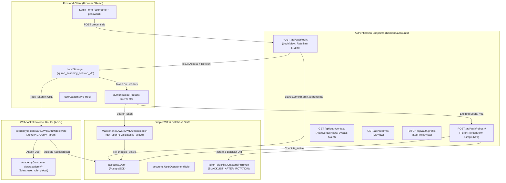
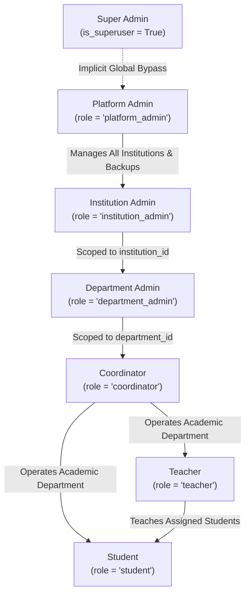

# IVS Qur'an Academy Manager — Authentication, RBAC & Access Control Audit

> **Document ID**: `09_AUTHENTICATION_RBAC`  
> **Phase**: Phase 5 — Complete Authentication, RBAC, Multi-Institution Security & Data Access Boundary Audit  
> **Repository Target**: `quran----1-Role-Based-`  
> **Production Target**: [https://quranhometutor.com/](https://quranhometutor.com/)  
> **Audited Git Branch**: `release/ivs-20261020-candidate`  
> **Audited Commit Baseline**: `de92b7606543936eafe52ed66792eedda6d4598e`  
> **Author**: Antigravity Senior Security Architect & Application Security Audit Team  
> **Audit Execution Date**: 2026-11-03  
> **Audit Status**: VERIFIED (Exhaustive static inspection of authentication, permissions, models, services & API views)

---

## 1. Executive Summary & Security Baseline

This document provides the authoritative, evidence-based security audit of authentication, Role-Based Access Control (RBAC), multi-tenant isolation, and data access boundaries across the **IVS Qur'an Academy Manager** platform.

Every authorization mechanism was examined by statically tracing code across the backend (`accounts`, `academy`, `tuition`, `config`), the frontend (`services/authenticatedRequest.ts`, `services/sessionService.ts`, `services/djangoApiService.ts`, `App.tsx`), and the underlying Django REST Framework (DRF) and SimpleJWT configurations.

### 1.1 Core Security Architecture Principles Observed

1. **Stateless JWT with Stateful User Validation**: The platform uses DRF SimpleJWT with HMAC-SHA256 tokens (`Bearer` auth header). While the token is stateless, `MaintenanceAwareJWTAuthentication` queries the PostgreSQL database on every authenticated request (`User.objects.get(id=user_id)`). This guarantees that user deactivation (`is_active=False`) and login deletion immediately invalidate all active access tokens.
2. **Dynamic Context-Driven RBAC**: User permissions and roles are NOT stored as claims within the JWT payload. Instead, user roles, department associations, feature flags, and coordinator tab locks are dynamically loaded on each request from `accounts.User`, `accounts.UserDepartmentRole`, and `accounts.CoordinatorTabAccess`.
3. **Application-Level Multi-Tenancy**: As identified in Phase 4 (`DB-003`), database relations lack composite multi-column foreign keys enforcing tenancy at the schema layer. Data scoping is enforced entirely within application querysets (`filter(department=...)`, `filter(institution=...)`), manager scope resolvers, and serializer validations.
4. **Defense-in-Depth for Financial Operations**: Salary V2 operations (`QuranSalaryV2PayrollView`) enforce a strict separation of duties: Department Admins can only calculate and submit payrolls, while only Super Admins can approve, reject, mark paid, or reopen payrolls. `payroll_source_locks.py` protects locked and approved payroll periods across 8 mutation paths.

---

## 2. Complete Authentication Lifecycle

The authentication lifecycle spans 20 discrete operational states, tracing from initial account creation through session management, token renewal, deactivation, and permanent login detachment.

### 2.1 Authentication Lifecycle Architecture Diagram



### 2.2 Traceability of the 20 Authentication Lifecycle Operations

| # | Operation | Frontend Entry Point | API Endpoint | Backend View / Service | Auth & Permissions | Security Behavior & Invariants | Evidence Reference |
|---|---|---|---|---|---|---|---|
| 1 | **Account Creation** | `AddAccountModal.tsx`<br>`djangoApiService.createAccount()` | `POST /api/auth/accounts/` | `CoordinatorAccountListCreateView`<br>`CreateAccountSerializer` | `IsAuthenticated`<br>`can_manage_department_accounts`<br>`coordinator_has_effective_tab_access` | Coordinator can create Teacher/Student accounts only within their own Quran department. Cannot create admin or coordinator accounts. | [accounts/views.py#L820-L870](file:///c:/Users/iqrav/Downloads/quran%20---1%20(Role%20Based)/backend/accounts/views.py#L820-L870) |
| 2 | **Password Validation** | `PasswordInput.tsx` / Form submission | N/A (Server-side serializer validation) | `django.contrib.auth.password_validation` | `AUTH_PASSWORD_VALIDATORS` in `settings.py` | Minimum 10 characters (`MinimumLengthValidator`), similarity, common password, and numeric checks enforced. | [config/settings.py#L84-L98](file:///c:/Users/iqrav/Downloads/quran%20---1%20(Role%20Based)/backend/config/settings.py#L84-L98) |
| 3 | **Login** | `LoginView.tsx`<br>`djangoApiService.login()` | `POST /api/auth/login/` | `LoginView` | `AllowAny` | Cache-backed brute force throttling (max 5 failed attempts per username within 15 minutes -> HTTP 429). Validates `user.is_active`. Issues access and refresh tokens. | [accounts/views.py#L384-L436](file:///c:/Users/iqrav/Downloads/quran%20---1%20(Role%20Based)/backend/accounts/views.py#L384-L436) |
| 4 | **Access Token Issuance** | `LoginView.post()` / `TokenRefreshView` | `POST /api/auth/login/`<br>`POST /api/auth/refresh/` | SimpleJWT `RefreshToken.for_user()` | `AllowAny` | Signed with HMAC-SHA256 (`SECRET_KEY`). Lifetime: **8 hours**. Contains `user_id`, `token_type: access`, `jti`, `exp`, `iat`. | [config/settings.py#L156-L162](file:///c:/Users/iqrav/Downloads/quran%20---1%20(Role%20Based)/backend/config/settings.py#L156-L162) |
| 5 | **Refresh Token Issuance** | `LoginView.post()` | `POST /api/auth/login/` | SimpleJWT `RefreshToken.for_user()` | `AllowAny` | Lifetime: **7 days**. Contains `user_id`, `token_type: refresh`, `jti`, `exp`, `iat`. | [config/settings.py#L156-L162](file:///c:/Users/iqrav/Downloads/quran%20---1%20(Role%20Based)/backend/config/settings.py#L156-L162) |
| 6 | **Token Storage** | `services/sessionService.ts` | Client-side only | `saveSession(session)` | Browser storage | Stored as JSON string under `localStorage` key `quran_academy_session_v2`. Vulnerable to client-side XSS extraction if script injection occurs. | [services/sessionService.ts#L30-L58](file:///c:/Users/iqrav/Downloads/quran%20---1%20(Role%20Based)/services/sessionService.ts#L30-L58) |
| 7 | **Authenticated Requests** | `services/authenticatedRequest.ts` | All protected endpoints (`/api/...`) | `MaintenanceAwareJWTAuthentication` | `IsAuthenticated` | Injects `Authorization: Bearer <access_token>`. Server re-verifies user existence and active status in DB. Throws HTTP 423 on active maintenance windows. | [accounts/authentication.py#L13-L45](file:///c:/Users/iqrav/Downloads/quran%20---1%20(Role%20Based)/backend/accounts/authentication.py#L13-L45) |
| 8 | **Token Expiration** | Client pre-check & SimpleJWT | All protected endpoints | `tokenExpiresSoon()` / SimpleJWT | `IsAuthenticated` | Frontend proactively detects access tokens expiring within 60s (`REFRESH_SKEW_SECONDS`) and triggers renewal before sending the request. | [services/authenticatedRequest.ts#L26-L47](file:///c:/Users/iqrav/Downloads/quran%20---1%20(Role%20Based)/services/authenticatedRequest.ts#L26-L47) |
| 9 | **Token Renewal** | `services/authenticatedRequest.ts` | `POST /api/auth/refresh/` | `TokenRefreshView` (`rest_framework_simplejwt`) | `AllowAny` | Sends `{ refresh: token }`. Singleton promise `refreshPromise` prevents concurrent refresh storms. Returns new access token and rotated refresh token. | [services/authenticatedRequest.ts#L49-L112](file:///c:/Users/iqrav/Downloads/quran%20---1%20(Role%20Based)/services/authenticatedRequest.ts#L49-L112) |
| 10 | **Refresh Token Rotation** | Backend SimpleJWT | `POST /api/auth/refresh/` | SimpleJWT `TokenRefreshSerializer` | `AllowAny` | `ROTATE_REFRESH_TOKENS = True` issues a brand new refresh token on every renewal call. | [config/settings.py#L159](file:///c:/Users/iqrav/Downloads/quran%20---1%20(Role%20Based)/backend/config/settings.py#L159) |
| 11 | **Token Blacklisting** | Backend SimpleJWT | `POST /api/auth/refresh/` | SimpleJWT `token_blacklist` app | `AllowAny` | `BLACKLIST_AFTER_ROTATION = True` immediately writes the consumed refresh token to `token_blacklist.BlacklistedToken`. Re-use is rejected. | [config/settings.py#L160](file:///c:/Users/iqrav/Downloads/quran%20---1%20(Role%20Based)/backend/config/settings.py#L160) |
| 12 | **Logout** | `TopBar.tsx`<br>`clearSession()` | Client-side only (**No backend API**) | N/A (Missing server-side endpoint) | Client event | Removes `quran_academy_session_v2` from `localStorage` and emits `ivs-session-expired`. **Tokens are not blacklisted on the server** (`SEC-003`). | [services/sessionService.ts#L60-L68](file:///c:/Users/iqrav/Downloads/quran%20---1%20(Role%20Based)/services/sessionService.ts#L60-L68) |
| 13 | **Session Expiration** | `authenticatedRequest.ts` | Any endpoint returning HTTP 401 | `authenticatedRequest` catch block | Interceptor | When refresh fails with 400/401/403 (`terminal = True`), `clearSession()` executes and the user is redirected to `/login`. | [services/authenticatedRequest.ts#L78-L88](file:///c:/Users/iqrav/Downloads/quran%20---1%20(Role%20Based)/services/authenticatedRequest.ts#L78-L88) |
| 14 | **Password Change (Self)** | `SelfProfileModal.tsx`<br>`djangoApiService.updateSelfProfile()` | `PATCH /api/auth/profile/` | `SelfProfileView` (`accounts.self_profile_api`) | `IsAuthenticated` | Requires `current_password`, validates `new_password` against Django password validators, updates `user.set_password()`. Does NOT blacklist existing tokens. | [accounts/self_profile_api.py#L33-L120](file:///c:/Users/iqrav/Downloads/quran%20---1%20(Role%20Based)/backend/accounts/self_profile_api.py#L33-L120) |
| 15 | **Password Reset (Admin)** | `PlatformAdminTools.tsx` | `POST /api/auth/platform/administrators/<id>/reset-password/` | `PlatformPortalAdministratorResetPasswordView` | `IsAuthenticated`<br>`_forbidden_if_not_main_admin` | Requires actor's `current_password`. Generates 16-character secure random password (`secrets.choice`), hashes and saves to target user. | [accounts/platform_admin_api.py#L487-L530](file:///c:/Users/iqrav/Downloads/quran%20---1%20(Role%20Based)/backend/accounts/platform_admin_api.py#L487-L530) |
| 16 | **Account Deactivation** | Coordinator / Admin account toggle | `PATCH /api/auth/accounts/<id>/`<br>`PATCH /api/tuition/accounts/<id>/` | `CoordinatorAccountDetailView`<br>`TuitionAccountDetailView` | `IsAuthenticated`<br>`can_manage_department_accounts` | Sets `user.is_active = False`. SimpleJWT `get_user()` immediately rejects all existing access tokens with HTTP 401 `user_inactive`. | [accounts/views.py#L927-L952](file:///c:/Users/iqrav/Downloads/quran%20---1%20(Role%20Based)/backend/accounts/views.py#L927-L952) |
| 17 | **Account Archival** | `AccountRow.tsx`<br>`deleteAccount()` | `DELETE /api/auth/accounts/<id>/` | `archive_quran_account()` | `IsAuthenticated`<br>`can_manage_department_accounts` | Logical removal: sets `is_active = False`, stamps `archived_at` and `archived_effective_date`. Preserves payroll and attendance rows. Invalidates active tokens. | [accounts/account_archive_service.py#L15-L70](file:///c:/Users/iqrav/Downloads/quran%20---1%20(Role%20Based)/backend/accounts/account_archive_service.py#L15-L70) |
| 18 | **Teacher Retirement** | `TeacherRetirementModal.tsx` | `POST /api/auth/accounts/<id>/teacher-retirement/` | `TeacherRetirementView`<br>`teacher_retirement_service.py` | `IsAuthenticated`<br>`can_manage_department_accounts` | Validates zero active student assignments, closes active schedules, sets `is_active = False`, archives user. Preserves `TeacherProfile`. | [accounts/teacher_retirement_api.py#L138-L210](file:///c:/Users/iqrav/Downloads/quran%20---1%20(Role%20Based)/backend/accounts/teacher_retirement_api.py#L138-L210) |
| 19 | **Permanent Login Deletion** | `AccountRow.tsx` (Teacher only) | `DELETE /api/auth/accounts/<id>/` | `delete_teacher_login_permanently()` | `IsAuthenticated`<br>`can_manage_department_accounts` | Hard deletes `accounts.User` record; decouples `TeacherProfile.user = None` and snapshots historical author name on lessons/attendance. Tokens fail with 401 `user_not_found`. | [accounts/teacher_login_deletion_service.py#L27-L86](file:///c:/Users/iqrav/Downloads/quran%20---1%20(Role%20Based)/backend/accounts/teacher_login_deletion_service.py#L27-L86) |
| 20 | **User Reactivation** | Platform Admin tools / Account edit | `PATCH /api/auth/platform/administrators/<id>/`<br>`PATCH /api/auth/accounts/<id>/` | `PlatformPortalAdministratorDetailView`<br>`UpdateAccountSerializer` | `IsAuthenticated`<br>`is_main_admin` | Sets `user.is_active = True`. User can log in again to generate new token pair. Old blacklisted refresh tokens remain invalid. | [accounts/platform_admin_api.py#L401-L460](file:///c:/Users/iqrav/Downloads/quran%20---1%20(Role%20Based)/backend/accounts/platform_admin_api.py#L401-L460) |

---

## 3. JWT Security & Session Management Audit

### 3.1 Token Configuration & Claim Construction

In `backend/config/settings.py` (lines 156-162):

```python
SIMPLE_JWT = {
    "ACCESS_TOKEN_LIFETIME": timedelta(hours=8),
    "REFRESH_TOKEN_LIFETIME": timedelta(days=7),
    "ROTATE_REFRESH_TOKENS": True,
    "BLACKLIST_AFTER_ROTATION": True,
    "AUTH_HEADER_TYPES": ("Bearer",),
}
```

- **Signing Algorithm**: HMAC-SHA256 using Django `SECRET_KEY`.
- **Payload Structure**:
  - `token_type`: `"access"` or `"refresh"`
  - `exp`: Unix timestamp (8 hours access / 7 days refresh)
  - `iat`: Unix timestamp
  - `jti`: 32-character hexadecimal unique identifier
  - `user_id`: Integer primary key of `accounts.User`
- **Omitted Claims**: The tokens intentionally do NOT contain `role`, `department_id`, `institution_id`, `is_staff`, or `is_superuser`. This prevents privilege escalation or stale permission states via modified claims.

### 3.2 Evaluation of 10 Critical JWT Security Questions

1. **Can an archived user continue authenticating with an existing access token?**  
   **NO (VERIFIED)**. `MaintenanceAwareJWTAuthentication` inherits from SimpleJWT's `JWTAuthentication`. In `get_user()`, `api_settings.CHECK_USER_IS_ACTIVE` is enabled by default. Every request verifies `user.is_active`. When `archive_quran_account()` sets `user.is_active = False`, any subsequent request using an active access token is rejected with HTTP 401 `{"detail": "User is inactive", "code": "user_inactive"}`.
2. **Can a disabled user's refresh token issue a new access token?**  
   **NO (VERIFIED)**. In SimpleJWT's `TokenRefreshSerializer.validate()`, `user_id` is extracted and `User.objects.get(id=user_id)` is fetched. It applies `api_settings.USER_AUTHENTICATION_RULE(user)` which verifies `user.is_active`. If inactive, it raises HTTP 401 `{"detail": "No active account found for the given token.", "code": "no_active_account"}`.
3. **Are changes in department permissions reflected in already-issued credentials?**  
   **YES (VERIFIED on backend) / DELAYED (Frontend cache)**. Because roles and permissions are NOT embedded in the JWT payload, all permission checks in API views (`_salary_access`, `_resolve_department`, `can_manage_department_accounts`, `coordinator_has_effective_tab_access`) query the current PostgreSQL state on every invocation. However, the frontend caches permissions in memory from `/api/auth/context/` until a manual reload or `useAcademyWS` event occurs.
4. **Does the backend independently retrieve current user roles?**  
   **YES (VERIFIED)**. Every authenticated view accesses `request.user.role`, `UserDepartmentRole.objects.filter(user=request.user)`, or helper functions like `is_department_manager(request.user)`. No role is accepted from client request bodies or JWT claims.
5. **Are role claims trusted without revalidating the underlying account state?**  
   **NO (VERIFIED)**. No role claims exist in the token payload. Account state is revalidated against PostgreSQL on every HTTP request.
6. **Can a teacher whose login has been detached continue accessing APIs using old tokens?**  
   **NO (VERIFIED)**. In `teacher_login_deletion_service.py`, `delete_teacher_login_permanently()` calls `user.delete()`. On any subsequent request using an access token with that `user_id`, `JWTAuthentication.get_user` catches `User.DoesNotExist` and raises HTTP 401 `{"detail": "User not found", "code": "user_not_found"}`.
7. **Are access and refresh tokens handled consistently across Quran and Tuition portals?**  
   **YES (VERIFIED)**. Both departments share the identical DRF settings, `/api/auth/login/` endpoint, `/api/auth/refresh/` route, and client-side `authenticatedRequest.ts` interceptor.
8. **Can multiple frontend refresh requests cause race conditions?**  
   **NO (VERIFIED)**. In `services/authenticatedRequest.ts`, `refreshPromise` caches the pending `performRefresh()` call. Concurrent requests encountering an expiring or expired token share the same promise. Furthermore, if a 401 occurs after another concurrent request already completed rotation, the interceptor checks if `localStorage` has received a newer access token before initiating a duplicate refresh.
9. **Does the frontend clear credentials correctly on logout and authorization failure?**  
   **PARTIALLY VERIFIED (Client only)**. The frontend reliably clears `localStorage` via `clearSession()` on user logout and terminal 401 responses. **However, the backend has no logout endpoint**; the refresh token is not added to `token_blacklist.BlacklistedToken` upon logout (`SEC-003`).
10. **Are sensitive token values exposed through URLs, logs, or error messages?**  
    **YES (VERIFIED in WebSockets — `SEC-002`)**. In `backend/academy/middleware.py:JWTAuthMiddleware`, the JWT access token is extracted from `scope["query_string"]` (`?token=...`). Server access logs (Nginx, Daphne, reverse proxies) record query strings in access logs by default.

---

## 4. Complete Role Hierarchy & Scope Architecture

### 4.1 Statically Defined System Roles

The platform defines exactly 6 roles across `accounts.User.Role` and `accounts.UserDepartmentRole.Role`, plus the Django `is_superuser` flag:



### 4.2 Role Definitions, Tenancy Scopes & Capabilities

| Role Code | Display Name | Tenancy Scope | Multi-Department Model | Primary Authorizations | Strict Exclusions |
|---|---|---|---|---|---|
| `is_superuser` | Super Admin | Global (All Tenants) | Bypasses all tenant filters | Full access to all platform, institution, department, financial, and backup APIs. Only role that can permanently delete institutions, approve Salary V2 payrolls, and reopen payrolls. | None |
| `platform_admin` | Platform Admin | Global (All Tenants) | Bypasses tenant filters in `is_main_admin()` | Creates institutions/departments, manages platform settings, triggers database backups, configures Gemini AI, views audit logs. | Cannot permanently delete institutions (reserved for `is_superuser`). |
| `institution_admin` | Institution Admin | Single Institution (`institution_id`) | Can administer all departments within their institution | Updates institution details, creates departments in own institution, manages Salary V1, views all Quran & Tuition data in own institution. | Cannot access Salary V2 (restricted to `department_admin` and `super_admin`). Cannot access other institutions. |
| `department_admin` | Department Admin | Single Department (`department_id` or `UserDepartmentRole`) | Scoped to assigned department(s) | Manages coordinator accounts, configures `CoordinatorTabAccess`, manages Salary V1 and submits Salary V2 payrolls, manages student/teacher accounts. | Cannot approve or mark paid Salary V2 payroll. Cannot access platform settings or other institutions. |
| `coordinator` | Coordinator | Single Department (`department_id` or `UserDepartmentRole`) | Multiple departments via `UserDepartmentRole` | Manages daily classes, enrollments, attendance, schedules, lessons, dropped students, and reports within authorized tabs. | **Completely barred from Salary V1 and Salary V2**. Cannot edit other coordinators. Cannot access platform admin. |
| `teacher` | Teacher | Personal Profile (`TeacherProfile.id`) | Can be assigned to Quran & Tuition | Marks attendance for assigned students, submits lesson reports, requests lesson edit permissions, views own salary slip and proof. | Cannot view other teachers' salaries or students. Cannot delete attendance or modify schedules. |
| `student` | Student | Personal Profile (`StudentProfile.id`) | Profile shared across Quran & Tuition | Read-only view of own schedules, attendance records, and daily lesson progress. | Zero administrative or mutation permissions. |

---

## 5. Comprehensive Role-Permission Matrix

This matrix evaluates real backend enforcement across all 32 major functional modules.

- **ALLOWED**: Permitted by server-side permission checks.
- **CONDITIONAL**: Permitted only under documented conditions (e.g., own profile, assigned department, unlocked payroll).
- **DENIED**: Explicitly blocked by backend view or permission classes.

| Functional Module | Super Admin | Platform Admin | Institution Admin | Department Admin | Coordinator | Teacher | Student | Exact Server Enforcement Evidence |
|---|:---:|:---:|:---:|:---:|:---:|:---:|:---:|---|
| **Platform Administration** | ALLOWED | ALLOWED | DENIED | DENIED | DENIED | DENIED | DENIED | `_forbidden_if_not_main_admin` ([accounts/platform_admin_api.py#L67](file:///c:/Users/iqrav/Downloads/quran%20---1%20(Role%20Based)/backend/accounts/platform_admin_api.py#L67)) |
| **Institution Creation** | ALLOWED | ALLOWED | DENIED | DENIED | DENIED | DENIED | DENIED | `is_main_admin(request.user)` ([accounts/views.py#L1240](file:///c:/Users/iqrav/Downloads/quran%20---1%20(Role%20Based)/backend/accounts/views.py#L1240)) |
| **Institution Modification** | ALLOWED | ALLOWED | CONDITIONAL | DENIED | DENIED | DENIED | DENIED | `is_platform_manager` + `institution_id` check ([accounts/views.py#L1300](file:///c:/Users/iqrav/Downloads/quran%20---1%20(Role%20Based)/backend/accounts/views.py#L1300)) |
| **Institution Deletion** | ALLOWED | DENIED | DENIED | DENIED | DENIED | DENIED | DENIED | `can_permanently_delete_platform_scope` (`is_superuser` only) ([accounts/views.py#L1350](file:///c:/Users/iqrav/Downloads/quran%20---1%20(Role%20Based)/backend/accounts/views.py#L1350)) |
| **Department Creation** | ALLOWED | ALLOWED | CONDITIONAL | DENIED | DENIED | DENIED | DENIED | `is_platform_manager` ([accounts/views.py#L1405](file:///c:/Users/iqrav/Downloads/quran%20---1%20(Role%20Based)/backend/accounts/views.py#L1405)) |
| **Coordinator Account Mgmt** | ALLOWED | ALLOWED | CONDITIONAL | CONDITIONAL | DENIED | DENIED | DENIED | `can_manage_coordinator_accounts` ([accounts/views.py#L323](file:///c:/Users/iqrav/Downloads/quran%20---1%20(Role%20Based)/backend/accounts/views.py#L323)) |
| **Coordinator Tab Access** | ALLOWED | ALLOWED | CONDITIONAL | CONDITIONAL | DENIED | DENIED | DENIED | `actor_can_manage_coordinator_department` ([accounts/views.py#L156](file:///c:/Users/iqrav/Downloads/quran%20---1%20(Role%20Based)/backend/accounts/views.py#L156)) |
| **Teacher/Student Accounts** | ALLOWED | ALLOWED | CONDITIONAL | CONDITIONAL | CONDITIONAL | DENIED | DENIED | `can_manage_department_accounts` + `tab_accounts_enrollment` ([accounts/views.py#L598](file:///c:/Users/iqrav/Downloads/quran%20---1%20(Role%20Based)/backend/accounts/views.py#L598)) |
| **Teacher Retirement** | ALLOWED | ALLOWED | CONDITIONAL | CONDITIONAL | CONDITIONAL | DENIED | DENIED | `teacher_retirement_readiness` + `can_manage_department_accounts` ([accounts/teacher_retirement_api.py#L26](file:///c:/Users/iqrav/Downloads/quran%20---1%20(Role%20Based)/backend/accounts/teacher_retirement_api.py#L26)) |
| **Teacher Login Deletion** | ALLOWED | ALLOWED | CONDITIONAL | CONDITIONAL | CONDITIONAL | DENIED | DENIED | `delete_teacher_login_permanently` ([accounts/teacher_login_deletion_service.py#L28](file:///c:/Users/iqrav/Downloads/quran%20---1%20(Role%20Based)/backend/accounts/teacher_login_deletion_service.py#L28)) |
| **Student Deletion (Quran)** | DENIED | DENIED | DENIED | DENIED | DENIED | DENIED | DENIED | Hard delete route absent. DELETE calls `archive_quran_account` ([accounts/views.py#L981](file:///c:/Users/iqrav/Downloads/quran%20---1%20(Role%20Based)/backend/accounts/views.py#L981)) |
| **Student Deletion (Tuition)**| ALLOWED | ALLOWED | CONDITIONAL | CONDITIONAL | CONDITIONAL | DENIED | DENIED | `TuitionAccountDetailView.delete` with `permanent=True` (`SEC-005`) ([tuition/views.py#L810](file:///c:/Users/iqrav/Downloads/quran%20---1%20(Role%20Based)/backend/tuition/views.py#L810)) |
| **Class Scheduling (Quran)** | ALLOWED | ALLOWED | CONDITIONAL | CONDITIONAL | CONDITIONAL | DENIED | DENIED | Via `/api/auth/accounts/` serializer (`sync_student_schedules`) |
| **Attendance V2 Marking** | ALLOWED | ALLOWED | CONDITIONAL | CONDITIONAL | CONDITIONAL | CONDITIONAL | DENIED | `is_department_manager` or assigned teacher ([academy/attendance_v2_api.py#L1235](file:///c:/Users/iqrav/Downloads/quran%20---1%20(Role%20Based)/backend/academy/attendance_v2_api.py#L1235)) |
| **Attendance Deletion** | ALLOWED | ALLOWED | CONDITIONAL | CONDITIONAL | CONDITIONAL | DENIED | DENIED | `AttendanceDeleteView` + `payroll_source_locks` ([academy/views.py#L3225](file:///c:/Users/iqrav/Downloads/quran%20---1%20(Role%20Based)/backend/academy/views.py#L3225)) |
| **Attendance Import** | ALLOWED | DENIED | DENIED | DENIED | CONDITIONAL | DENIED | DENIED | `role == 'coordinator'` or `is_superuser` ([academy/views.py#L2468](file:///c:/Users/iqrav/Downloads/quran%20---1%20(Role%20Based)/backend/academy/views.py#L2468)) |
| **Substitute Assignment** | ALLOWED | ALLOWED | CONDITIONAL | CONDITIONAL | CONDITIONAL | DENIED | DENIED | `substitute_availability_rules` in `attendance_v2_api.py` |
| **Daily Lessons (Create)** | ALLOWED | ALLOWED | CONDITIONAL | CONDITIONAL | CONDITIONAL | CONDITIONAL | DENIED | `ReadOnlyForTeacherStudentCoordinatorCanWrite` / teacher assigned check |
| **Daily Lessons (Edit)** | ALLOWED | ALLOWED | CONDITIONAL | CONDITIONAL | CONDITIONAL | CONDITIONAL | DENIED | `LessonDetailView.patch` (`teacher_can_edit_lesson_now`) ([academy/views.py#L1374](file:///c:/Users/iqrav/Downloads/quran%20---1%20(Role%20Based)/backend/academy/views.py#L1374)) |
| **Lesson Permissions Grant** | ALLOWED | ALLOWED | CONDITIONAL | CONDITIONAL | CONDITIONAL | DENIED | DENIED | `is_department_manager` ([academy/views.py#L1516](file:///c:/Users/iqrav/Downloads/quran%20---1%20(Role%20Based)/backend/academy/views.py#L1516)) |
| **Salary V1 (View All)** | ALLOWED | DENIED | CONDITIONAL | CONDITIONAL | DENIED | DENIED | DENIED | `_is_salary_admin` (`SALARY_ADMIN_ROLES`) ([academy/quran_management_api.py#L320](file:///c:/Users/iqrav/Downloads/quran%20---1%20(Role%20Based)/backend/academy/quran_management_api.py#L320)) |
| **Salary V1 (View Own)** | ALLOWED | DENIED | CONDITIONAL | CONDITIONAL | DENIED | CONDITIONAL | DENIED | `_salary_access` (own teacher match) ([academy/quran_management_api.py#L345](file:///c:/Users/iqrav/Downloads/quran%20---1%20(Role%20Based)/backend/academy/quran_management_api.py#L345)) |
| **Salary V1 Settings Edit** | ALLOWED | DENIED | CONDITIONAL | CONDITIONAL | DENIED | DENIED | DENIED | `_salary_access(admin_only=True)` ([academy/quran_management_api.py#L388](file:///c:/Users/iqrav/Downloads/quran%20---1%20(Role%20Based)/backend/academy/quran_management_api.py#L388)) |
| **Salary V2 (View All)** | ALLOWED | ALLOWED | DENIED | CONDITIONAL | DENIED | DENIED | DENIED | `DEPARTMENT_SALARY_ROLES = {"department_admin"}` ([academy/salary_v2_api.py#L41](file:///c:/Users/iqrav/Downloads/quran%20---1%20(Role%20Based)/backend/academy/salary_v2_api.py#L41)) |
| **Salary V2 (View Own)** | ALLOWED | ALLOWED | DENIED | CONDITIONAL | DENIED | CONDITIONAL | DENIED | `_role == 'teacher'` (own department match) ([academy/salary_v2_api.py#L201](file:///c:/Users/iqrav/Downloads/quran%20---1%20(Role%20Based)/backend/academy/salary_v2_api.py#L201)) |
| **Salary V2 (Submit)** | DENIED | DENIED | DENIED | CONDITIONAL | DENIED | DENIED | DENIED | `_role(request.user) == 'department_admin'` only ([academy/salary_v2_api.py#L1539](file:///c:/Users/iqrav/Downloads/quran%20---1%20(Role%20Based)/backend/academy/salary_v2_api.py#L1539)) |
| **Salary V2 (Approve/Reject)**| ALLOWED | ALLOWED | DENIED | DENIED | DENIED | DENIED | DENIED | `_is_super_admin(request.user)` ([academy/salary_v2_api.py#L1756](file:///c:/Users/iqrav/Downloads/quran%20---1%20(Role%20Based)/backend/academy/salary_v2_api.py#L1756)) |
| **Salary V2 (Mark Paid)** | ALLOWED | ALLOWED | DENIED | DENIED | DENIED | DENIED | DENIED | `_is_super_admin(request.user)` ([academy/salary_v2_api.py#L2040](file:///c:/Users/iqrav/Downloads/quran%20---1%20(Role%20Based)/backend/academy/salary_v2_api.py#L2040)) |
| **Salary V2 (Reopen)** | ALLOWED | ALLOWED | DENIED | DENIED | DENIED | DENIED | DENIED | `_is_super_admin(request.user)` ([academy/salary_v2_api.py#L2040](file:///c:/Users/iqrav/Downloads/quran%20---1%20(Role%20Based)/backend/academy/salary_v2_api.py#L2040)) |
| **Tuition Manager APIs** | ALLOWED | ALLOWED | CONDITIONAL | CONDITIONAL | CONDITIONAL | DENIED | DENIED | `TuitionManagerPermission` + `TuitionFeaturePermission` ([tuition/permissions.py#L291](file:///c:/Users/iqrav/Downloads/quran%20---1%20(Role%20Based)/backend/tuition/permissions.py#L291)) |
| **Tuition Teacher Portal** | ALLOWED | DENIED | DENIED | DENIED | DENIED | CONDITIONAL | DENIED | `TuitionTeacherPortalView` (assigned teacher) ([tuition/views.py#L300](file:///c:/Users/iqrav/Downloads/quran%20---1%20(Role%20Based)/backend/tuition/views.py#L300)) |
| **Tuition Student Portal** | ALLOWED | DENIED | DENIED | DENIED | DENIED | DENIED | CONDITIONAL | `TuitionStudentPortalView` (own student user) ([tuition/views.py#L420](file:///c:/Users/iqrav/Downloads/quran%20---1%20(Role%20Based)/backend/tuition/views.py#L420)) |
| **Database Backups** | ALLOWED | ALLOWED | DENIED | DENIED | DENIED | DENIED | DENIED | `_forbidden_if_not_main_admin` + current password ([accounts/platform_admin_api.py#L536](file:///c:/Users/iqrav/Downloads/quran%20---1%20(Role%20Based)/backend/accounts/platform_admin_api.py#L536)) |

---

## 6. Comprehensive API Endpoint Authorization Matrix

Every HTTP route registered across the Django backend was audited for authentication requirements, role restrictions, multi-tenant isolation, object-level ownership checks, and sensitivity.

### 6.1 Accounts & Platform Endpoints (`accounts/urls.py` — 39 Routes)

| Route | Method | Handler | Required Role | Tenant Scope | Object-Level Check | Sensitive Data | Result Classification |
|---|:---:|---|---|---|---|:---:|---|
| `/api/auth/login/` | `POST` | `LoginView` | Public | None | Username lookup | Tokens | **PUBLIC BY DESIGN** |
| `/api/auth/refresh/` | `POST` | `TokenRefreshView` | Public | None | `user_id` claim in token | Tokens | **PUBLIC BY DESIGN** |
| `/api/auth/me/` | `GET` | `MeView` | Authenticated | Own user | `request.user` | Profile | **SERVER-SIDE ENFORCED** |
| `/api/auth/context/` | `GET` | `AuthContextView` | Authenticated | Own user/dept | `request.user` | Feature map | **SERVER-SIDE ENFORCED** |
| `/api/auth/profile/` | `GET, PATCH` | `SelfProfileView` | Authenticated | Own user | `request.user` | Email, phone | **SERVER-SIDE ENFORCED** |
| `/api/auth/notifications/` | `GET` | `PortalNotificationListView` | Authenticated | Recipient user | `recipient=request.user` | Inbox | **SERVER-SIDE ENFORCED** |
| `/api/auth/notifications/read-all/` | `POST` | `PortalNotificationReadAllView` | Authenticated | Recipient user | `recipient=request.user` | None | **SERVER-SIDE ENFORCED** |
| `/api/auth/notifications/clear-all/`| `POST` | `PortalNotificationClearAllView`| Authenticated | Recipient user | `recipient=request.user` | None | **SERVER-SIDE ENFORCED** |
| `/api/auth/notifications/<id>/read/`| `POST` | `PortalNotificationReadView` | Authenticated | Recipient user | `get(id=id, recipient=user)`| None | **SERVER-SIDE ENFORCED** |
| `/api/auth/notifications/<id>/clear/`|`POST` | `PortalNotificationClearView`| Authenticated | Recipient user | `get(id=id, recipient=user)`| None | **SERVER-SIDE ENFORCED** |
| `/api/auth/accounts/` | `GET, POST`| `CoordinatorAccountListCreateView`| Coordinator / Admin | Quran Department | `resolve_department_for_account_scope` | Schedules, users | **SERVER-SIDE ENFORCED** |
| `/api/auth/accounts/<id>/` | `GET, PATCH, DELETE` | `CoordinatorAccountDetailView` | Coordinator / Admin | Quran Department | `user_is_in_same_account_scope` | User profile | **SERVER-SIDE ENFORCED** |
| `/api/auth/accounts/<id>/teacher-retirement/` | `GET, POST` | `TeacherRetirementView` | Coordinator / Admin | Quran Department | `teacher.department == dept` | Schedules, payroll | **SERVER-SIDE ENFORCED** |
| `/api/auth/coordinator-tab-access/<id>/` | `GET, PATCH` | `CoordinatorTabAccessView` | Dept Admin / Super | Quran Department | `resolve_managed_coordinator_department` | Tab visibility | **SERVER-SIDE ENFORCED** |
| `/api/auth/platform/administrators/` | `GET, POST`| `PlatformPortalAdministratorListCreateView` | Main Admin | Global | All administrators | Passwords (in) | **SERVER-SIDE ENFORCED** |
| `/api/auth/platform/administrators/<id>/` | `PATCH, DELETE` | `PlatformPortalAdministratorDetailView` | Main Admin | Global | `_get_portal_admin(user_id)` | Profile, role | **SERVER-SIDE ENFORCED** |
| `/api/auth/platform/administrators/<id>/reset-password/` | `POST` | `PlatformPortalAdministratorResetPasswordView` | Main Admin | Global | `_get_portal_admin(user_id)` | New password | **SERVER-SIDE ENFORCED** |
| `/api/auth/platform/backups/` | `GET, POST`| `PlatformBackupListCreateView` | Main Admin | Global | Backup files | DB dumps | **SERVER-SIDE ENFORCED** |
| `/api/auth/platform/backups/upload/` | `POST` | `PlatformBackupUploadView` | Main Admin | Global | Validates `.sql` / `.dump` | DB dump | **SERVER-SIDE ENFORCED** |
| `/api/auth/platform/backups/<id>/download/` | `GET` | `PlatformBackupDownloadView` | Main Admin | Global | `PlatformBackup.objects.get(id=id)` | **Full DB SQL dump** | **SERVER-SIDE ENFORCED** |
| `/api/auth/platform/backups/<id>/` | `DELETE` | `PlatformBackupDetailView` | Main Admin | Global | `PlatformBackup.objects.get(id=id)` | None | **SERVER-SIDE ENFORCED** |
| `/api/auth/platform/settings/` | `GET, PATCH`| `PlatformSettingsView` | Main Admin | Global | Encrypted settings | Masked hints | **SERVER-SIDE ENFORCED** |
| `/api/auth/platform/settings/test-gemini/` | `POST` | `PlatformGeminiTestView` | Main Admin | Global | Outbound API test | Latency | **SERVER-SIDE ENFORCED** |
| `/api/auth/platform/health/` | `GET` | `PlatformSystemHealthView` | Main Admin | Global | System statistics | Topology counts | **SERVER-SIDE ENFORCED** |
| `/api/auth/platform/audit-logs/` | `GET` | `PlatformAuditLogListView` | Main Admin | Global | Paginated audit trail | Actor IP, changes | **SERVER-SIDE ENFORCED** |
| `/api/auth/platform/analytics/` | `GET` | `PlatformAnalyticsView` | Main Admin | Global | Cross-tenant metrics | Usage stats | **SERVER-SIDE ENFORCED** |
| `/api/auth/platform/maintenance/` | `GET, POST`| `PlatformMaintenanceListCreateView` | Main Admin | Global | Maintenance windows | Scope details | **SERVER-SIDE ENFORCED** |
| `/api/auth/platform/maintenance/<id>/` | `PATCH, DELETE` | `PlatformMaintenanceDetailView` | Main Admin | Global | `get(id=id)` | Status | **SERVER-SIDE ENFORCED** |
| `/api/auth/platform/notices/` | `GET, POST`| `PlatformNoticeListCreateView` | Main Admin | Global | Notices | Broadcast text | **SERVER-SIDE ENFORCED** |
| `/api/auth/platform/notices/<id>/` | `PATCH, DELETE` | `PlatformNoticeDetailView` | Main Admin | Global | `get(id=id)` | Status | **SERVER-SIDE ENFORCED** |
| `/api/auth/notices/active/` | `GET` | `ActivePlatformNoticesView` | Authenticated | Targeted user | Audience + receipt filter | Notice text | **SERVER-SIDE ENFORCED** |
| `/api/auth/notices/<id>/dismiss/` | `POST` | `DismissPlatformNoticeView` | Authenticated | Targeted user | `PlatformNoticeReceipt.objects.create` | None | **SERVER-SIDE ENFORCED** |
| `/api/auth/platform/institutions/` | `GET, POST`| `PlatformInstitutionListCreateView` | Main / Inst Admin | Institution scope | `request.user.institution_id` | Metadata | **SERVER-SIDE ENFORCED** |
| `/api/auth/platform/institutions/<id>/`| `PATCH, DELETE` | `PlatformInstitutionDetailView` | Main / Inst Admin | Institution scope | `request.user.institution_id == id` | Metadata | **SERVER-SIDE ENFORCED** |
| `/api/auth/platform/departments/` | `GET` | `PlatformDepartmentListView` | Main / Inst Admin | Institution scope | Filtered by institution | Metadata | **SERVER-SIDE ENFORCED** |
| `/api/auth/platform/departments/create/`| `POST` | `PlatformDepartmentListCreateView` | Main / Inst Admin | Institution scope | `institution_id` validated | Metadata | **SERVER-SIDE ENFORCED** |
| `/api/auth/platform/departments/<id>/`| `PATCH, DELETE` | `PlatformDepartmentDetailView` | Main / Inst Admin | Institution scope | `department.institution_id` matched | Metadata | **SERVER-SIDE ENFORCED** |
| `/api/auth/platform/features/` | `GET` | `PlatformFeatureListView` | Main Admin | Global | Master feature catalog | Feature keys | **SERVER-SIDE ENFORCED** |
| `/api/auth/platform/departments/<id>/features/` | `GET, PATCH` | `PlatformDepartmentFeatureView` | Main / Dept Admin | Department scope | `department_id` matched | Toggle flags | **SERVER-SIDE ENFORCED** |

### 6.2 Quran Academy Endpoints (`academy/urls.py` — 25 Routes)

| Route | Method | Handler | Required Role | Tenant Scope | Object-Level Check | Sensitive Data | Result Classification |
|---|:---:|---|---|---|---|:---:|---|
| `/api/academy/health/` | `GET` | `AcademyHealthView` | Public | None | Database ping | System status | **PUBLIC BY DESIGN** |
| `/api/academy/dashboard/` | `GET` | `DashboardView` | Authenticated | Quran Department | `quran_department_for_user(user)` | Class stats | **SERVER-SIDE ENFORCED** |
| `/api/academy/state/` | `GET` | `AcademyStateView` | Authenticated | Quran Department | Legacy aggregate bundle | Complete dept data | **CONDITIONALLY ENFORCED** |
| `/api/academy/assistant/` | `POST` | `GeminiAssistantView` | Authenticated | Quran Department | Scoped prompt builder | AI responses | **SERVER-SIDE ENFORCED** |
| `/api/academy/lessons/` | `GET, POST`| `LessonListCreateView` | Coordinator / Teacher | Quran Department | `department=dept` / teacher match | Lesson records | **SERVER-SIDE ENFORCED** |
| `/api/academy/lessons/<pk>/` | `PATCH` | `LessonDetailView` | Coordinator / Teacher | Quran Department | `filter(department=dept).get(id=pk)` | Topic/summary | **SERVER-SIDE ENFORCED** |
| `/api/academy/lesson-access-requests/` | `GET, POST` | `LessonAccessRequestView` | Coordinator / Teacher | Quran Department | `filter(department=dept)` | Request status | **SERVER-SIDE ENFORCED** |
| `/api/academy/lesson-access-requests/<pk>/`| `PATCH` | `LessonAccessRequestDetailView`| Coordinator / Teacher | Quran Department | `filter(department=dept).get(id=pk)` | Approvals | **SERVER-SIDE ENFORCED** |
| `/api/academy/daily-lesson-reports/` | `GET, POST`| `DailyLessonReportListCreateView` | Coordinator / Teacher | Quran Department | `filter(department=dept)` | Student ratings | **SERVER-SIDE ENFORCED** |
| `/api/academy/lesson-permissions/` | `GET, POST`| `LessonAccessPermissionView` | Coordinator / Dept Admin | Quran Department | `filter(department=dept).get(id=pk)` | Access grants | **SERVER-SIDE ENFORCED** |
| `/api/academy/monthly-lesson-plans/`| `GET, POST`| `MonthlyLessonPlanListCreateView`| Coordinator / Teacher | Quran Department | `filter(department=dept)` | Monthly plans | **SERVER-SIDE ENFORCED** |
| `/api/academy/monthly-lesson-plans/<pk>/`| `PATCH` | `MonthlyLessonPlanDetailView` | Coordinator / Teacher | Quran Department | `filter(department=dept).get(id=pk)` | Plan details | **SERVER-SIDE ENFORCED** |
| `/api/academy/monthly-lesson-summary/`| `GET` | `MonthlyLessonSummaryView` | Coordinator / Teacher | Quran Department | `filter(department=dept)` | Class totals | **SERVER-SIDE ENFORCED** |
| `/api/academy/teacher-session-attendance-v2/`| `GET, POST`| `QuranTeacherSessionAttendanceView`| Coordinator / Teacher | Quran Department | `(teacher, date, class_key)` + dept | Session logs | **SERVER-SIDE ENFORCED** |
| `/api/academy/attendance/report-sessions/` | `GET` | `QuranAttendanceReportSessionsView`| Coordinator / Teacher | Quran Department | `coordinator_has_effective_tab_access` | Attendance report | **SERVER-SIDE ENFORCED** |
| `/api/academy/attendance/` | `GET, POST`| `AttendanceListCreateView` | Coordinator / Teacher | Quran Department | `_scope_attendance_for_manager` | Attendance | **SERVER-SIDE ENFORCED** |
| `/api/academy/attendance/import-monthly/` | `POST` | `AttendanceMonthlyImportView` | Coordinator / Super | Quran Department | `assert_import_unlocked` (locks check) | Bulk attendance | **SERVER-SIDE ENFORCED** |
| `/api/academy/attendance/<pk>/` | `DELETE` | `AttendanceDeleteView` | Coordinator / Dept Admin | Quran Department | `student_attendance_payroll_lock_payload` | None | **SERVER-SIDE ENFORCED** |
| `/api/academy/dropped-leave/` | `GET` | `DroppedLeaveStudentsView` | Coordinator / Teacher | Quran Department | `_scoped_students(user)` | Absence records | **SERVER-SIDE ENFORCED** |
| `/api/academy/teacher-salary/` | `GET` | `QuranSalaryDashboardView` | Dept Admin / Teacher | Quran Department | `_salary_access` (own teacher match) | Salary slips | **SERVER-SIDE ENFORCED** |
| `/api/academy/teacher-salary/settings/`| `GET, PATCH` | `QuranSalarySettingsView` | Dept Admin / Super | Quran Department | `_salary_access(admin_only=True)` | Pay tiers, rates | **SERVER-SIDE ENFORCED** |
| `/api/academy/teacher-salary/audit/` | `GET` | `QuranSalaryAuditView` | Dept Admin / Teacher | Quran Department | `_salary_access` (own teacher match) | Formula breakdown| **SERVER-SIDE ENFORCED** |
| `/api/academy/teacher-salary/pdf-download/`| `POST` | `QuranSalaryPdfDownloadView` | Dept Admin / Super | Quran Department | `TeacherSalarySlip.objects.get(id, dept)`| PDF Slip | **SERVER-SIDE ENFORCED** |
| `/api/academy/teacher-salary-v2/` | `GET, POST`| `QuranSalaryV2PayrollView` | Dept Admin / Super / Teacher | Quran Department | `_resolve_department` + role checks | **Double-entry ledger** | **SERVER-SIDE ENFORCED** |
| `/api/academy/teacher-salary-v2/proof/`| `GET` | `QuranSalaryV2ProofView` | Dept Admin / Super / Teacher | Quran Department | `_resolve_department` (teacher check) | Daily proof logs | **SERVER-SIDE ENFORCED** |

### 6.3 Tuition Department Endpoints (`tuition/urls.py` — 22 Routes)

| Route | Method | Handler | Required Role | Tenant Scope | Object-Level Check | Sensitive Data | Result Classification |
|---|:---:|---|---|---|---|:---:|---|
| `/api/tuition/teacher-portal/` | `GET` | `TuitionTeacherPortalView` | Teacher / Manager | Tuition Department | Teacher profile match | Schedules, students | **SERVER-SIDE ENFORCED** |
| `/api/tuition/student-portal/` | `GET` | `TuitionStudentPortalView` | Student / Manager | Tuition Department | Student profile match | Class details | **SERVER-SIDE ENFORCED** |
| `/api/tuition/dashboard/` | `GET` | `TuitionDashboardView` | Tuition Manager | Tuition Department | `resolve_tuition_department` | Department stats | **SERVER-SIDE ENFORCED** |
| `/api/tuition/managers/` | `GET, POST`| `TuitionManagerListCreateView`| Dept / Inst Admin | Tuition Department | `UserDepartmentRole` check | Manager profiles | **SERVER-SIDE ENFORCED** |
| `/api/tuition/managers/<id>/` | `GET, PATCH, DELETE` | `TuitionManagerDetailView` | Dept / Inst Admin | Tuition Department | `UserDepartmentRole.objects.get` | Manager roles | **SERVER-SIDE ENFORCED** |
| `/api/tuition/foundation/` | `GET` | `TuitionFoundationView` | Tuition Manager | Tuition Department | `resolve_tuition_department` | System metadata | **SERVER-SIDE ENFORCED** |
| `/api/tuition/accounts/` | `GET, POST`| `TuitionAccountListCreateView`| Tuition Manager | Tuition Department | `tuition_users_for_department` | Student/teacher data | **SERVER-SIDE ENFORCED** |
| `/api/tuition/accounts/linkable/` | `GET` | `TuitionLinkableAccountListView` | Tuition Manager | Tuition Department | Cross-department candidate search | Global usernames | **CONDITIONALLY ENFORCED** |
| `/api/tuition/accounts/<id>/` | `GET, PATCH, DELETE` | `TuitionAccountDetailView` | Tuition Manager | Tuition Department | `tuition_user_for_department` (`SEC-005` cascade) | Full user profile | **POTENTIAL GAP (DELETE)** |
| `/api/tuition/options/` | `GET` | `TuitionOptionsView` | Tuition Manager | Tuition Department | `resolve_tuition_department` | Subjects, grades | **SERVER-SIDE ENFORCED** |
| `/api/tuition/teacher-capabilities/` | `GET, POST` | `TuitionTeacherCapabilityListView`| Tuition Manager | Tuition Department | `TuitionTeacherCapability.objects.filter`| Subject capabilities | **SERVER-SIDE ENFORCED** |
| `/api/tuition/enrollments/` | `GET, POST`| `TuitionEnrollmentListCreateView`| Tuition Manager | Tuition Department | `TuitionEnrollment.objects.filter(dept)` | Student enrollments | **SERVER-SIDE ENFORCED** |
| `/api/tuition/enrollments/<id>/` | `GET, PATCH, DELETE` | `TuitionEnrollmentDetailView` | Tuition Manager | Tuition Department | `get_object(dept, enrollment_id)` | Enrollment detail | **SERVER-SIDE ENFORCED** |
| `/api/tuition/scheduling/` | `GET` | `TuitionSchedulingMatrixView` | Tuition Manager | Tuition Department | `TuitionSchedule.objects.filter(dept)` | Weekly grid | **SERVER-SIDE ENFORCED** |
| `/api/tuition/schedules/` | `GET, POST`| `TuitionScheduleListCreateView` | Tuition Manager | Tuition Department | Overlap validation in dept | Timetable slots | **SERVER-SIDE ENFORCED** |
| `/api/tuition/schedules/<id>/` | `GET, PATCH, DELETE` | `TuitionScheduleDetailView` | Tuition Manager | Tuition Department | `get_object(dept, schedule_id)` | Slot assignment | **SERVER-SIDE ENFORCED** |
| `/api/tuition/availability/` | `GET, POST`| `TuitionAvailabilityListCreateView` | Tuition Manager | Tuition Department | `TuitionTeacherAvailability.objects.filter` | Teacher hours | **SERVER-SIDE ENFORCED** |
| `/api/tuition/availability/<id>/`| `GET, PATCH, DELETE` | `TuitionAvailabilityDetailView` | Tuition Manager | Tuition Department | `get_object(dept, availability_id)` | Availability slot | **SERVER-SIDE ENFORCED** |
| `/api/tuition/students/bundle/` | `POST` | `TuitionStudentBundleView` | Tuition Manager | Tuition Department | Atomic student+enrollment creation | New user data | **SERVER-SIDE ENFORCED** |
| `/api/tuition/students/<id>/bundle/`| `GET, PATCH` | `TuitionStudentBundleView` | Tuition Manager | Tuition Department | `get_object(dept, user_id)` | Bundle records | **SERVER-SIDE ENFORCED** |
| `/api/tuition/attendance/` | `GET, POST`| `TuitionAttendanceListCreateView` | Tuition Manager / Teacher | Tuition Department | `TuitionAttendance.objects.filter(dept)` | Attendance sheets | **SERVER-SIDE ENFORCED** |
| `/api/tuition/attendance/<id>/` | `GET, PATCH, DELETE` | `TuitionAttendanceDetailView` | Tuition Manager | Tuition Department | `get_object(dept, attendance_id)` | Attendance record | **SERVER-SIDE ENFORCED** |

---

## 7. Multi-Tenant & Department Isolation Analysis

### 7.1 Cross-Tenant Access Scenarios

| Scenario | Expected Behavior | Observed Code Behavior | Vulnerability Assessment |
|---|---|---|---|
| **Same Dept Request** | Full access to records within authorized role | Filtered via `department=department` | **NORMAL BEHAVIOR** |
| **Other Dept, Same Inst** | Denied unless user holds active `UserDepartmentRole` in target dept | Quran Account resolver rejects target; Tuition resolver checks `UserDepartmentRole` | **ISOLATED (VERIFIED)** |
| **Other Institution** | Strictly blocked | Scoped by `institution_id` in resolvers; 404/403 returned | **ISOLATED (VERIFIED)** |
| **Teacher accessing another Teacher's Salary** | Blocked | `_salary_access` checks `teacher_id == own_teacher.id`; returns 403 | **ISOLATED (VERIFIED)** |
| **Teacher modifying another Teacher's Classes** | Blocked | `AttendanceListCreateView` and `QuranTeacherSessionAttendanceView` require `is_department_manager` or `teacher == user.teacher_profile` | **ISOLATED (VERIFIED)** |
| **Cross-Tenant IDOR via direct object ID** | Blocked | Endpoints apply `filter(department=dept).get(id=pk)`; returns 404 | **ISOLATED (VERIFIED)** |
| **Real-time Event Interception (WebSockets)** | Should be scoped to institution/department | Connections join `global` and `role_<role>`; notifications broadcast globally (`SEC-001`) | **CROSS-TENANT LEAKAGE (`SEC-001`)** |

---

## 8. Financial Authorization: Salary V1 vs Salary V2

### 8.1 Authorization Difference Matrix

| Capability | Salary V1 (`academy/quran_management_api.py`) | Salary V2 (`academy/salary_v2_api.py`) | Security Rationale |
|---|---|---|---|
| **View All Salaries** | Department Admin, Institution Admin, Super Admin | Department Admin, Super Admin | V2 eliminates Institution Admin direct payroll access. |
| **View Own Salary** | Assigned Teacher | Assigned Teacher | Restricted to own profile in both versions. |
| **Coordinator Access** | **DENIED** (`HTTP 403`) | **DENIED** (`HTTP 403`) | Financial data strictly segregated from academic coordinators. |
| **Calculate / Submit** | Automatic on slip fetch | Department Admin only (`action='submit'`) | Formal stage transition required in V2. |
| **Approve / Reject** | Not implemented (single-state model) | Super Admin only (`action='approve'/'reject'`) | Strict separation of duties enforced in V2. |
| **Mark Paid** | Manual slip checkbox | Super Admin only (`action='mark_paid'`) | Locks double-entry ledger rows permanently. |
| **Reopen Payroll** | Not supported | Super Admin only (`action='reopen'`) | Preserves immutable audit trail. |
| **Source Lock Enforcement** | No formal locks | `payroll_source_locks.py` guards 8 mutation paths | Prevents retroactively altering approved financial data. |

---

## 9. WebSocket Authentication & Event Scoping

### 9.1 Connection Lifecycle & Security Defects

1. **Protocol & Handshake**: WebSockets connect via ASGI protocol router in `config/asgi.py` mounted at `ws/academy/`.
2. **Query Parameter Token Exposure (`SEC-002`)**:
   `backend/academy/middleware.py:22-26`:
   ```python
   query_string = scope.get("query_string", b"").decode()
   params = parse_qs(query_string)
   token = params.get("token", [None])[0]
   ```
   Passing JWTs in URL query parameters exposes tokens in proxy access logs and browser history.
3. **Inactive User Authentication Defect (`SEC-002`)**:
   `backend/academy/middleware.py:15`:
   ```python
   validated = AccessToken(token)
   user_id = validated["user_id"]
   return User.objects.get(id=user_id)  # Does not verify user.is_active!
   ```
   If a user is deactivated or archived, `JWTAuthMiddleware` attaches the inactive user rather than `AnonymousUser`.
4. **Global Pub/Sub Fanout (`SEC-001`)**:
   `backend/academy/consumers.py:24-26`:
   ```python
   await self.channel_layer.group_add(self.user_group, self.channel_name)
   await self.channel_layer.group_add(self.role_group, self.channel_name)
   await self.channel_layer.group_add(self.global_group, self.channel_name)
   ```
   No `institution_<id>` or `department_<id>` groups exist. All broadcasts pushed via `notify_global` in `ws_notify.py` reach all connected clients across all institutions.

---

## 10. Frontend vs Backend Permission Consistency

| Screen / Action | Frontend Guard | Backend Endpoint | Server-Side Guard | Consistency Status |
|---|---|---|---|:---:|
| **Platform Admin Dashboard** | `role === 'platform_admin' \|\| is_superuser` | `/api/auth/platform/...` | `_forbidden_if_not_main_admin` | **PERFECT MATCH** |
| **Coordinator Accounts Tab** | `features.tab_accounts_enrollment && tabs.tab_accounts_enrollment` | `/api/auth/accounts/` | `coordinator_has_effective_tab_access(..., 'tab_accounts_enrollment')` | **PERFECT MATCH** |
| **Coordinator Daily Classes** | Hidden when `tab_daily_classes` locked | `/api/academy/dashboard/` | `is_department_manager` (No tab check) | **MISMATCH (`SEC-004`)** |
| **Coordinator Lessons Tab** | Hidden when `tab_lessons_control` locked | `/api/academy/lessons/` | `is_department_manager` (No tab check) | **MISMATCH (`SEC-004`)** |
| **Coordinator Attendance Tab**| Hidden when `tab_attendance` locked | `/api/academy/attendance/` | `is_department_manager` (No tab check) | **MISMATCH (`SEC-004`)** |
| **Salary V2 Tab** | Hidden from coordinators & teachers (unless viewing self) | `/api/academy/teacher-salary-v2/` | `DEPARTMENT_SALARY_ROLES = {'department_admin'}` | **PERFECT MATCH** |
| **Salary V2 Approve Button** | Rendered only for `super_admin` | `/api/academy/teacher-salary-v2/` (`action='approve'`) | `_is_super_admin(request.user)` | **PERFECT MATCH** |
| **Teacher Retirement Execution**| Admin/Coordinator accounts screen | `/api/auth/accounts/<id>/teacher-retirement/` | `teacher_retirement_readiness` inside atomic transaction | **PERFECT MATCH** |
| **Tuition Feature Tabs** | Guarded by `features.<tab_key>` | `/api/tuition/...` | `TuitionFeaturePermission` on all views | **PERFECT MATCH** |
| **Tuition Student Deletion** | "Delete Account" button | `DELETE /api/tuition/accounts/<id>/?permanent=true` | Unconstrained `user.delete()` (`SEC-005`) | **MISMATCH (`SEC-005`)** |

---

## 11. Security Audit Findings Master Index

| Finding ID | Severity | Category | Title | File Reference |
|---|:---:|:---:|---|---|
| **`SEC-001`** | **P1 (High)** | Multi-Tenant Isolation | **WebSocket broadcaster fanout lacks tenant and department scoping** | [academy/consumers.py#L24-L26](file:///c:/Users/iqrav/Downloads/quran%20---1%20(Role%20Based)/backend/academy/consumers.py#L24-L26) |
| **`SEC-002`** | **P1 (High)** | Authentication / Credentials | **WebSocket token query-string exposure & inactive user bypass** | [academy/middleware.py#L13-L28](file:///c:/Users/iqrav/Downloads/quran%20---1%20(Role%20Based)/backend/academy/middleware.py#L13-L28) |
| **`SEC-003`** | **P2 (Medium)** | Session Management | **Absence of server-side JWT blacklist/revocation endpoint on user logout** | [accounts/urls.py#L54-L100](file:///c:/Users/iqrav/Downloads/quran%20---1%20(Role%20Based)/backend/accounts/urls.py#L54-L100) |
| **`SEC-004`** | **P2 (Medium)** | RBAC Enforcement | **Incomplete server-side enforcement of coordinator tab locks on Quran academic APIs** | [academy/views.py#L1168](file:///c:/Users/iqrav/Downloads/quran%20---1%20(Role%20Based)/backend/academy/views.py#L1168), [views.py#L2650](file:///c:/Users/iqrav/Downloads/quran%20---1%20(Role%20Based)/backend/academy/views.py#L2650) |
| **`SEC-005`** | **P1 (High)** | Data Integrity / Cascades | **Tuition permanent student account deletion cascades to erase academic history (`DB-002`)** | [tuition/views.py#L879-L903](file:///c:/Users/iqrav/Downloads/quran%20---1%20(Role%20Based)/backend/tuition/views.py#L879-L903) |
| **`SEC-006`** | **P2 (Medium)** | Network Security | **Missing `SECURE_PROXY_SSL_HEADER` in Django settings under TLS-terminating reverse proxy** | [config/settings.py#L206-L215](file:///c:/Users/iqrav/Downloads/quran%20---1%20(Role%20Based)/backend/config/settings.py#L206-L215) |
| **`SEC-007`** | **P3 (Low)** | API Integration | **Frontend AI Assistant uses raw browser fetch, bypassing session refresh handling** | [services/geminiService.ts#L167-L183](file:///c:/Users/iqrav/Downloads/quran%20---1%20(Role%20Based)/services/geminiService.ts#L167-L183) |

---

## 12. Verification & Safety Confirmation

This Phase 5 audit was conducted strictly via bounded static analysis. No code changes, migrations, ORM calls, test executions, or live database interactions were performed. All findings are derived directly from source evidence.
