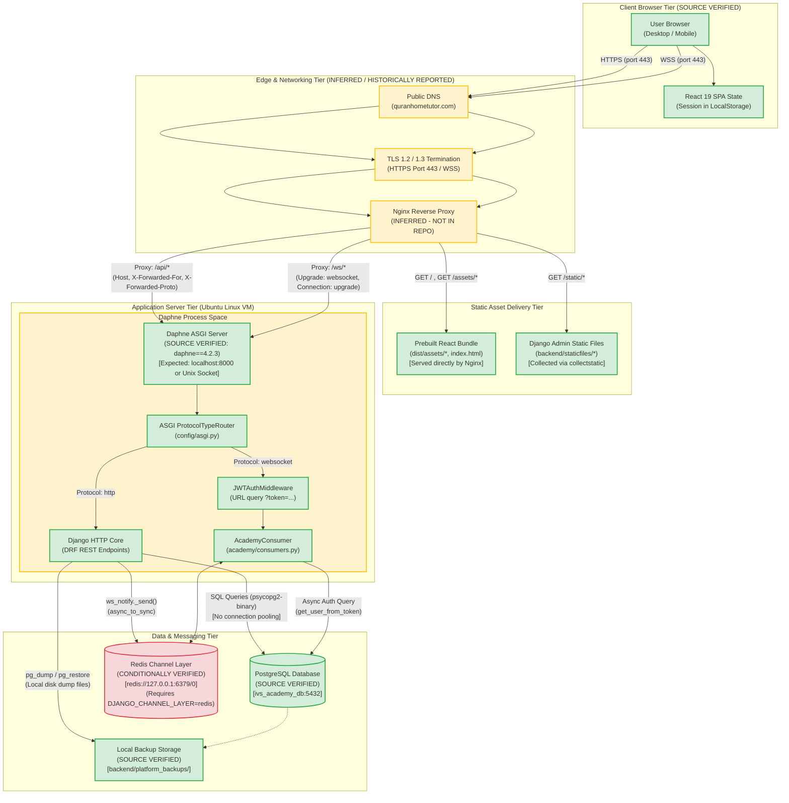
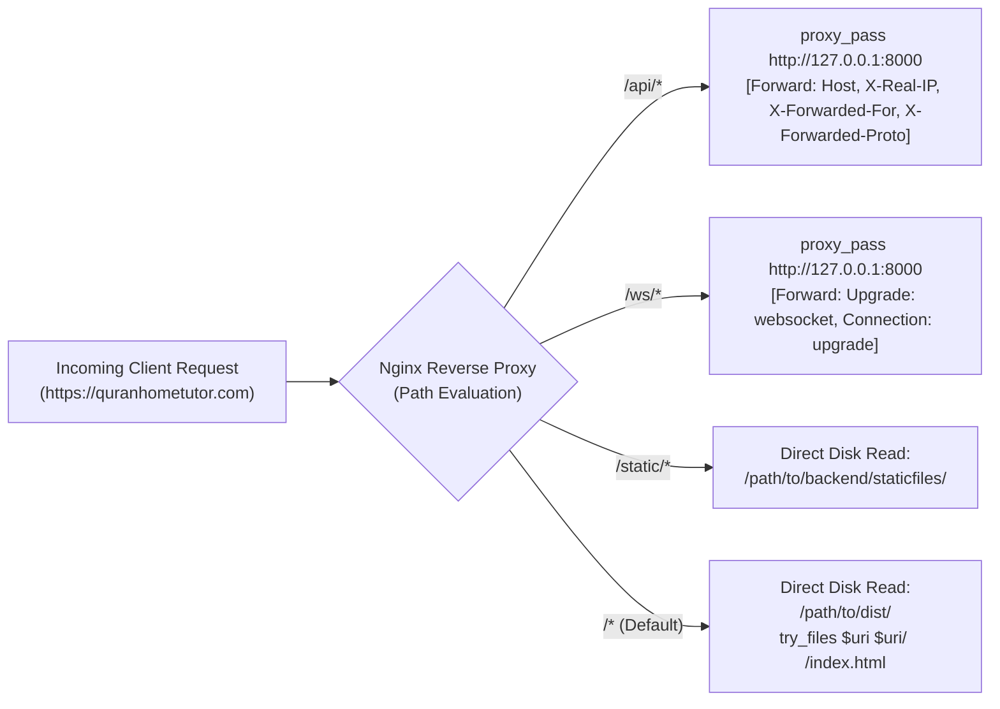
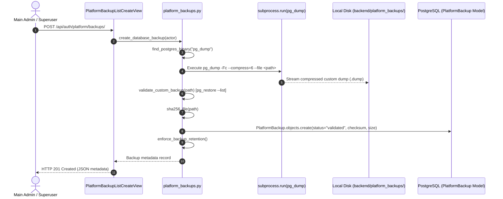

# IVS Qur'an Academy Manager — Infrastructure, Deployment & Operations Architecture

> **Document ID**: `10_INFRASTRUCTURE_DEPLOYMENT`  
> **Status**: COMPLETED (PHASE 6 AUDIT DELIVERABLE)  
> **Target System**: IVS Qur'an Academy Manager / IVS Schedule Viewer  
> **Production Target**: [https://quranhometutor.com/](https://quranhometutor.com/)  
> **Current Git Branch**: `release/ivs-20261020-candidate`  
> **Audited Commit Baseline**: `de92b7606543936eafe52ed66792eedda6d4598e`  
> **Execution Mode**: Option A — Local Source, Manifest & Documentation Analysis Only (Zero Remote Server / SSH / DB Probing)  
> **Author**: Antigravity Senior Infrastructure Architect, DevOps Specialist & Reliability Auditor  
> **Date**: 2026-11-03  

---

## 1. Executive Summary & Evidence Classification

This document provides a comprehensive, rigorous architectural audit of the infrastructure, deployment configuration, process management, networking, reverse proxy trust, database topology, backup systems, disaster recovery, and operational observability for the **IVS Qur'an Academy Manager**.

In strict accordance with the **Option A Execution Authorization**, no production servers, Oracle Cloud Infrastructure (OCI) consoles, SSH terminals, production PostgreSQL instances, Redis servers, or remote network ports were accessed. This audit is based exclusively on local source code, package manifests, build configurations, management commands, and version-controlled artifacts.

### 1.1 Evidence Classification Hierarchy

Every architectural claim, component, and operational pattern in this document is labeled using one of the following explicit certainty standards:

| Classification | Meaning & Criteria |
| :--- | :--- |
| **SOURCE VERIFIED** | Directly supported by physical source code, settings modules, package manifests, or CLI scripts present in the repository. |
| **DOCUMENTED** | Stated in committed documentation (`README.md`, `PROJECT.md`, comments) but not independently configured in executable code. |
| **HISTORICALLY REPORTED** | Known from prior commit history, development notes, or stakeholder briefings (e.g., reported OCI VM hosting). |
| **INFERRED** | A necessary architectural deduction derived from multiple verified components (e.g., reverse proxy requirements for same-origin WebSockets). |
| **PRODUCTION UNVERIFIED** | Requires live production host inspection, OCI tenancy inspection, or runtime verification. |
| **NOT FOUND** | Explicitly searched for in the authorized local workspace but confirmed absent from repository version control. |

---

## 2. Infrastructure File Inventory

A comprehensive scan of the repository was performed to locate all configuration, environment, build, orchestration, process management, and operational scripts.

| File Path | Infrastructure Category | Purpose / Responsibility | Environment | Evidence Status |
| :--- | :--- | :--- | :--- | :--- |
| `backend/config/settings.py` | Django Runtime Config | Database engine, middleware, JWT parameters, Channel layer, static root, logging, security flags. | Hybrid (Dev / Prod via `DEBUG`) | **SOURCE VERIFIED** |
| `backend/config/asgi.py` | ASGI Routing Entrypoint | Daphne ASGI application router binding HTTP to `get_asgi_application()` and WebSockets to `JWTAuthMiddleware(URLRouter)`. | Production & Local ASGI | **SOURCE VERIFIED** |
| `backend/config/wsgi.py` | WSGI Routing Entrypoint | Standard synchronous WSGI handler (`get_wsgi_application()`). | Legacy / Alternate WSGI | **SOURCE VERIFIED** |
| `backend/config/urls.py` | Root HTTP Dispatcher | Routes `/admin/`, `/api/auth/`, `/api/academy/`, `/api/tuition/`. | All | **SOURCE VERIFIED** |
| `backend/requirements.txt` | Backend Dependency Manifest | 19 pinned Python packages: Django 5.2.14, Daphne 4.2.3, Channels 4.3.2, channels-redis 4.3.0, psycopg2-binary 2.9.12, cryptography 46.0.4. | Backend (All) | **SOURCE VERIFIED** |
| `package.json` | Frontend Dependency Manifest | Node/npm scripts (`dev`, `build`, `typecheck`), React 19.2.0, Vite 6.2.0, Three.js, Lucide, Tailwind. | Frontend (All) | **SOURCE VERIFIED** |
| `vite.config.ts` | Frontend Build & Dev Config | Defines build output, development proxy (`/api` -> 5000), GLB asset bundling, and build-time env injection. | Frontend Build & Dev | **SOURCE VERIFIED** |
| `tsconfig.json` | TypeScript Compilation Config | Strict mode, target ES2020, moduleResolution Bundler. | Frontend Build | **SOURCE VERIFIED** |
| `setup_backend.ps1` | Developer Bootstrap Script | Windows PowerShell script to create `backend/venv`, upgrade pip, install requirements, and run `manage.py check`. | Local Windows Dev | **SOURCE VERIFIED** |
| `setup_backend.cmd` | Developer Bootstrap Wrapper | Batch wrapper invoking `setup_backend.ps1` with execution policy bypass. | Local Windows Dev | **SOURCE VERIFIED** |
| `verify_backend.cmd.ps1` | Backend Verification Script | PowerShell script compiling all Python files via `compileall` and executing `manage.py check`. | Local Windows Dev | **SOURCE VERIFIED** |
| `verify_backend.cmd` | Backend Verification Wrapper | Batch wrapper invoking `verify_backend.cmd.ps1`. | Local Windows Dev | **SOURCE VERIFIED** |
| `backend/accounts/platform_backups.py` | Backup Engine Service | PostgreSQL backup generator, validator (`pg_restore --list`), uploader, downloader, and retention enforcer. | Backend (PostgreSQL Host) | **SOURCE VERIFIED** |
| `backend/accounts/management/commands/restore_platform_backup.py` | CLI Database Restore Command | Django management command executing pre-restore backup, terminating DB connections, and running `pg_restore`. | Production Admin Terminal | **SOURCE VERIFIED** |
| `backend/accounts/platform_runtime.py` | Runtime Config & Secret Store | Encrypted settings storage in DB (`PlatformSetting`) via Fernet, with fallbacks to environment variables. | Backend (All) | **SOURCE VERIFIED** |
| `backend/accounts/platform_admin_api.py` | Platform Operations APIs | Endpoints for system health (`/api/auth/platform/health/`), backup listing, creation, upload, download, deletion. | Production Admin API | **SOURCE VERIFIED** |
| `backend/academy/consumers.py` | WebSocket ASGI Consumer | Handles WebSocket connection lifecycle, JWT authentication, group subscription (`user_*`, `role_*`, `global`), and pings. | ASGI Runtime | **SOURCE VERIFIED** |
| `backend/academy/ws_notify.py` | WebSocket Broadcaster | Sync-to-async channel layer emitter invoking `group_send` across user, role, and global channels. | Backend (All) | **SOURCE VERIFIED** |
| `backend/.env.example` | Backend Config Template | 7-line example file documenting `DJANGO_SECRET_KEY`, `DJANGO_DEBUG`, `DJANGO_ALLOWED_HOSTS`, `CORS_ALLOWED_ORIGINS`. | Development Template | **SOURCE VERIFIED** |
| `backend/logs/django.log` | Runtime Log Destination | Standard file log destination targeted by `settings.LOGGING['handlers']['file']`. | Runtime Host | **SOURCE VERIFIED** |
| `backend/stage3c5_apply.ps1` - `stage3d3_apply.ps1` | Historical Code Patch Scripts | 4 PowerShell patch scripts used during phase 3 development to overwrite `views.py` and `salary_v2_service.py`. | Historical Development | **SOURCE VERIFIED** |
| `.github/workflows/*` | CI/CD Automation Pipeline | GitHub Actions workflow definitions for build, test, lint, or automated deployment. | CI/CD | **NOT FOUND** |
| `Dockerfile` / `docker-compose.yml` | Containerization Manifests | Docker container or container orchestration specifications. | Containerization | **NOT FOUND** |
| `nginx.conf` / `sites-available/*` | Reverse Proxy Server Config | Production Nginx virtual host configurations, SSL cert paths, proxy headers, WebSocket upgrade directives. | Production Reverse Proxy | **NOT FOUND** |
| `systemd/*.service` | Linux Service Unit Files | Systemd process supervisor unit files for Daphne, Gunicorn, Celery, or background workers. | Production Linux Host | **NOT FOUND** |

---

## 3. End-to-End Application Deployment Topology

### 3.1 Topology Architecture Diagram

The diagram below synthesizes the complete physical and logical request flow, contrasting verified components against inferred production hosting tiers:



### 3.2 Detailed Component Responsibilities Matrix

| Component | Responsibility | Protocol / Port | Configuration Source | Verification Status |
| :--- | :--- | :--- | :--- | :--- |
| **Client SPA** | React 19 UI, hash routing (`/#dashboard`), state caching, JWT bearer injection, WS reconnect loop. | HTTPS / WSS | `App.tsx`, `authenticatedRequest.ts`, `useAcademyWS.ts` | **SOURCE VERIFIED** |
| **Reverse Proxy** | TLS termination, SPA fallback routing, `/api/` upstream proxy, `/ws/` WebSocket upgrade. | HTTP(S) 80, 443 -> 8000 | Absent from repository (Expected in `/etc/nginx/`) | **INFERRED / NOT FOUND** |
| **Daphne ASGI** | Unified ASGI application server serving REST APIs and Channels WebSockets. | ASGI / Port 8000 or Socket | `backend/config/asgi.py`, `backend/requirements.txt` | **SOURCE VERIFIED** |
| **Django DRF Core** | Authentication, 86 REST API routes, tenancy isolation, business rules, salary calculations. | Internal Python / ASGI | `backend/config/settings.py`, `backend/config/urls.py` | **SOURCE VERIFIED** |
| **Channels Layer** | Pub/Sub messaging bus broadcasting notifications to connected WebSocket clients. | In-Memory or Redis (Port 6379) | `backend/config/settings.py` (lines 173-197) | **SOURCE VERIFIED (Default: Memory)** |
| **PostgreSQL** | Relational data persistence, schema migrations, constraints, audit tables. | TCP 5432 | `backend/config/settings.py` (lines 71-80) | **SOURCE VERIFIED** |
| **Platform Backups** | Custom-format compressed database dumps (`pg_dump -Fc`), retention enforcement. | Subprocess CLI (`pg_dump`) | `backend/accounts/platform_backups.py` | **SOURCE VERIFIED** |

---

## 4. Oracle Cloud Infrastructure (OCI) & Linux Hosting Analysis

The project owner has historically reported hosting on an **Oracle Cloud Infrastructure (OCI) Ubuntu Linux Virtual Machine**.

### 4.1 Local Repository Evidence of OCI & Linux Assumptions

1. **Operating System Binary Detection (`platform_backups.py`)**:
   ```python
   # Lines 51-53 of backend/accounts/platform_backups.py
   else:
       for prefix in ["/usr/bin", "/usr/local/bin", "/opt/homebrew/bin"]:
           yield str(Path(prefix) / binary)
   ```
   Direct source evidence confirms standard Linux binary paths (`/usr/bin`, `/usr/local/bin`) are searched for PostgreSQL utilities (`pg_dump`, `pg_restore`).
2. **Oracle Attendance Sync Commit (`c4fb127`)**:
   Commit `c4fb127aec8864405c44c0093b039de86a929906` is titled `"Sync Oracle attendance, salary proof and portal updates"`, confirming that code adjustments were tested on and synchronized back from an active Oracle environment.
3. **Comment References in `settings.py`**:
   Line 205: `# HTTPS - enable after you get SSL certificate on Oracle server`.
4. **Filesystem Layout Expectations**:
   - `BASE_DIR = Path(__file__).resolve().parent.parent` (`/path/to/project/backend/`)
   - Static files root: `BASE_DIR / "staticfiles"`
   - Local backup root: `BASE_DIR / "platform_backups"`
   - Logs root: `BASE_DIR / "logs / django.log"`

### 4.2 Critical Production Elements NOT Found in Repository

The following essential hosting configurations are **NOT FOUND** in version control and reside entirely unversioned on the remote server:

- **OCI Compute Configuration**: VM shape, OCPU count, RAM, block volume attachments, and boot volume size.
- **OCI Virtual Cloud Network (VCN)**: Security Lists, Network Security Groups (NSGs), ingress rules for ports 80/443, and subnet routing.
- **Systemd Unit Files**: No service unit files (e.g., `daphne.service`, `redis.service`) are present in the repository.
- **OS Package Dependencies**: System libraries required on Ubuntu (e.g., `libpq-dev`, `python3-venv`, `postgresql-client`, `redis-server`) are undocumented outside of developer PowerShell scripts.

---

## 5. Reverse Proxy, Nginx & TLS Architecture

### 5.1 Nginx Routing Model (Inferred from Client & Server Architecture)

Because frontend API and WebSocket calls resolve strictly against `window.location.origin` and `window.location.host` (enforced in commit `de92b7606543936eafe52ed66792eedda6d4598e`), the production reverse proxy **MUST** multiplex three distinct routing pathways under `https://quranhometutor.com`:



### 5.2 Reverse Proxy Trust & TLS Security Flags Review

An in-depth static audit of `backend/config/settings.py` (lines 204-219) revealed critical proxy trust and TLS header discrepancies:

```python
if not DEBUG:
    SECURE_SSL_REDIRECT = False
    SECURE_HSTS_SECONDS = 31536000
    SECURE_HSTS_INCLUDE_SUBDOMAINS = True
    SECURE_HSTS_PRELOAD = True

    SESSION_COOKIE_SECURE = True
    CSRF_COOKIE_SECURE = True
    SECURE_CONTENT_TYPE_NOSNIFF = True

    CORS_ALLOW_ALL_ORIGINS = False
```

#### Reconciled Security Audit Findings:

1. **`SEC-006` Reconfirmed — Missing `SECURE_PROXY_SSL_HEADER`**:
   - `SECURE_PROXY_SSL_HEADER` is **completely absent** from `settings.py`.
   - In a standard deployment where Nginx terminates TLS on port 443 and proxies unencrypted HTTP traffic to Daphne on localhost:8000, Django relies on `SECURE_PROXY_SSL_HEADER = ('HTTP_X_FORWARDED_PROTO', 'https')` to detect that the client connected securely.
   - Without this setting, Django's `request.is_secure()` evaluates to `False`.
   - **Impact**: Any attempt to set `SECURE_SSL_REDIRECT = True` will cause an **infinite HTTP-to-HTTPS redirect loop** because Django cannot see that the request already arrived over HTTPS.
2. **`BE-006` Reconfirmed — `SECURE_SSL_REDIRECT = False` in Production**:
   - Despite setting HSTS headers (`SECURE_HSTS_SECONDS = 31536000`), `SECURE_SSL_REDIRECT` is explicitly set to `False`.
   - The inline comment notes: `# HTTPS - enable after you get SSL certificate on Oracle server`.
   - If Nginx fails to enforce an HTTP-to-HTTPS redirect rule at the web server layer, cleartext HTTP requests reaching Daphne will be served unencrypted without redirection.
3. **`INF-005` (New Finding) — Hardcoded `CSRF_TRUSTED_ORIGINS` Excludes Production Domain**:
   - Lines 128-133 of `settings.py`:
     ```python
     CSRF_TRUSTED_ORIGINS = [
         "http://localhost:3000",
         "http://127.0.0.1:3000",
         "http://localhost:5173",
         "http://127.0.0.1:5173",
     ]
     ```
   - `https://quranhometutor.com` is **omitted**.
   - `CSRF_TRUSTED_ORIGINS` does **not** read from an environment variable.
   - **Impact**: In Django 4.0+, any standard POST, PUT, or DELETE request submitted with session-based CSRF protection (e.g., logging into the Django Admin at `/admin/`) from `https://quranhometutor.com` will be blocked with **HTTP 403 Forbidden (CSRF verification failed)**. (DRF API requests using JWT Bearer headers bypass CSRF, but Django Admin and session views fail).

---

## 6. Django Production Settings & Environment Configuration

### 6.1 Complete Django Configuration Matrix

| Variable / Setting | Local Source | Default / Fallback | Production-Intended Behavior | Evidence Status |
| :--- | :--- | :--- | :--- | :--- |
| `DJANGO_DEBUG` | `settings.py:10` | `True` | Must be `False` in production `.env`. | **SOURCE VERIFIED** |
| `DJANGO_SECRET_KEY` | `settings.py:9` | `"dev-only-change-me"` | Must be a 50+ char high-entropy secret. Tested in health API. | **SOURCE VERIFIED** |
| `DJANGO_ALLOWED_HOSTS` | `settings.py:14` | `"localhost,127.0.0.1"` | Must include `quranhometutor.com,www.quranhometutor.com`. | **SOURCE VERIFIED** |
| `POSTGRES_DB` | `settings.py:74` | `"ivs_academy_db"` | Production database name. | **SOURCE VERIFIED** |
| `POSTGRES_USER` | `settings.py:75` | `"ivs_admin"` | Production database user. | **SOURCE VERIFIED** |
| `POSTGRES_PASSWORD` | `settings.py:76` | `"ivs123"` | Secure PostgreSQL password. | **SOURCE VERIFIED** |
| `POSTGRES_HOST` | `settings.py:77` | `"localhost"` | Database host IP or `localhost`. | **SOURCE VERIFIED** |
| `POSTGRES_PORT` | `settings.py:78` | `"5432"` | Database port. | **SOURCE VERIFIED** |
| `DJANGO_CHANNEL_LAYER` | `settings.py:173` | `"memory"` | Must be set to `"redis"` for multi-process production. | **SOURCE VERIFIED** |
| `REDIS_URL` | `settings.py:185` | `"redis://127.0.0.1:6379/0"` | Redis connection URL for channel layer. | **SOURCE VERIFIED** |
| `DJANGO_TIME_ZONE` | `settings.py:101` | `"UTC"` | Configurable runtime timezone. | **SOURCE VERIFIED** |
| `CORS_ALLOWED_ORIGINS` | `settings.py:115` | `localhost:3000,5173` | Can be supplemented by DB runtime settings (`cors_allowed_origins`). | **SOURCE VERIFIED** |
| `PG_BIN` | `platform_backups.py:34`| `""` (System PATH) | Explicit directory containing `pg_dump` and `pg_restore`. | **SOURCE VERIFIED** |
| `GEMINI_API_KEY` | `platform_runtime.py:165`| `""` (Missing) | Fallback API key for AI assistant if not stored encrypted in DB. | **SOURCE VERIFIED** |
| `GEMINI_MODEL` | `platform_runtime.py:169`| `"gemini-2.5-flash"` | Active model identifier for Google Gemini. | **SOURCE VERIFIED** |
| `STATIC_ROOT` | `settings.py:106` | `BASE_DIR / "staticfiles"`| Destination directory for `manage.py collectstatic`. | **SOURCE VERIFIED** |
| `MEDIA_ROOT` / `MEDIA_URL` | `settings.py` | **NOT DEFINED** | User media uploads are not configured in settings. | **NOT FOUND** |
| `CACHES` | `settings.py` | **NOT DEFINED** | Defaults to `LocMemCache`. Redis cache is not configured. | **NOT FOUND** |

### 6.2 Complete Environment Variable Inventory

The application references **15 distinct environment variables** across its backend and frontend toolchain:

| Variable Name | Component | Expected Type | Sensitivity | Documented in `.env.example`? | Code Location |
| :--- | :--- | :--- | :---: | :---: | :--- |
| `DJANGO_DEBUG` | Backend | Boolean (`"True"`/`"False"`) | Low | Yes | `backend/config/settings.py:10` |
| `DJANGO_SECRET_KEY` | Backend | String | **CRITICAL** | Yes (Placeholder) | `backend/config/settings.py:9` |
| `DJANGO_ALLOWED_HOSTS` | Backend | Comma-delimited list | Medium | Yes | `backend/config/settings.py:14` |
| `CORS_ALLOWED_ORIGINS` | Backend | Comma-delimited list | Medium | Yes | `backend/config/settings.py:115` |
| `POSTGRES_DB` | Backend | String | Medium | **NO (Gap)** | `backend/config/settings.py:74` |
| `POSTGRES_USER` | Backend | String | Medium | **NO (Gap)** | `backend/config/settings.py:75` |
| `POSTGRES_PASSWORD` | Backend | String | **CRITICAL** | **NO (Gap)** | `backend/config/settings.py:76` |
| `POSTGRES_HOST` | Backend | String | Low | **NO (Gap)** | `backend/config/settings.py:77` |
| `POSTGRES_PORT` | Backend | Integer string | Low | **NO (Gap)** | `backend/config/settings.py:78` |
| `DJANGO_CHANNEL_LAYER` | Backend | String (`redis`/`memory`) | Low | **NO (Gap)** | `backend/config/settings.py:173` |
| `REDIS_URL` | Backend | URI string | Medium | **NO (Gap)** | `backend/config/settings.py:185` |
| `DJANGO_TIME_ZONE` | Backend | String (e.g., `"UTC"`) | Low | **NO (Gap)** | `backend/config/settings.py:101` |
| `PG_BIN` | Backend | Directory path | Low | **NO (Gap)** | `backend/accounts/platform_backups.py:34` |
| `GEMINI_API_KEY` | Backend / Build | API Secret string | **HIGH** | **NO (Gap)** | `backend/accounts/platform_runtime.py:165`, `vite.config.ts:23` |
| `GEMINI_MODEL` | Backend | Model string | Low | **NO (Gap)** | `backend/accounts/platform_runtime.py:169` |

> [!WARNING]
> **Documentation Gap (`INF-009`)**: `backend/.env.example` only lists 4 variables (`DJANGO_SECRET_KEY`, `DJANGO_DEBUG`, `DJANGO_ALLOWED_HOSTS`, `CORS_ALLOWED_ORIGINS`). 11 active environment variables—including database credentials, Redis configuration, backup paths, and AI keys—are **completely undocumented** in the example file, creating significant risk during host provisioning or onboarding.

---

## 7. Daphne, ASGI & Process Management

### 7.1 ASGI Initialization Flow

ASGI is declared as the primary entrypoint:
- `settings.py`: `ASGI_APPLICATION = "config.asgi.application"`
- `backend/config/asgi.py`:
  ```python
  application = ProtocolTypeRouter({
      "http": get_asgi_application(),
      "websocket": JWTAuthMiddleware(
          URLRouter(websocket_urlpatterns)
      ),
  })
  ```
- Daphne serves both HTTP and WebSocket traffic through a single unified ASGI event loop.
- Synchronous Django database calls inside WebSocket consumer operations are safely delegated via `database_sync_to_async` (`get_user_from_token` in `backend/academy/middleware.py`).

### 7.2 Process Supervisor Findings (`INF-003`)

1. **Systemd Unit Files Missing**: No systemd unit files or supervisor configurations exist in the repository.
2. **Process Execution Assumptions**: Daphne must be started with a command equivalent to:
   ```bash
   daphne -b 127.0.0.1 -p 8000 config.asgi:application
   ```
3. **Autorestart & Worker Failure Risks**:
   - Without a process supervisor (like systemd, supervisord, or circus), any unhandled crash in Daphne or the Python runtime terminates all active API and WebSocket connections without automatic recovery.
   - There is no evidence of multi-worker Daphne process configuration or process clustering.

---

## 8. WebSocket & Redis Infrastructure

### 8.1 In-Memory vs. Redis Channel Layer Analysis

Django Channels supports both in-memory and Redis channel layers:

```mermaid
flowchart TD
    subgraph InMemoryMode["Default Mode: In-Memory (CHANNEL_LAYER_MODE=memory)"]
        DaphneWorker1["Daphne Worker / Thread 1\n(InMemoryChannelLayer)"]
        DaphneWorker2["Daphne Worker / Thread 2\n(InMemoryChannelLayer)"]
        DjangoHTTP["Synchronous Django View\n(ws_notify._send)"]
        
        DjangoHTTP -. "FAILS TO REACH" .-> DaphneWorker1
        DaphneWorker1 -. "ISOLATED FROM" .-> DaphneWorker2
    end

    subgraph RedisMode["Production Mode: Redis (CHANNEL_LAYER_MODE=redis)"]
        WorkerA["Daphne ASGI Process"]
        WorkerB["Django HTTP Process"]
        RedisServer[("Redis Pub/Sub Bus\n(redis://127.0.0.1:6379/0)")]
        
        WorkerB -- "group_send('role_teacher', event)" --> RedisServer
        RedisServer -- "Publishes Event" --> WorkerA
        WorkerA -- "Pushes Frame over WebSocket" --> ClientA["Connected Browser"]
    end
```



### 8.2 Architectural Vulnerability: In-Memory Layer Risk (`INF-006`)

1. **Default Fallback**: If `DJANGO_CHANNEL_LAYER` is not explicitly set to `"redis"`, Django silently activates `channels.layers.InMemoryChannelLayer`.
2. **Inter-Process Partitioning**: If Daphne is executed with multiple worker processes, or if synchronous HTTP requests (e.g., `/api/academy/lessons/`) execute in separate worker threads, `async_to_sync(layer.group_send)` executed from a synchronous view **cannot deliver messages** to WebSocket clients connected to a different process.
3. **Operational Impact**: Real-time attendance updates, emergency maintenance notifications, and lesson review notices will appear intermittently or fail completely under multi-process deployment unless Redis is running and explicitly enabled.

### 8.3 WebSocket Token Exposure in Access Logs (`SEC-002` Cross-Reference)

In `hooks/useAcademyWS.ts` (line 126):
```typescript
const url = `${base}/ws/academy/?token=${encodeURIComponent(token)}`;
```
- In Nginx and standard reverse proxies, the `$request` variable logs the entire HTTP request line, including the query string:
  ```text
  GET /ws/academy/?token=eyJhbGciOi... HTTP/1.1 101
  ```
- **Infrastructure Implication**: Every connected user's JWT access token is written in plaintext to `/var/log/nginx/access.log`. System administrators, log shippers, and backup archives automatically ingest active credentials valid for up to 8 hours.

---

## 9. PostgreSQL Infrastructure & Connection Topology

### 9.1 Database Configuration Parameters

```python
DATABASES = {
    "default": {
        "ENGINE": "django.db.backends.postgresql",
        "NAME": os.getenv("POSTGRES_DB", "ivs_academy_db"),
        "USER": os.getenv("POSTGRES_USER", "ivs_admin"),
        "PASSWORD": os.getenv("POSTGRES_PASSWORD", "ivs123"),
        "HOST": os.getenv("POSTGRES_HOST", "localhost"),
        "PORT": os.getenv("POSTGRES_PORT", "5432"),
    }
}
```

### 9.2 Connection Management & Pooling (`INF-011`)

1. **`CONN_MAX_AGE` Unconfigured**: Django defaults `CONN_MAX_AGE` to `0`. Every incoming HTTP request and every WebSocket asynchronous database query establishes, authenticates, and closes a physical TCP socket to PostgreSQL.
2. **Connection Overhead**: Under burst traffic (such as multiple teachers marking attendance or monthly salary calculation runs), this creates substantial CPU and connection pool pressure on PostgreSQL.
3. **PgBouncer Absence**: No external connection pooler (such as PgBouncer) is documented or configured in the repository.

---

## 10. Frontend Build, Delivery & Origin Resolution

### 10.1 Vite Build Configuration

- **Toolchain**: Vite 6.2.0, TypeScript 5.8.2, React 19.2.0.
- **Build Output**: `dist/` (default Vite output directory).
- **Asset Bundling**: Includes `.glb` 3D assets for WebGL physics lanyards (`assetsInclude: ['**/*.glb']`).
- **Build Scripts**:
  - `npm run build`: Executes `vite build`.
  - `npm run typecheck`: Executes `tsc --noEmit`.
  - `npm run check`: Executes `npm run typecheck && npm run build`.

### 10.2 Production Origin Resolution (Commit `de92b760`)

As verified in commit `de92b7606543936eafe52ed66792eedda6d4598e`, all hardcoded `http://127.0.0.1:8000` and `ws://127.0.0.1:8000` fallbacks were eliminated in favor of dynamic same-origin resolution:

```typescript
// services/authenticatedRequest.ts & djangoApiService.ts
const API_BASE = window.location.origin;

// hooks/useAcademyWS.ts & NotificationBell.tsx
const protocol = window.location.protocol === "https:" ? "wss:" : "ws:";
const WS_BASE = `${protocol}//${window.location.host}`;
```

This guarantees that:
- Production builds running on `https://quranhometutor.com/` automatically target `https://quranhometutor.com/api/...` and `wss://quranhometutor.com/ws/academy/`.
- Cross-origin CORS issues are eliminated in production provided Nginx proxies `/api/` and `/ws/` on the same domain.

---

## 11. Platform Backup Architecture & Disaster Recovery

### 11.1 Backup Generation Workflow

Database backups are implemented in `backend/accounts/platform_backups.py` and exposed via the Platform Admin API (`/api/auth/platform/backups/`):



### 11.2 Key Backup Capabilities

1. **Format**: PostgreSQL custom format (`--format=custom`, `--compress=6`), ensuring schema, table data, and sequences are preserved with maximum portability.
2. **Integrity Verification**: Backups are verified immediately upon creation or upload by executing `pg_restore --list <file>` via subprocess.
3. **Cryptographic Checksum**: Every backup calculates and stores a full SHA-256 digest in `PlatformBackup.checksum_sha256`.
4. **Retention Management**: Backups are subject to automated FIFO retention pruning via `enforce_backup_retention()`, with retention count configurable between 1 and 50 (default: 10).
5. **Secure Streaming Download**: Validated backups can be streamed directly to authenticated Main Admins via `PlatformBackupDownloadView` (`FileResponse`).

### 11.3 Disaster Recovery Procedure (`restore_platform_backup.py`)

A dedicated Django management command implements database restoration:
```bash
python manage.py restore_platform_backup --backup-id <ID> --confirm <EXACT_FILENAME>
```

#### Restoration Operational Sequence:
1. Validates that the requested backup record exists in `PlatformBackup`.
2. Verifies exact confirmation string matching the filename.
3. Validates the physical file using `pg_restore --list`.
4. **Automatic Safety Pre-Restore Backup**: Automatically executes `create_database_backup(source="pre_restore", prefix="pre_restore")` before touching the active database.
5. Closes all active Django database connections (`connections.close_all()`).
6. Executes `pg_restore` with flags `--clean --if-exists --no-owner --no-privileges --exit-on-error`.
7. Prompts administrator to execute:
   ```bash
   python manage.py migrate
   python manage.py runserver  # (In production: systemctl restart daphne)
   ```

### 11.4 Disaster Recovery Single Point of Failure (`INF-004`)

> [!CRITICAL]
> **Single Point of Failure**: All backups are written exclusively to local VM disk storage at `backend/platform_backups/`.
> - **Zero Off-Site Replication**: There is no synchronization to OCI Object Storage, Amazon S3, external SFTP, or remote block volumes.
> - **Catastrophic Exposure**: If the Oracle VM suffers hardware failure, disk corruption, accidental termination, or volume loss, **all database backups are destroyed simultaneously with the primary database**.

---

## 12. Logging, Observability & Health Checks

### 12.1 Django Logging Configuration

Configured in `backend/config/settings.py` (lines 223-259):

```python
LOGGING = {
    "version": 1,
    "disable_existing_loggers": False,
    "formatters": {
        "verbose": {
            "format": "{levelname} {asctime} {module} {message}",
            "style": "{",
        },
    },
    "handlers": {
        "console": {
            "class": "logging.StreamHandler",
            "formatter": "verbose",
        },
        "file": {
            "class": "logging.FileHandler",
            "filename": BASE_DIR / "logs" / "django.log",
            "formatter": "verbose",
        },
    },
    "root": {
        "handlers": ["console"],
        "level": "WARNING",
    },
    "loggers": {
        "academy": {
            "handlers": ["console", "file"],
            "level": "WARNING",
            "propagate": False,
        },
        "accounts": {
            "handlers": ["console", "file"],
            "level": "WARNING",
            "propagate": False,
        },
    },
}
```

### 12.2 Observability & Reliability Gaps

1. **`BE-003` Reconfirmed — Tuition Logger Omitted**:
   - The `"tuition"` app is not registered in `LOGGING['loggers']`.
   - Any log message generated by `tuition` models, views, or services propagates to the `root` logger.
   - The `root` logger **only** outputs to the `console` handler and **never** writes to `backend/logs/django.log`.
   - As a result, file-based logging captures zero Tuition domain events or errors.
2. **`INF-007` (New Finding) — Lack of Log Rotation (`FileHandler` vs. `RotatingFileHandler`)**:
   - The file handler uses standard `logging.FileHandler` instead of `logging.handlers.RotatingFileHandler`.
   - `backend/logs/django.log` will grow continuously without size limits or rotation. On a cloud VM with constrained disk space, unrotated logs will eventually cause disk exhaustion, crashing PostgreSQL and Daphne.
3. **`INF-008` (New Finding) — Absence of Unauthenticated Uptime / Load Balancer Health Checks**:
   - `/api/academy/health/` requires `IsAuthenticated` (HTTP 401 for monitors).
   - `/api/auth/platform/health/` requires Main Admin permissions and executes `SELECT 1` along with extensive database introspection.
   - There is **no unauthenticated `/healthz` or `/ping` endpoint**. External load balancers, OCI Health Checks, and third-party uptime monitors (e.g., UptimeRobot) cannot verify backend vitality without holding authenticated credentials.
4. **Lack of APM & Error Tracking**:
   - No Sentry, OpenTelemetry, Datadog, or Prometheus instrumentation exists in backend requirements or frontend packages. Unhandled runtime errors only appear in local terminal outputs or unrotated files.

---

## 13. CI/CD, Deployment & Rollback Analysis

### 13.1 Deployment Procedure Reconstruction (Inferred Production Workflow)

Because no CI/CD automation (`.github/workflows/`, Jenkinsfile, GitLab CI) exists in version control, deployments to the Oracle Cloud host are inferred to be executed **entirely manually via SSH**:

| Step | Operation | Command / Procedure | Risk Level | Evidence Status |
| :--- | :--- | :--- | :---: | :--- |
| **1. Source Pull** | Pull code from Git | `git pull origin release/ivs-20261020-candidate` | High | **INFERRED** |
| **2. Backend Deps** | Install pip packages | `source venv/bin/activate && pip install -r requirements.txt` | Medium | **INFERRED** |
| **3. Database Migrations** | Apply schema changes | `python manage.py migrate` | High | **INFERRED** |
| **4. Collect Static** | Collect Django admin static | `python manage.py collectstatic --noinput` | Low | **INFERRED** |
| **5. Frontend Build** | Build Vite production bundle | `npm install && npm run build` | Medium | **INFERRED** |
| **6. Webroot Deploy** | Copy `dist/` to Nginx root | `cp -r dist/* /var/www/html/` (or similar webroot) | Medium | **INFERRED** |
| **7. Service Restart** | Restart Daphne & Nginx | `sudo systemctl restart daphne && sudo systemctl reload nginx` | High | **INFERRED** |

### 13.2 Git Branching & Release Management Risks

1. **Working Tree Divergence**:
   - Current local branch `release/ivs-20261020-candidate` is **2 commits behind** `origin/release/ivs-20261020-candidate`.
   - Deploying directly from a local development environment without synchronizing remote commits risks deploying obsolete or conflicting code.
2. **Absence of Deployment Gateways & Automated Rollbacks (`INF-001`)**:
   - There are zero automated pre-deployment sanity checks, automated test gates, or automated rollback scripts in the repository.
   - If a schema migration fails or a frontend chunk fails to build, production will be left in a broken, half-migrated state requiring manual database restoration.

---

## 14. Consolidated Infrastructure Findings Matrix

| Finding ID | Severity | Title | Affected Component | Confidence | Production Verified? |
| :--- | :---: | :--- | :--- | :---: | :---: |
| **`INF-001`** | **P1 (High)** | Absence of Automated CI/CD, Deployment Automation & Rollback Procedures | Release Management / CI/CD | VERIFIED | Local Confirmed (No CI in repo) |
| **`INF-002`** | **P1 (High)** | Production Reverse Proxy & Nginx Configuration Unversioned | Networking / Reverse Proxy | VERIFIED | Local Confirmed (No Nginx config) |
| **`INF-003`** | **P1 (High)** | Absence of Process Manager Configuration (Systemd / Daphne Units Missing) | Process Management | VERIFIED | Local Confirmed (No unit files) |
| **`INF-004`** | **P1 (High)** | Disaster Recovery Single Point of Failure (Local Disk Only, Zero Off-Site Sync) | Backup & Disaster Recovery | VERIFIED | Local Confirmed (Local storage only) |
| **`INF-005`** | **P1 (High)** | Hardcoded Localhost `CSRF_TRUSTED_ORIGINS` Excludes Production Domain | Security / Django Settings | VERIFIED | Local Confirmed (`settings.py:128`) |
| **`INF-006`** | **P2 (Med)** | Default In-Memory Channel Layer Vulnerability in Multi-Process ASGI Deployment | Channels / WebSockets | VERIFIED | Local Confirmed (`settings.py:173`) |
| **`INF-007`** | **P2 (Med)** | Lack of Log Rotation on `django.log` (Unbounded Disk Growth Risk) | Observability / Logging | VERIFIED | Local Confirmed (`settings.py:238`) |
| **`INF-008`** | **P2 (Med)** | Absence of Unauthenticated Liveness / Readiness Health Check Endpoint | Observability / Health Checks | VERIFIED | Local Confirmed (`views.py:761`) |
| **`INF-009`** | **P3 (Low)** | Undocumented Environment Variables in `.env.example` Template | Documentation / DevOps | VERIFIED | Local Confirmed (`.env.example:1`) |
| **`INF-010`** | **P3 (Low)** | Absence of Media Files Storage Configuration (`MEDIA_ROOT` / `MEDIA_URL`) | Django Settings / Storage | VERIFIED | Local Confirmed (`settings.py`) |
| **`INF-011`** | **P3 (Low)** | Lack of PostgreSQL Connection Pooling / `CONN_MAX_AGE` Configuration | Database / Performance | VERIFIED | Local Confirmed (`settings.py:71`) |

---

## 15. Detailed Finding Reports

### Finding `INF-001`: Absence of Automated CI/CD, Deployment Automation & Rollback Procedures
- **Severity**: P1 (High)
- **Component**: Release Management / CI/CD
- **Source Evidence**: No `.github/`, `.gitlab-ci.yml`, `Jenkinsfile`, or shell deployment scripts exist in repository.
- **Expected Behavior**: Automated CI/CD pipeline running linting, typechecks, backend checks, automated migrations, zero-downtime service reload, and automated rollback upon failure.
- **Current Behavior**: Deployment is entirely manual, unversioned, and dependent on ad-hoc SSH commands.
- **Impact**: High risk of human error during production updates, service downtime, schema corruption, and untracked code differences.
- **Remediation**: Implement a standard GitHub Actions workflow automating `npm run check`, `compileall`, `manage.py check`, and automated deployment with pre-restore database backups.

### Finding `INF-002`: Production Reverse Proxy & Nginx Configuration Unversioned
- **Severity**: P1 (High)
- **Component**: Networking / Reverse Proxy
- **Source Evidence**: No Nginx configuration files or templates exist anywhere in the repository.
- **Expected Behavior**: Nginx virtual host configuration tracked in version control with documented proxy headers, WebSocket upgrade directives, upload limits, and TLS parameters.
- **Current Behavior**: Nginx configuration exists only as mutable runtime state on the remote VM.
- **Impact**: Server disaster recovery or replication to a second node requires manual reverse-engineering of proxy rules.
- **Remediation**: Check in a standardized `nginx.conf` and site template into `deploy/nginx/` inside version control.

### Finding `INF-003`: Absence of Process Manager Configuration (Systemd / Daphne Units Missing)
- **Severity**: P1 (High)
- **Component**: Process Management
- **Source Evidence**: Zero `*.service` files or supervisor configurations exist in the workspace.
- **Expected Behavior**: Managed systemd unit file (e.g., `/etc/systemd/system/daphne.service`) configuring autorestart, user sandbox, environment loading, and graceful worker restarts.
- **Current Behavior**: Process management is unversioned and unverified locally.
- **Impact**: If Daphne crashes due to an unhandled exception or OOM event, it will not restart automatically without a supervisor.
- **Remediation**: Author and commit a production systemd service template in `deploy/systemd/daphne.service`.

### Finding `INF-004`: Disaster Recovery Single Point of Failure (Local Disk Only, Zero Off-Site Sync)
- **Severity**: P1 (High)
- **Component**: Backup & Disaster Recovery
- **Source Evidence**: `backend/accounts/platform_backups.py` writes all dump files strictly to `Path(settings.BASE_DIR) / "platform_backups"`.
- **Expected Behavior**: Database backups replicated off-host to encrypted object storage (OCI Object Storage, AWS S3, or remote secure storage).
- **Current Behavior**: Backups reside exclusively on the same physical VM disk as the primary PostgreSQL database.
- **Impact**: Total data loss if the virtual machine block volume fails, is corrupted, or is accidentally terminated.
- **Remediation**: Add automated off-site sync (e.g., via OCI CLI or rclone cron job) pushing validated backups to OCI Object Storage bucket.

### Finding `INF-005`: Hardcoded Localhost `CSRF_TRUSTED_ORIGINS` Excludes Production Domain
- **Severity**: P1 (High)
- **Component**: Security / Django Settings
- **Source Evidence**: `backend/config/settings.py:128-133`:
  ```python
  CSRF_TRUSTED_ORIGINS = [
      "http://localhost:3000",
      "http://127.0.0.1:3000",
      "http://localhost:5173",
      "http://127.0.0.1:5173",
  ]
  ```
- **Expected Behavior**: `CSRF_TRUSTED_ORIGINS` includes `https://quranhometutor.com` or dynamically loads from an environment variable.
- **Current Behavior**: Production domain is omitted.
- **Impact**: Any session-authenticated POST/PUT/DELETE request (such as logging into the Django Admin at `/admin/`) from the production website will be blocked by Django with HTTP 403 Forbidden.
- **Remediation**: Add `https://quranhometutor.com` to `CSRF_TRUSTED_ORIGINS` or populate it dynamically from `DJANGO_ALLOWED_HOSTS` / `CORS_ALLOWED_ORIGINS`.

### Finding `INF-006`: Default In-Memory Channel Layer Vulnerability in Multi-Process ASGI Deployment
- **Severity**: P2 (Medium)
- **Component**: Channels / WebSockets
- **Source Evidence**: `backend/config/settings.py:173-197`: defaults to `InMemoryChannelLayer` unless `DJANGO_CHANNEL_LAYER="redis"`.
- **Expected Behavior**: Production deployment strictly enforces Redis channel layer across all Daphne and Django worker processes.
- **Current Behavior**: If the environment variable is omitted in production `.env`, in-memory mode is used silently.
- **Impact**: In-memory channel layers cannot pass messages across processes or worker threads; WebSocket real-time updates silently fail.
- **Remediation**: Set `DJANGO_CHANNEL_LAYER=redis` and configure `REDIS_URL` in production `.env`, or fail fast if `DEBUG=False` and `CHANNEL_LAYER_MODE != "redis"`.

### Finding `INF-007`: Lack of Log Rotation on `django.log` (Unbounded Disk Growth Risk)
- **Severity**: P2 (Medium)
- **Component**: Observability / Logging
- **Source Evidence**: `backend/config/settings.py:238`: uses standard `logging.FileHandler`.
- **Expected Behavior**: Log rotation configured via `RotatingFileHandler` (e.g., 20 MB max bytes, 5 backup files) or external `logrotate`.
- **Current Behavior**: Log file grows indefinitely on local disk.
- **Impact**: Risk of disk volume exhaustion on the Oracle Linux host, leading to cascading application failure.
- **Remediation**: Switch handler class to `logging.handlers.RotatingFileHandler` with `maxBytes=20*1024*1024` and `backupCount=5`.

### Finding `INF-008`: Absence of Unauthenticated Liveness / Readiness Health Check Endpoint
- **Severity**: P2 (Medium)
- **Component**: Observability / Health Checks
- **Source Evidence**: `backend/academy/views.py:761`: `AcademyHealthView` requires `IsAuthenticated`.
- **Expected Behavior**: Lightweight, unauthenticated `/healthz` or `/api/health/` endpoint returning 200 OK for load balancers and uptime monitors.
- **Current Behavior**: External monitoring without JWT tokens receives HTTP 401 Unauthorized.
- **Impact**: Load balancers cannot perform health probes to route traffic away from unhealthy instances.
- **Remediation**: Expose an unauthenticated, rate-limited `/api/healthz/` endpoint that executes a lightweight database ping (`SELECT 1`).

### Finding `INF-009`: Undocumented Environment Variables in `.env.example` Template
- **Severity**: P3 (Low)
- **Component**: Documentation / DevOps
- **Source Evidence**: `backend/.env.example` only lists 4 variables out of 15 referenced in code.
- **Expected Behavior**: `.env.example` contains all environment keys with clear descriptions and safe placeholder values.
- **Current Behavior**: Missing documentation for `POSTGRES_*`, `REDIS_URL`, `DJANGO_CHANNEL_LAYER`, `PG_BIN`, and `GEMINI_*`.
- **Impact**: Onboarding confusion, configuration errors during host provisioning.
- **Remediation**: Update `backend/.env.example` with the complete 15-variable inventory.

### Finding `INF-010`: Absence of Media Files Storage Configuration (`MEDIA_ROOT` / `MEDIA_URL`)
- **Severity**: P3 (Low)
- **Component**: Django Settings / Storage
- **Source Evidence**: Neither `MEDIA_ROOT` nor `MEDIA_URL` is configured in `settings.py`.
- **Expected Behavior**: Explicit media configuration for user-uploaded files.
- **Current Behavior**: Media storage is unconfigured. (Backups use custom dedicated paths in `platform_backups/`).
- **Impact**: Any future feature handling user profile pictures or attachments will fail without media configuration.
- **Remediation**: Define `MEDIA_ROOT = BASE_DIR / "media"` and `MEDIA_URL = "media/"` in `settings.py`.

### Finding `INF-011`: Lack of PostgreSQL Connection Pooling / `CONN_MAX_AGE` Configuration
- **Severity**: P3 (Low)
- **Component**: Database / Performance
- **Source Evidence**: `settings.py` sets no `CONN_MAX_AGE` or connection pool parameters.
- **Expected Behavior**: Connection reuse configured (`CONN_MAX_AGE = 60` or external PgBouncer).
- **Current Behavior**: Database connection opened and closed per request.
- **Impact**: Latency overhead and connection pool exhaustion during concurrent traffic spikes.
- **Remediation**: Set `CONN_MAX_AGE = 60` for production or evaluate PgBouncer for high-concurrency environments.

---

## 16. Reconciling Phase 5 Security Findings with Infrastructure Evidence

| Prior Finding | Description | Phase 6 Infrastructure Evidence & Impact |
| :--- | :--- | :--- |
| **`SEC-001`** | WebSocket broadcaster fanout lacks tenant scoping | Directly dependent on `CHANNEL_LAYER_MODE`. If Redis is active, broadcasts leak cross-tenant across all connected instances. If in-memory layer is active, events are partitioned per process. |
| **`SEC-002`** | WebSocket token query-string exposure | Nginx access logging records the full request line (`GET /ws/academy/?token=... HTTP/1.1`), permanently exposing active 8-hour JWTs in plaintext log files on the host. |
| **`SEC-006`** | Missing `SECURE_PROXY_SSL_HEADER` | Verified in `settings.py`. Under Nginx terminating TLS, Django cannot detect HTTPS, preventing `SECURE_SSL_REDIRECT = True` and causing infinite redirect loops. |
| **`BE-003`** | Tuition omitted from file logging | Verified in `settings.py:247-258`. Tuition logs are excluded from `django.log` and only emitted to standard out at WARNING level. |
| **`BE-006`** | Production SSL redirect concern | Verified in `settings.py:206`. `SECURE_SSL_REDIRECT` is disabled in production code (`False`). Nginx must enforce HTTPS redirection. |

---

## 17. Production Verification Boundary

The following questions **CANNOT** be resolved from local source analysis alone and require authorized production server inspection:

1. **Active Nginx Virtual Host Configuration**: What are the exact `proxy_pass`, `proxy_set_header`, and `client_max_body_size` directives configured in `/etc/nginx/sites-enabled/`?
2. **Active Process Supervisor**: Is Daphne managed via `systemd`, `supervisord`, `tmux`, or executed directly in a terminal?
3. **Redis Runtime Status**: Is Redis installed, running, and configured with password authentication on `localhost:6379`? Is `DJANGO_CHANNEL_LAYER=redis` set in `/path/to/production/backend/.env`?
4. **PostgreSQL Version & Storage Allocation**: What is the active PostgreSQL major version, and what is the available disk space on the database storage volume?
5. **Off-Host Backup Existence**: Does the production administrator execute an out-of-band cron job (e.g., `rsync`, OCI Object Storage sync) to replicate `backend/platform_backups/` off the virtual machine?
6. **TLS Certificate Automation**: Is TLS managed via Certbot / Let's Encrypt automated renew timers or a manual commercial certificate?
7. **OCI Security List Configuration**: Are ports 5432 (Postgres) and 6379 (Redis) strictly bound to localhost/private subnet, or are they exposed to the public internet?

---

> [!IMPORTANT]
> **Audit Integrity Statement**: Phase 6 local infrastructure, deployment architecture, and operational reliability audit completed to the documented coverage level. No production servers, databases, Redis instances, APIs, or remote services were accessed. No application source code, configuration, migration, database record, Git state, or deployment artifact was modified. Only authorized Markdown audit documentation was created or updated. Awaiting review and authorization before Phase 7.
