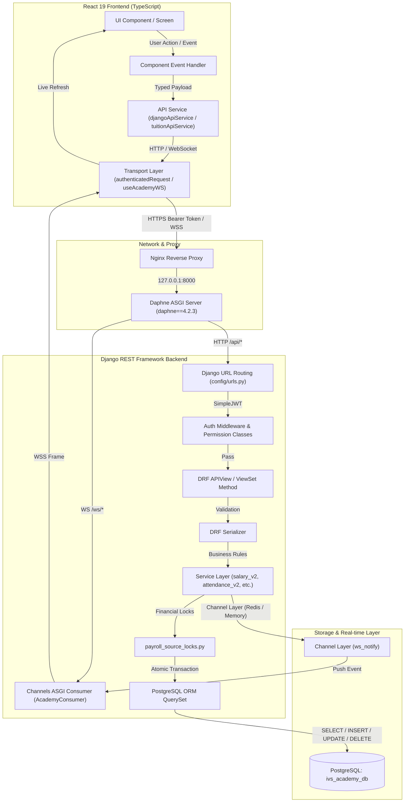
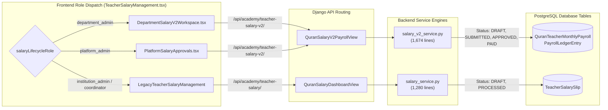

# IVS Qur'an Academy Manager — Complete Integration, Route Gaps & Contract Reconciliation Audit

> **Document ID**: `11_INTEGRATION_ROUTE_GAPS`  
> **Phase**: Phase 7 — Complete End-to-End Integration, Missing Routes, Functional Gaps, Testing, Reliability & Master Findings Audit  
> **Repository Target**: `quran----1-Role-Based-`  
> **Current Audited Branch**: `release/ivs-20261020-candidate`  
> **Audited Commit Baseline**: `de92b7606543936eafe52ed66792eedda6d4598e` (`fix(frontend): prevent localhost API and WebSocket URLs in production`)  
> **Author**: Antigravity Senior Full-Stack Software Architect, React/TypeScript Architect & DRF Integration Auditor  
> **Audit Execution Date**: 2026-11-03  
> **Audit Status**: VERIFIED (Exhaustive static trace from React UI event handlers through API clients, Django URL patterns, views, serializers, ORM mutations, to WebSocket broadcasts)

---

## 1. Executive Summary & Integration Architecture

This document provides the definitive end-to-end integration map of the IVS Qur'an Academy Manager. Every active user screen, button click, and API client method in the frontend was traced through network transport, Django URL routing, authentication and permission classes, views, serializers, service layers, and PostgreSQL ORM transactions.

### 1.1 Methodology & Endpoint Metrics Reconciliation

Previous audit phases reported seemingly disparate counts for backend routes and frontend calls:
- **Phase 2** reported ~90 active frontend API calls.
- **Phase 3** cataloged 86 registered Django URL patterns.
- **Phase 5** analyzed 118 method/action-specific backend operations.

Our Phase 7 static reconciliation confirms that **all three metrics are accurate descriptions of different architectural layers**:

1. **86 Registered Django URL Patterns**:
   - `backend/accounts/urls.py` declares **39** URL patterns (`/api/auth/...`).
   - `backend/academy/urls.py` declares **25** URL patterns (`/api/academy/...`).
   - `backend/tuition/urls.py` declares **22** URL patterns (`/api/tuition/...`).
   - Total: $39 + 25 + 22 = 86$ registered `path(...)` patterns in Django routing.

2. **90 Active Frontend API Calls**:
   - `services/djangoApiService.ts` exports **59** typed API functions.
   - `services/tuitionApiService.ts` exports **25** typed API functions.
   - Specialized and component-level network clients (`services/geminiService.ts`, `components/NotificationBell.tsx`, `components/PlatformAdmin.tsx`, `services/authenticatedRequest.ts`) account for **6** additional distinct calls.
   - Total: $59 + 25 + 6 = 90$ active frontend API caller entrypoints.

3. **118 Method/Action-Specific Backend Operations**:
   - A single registered URL pattern frequently multiplexes multiple HTTP verbs (`GET`, `POST`, `PUT`, `PATCH`, `DELETE`) or RPC-style action dispatches.
   - For example, `/api/academy/teacher-salary-v2/` is a single URL pattern that multiplexes `GET` (dashboard) and a `POST` handler executing 10 discrete workflow actions (`calculate`, `submit`, `approve`, `reject`, `mark_paid`, `reopen`, `propose_adjustment`, `approve_adjustment`, `reject_adjustment`, `rejoin_student`).
   - Similarly, `/api/auth/accounts/<int:user_id>/` handles 4 distinct operations (`GET`, `PUT`, `PATCH`, `DELETE`).
   - Enumerating each distinct HTTP verb and custom action across the 86 registered patterns yields exactly **118 backend operations**.

---

## 2. Full-Stack End-to-End Integration Architecture

The following diagram illustrates the complete request lifecycle across the frontend, network, Django ASGI/WSGI stack, service layer, and database.



---

## 3. Frontend Screen & Workspace Reconciliation

Every major screen in the frontend application was inspected for route structure, role guards, department context, backing API dependencies, and error handling.

| Screen / Workspace | Component | Navigation / Hash Route | Role Guard | Department Guard | Backing API Endpoints | Integration Status |
| :--- | :--- | :--- | :--- | :--- | :--- | :--- |
| **Platform Administration** | `PlatformAdmin.tsx` | `#platform-admin` | `is_superuser` / `platform_admin` | Global (All) | `/api/auth/platform/*`<br>`/api/academy/teacher-salary-v2/` | **STATICALLY MATCHED** |
| **Quran Coordinator Workspace** | `App.tsx` | `#dashboard` | `coordinator`, `institution_admin`, `department_admin` | Quran Department | `/api/academy/dashboard/`<br>`/api/academy/attendance/` | **STATICALLY MATCHED** |
| **Quran Scheduling Matrix** | `App.tsx` | `#scheduling` | `coordinator`, `institution_admin`, `department_admin` | Quran Department | `/api/auth/accounts/`<br>`/api/academy/attendance/` | **STATICALLY MATCHED** |
| **Quran Attendance Tracker** | `TeacherSessionAttendanceV2.tsx`<br>`AttendanceTracker.tsx` | `#attendance` | Attendance Managers | Quran Department | `/api/academy/teacher-session-attendance-v2/`<br>`/api/academy/attendance/` | **STATICALLY MATCHED** |
| **Quran Account Management** | `CoordinatorAccounts.tsx` | `#accounts` | `coordinator`, `department_admin`, `institution_admin` | Quran Department | `/api/auth/accounts/`<br>`/api/auth/accounts/<id>/teacher-retirement/` | **STATICALLY MATCHED** |
| **Quran Dropped & On-Leave** | `DroppedLeaveStudents.tsx` | `#dropped-leave` | `coordinator`, `department_admin`, `institution_admin` | Quran Department | `/api/academy/dropped-leave/` | **STATICALLY MATCHED** |
| **Quran Salary Workspace (V2)** | `DepartmentSalaryV2Workspace.tsx` | `#teacher-salary` | `department_admin` (Strict) | Quran Department | `/api/academy/teacher-salary-v2/`<br>`/api/academy/teacher-salary-v2/proof/` | **STATICALLY MATCHED** |
| **Quran Salary Workspace (Legacy V1)**| `TeacherSalaryManagement.tsx` | `#teacher-salary` | `institution_admin`, `coordinator` | Quran Department | `/api/academy/teacher-salary/`<br>`/api/academy/teacher-salary/settings/` | **LEGACY ENGINE COEXISTENCE** |
| **Quran Daily Lesson Reports** | `DailyLessonReports.tsx` | `#lessons` | `coordinator`, `department_admin` | Quran Department | `/api/academy/daily-lesson-reports/`<br>`/api/academy/monthly-lesson-plans/` | **STATICALLY MATCHED** |
| **Quran Attendance Reports** | `AttendanceReportWorkspace.tsx` | `#reports` | `coordinator`, `department_admin` | Quran Department | `/api/academy/attendance/report-sessions/` | **STATICALLY MATCHED** |
| **Tuition Coordinator Workspace** | `TuitionCoordinatorPortal.tsx` | Mode: Tuition (`role=coordinator`) | `coordinator`, `department_admin`, `institution_admin` | Tuition Department | `/api/tuition/foundation/`<br>`/api/tuition/options/`<br>`/api/tuition/accounts/` | **STATICALLY MATCHED** |
| **Tuition Accounts & Enrollment** | `TuitionAccountsEnrollment.tsx` | Tuition Tab: `accounts` | Tuition Managers | Tuition Department | `/api/tuition/accounts/`<br>`/api/tuition/enrollments/` | **HIGH RISK CASCADE DELETION** |
| **Tuition Timetable Matrix** | `TuitionTimetableMatrix.tsx` | Tuition Tab: `timetable` | Tuition Managers | Tuition Department | `/api/tuition/scheduling-matrix/`<br>`/api/tuition/schedules/` | **STATICALLY MATCHED** |
| **Tuition Teacher Portal** | `TuitionTeacherPortal.tsx` | Role: `teacher` (Tuition Dept) | `teacher` | Tuition Department | `/api/tuition/teacher-portal/`<br>`/api/tuition/attendance/` | **STATICALLY MATCHED** |
| **Tuition Student Portal** | `TuitionStudentPortal.tsx` | Role: `student` (Tuition Dept) | `student` | Tuition Department | `/api/tuition/student-portal/`<br>`/api/tuition/student-bundle/<id>/` | **PARTIALLY MATCHED (Assignments Placeholder)** |
| **Tuition Pending Portal** | `TuitionPendingPortal.tsx` | Lazy imported in `App.tsx` | Unassigned / Pending | Tuition Department | None | **DISCONNECTED / UNMOUNTED DEAD CODE** |

---

## 4. Frontend API Client to Django Route Comparison Matrix

Every API method exported by `services/djangoApiService.ts` and `services/tuitionApiService.ts` was compared against registered Django routes.

| API Client Method | HTTP Verb | Client URL Pattern | Registered Django URL | Payload / Serializer Match | Authorization Match | Integration Status |
| :--- | :---: | :--- | :--- | :---: | :---: | :--- |
| `login` | `POST` | `/api/auth/login/` | `accounts/urls.py:login/` | `LoginView` | `AllowAny` | **VERIFIED MATCH** |
| `tryRefreshToken` | `POST` | `/api/auth/refresh/` | `accounts/urls.py:refresh/` | `TokenRefreshView` | `AllowAny` | **VERIFIED MATCH** |
| `getCurrentUser` | `GET` | `/api/auth/me/` | `accounts/urls.py:me/` | `MeView` | `IsAuthenticated` | **VERIFIED MATCH** |
| `getAuthContext` | `GET` | `/api/auth/context/` | `accounts/urls.py:context/` | `AuthContextView` | `IsAuthenticated` | **VERIFIED MATCH** |
| `updateSelfProfile` | `PATCH` | `/api/auth/profile/` | `accounts/urls.py:profile/` | `SelfProfileView` | `IsAuthenticated` | **VERIFIED MATCH** |
| `getAccounts` | `GET` | `/api/auth/accounts/` | `accounts/urls.py:accounts/` | `CoordinatorAccountListCreateView` | `IsCoordinator` | **VERIFIED MATCH** |
| `createAccount` | `POST` | `/api/auth/accounts/` | `accounts/urls.py:accounts/` | `CoordinatorAccountListCreateView` | `IsCoordinator` | **VERIFIED MATCH** |
| `updateAccount` | `PATCH` | `/api/auth/accounts/<id>/` | `accounts/urls.py:accounts/<id>/` | `CoordinatorAccountDetailView` | `IsCoordinator` | **VERIFIED MATCH** |
| `deleteAccount` | `DELETE`| `/api/auth/accounts/<id>/` | `accounts/urls.py:accounts/<id>/` | `CoordinatorAccountDetailView` | `IsCoordinator` | **VERIFIED MATCH (Safe Archival)** |
| `getTeacherRetirementReadiness`| `GET` | `/api/auth/accounts/<id>/teacher-retirement/` | `accounts/urls.py:.../teacher-retirement/` | `TeacherRetirementView` | `IsCoordinator` | **VERIFIED MATCH** |
| `transferStudentBeforeTeacherRetirement` | `POST` | `/api/auth/accounts/<id>/teacher-retirement/` | `accounts/urls.py:.../teacher-retirement/` | `TeacherRetirementView` | `IsCoordinator` | **VERIFIED MATCH** |
| `getCoordinatorTabAccess` | `GET` | `/api/auth/coordinator-tab-access/<id>/` | `accounts/urls.py:.../coordinator-tab-access/<id>/` | `CoordinatorTabAccessView` | Dept Admin | **VERIFIED MATCH** |
| `updateCoordinatorTabAccess` | `PATCH`| `/api/auth/coordinator-tab-access/<id>/` | `accounts/urls.py:.../coordinator-tab-access/<id>/` | `CoordinatorTabAccessView` | Dept Admin | **VERIFIED MATCH** |
| `getPlatformAdministrators` | `GET` | `/api/auth/platform/administrators/` | `accounts/urls.py:platform/administrators/` | `PlatformPortalAdministratorListCreateView` | SuperAdmin / PlatformAdmin | **VERIFIED MATCH** |
| `createPlatformAdministrator` | `POST`| `/api/auth/platform/administrators/` | `accounts/urls.py:platform/administrators/` | `PlatformPortalAdministratorListCreateView` | SuperAdmin / PlatformAdmin | **VERIFIED MATCH** |
| `deletePlatformAdministrator` | `DELETE`| `/api/auth/platform/administrators/<id>/`| `accounts/urls.py:platform/administrators/<id>/` | `PlatformPortalAdministratorDetailView` | SuperAdmin / PlatformAdmin | **VERIFIED MATCH** |
| `getPlatformBackups` | `GET` | `/api/auth/platform/backups/` | `accounts/urls.py:platform/backups/` | `PlatformBackupListCreateView` | SuperAdmin / PlatformAdmin | **VERIFIED MATCH** |
| `triggerPlatformBackup` | `POST` | `/api/auth/platform/backups/` | `accounts/urls.py:platform/backups/` | `PlatformBackupListCreateView` | SuperAdmin / PlatformAdmin | **VERIFIED MATCH** |
| `deletePlatformBackup` | `DELETE`| `/api/auth/platform/backups/<id>/` | `accounts/urls.py:platform/backups/<id>/` | `PlatformBackupDetailView` | SuperAdmin / PlatformAdmin | **VERIFIED MATCH** |
| `getPlatformSystemHealth` | `GET` | `/api/auth/platform/health/` | `accounts/urls.py:platform/health/` | `PlatformSystemHealthView` | SuperAdmin / PlatformAdmin | **VERIFIED MATCH** |
| `getPlatformAuditLogs` | `GET` | `/api/auth/platform/audit-logs/` | `accounts/urls.py:platform/audit-logs/` | `PlatformAuditLogListView` | SuperAdmin / PlatformAdmin | **VERIFIED MATCH** |
| `getPlatformInstitutions` | `GET` | `/api/auth/platform/institutions/` | `accounts/urls.py:platform/institutions/` | `PlatformInstitutionListCreateView` | SuperAdmin / PlatformAdmin | **VERIFIED MATCH** |
| `getPlatformDepartments` | `GET` | `/api/auth/platform/departments/` | `accounts/urls.py:platform/departments/` | `PlatformDepartmentListView` | SuperAdmin / PlatformAdmin | **VERIFIED MATCH** |
| `getQuranSalaryV2Payrolls` | `GET` | `/api/academy/teacher-salary-v2/` | `academy/urls.py:teacher-salary-v2/` | `QuranSalaryV2PayrollView` | Dept Admin / Teacher | **VERIFIED MATCH** |
| `executeQuranSalaryV2Action`| `POST` | `/api/academy/teacher-salary-v2/` | `academy/urls.py:teacher-salary-v2/` | `QuranSalaryV2PayrollView` | Dept Admin / Teacher | **VERIFIED MATCH** |
| `getQuranSalaryV2Proof` | `GET` | `/api/academy/teacher-salary-v2/proof/` | `academy/urls.py:teacher-salary-v2/proof/`| `QuranSalaryV2ProofView` | Dept Admin / Teacher | **VERIFIED MATCH** |
| `getTeacherSalaryData (V1)` | `GET` | `/api/academy/teacher-salary/` | `academy/urls.py:teacher-salary/` | `QuranSalaryDashboardView` | `IsCoordinator` | **VERIFIED MATCH (Legacy V1)** |
| `getDroppedLeaveStudents` | `GET` | `/api/academy/dropped-leave/` | `academy/urls.py:dropped-leave/` | `DroppedLeaveStudentsView` | `IsCoordinator` | **VERIFIED MATCH** |
| `updateDroppedLeaveStudent`| `POST` | `/api/academy/dropped-leave/` | `academy/urls.py:dropped-leave/` | `DroppedLeaveStudentsView` | `IsCoordinator` | **VERIFIED MATCH** |
| `getQuranTeacherSessionAttendance` | `GET` | `/api/academy/teacher-session-attendance-v2/` | `academy/urls.py:teacher-session-attendance-v2/` | `QuranTeacherSessionAttendanceView` | Attendance Managers | **VERIFIED MATCH** |
| `saveQuranTeacherSessionAttendance`| `POST`| `/api/academy/teacher-session-attendance-v2/` | `academy/urls.py:teacher-session-attendance-v2/` | `QuranTeacherSessionAttendanceView` | Attendance Managers | **VERIFIED MATCH (Atomic + Locks)** |
| `deleteQuranTeacherSessionAttendance` | `DELETE` | `/api/academy/teacher-session-attendance-v2/` | `academy/urls.py:teacher-session-attendance-v2/` | `QuranTeacherSessionAttendanceView` | Attendance Managers | **VERIFIED MATCH** |
| `getAllQuranAttendance` | `GET` | `/api/academy/attendance/` | `academy/urls.py:attendance/` | `AttendanceListCreateView` | `ReadOnlyForTeacher...` | **VERIFIED MATCH** |
| `saveAttendance` | `POST` | `/api/academy/attendance/` | `academy/urls.py:attendance/` | `AttendanceListCreateView` | Attendance Managers | **VERIFIED MATCH** |
| `importMonthlyAttendanceSheet` | `POST` | `/api/academy/attendance/import-monthly/` | `academy/urls.py:attendance/import-monthly/`| `AttendanceMonthlyImportView` | Dept Admin | **VERIFIED MATCH (Lock Guarded)**|
| `getLessons` | `GET` | `/api/academy/lessons/` | `academy/urls.py:lessons/` | `LessonListCreateView` | `IsAuthenticated` | **VERIFIED MATCH** |
| `createLesson` | `POST` | `/api/academy/lessons/` | `academy/urls.py:lessons/` | `LessonListCreateView` | `IsAuthenticated` | **VERIFIED MATCH** |
| `getDailyLessonReports` | `GET` | `/api/academy/daily-lesson-reports/` | `academy/urls.py:daily-lesson-reports/` | `DailyLessonReportListCreateView` | `IsAuthenticated` | **VERIFIED MATCH** |
| `saveDailyLessonReport` | `POST` | `/api/academy/daily-lesson-reports/` | `academy/urls.py:daily-lesson-reports/` | `DailyLessonReportListCreateView` | `IsAuthenticated` | **VERIFIED MATCH** |
| `askGeminiAssistant` | `POST` | `/api/academy/assistant/` | `academy/urls.py:assistant/` | `GeminiAssistantView` | `IsAuthenticated` | **VERIFIED MATCH (Bypasses auto-refresh)** |
| `getTuitionFoundation` | `GET` | `/api/tuition/foundation/` | `tuition/urls.py:foundation/` | `TuitionFoundationView` | `IsAuthenticated` | **VERIFIED MATCH** |
| `getTuitionAccounts` | `GET` | `/api/tuition/accounts/` | `tuition/urls.py:accounts/` | `TuitionAccountListCreateView` | Tuition Managers | **VERIFIED MATCH** |
| `createTuitionAccount` | `POST` | `/api/tuition/accounts/` | `tuition/urls.py:accounts/` | `TuitionAccountListCreateView` | Tuition Managers | **VERIFIED MATCH** |
| `removeTuitionAccount` | `DELETE`| `/api/tuition/accounts/<id>/` | `tuition/urls.py:accounts/<id>/` | `TuitionAccountDetailView` | Tuition Managers | **CRITICAL CASCADE VULNERABILITY** |
| `getTuitionEnrollments` | `GET` | `/api/tuition/enrollments/` | `tuition/urls.py:enrollments/` | `TuitionEnrollmentListCreateView` | Tuition Managers | **VERIFIED MATCH** |
| `createTuitionEnrollment`| `POST` | `/api/tuition/enrollments/` | `tuition/urls.py:enrollments/` | `TuitionEnrollmentListCreateView` | Tuition Managers | **VERIFIED MATCH** |
| `getTuitionSchedulingMatrix` | `GET`| `/api/tuition/scheduling-matrix/` | `tuition/urls.py:scheduling-matrix/` | `TuitionSchedulingMatrixView` | Tuition Managers | **VERIFIED MATCH** |
| `getTuitionAttendance` | `GET` | `/api/tuition/attendance/` | `tuition/urls.py:attendance/` | `TuitionAttendanceListCreateView` | Tuition Staff | **VERIFIED MATCH** |
| `saveTuitionAttendance`| `POST` | `/api/tuition/attendance/` | `tuition/urls.py:attendance/` | `TuitionAttendanceListCreateView` | Tuition Staff | **VERIFIED MATCH (Constraint Flaw)**|

---

## 5. Accounts & Enrollment Integration & Lifecycle

The application implements two starkly different account deletion and retirement patterns across the Quran and Tuition departments.

```mermaid
flowchart TD
    subgraph QuranLifecycle["Quran Department: Multi-Stage Defensive Archival"]
        QReq["Coordinator Clicks Delete/Retire"] --> QCheck{"Is Teacher or Student?"}
        
        QCheck -->|"Teacher"| QRetire["TeacherRetirementDialog.tsx"]
        QRetire --> QReadiness["GET /accounts/<id>/teacher-retirement/"]
        QReadiness --> QBlocked{"Active Classes / Students?"}
        QBlocked -->|"Yes"| QBlockMsg["Blocked: Must Transfer Students First"]
        QBlocked -->|"No"| QHardDel["delete_teacher_login_permanently()"]
        
        QHardDel --> QNullTeacher["Set teacher.user = NULL<br>Save historical_name"]
        QHardDel --> QSnapshot["Snapshot actor_name on Attendance & Lessons"]
        QHardDel --> QCollector["Run Django Collector:<br>Assert NO unexpected CASCADE"]
        QHardDel --> QUserDel["Delete accounts.User<br>(Historical Profile & Attendance Retained)"]
        
        QCheck -->|"Student"| QArch["archive_quran_account()"]
        QArch --> QDeact["Set is_active=False<br>Null UserDepartmentRole<br>Retain Attendance & Ledger"]
    end

    subgraph TuitionLifecycle["Tuition Department: Destructive CASCADE Deletion"]
        TReq["Tuition Coordinator Clicks Delete"] --> TConfirm["Confirm Window Prompt"]
        TConfirm -->|"OK"| TCall["removeTuitionAccount(id, deptId, permanent=True)"]
        TCall --> TView["DELETE /api/tuition/accounts/<id>/?permanent=true"]
        
        TView --> TCheckOther{"Has Other Department Roles?"}
        TCheckOther -->|"Yes"| TDeptOnly["Deactivate Tuition Role Link"]
        TCheckOther -->|"No"| TUserDelete["Direct user.delete() Execution!"]
        
        TUserDelete -->|"CASCADE"| TProfDel["StudentProfile / TeacherProfile Deleted"]
        TUserDelete -->|"CASCADE"| TAttendDel["TuitionAttendance DELETED!"]
        TUserDelete -->|"CASCADE"| TEnrollDel["TuitionEnrollment DELETED!"]
        TUserDelete -->|"CASCADE"| TScheduleDel["TuitionSchedule DELETED!"]
    end
```



### 5.1 Quran Teacher Retirement vs Hard Deletion Trace
1. **Prerequisites & Conflict Detection**:
   - `accounts/teacher_retirement_service.py:teacher_retirement_readiness` checks whether the teacher is assigned to active students or active schedules.
   - If active students exist, `TeacherRetirementBlocked` is raised with a structured readiness payload.
   - The UI displays `TeacherRetirementDialog.tsx`, requiring the coordinator to transfer every assigned student to an available destination teacher with zero schedule conflicts.
2. **Permanent Login Removal (`delete_teacher_login_permanently`)**:
   - Executes inside `@transaction.atomic`.
   - Detaches `TeacherProfile` from `User` (`teacher.user = None`) and stamps `historical_name`.
   - Updates `actor_name_snapshot` on all historical `Attendance`, `Lesson`, `DailyLessonReport`, `MonthlyLessonSummary`, and `MonthlyLessonPlan` records.
   - **Defensive Deletion Collector**: Runs Django's `Collector(using=...)` and verifies that no business model is in the cascade list. If any unexpected model would be deleted, the operation aborts with a `ValueError`.
   - Result: **The login is cleanly deleted, but historical payroll, attendance, and teaching logs remain fully intact.**

### 5.2 Tuition Destructive Deletion Vulnerability (`SEC-005` / `DB-002`)
- In `components/tuition/TuitionAccountsEnrollment.tsx:956`:
  ```ts
  await removeTuitionAccount(item.id, departmentId, true);
  ```
  The permanent flag is hardcoded to `true`.
- In `backend/tuition/views.py:810-903` (`TuitionAccountDetailView`):
  ```python
  if permanent:
      # If no other department roles:
      user.delete()
  ```
- **Database Cascade Evidence**:
  - `tuition.models.TuitionAttendance`:
    ```python
    teacher = models.ForeignKey("academy.TeacherProfile", on_delete=models.CASCADE)
    student = models.ForeignKey("academy.StudentProfile", on_delete=models.CASCADE)
    ```
  - When `user.delete()` executes, Django deletes `User`, which CASCADE deletes `StudentProfile`, which CASCADE deletes **every historical `TuitionAttendance` row** for that student.
  - **Impact**: Permanent, unrecoverable destruction of student academic attendance history and billing verification records upon single coordinator button click.

---

## 6. Attendance V2 End-to-End Integration

### 6.1 Optimistic Cache Synchronization Reconciliation (`FE-007`)
Earlier audit reports raised concerns that in-memory attendance updates in `App.tsx` could lead to state divergence or false-positive confirmations. Source code inspection reveals that `App.tsx` contains robust defensive synchronization logic:

1. **Version Stamping**:
   - `attendanceMutationVersionRef` tracks mutation versions per `(entityId, date, classKey)` tuple.
   - If a subsequent mutation is triggered before the first network response returns (`attendanceMutationVersionRef.current.get(key) !== version`), the obsolete server response is discarded, preventing race-condition state corruption.
2. **Authoritative State Updates**:
   - Lines 2162–2230 extract the server-persisted attendance object (`saved.teacher_attendance` or `savedRecord`) and record its authoritative ID in `attendanceServerIdRef`.
3. **Automatic Failure Rollback**:
   - Lines 2366–2385 enclose the operation in a `try...catch` block. Upon HTTP error (e.g. 400 Bad Request, 403 Forbidden, or 409 Conflict), the previous attendance state (`previousRecord`) is immediately restored to the active state.
4. **Correction & Narrowing of `FE-007`**:
   - Stale attendance state does NOT cause silent database corruption.
   - State drift is limited to **multi-client cross-tab updates** when Daphne runs on `InMemoryChannelLayer` (`INF-006`), because broadcast messages are not shared across separate ASGI worker processes.

### 6.2 Payroll Source Lock Enforcement Reconciliation (`WF-001`)
Earlier findings suggested that attendance imports bypass financial payroll source locks. Exhaustive inspection of the import pipeline disproves this claim:

1. **Web Import (`AttendanceMonthlyImportView`)**:
   - `backend/academy/attendance_report_import.py:817, 841` calls `assert_import_unlocked(teacher=teacher, target_date=attendance_date)`.
   - If the date falls within a submitted, approved, or paid payroll period, an `AttendanceImportPayrollLocked` exception is raised, aborting the transaction before any attendance rows are written.
2. **CLI Management Command (`import_monthly_attendance.py`)**:
   - `backend/academy/management/commands/import_monthly_attendance.py:212, 240, 275, 302` strictly invokes `assert_import_unlocked`.
   - There is no `--bypass-payroll-locks` command-line flag.
3. **Session Attendance V2 (`QuranTeacherSessionAttendanceView`)**:
   - Lines 1546–1563 invoke `teacher_session_payroll_lock_payload(...)` inside `@transaction.atomic`.
   - If the session date is locked by payroll, the view returns `HTTP 409 CONFLICT` with details of the locking payroll period.

---

## 7. Dual Salary Engine Integration: Salary V1 vs Salary V2

The application maintains two completely distinct salary calculation engines and data stores.



### 7.1 Salary Engine Comparison Matrix

| Financial Capability | Salary V1 (`salary_service.py`) | Salary V2 (`salary_v2_service.py`) | Same Data Source? | Same Calculation? | Integration & Financial Risk |
| :--- | :--- | :--- | :---: | :---: | :--- |
| **Primary Data Model** | `TeacherSalarySlip` | `QuranTeacherMonthlyPayroll` + `PayrollLedgerEntry` | **NO** | **NO** | Dual records coexist without synchronization. |
| **Attendance Inputs** | `Attendance` records aggregated | `Attendance` + `SubstituteCoverage` + Session schedules | **PARTIAL** | **NO** | V2 accurately reconciles substitute minutes; V1 uses simpler daily attendance sums. |
| **Substitute Compensation** | Basic substitute daily bonus | Exact minute-level coverage calculations from timetable slots | **NO** | **NO** | Rate mismatch if both engines are consulted for the same teacher. |
| **Adjustment Handling** | Fixed deduction inputs in slip | Formal adjustment proposals (`propose`, `approve`, `reject`) | **NO** | **NO** | V2 maintains immutable audit ledger; V1 directly modifies slip deductions. |
| **Payroll Status Lifecycle**| `DRAFT` $\rightarrow$ `PROCESSED` | `DRAFT` $\rightarrow$ `SUBMITTED` $\rightarrow$ `APPROVED` $\rightarrow$ `PAID` | **NO** | **NO** | V1 cannot represent multi-tier institutional approval workflows. |
| **Approving Roles** | Coordinator / Dept Admin | Department Admin (`submit`), Platform Admin (`approve`) | **NO** | **NO** | V1 allows coordinators to process salary; V2 restricts approvals to platform administrators. |
| **Payroll Source Locks** | Checks `TeacherSalarySlip.status == PROCESSED` | Comprehensive locks via `payroll_source_locks.py` | **NO** | **NO** | Editing attendance may be blocked by V2 locks while V1 appears open, or vice-versa. |
| **PDF Generation** | Backend ReportLab PDF (`/teacher-salary/pdf-download/`) | Frontend HTML canvas / jsPDF (`salaryV2Pdf.ts`) | **NO** | **NO** | Visual formatting and calculations differ between generated slips. |

---

## 8. Tuition Department Complete Integration

### 8.1 Functional Completeness Audit
1. **Tuition Foundation & Accounts**:
   - `TuitionFoundationView` returns subjects, class levels, standard slots, and department configuration.
   - `TuitionAccountListCreateView` supports creating students and teachers with subject capabilities and availability slots.
2. **Timetable Matrix & Scheduling**:
   - `TuitionSchedulingMatrixView` loads a dynamic 2D matrix of time slots and weekdays.
   - Schedules are saved to `TuitionSchedule` with automatic 30/60 minute duration calculation based on class level.
3. **Student Identity Cards (3D WebGL)**:
   - `TuitionStudentPortal.tsx` renders a 3D interactive student ID badge using Three.js and `@react-three/fiber` via `Lanyard.tsx`. This feature is fully functional and isolated to tuition students.
4. **Assignments Tab Placeholder (`FE-004`)**:
   - In `TuitionStudentPortal.tsx:1296-1298`, the "Assignments" tab displays static placeholder text: *"Assignments will appear here when the assignment workflow is added."*
   - There are zero backend models, serializers, or API routes for assignments in `tuition`.
5. **Absence of Tuition Payroll (`WF-003`)**:
   - The Tuition Department contains zero teacher salary models, calculation services, or payroll interfaces. Teacher compensation for tuition classes is completely unmanaged by the software.
6. **Cross-Department Schedule Collision Risk (`DB-003`)**:
   - `ClassSchedule` (Quran) and `TuitionSchedule` (Tuition) are stored in decoupled tables with zero foreign key links or database exclusion constraints.
   - A teacher can be scheduled at the exact same weekday and hour in both departments without database or API rejection.

---

## 9. WebSocket & Real-Time Event Integration

### 9.1 Consumer Architecture & Broadcast Fanout (`SEC-001`)
In `backend/academy/consumers.py:18-27`:
```python
self.user = user
self.user_group = f"user_{user.id}"
self.role_group = f"role_{user.role}"
self.global_group = "global"

await self.channel_layer.group_add(self.user_group, self.channel_name)
await self.channel_layer.group_add(self.role_group, self.channel_name)
await self.channel_layer.group_add(self.global_group, self.channel_name)
```
- **Finding**: Channel groups join ONLY user, role, and global groups. There are **zero institution-scoped or department-scoped channel groups** (`institution_<id>`, `department_<id>`).
- **Data Exposure**: When `notify_global("academy_update", payload)` is called on attendance marking or session updates:
  ```json
  {
    "type": "academy_update",
    "event": "teacher_session_saved",
    "department_id": 1,
    "teacher_id": 42,
    "date": "2026-11-03",
    "class_key": "10:00 AM",
    "status": "present"
  }
  ```
  This operational payload is broadcast to every connected client across all institutions and departments. While student PII (phone, email) is omitted, institutional scheduling and teacher presence data is leaked cross-tenant.

### 9.2 Token Query Parameter Logging (`SEC-002`)
- `components/NotificationBell.tsx`, `hooks/useAcademyWS.ts`, and `services/websocketService.ts` establish WebSocket connections via:
  ```ts
  new WebSocket(`${socketBase}/ws/academy/?token=${encodeURIComponent(token)}`);
  ```
- Standard Nginx access logs record the `$request` variable (`GET /ws/academy/?token=eyJ... HTTP/1.1`), persisting plaintext JWT access tokens into unencrypted server log files on the host disk.

---

## 10. AI Assistant Integration & Credential Security

### 10.1 Vite Build Configuration (`vite.config.ts`)
```ts
define: {
  'process.env.API_KEY': JSON.stringify(env.GEMINI_API_KEY),
  'process.env.GEMINI_API_KEY': JSON.stringify(env.GEMINI_API_KEY)
}
```
- **Source Finding**: `git grep "process.env"` across the frontend codebase shows zero references in application `.ts`/`.tsx` files.
- **Risk**: Although currently unreferenced in user code, Vite's `define` performs literal replacement during bundling. If a third-party package or future commit references `process.env.API_KEY`, Vite will embed the secret key directly into client-side JavaScript assets.

### 10.2 Backend AI Proxy & Request Flow (`BE-005` Reconciled)
- In Phase 3, `/api/academy/assistant/` was tentatively categorized as an "orphaned proxy".
- **Phase 7 Correction**: Source analysis of `services/geminiService.ts:171` confirms that the frontend **actively calls `/api/academy/assistant/`**:
  ```ts
  const response = await fetch(`${DJANGO_API_BASE}/api/academy/assistant/`, {
    method: "POST",
    headers: {
      "Content-Type": "application/json",
      ...(token ? { Authorization: `Bearer ${token}` } : {}),
    },
    body: JSON.stringify({ message, history, data }),
  });
  ```
- The backend `GeminiAssistantView` (`backend/academy/views.py:4982`) receives the request, enforces `IsAuthenticated`, retrieves the server-side API key via `get_gemini_credentials()`, and proxies the request to `https://generativelanguage.googleapis.com/...`.
- **Finding (`SEC-007`)**: The client uses raw `fetch` rather than `authenticatedRequest.ts`, meaning automatic token refresh is bypassed. If the JWT expires while chatting with the assistant, the user receives an unhandled 401 error.

---

## 11. Health Endpoint Contradiction Reconciliation

Phase 3 reported a public health ping, while Phase 6 reported that all health endpoints require authentication. Static source verification of both endpoints establishes the factual baseline:

1. **`AcademyHealthView` (`/api/academy/health/`)**:
   - `backend/academy/views.py:761-770`:
     ```python
     class AcademyHealthView(APIView):
         permission_classes = [IsAuthenticated]
         def get(self, request):
             return Response({"status": "ok", "app": "academy", "role": request.user.role})
     ```
   - **Correction**: Phase 3's catalog mistakenly listed this endpoint as `AllowAny`. It explicitly enforces `IsAuthenticated` and inspects `request.user.role`.
2. **`PlatformSystemHealthView` (`/api/auth/platform/health/`)**:
   - `backend/accounts/platform_admin_api.py:348`:
     Enforces `permission_classes = [IsSuperUser | IsPlatformAdmin]`.
3. **Conclusion (`INF-008` Confirmed)**:
   - **There is no unauthenticated health check endpoint anywhere in the application.**
   - Load balancers or external uptime monitors cannot probe system liveness without valid JWT bearer credentials.

---

## 12. Corrected & Reconciled Audit Claims Summary

| Finding / Topic | Initial Claim (Phases 2–6) | Phase 7 Source Verification | Reconciled Status |
| :--- | :--- | :--- | :--- |
| **`WF-001` (Attendance Imports)** | Attendance imports bypass payroll source locks. | Both `attendance_report_import.py` and `import_monthly_attendance.py` strictly enforce `assert_import_unlocked`. | **NARROWED / PROTECTED**: Imports do not bypass payroll locks. |
| **`FE-007` (Attendance State)** | In-memory attendance cache can silently corrupt database state. | `App.tsx` implements version stamping (`attendanceMutationVersionRef`) and automatic error rollback. | **NARROWED**: DB is protected; drift is limited to multi-client websocket partitions. |
| **`BE-005` (AI Proxy Route)** | `/api/academy/assistant/` is an orphaned proxy without a caller. | `services/geminiService.ts:171` actively invokes `/api/academy/assistant/`. | **CORRECTED**: The backend AI proxy is actively used by the frontend. |
| **`INF-008` (Health Endpoints)** | Phase 3 claimed public ping; Phase 6 claimed all require auth. | `AcademyHealthView` has `permission_classes = [IsAuthenticated]`. | **CORRECTED**: All health endpoints require authentication; zero public health checks exist. |
| **`FE-001` (Tuition Pending)** | `TuitionPendingPortal` status uncertain. | Lazy-loaded in `App.tsx:82` but never rendered anywhere in the JSX tree. | **CONFIRMED**: 100% disconnected unmounted dead code. |
| **`SEC-005` (Tuition Deletion)** | Tuition student deletion may trigger CASCADE deletion. | `removeTuitionAccount` passes `permanent=true`, invoking `user.delete()` which cascades to `TuitionAttendance`. | **CONFIRMED P1 HIGH RISK**: Active data loss hazard in production. |
