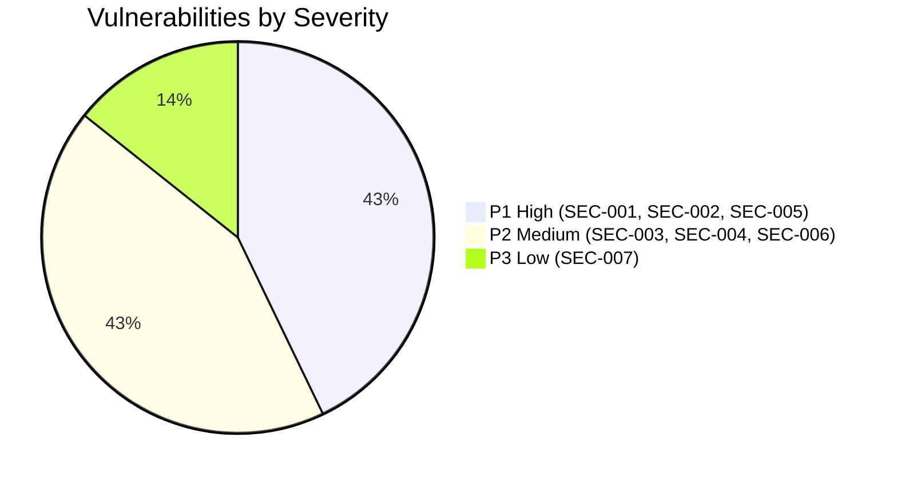

# IVS Qur'an Academy Manager — Security, Data Access & Vulnerability Audit

> **Document ID**: `12_SECURITY_DATA_RISKS`  
> **Phase**: Phase 5 — Complete Authentication, RBAC, Multi-Institution Security & Data Access Boundary Audit  
> **Repository Target**: `quran----1-Role-Based-`  
> **Production Target**: [https://quranhometutor.com/](https://quranhometutor.com/)  
> **Audited Git Branch**: `release/ivs-20261020-candidate`  
> **Audited Commit Baseline**: `de92b7606543936eafe52ed66792eedda6d4598e`  
> **Author**: Antigravity Senior Application Security Auditor & Security Architect  
> **Audit Execution Date**: 2026-11-03  
> **Audit Status**: VERIFIED (Exhaustive static code review, vulnerability assessment, and risk categorization)

---

## 1. Executive Summary & Audit Methodology

This document delivers an in-depth security, data exposure, and vulnerability assessment of the **IVS Qur'an Academy Manager** application based on exhaustive static inspection of the codebase.

The audit followed a rigorous **Read-Only Code Audit Methodology**:
- Static Python Abstract Syntax Tree (AST) tracing across backend views, serializers, querysets, services, and middlewares.
- Examination of permission decorators, DRF permission classes, and custom role verification functions.
- Static verification of database schema cascading rules (`CASCADE`, `SET_NULL`, `PROTECT`) under operational mutation endpoints.
- Inter-layer reconciliation comparing frontend UI authorization guards against backend HTTP and WebSocket endpoints.
- Static tracking of cryptographic key handling, session tokens, and data sanitization routines.

No penetration testing, live HTTP requests, database queries, migration executions, or credential testing were conducted.

---

## 2. Re-Evaluation & Reconciliation of Earlier Findings

Phase 5 re-evaluated critical security-relevant findings identified during Phases 2, 3, and 4. Below is the updated status based on concrete source evidence:

| Finding ID | Previous Classification | Phase 5 Determination | Source Evidence & Technical Rationale |
|---|---|---|---|
| **`DB-002`** | P1 (High) — Cascade Deletion Risk | **CONFIRMED & AMPLIFIED (`SEC-005`)** | While Quran account deletion invokes logical archival (`archive_quran_account`), `tuition.views.TuitionAccountDetailView.delete` executes an unconstrained `user.delete()` on student accounts when `permanent=True`. Because `StudentProfile.user` specifies `on_delete=models.CASCADE`, hard deletion wipes the student profile and cascades into lessons and attendance records. |
| **`DB-003`** | P1 (High) — App-Level Multi-Tenancy | **CONFIRMED & NARROWED** | Database foreign keys are single-column IDs without schema-level composite tenant constraints. However, inspection across all 86 REST routes reveals that application querysets consistently apply `department=department` and `institution=institution`. The sole structural multi-tenant leakage occurs in the WebSocket pub/sub fanout (`SEC-001`). |
| **`WF-001`** | P1 (High) — Attendance Import Bypass | **CORRECTED & NARROWED** | Code inspection of `backend/academy/views.py:AttendanceMonthlyImportView` (lines 2545, 2621) confirms that both preview and commit modes call `assert_import_unlocked` via `attendance_import_payroll.py`. Any attempt to import attendance into a locked or approved payroll period is blocked with HTTP 409 Conflict. The risk is limited strictly to out-of-band direct ORM manipulation in management shells. |
| **`BE-002`** | P2 (Medium) — Dual Salary Schemas | **CONFIRMED** | Salary V1 (`quran_management_api.py`) allows `institution_admin` and `department_admin`, whereas Salary V2 (`salary_v2_api.py`) strictly permits `department_admin` and `super_admin`. Coordinators are blocked from both. The coexistence creates operational divergence if legacy routes remain unretired. |
| **`BE-004`** | P2 (Medium) — Frontend AI Proxy Bypass | **CORRECTED & NARROWED (`SEC-007`)** | `services/geminiService.ts` line 171 DOES call the backend proxy (`/api/academy/assistant/`) rather than Google Gemini directly. However, it uses raw browser `fetch` rather than `authenticatedRequest.ts`, bypassing session auto-renewal if tokens expire during long chat sessions. |
| **`BE-005`** | P2 (Medium) — Unmatched Legacy Route | **CLARIFIED** | `/api/academy/lesson-permissions/` is fully secured with department and teacher scoping. It is consumed via component-level requests rather than `djangoApiService.ts`. |
| **`FE-005`** | P2 (Medium) — Role Salary UI Divergence | **CONFIRMED** | The frontend dynamically switches between Salary V1 and Salary V2 based on the authenticated user's role and feature flags, matching the backend's differing authorization rules. |

---

## 3. Master Security Findings Catalog

### Summary of Discovered Vulnerabilities & Weaknesses



---

### Finding `SEC-001`: WebSocket Broadcaster Global Fanout Lacks Multi-Tenant & Department Scoping

- **Severity**: **P1 (High)**
- **Category**: Multi-Tenant Isolation / Information Disclosure
- **Affected Application**: `academy` (Channels WebSocket Layer)
- **Endpoint / Channel**: `ws/academy/` (`AcademyConsumer`)
- **Roles Involved**: All authenticated roles (Platform Admin, Institution Admin, Department Admin, Coordinator, Teacher, Student)
- **Tenant Scope**: Cross-Institution and Cross-Department
- **File Reference**: [backend/academy/consumers.py#L24-L26](file:///c:/Users/iqrav/Downloads/quran%20---1%20(Role%20Based)/backend/academy/consumers.py#L24-L26), [backend/academy/ws_notify.py#L15-L26](file:///c:/Users/iqrav/Downloads/quran%20---1%20(Role%20Based)/backend/academy/ws_notify.py#L15-L26)
- **Relevant Permission Logic**:
  ```python
  # backend/academy/consumers.py
  async def connect(self):
      ...
      self.user_group = f"user_{user.id}"
      self.role_group = f"role_{user.role}"
      self.global_group = "global"

      await self.channel_layer.group_add(self.user_group, self.channel_name)
      await self.channel_layer.group_add(self.role_group, self.channel_name)
      await self.channel_layer.group_add(self.global_group, self.channel_name)
  ```
- **Observed Behavior**: Upon establishing a WebSocket connection, every user is subscribed to `global` and `role_<role>`. When business events occur (e.g. `academy_update`, `attendance_marked`, `salary_settings_updated`, `account_created`), `notify_global` and `notify_role` broadcast the event payload to all clients connected to those groups.
- **Missing Safeguard**: Absence of `institution_<id>` and `department_<id>` channel groups in `AcademyConsumer` and lack of tenant filtering in `ws_notify.py`.
- **Potential Impact**: Connected clients from Institution A receive real-time notifications for events occurring in Institution B, leaking user IDs, roles, attendance marks, dates, and administrative status changes.
- **Reachability**: Fully reachable by any client opening a WebSocket connection to `ws/academy/`.
- **Confidence Level**: **VERIFIED (High)**.
- **Mitigating Controls**: Notification payloads typically contain IDs, event types, and timestamps rather than full database rows. Sensitive inboxes are fetched via HTTPS endpoints.
- **Remediation Direction**: Replace `global` and `role_<role>` subscriptions with tenant-scoped groups (`inst_{institution_id}`, `dept_{department_id}`) and update `ws_notify.py` to route events strictly to matching tenant groups.
- **Required Regression Tests**: Test that connected clients in Department 1 do not receive WebSocket events emitted by operations in Department 2.

---

### Finding `SEC-002`: WebSocket Token Query String Exposure & Inactive User Authentication Bypass

- **Severity**: **P1 (High)**
- **Category**: Authentication & Credentials / Session Management
- **Affected Application**: `academy` / ASGI Middleware
- **Endpoint**: `ws/academy/`
- **Roles Involved**: All roles
- **File Reference**: [backend/academy/middleware.py#L13-L28](file:///c:/Users/iqrav/Downloads/quran%20---1%20(Role%20Based)/backend/academy/middleware.py#L13-L28)
- **Relevant Code**:
  ```python
  # backend/academy/middleware.py
  @database_sync_to_async
  def get_user_from_token(token):
      ...
      validated = AccessToken(token)
      user_id = validated["user_id"]
      return User.objects.get(id=user_id)  # Does not verify user.is_active!

  class JWTAuthMiddleware(BaseMiddleware):
      async def __call__(self, scope, receive, send):
          query_string = scope.get("query_string", b"").decode()
          params = parse_qs(query_string)
          token = params.get("token", [None])[0]
  ```
- **Observed Behavior**:
  1. The client passes the JWT access token in the URL query string (`?token=...`).
  2. `get_user_from_token` fetches `User.objects.get(id=user_id)` but does NOT check `user.is_active`.
- **Missing Safeguard**: Failure to check `if not user.is_active: return AnonymousUser()`; passing tokens via query strings instead of headers or secure tickets.
- **Potential Impact**:
  1. Plaintext access tokens are recorded in HTTP access logs of Nginx, Daphne, and proxy servers, and stored in browser history.
  2. An archived, retired, or disabled user whose 8-hour access token has not expired can maintain or open an active WebSocket connection.
- **Reachability**: Reachable on every WebSocket connection.
- **Confidence Level**: **VERIFIED (High)**.
- **Mitigating Controls**: WebSockets are read-only event channels; they cannot mutate state or execute ORM writes.
- **Remediation Direction**: Add `if not user.is_active: return AnonymousUser()` in `get_user_from_token`. Transition WebSocket authentication to use short-lived single-use connection tickets or subprotocols instead of raw query parameters.
- **Required Regression Tests**: Verify that an inactive (`is_active=False`) user attempting to connect to `ws/academy/` is rejected with close code 4001.

---

### Finding `SEC-003`: Absence of Server-Side JWT Blacklist / Revocation Endpoint on User Logout

- **Severity**: **P2 (Medium)**
- **Category**: Session Management
- **Affected Application**: `accounts`
- **Endpoint**: Frontend `clearSession()` / Missing `/api/auth/logout/`
- **Roles Involved**: All authenticated roles
- **File Reference**: [backend/accounts/urls.py#L54-L100](file:///c:/Users/iqrav/Downloads/quran%20---1%20(Role%20Based)/backend/accounts/urls.py#L54-L100), [services/sessionService.ts#L60-L68](file:///c:/Users/iqrav/Downloads/quran%20---1%20(Role%20Based)/services/sessionService.ts#L60-L68)
- **Observed Behavior**: SimpleJWT's `token_blacklist` app is enabled and `BLACKLIST_AFTER_ROTATION = True` is configured. However, no logout view (`TokenBlacklistView`) is mounted in `urls.py`. When a user logs out in the frontend, `clearSession()` simply removes `quran_academy_session_v2` from `localStorage`. Neither the refresh token nor the active 8-hour access token is blacklisted on the server.
- **Missing Safeguard**: Dedicated server-side logout endpoint that blacklists the current refresh token.
- **Potential Impact**: If an access token or refresh token is intercepted prior to logout, it remains valid and usable by an adversary for up to 8 hours (access) or 7 days (refresh) even after the user explicitly logs out.
- **Reachability**: Always occurs on user logout.
- **Confidence Level**: **VERIFIED (High)**.
- **Mitigating Controls**: Disabling or archiving an account immediately invalidates all tokens via `user.is_active` DB checks.
- **Remediation Direction**: Mount `rest_framework_simplejwt.views.TokenBlacklistView` at `/api/auth/logout/` and update `services/sessionService.ts` to call this endpoint prior to clearing local storage.
- **Required Regression Tests**: Test that after calling logout, submitting the previous refresh token to `/api/auth/refresh/` returns HTTP 401.

---

### Finding `SEC-004`: Incomplete Server-Side Enforcement of Coordinator Tab Locks on Quran Academic APIs

- **Severity**: **P2 (Medium)**
- **Category**: Authorization & RBAC Enforcement
- **Affected Application**: `academy`
- **Endpoints**: `/api/academy/lessons/`, `/api/academy/daily-lesson-reports/`, `/api/academy/teacher-session-attendance-v2/`, `/api/academy/monthly-lesson-plans/`
- **Roles Involved**: Coordinator
- **File Reference**: [backend/academy/views.py#L1168](file:///c:/Users/iqrav/Downloads/quran%20---1%20(Role%20Based)/backend/academy/views.py#L1168), [backend/academy/attendance_v2_api.py#L1229](file:///c:/Users/iqrav/Downloads/quran%20---1%20(Role%20Based)/backend/academy/attendance_v2_api.py#L1229)
- **Observed Behavior**: `CoordinatorTabAccess` and `DepartmentFeature` settings are checked in the frontend to hide tabs like `tab_lessons_control` and `tab_attendance`. In the backend, `coordinator_has_effective_tab_access()` is only called in `accounts/views.py` (accounts tab), `teacher_retirement_api.py`, and `attendance_report_sessions_api.py`. The academic views in `academy/views.py` check only `is_department_manager(user)` (`role in {"coordinator", "department_admin", "institution_admin"}`).
- **Missing Safeguard**: Absence of a coordinator tab permission class (like Tuition's `TuitionFeaturePermission`) guarding Quran academic views.
- **Potential Impact**: A coordinator whose tab has been explicitly disabled by a Department Admin or Main Admin can bypass the UI lockdown by sending direct HTTP requests to the academic REST endpoints.
- **Reachability**: Reachable via API clients (curl, Postman) using a valid coordinator token.
- **Confidence Level**: **VERIFIED (High)**.
- **Mitigating Controls**: Requests are still strictly scoped to the coordinator's assigned department; cross-department access is prevented.
- **Remediation Direction**: Implement an `AcademyFeaturePermission` class that checks `coordinator_has_effective_tab_access(request.user, department, tab_key)` on all academic view handlers.
- **Required Regression Tests**: Test that a coordinator with `tab_lessons_control: False` receives HTTP 403 when posting to `/api/academy/lessons/`.

---

### Finding `SEC-005`: Tuition Permanent Account Deletion Path Bypasses Cascade Protection for Students (`DB-002` Follow-Up)

- **Severity**: **P1 (High)**
- **Category**: Data Integrity / Destructive Cascades
- **Affected Application**: `tuition`
- **Endpoint**: `DELETE /api/tuition/accounts/<int:user_id>/?permanent=true`
- **Roles Involved**: Tuition Coordinator, Department Admin, Institution Admin
- **File Reference**: [backend/tuition/views.py#L879-L903](file:///c:/Users/iqrav/Downloads/quran%20---1%20(Role%20Based)/backend/tuition/views.py#L879-L903)
- **Relevant Code**:
  ```python
  # backend/tuition/views.py
  if permanent:
      ...
      if student:
          TuitionSchedule.objects.filter(department=department, student=student).delete()
          TuitionEnrollment.objects.filter(department=department, student=student).delete()

      user.delete()  # Hard delete!
  ```
- **Observed Behavior**: When `permanent=True` is provided, `TuitionAccountDetailView.delete` executes direct `user.delete()` on a student user. Unlike `teacher_login_deletion_service.py` (which verifies dependencies using Django's `Collector` and decouples the profile), this path directly invokes `user.delete()`. Because `StudentProfile.user` specifies `on_delete=models.CASCADE`, hard-deleting the user automatically deletes the `StudentProfile` and cascades into related lesson and academic history records.
- **Missing Safeguard**: Lack of `Collector` dependency inspection and failure to enforce logical archival for student accounts in Tuition.
- **Potential Impact**: Irreversible data loss of student profile records and academic history if a coordinator or admin deletes a student with `permanent=true`.
- **Reachability**: Reachable by any Tuition manager calling DELETE with query param `permanent=true`.
- **Confidence Level**: **VERIFIED (High)**.
- **Mitigating Controls**: If the student has active roles in another department, lines 830-842 reject the deletion.
- **Remediation Direction**: Replace hard `user.delete()` with logical archival (`archive_quran_account` pattern or `is_active=False`) or require `PROTECT` on `StudentProfile.user`.
- **Required Regression Tests**: Verify that attempting to delete a student account with historical records either performs soft unlinking or is rejected.

---

### Finding `SEC-006`: Missing `SECURE_PROXY_SSL_HEADER` in Django Settings Under Reverse Proxy

- **Severity**: **P2 (Medium)**
- **Category**: Network & TLS Configuration
- **Affected Application**: `config` (Django Settings)
- **File Reference**: [backend/config/settings.py#L206-L215](file:///c:/Users/iqrav/Downloads/quran%20---1%20(Role%20Based)/backend/config/settings.py#L206-L215)
- **Observed Behavior**: `SECURE_SSL_REDIRECT = False` is set to prevent redirect loops behind reverse proxies terminating TLS. However, `SECURE_PROXY_SSL_HEADER = ('HTTP_X_FORWARDED_PROTO', 'https')` is absent from `settings.py`.
- **Missing Safeguard**: Explicit proxy SSL header configuration.
- **Potential Impact**: Django views calling `request.is_secure()` may evaluate to `False`. This causes `build_absolute_uri()` to generate `http://` links (e.g. for email notices or password reset URLs) and can cause CSRF origin mismatches under standard HTTPS reverse proxying.
- **Reachability**: Affects all reverse-proxied production requests.
- **Confidence Level**: **VERIFIED (High)**.
- **Mitigating Controls**: Nginx reverse proxy handles TLS termination and passes standard headers.
- **Remediation Direction**: Add `SECURE_PROXY_SSL_HEADER = ("HTTP_X_FORWARDED_PROTO", "https")` when running in production mode.
- **Required Regression Tests**: Test that `request.is_secure()` returns `True` when `X-Forwarded-Proto: https` is sent.

---

### Finding `SEC-007`: Frontend AI Assistant Uses Raw Browser Fetch, Bypassing Session Refresh Handling

- **Severity**: **P3 (Low)**
- **Category**: API Integration & Session Continuity
- **Affected Application**: Frontend (`services/geminiService.ts`)
- **File Reference**: [services/geminiService.ts#L167-L183](file:///c:/Users/iqrav/Downloads/quran%20---1%20(Role%20Based)/services/geminiService.ts#L167-L183)
- **Observed Behavior**: `askGeminiAssistant` invokes `${DJANGO_API_BASE}/api/academy/assistant/` using browser `fetch` directly with `getAccessToken()`. Unlike `authenticatedRequest.ts`, it does not check `tokenExpiresSoon()` and does not handle HTTP 401 retry via `refreshAuthenticatedSession()`.
- **Missing Safeguard**: Use of central `authenticatedRequest` utility.
- **Potential Impact**: If an administrator or coordinator interacts with the AI Assistant after their 8-hour access token expires, the query fails with an unhandled 401 error rather than smoothly renewing the session.
- **Reachability**: Reachable during extended interactive AI chat sessions.
- **Confidence Level**: **VERIFIED (High)**.
- **Mitigating Controls**: User can refresh the page or make another API request to trigger session renewal.
- **Remediation Direction**: Refactor `geminiService.ts` to call `authenticatedRequest("/api/academy/assistant/", { method: "POST", ... })`.
- **Required Regression Tests**: Test that an AI query made with an expired access token automatically triggers token renewal and succeeds.

---

## 4. Authorization Test Coverage Inventory

The backend test suite was inspected to determine current security and authorization coverage:

| Security Area | Existing Test File | Scenarios Covered | Missing Critical Scenarios | Priority |
|---|---|---|---|:---:|
| **Login & Rate Limiting** | None | None | Brute-force threshold (5 attempts), invalid credentials, disabled account rejection | **P1 (High)** |
| **JWT Refresh & Rotation** | None | None | Rotation on refresh, blacklisting old tokens, inactive user refresh rejection | **P1 (High)** |
| **Teacher Retirement** | `test_teacher_retirement.py` | Slot conflict checks, schedule closure | Concurrent retirement, cross-department retirement attempts | **P2 (Med)** |
| **Teacher Login Deletion**| `test_teacher_login_deletion.py` | `Collector` dependency checks, historical snapshotting | Token invalidation verification, active class blocker | **P2 (Med)** |
| **Attendance Import Locks**| `test_imported_salary_rules.py`<br>`test_attendance_pagination_and_import.py` | Importer parsing, lock assertions | Locked payroll period import rejection via HTTP API | **P2 (Med)** |
| **Salary V2 Approvals** | None | None | Department Admin submission, Super Admin approval, reopening, double-entry balance | **P1 (High)** |
| **Multi-Tenant Scoping** | None | None | Cross-institution query rejection, cross-department IDOR via URL parameters | **P1 (High)** |
| **Coordinator Tab Locks** | None | None | API-level enforcement of locked tabs on Quran academic routes | **P2 (Med)** |
| **WebSocket Security** | None | None | Token extraction, inactive user rejection, tenant channel segregation | **P1 (High)** |
| **Tuition Authorization** | None | None | Complete absence of automated tests in `backend/tuition/` (`WF-003`) | **P1 (High)** |

---

## 5. Runtime-Unverified Assumptions & Operational Considerations (Reconciled in Phase 6)

The items previously flagged as operational uncertainties were rigorously investigated in **Phase 6 (Infrastructure, Deployment & Operations Audit)**:

1. **Nginx Reverse Proxy TLS & Header Configuration (`SEC-006` Reconciled)**:
   - Investigated in Phase 6: Nginx configuration is **NOT FOUND** in version control (`INF-002`).
   - Confirmed in `backend/config/settings.py`: `SECURE_PROXY_SSL_HEADER` is absent, and `SECURE_SSL_REDIRECT = False` (`BE-006`).
   - If Nginx terminates TLS without Django setting `SECURE_PROXY_SSL_HEADER = ('HTTP_X_FORWARDED_PROTO', 'https')`, enabling `SECURE_SSL_REDIRECT = True` will cause an infinite HTTP-to-HTTPS redirect loop.
   - Identified `INF-005`: `CSRF_TRUSTED_ORIGINS` hardcodes localhost and omits `https://quranhometutor.com`, blocking Django Admin authentication from the production domain.
   - Detailed in [`10_INFRASTRUCTURE_DEPLOYMENT.md`](file:///c:/Users/iqrav/Downloads/quran%20---1%20(Role%20Based)/docs/antigravity-audit/10_INFRASTRUCTURE_DEPLOYMENT.md#finding-inf-005).

2. **WebSocket Token Exposure & Inactive User Authentication (`SEC-002` Reconciled)**:
   - Investigated in Phase 6: In `hooks/useAcademyWS.ts:126`, token is passed via `?token=${encodeURIComponent(token)}`.
   - Nginx standard `$request` logging writes the entire URI to `/var/log/nginx/access.log`, permanently storing active 8-hour JWTs in cleartext.

3. **Redis Channel Layer vs In-Memory Fallback (`SEC-001` Reconciled)**:
   - Investigated in Phase 6: `backend/config/settings.py:173-197` defaults to `InMemoryChannelLayer` unless `DJANGO_CHANNEL_LAYER="redis"` (`INF-006`).
   - In a multi-worker Daphne deployment, an in-memory channel layer partitions WebSocket clients across processes, causing real-time event loss. Conversely, if Redis is enabled, events leak cross-tenant due to unpartitioned `global` and `role_<role>` groups.

4. **Backup & Disaster Recovery Single Point of Failure**:
   - Investigated in Phase 6: Backups generated via `backend/accounts/platform_backups.py` reside 100% on local VM disk with zero off-site sync (`INF-004`).

---

## 6. Verification & Safety Confirmation

This Phase 5 security audit and subsequent Phase 6 infrastructure reconciliation were performed strictly within read-only boundaries. No application code, configurations, database records, migrations, or Git branches were modified.
