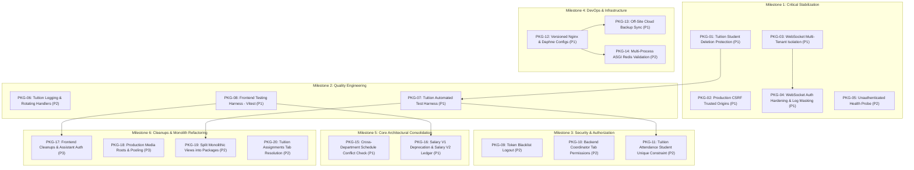

# IVS Qur'an Academy Manager — Complete Engineering Development Roadmap

> **Document ID**: `15_DEVELOPMENT_ROADMAP`  
> **Phase**: Phase 8 — Final Architecture Validation, Master Findings Reconciliation & Complete Development Roadmap  
> **Repository Target**: `quran----1-Role-Based-`  
> **Audited Branch**: `release/ivs-20261020-candidate`  
> **Audited Commit Baseline**: `de92b7606543936eafe52ed66792eedda6d4598e`  
> **Production Target**: [https://quranhometutor.com/](https://quranhometutor.com/)  
> **Author**: Antigravity Senior Software Architect & Engineering Audit Lead  
> **Date**: 2026-11-03  
> **Status**: COMPLETED & VERIFIED (Read-Only Implementation Plan — Awaiting Explicit Approval Before Execution)

---

## 1. Executive Summary & Governance Principles

This document defines the definitive, phased engineering implementation roadmap designed to remediate all **26 Master Findings** (`MASTER-001` through `MASTER-026`) identified across the seven preceding architectural audit phases.

### 1.1 Non-Negotiable Engineering Principles
1. **Zero Unintended Data Loss**: Historical attendance records, student and teacher profiles, class history logs, and approved payroll ledgers must be strictly preserved. Destructive SQL cascades (`CASCADE` on business records) are prohibited.
2. **Small, Separately Approvable Packages**: All work is decomposed into 20 discrete implementation packages (`PKG-01` through `PKG-20`). Each package is independently testable, reviewable, deployable, and roll-backable.
3. **Explicit Authorization Gateway**: No package execution may begin without explicit stakeholder approval. Each package must satisfy rigid acceptance criteria before proceeding to the next.
4. **Zero Production Downtime**: Database migrations and configuration updates must remain backward compatible with live frontend clients and database replicas.
5. **Regression Protection First**: Critical test coverage must be established before executing refactorings or schema changes.

---

## 2. Implementation Package Summary Register

| Package ID | Title | Target Finding(s) | Severity | Category | Milestone |
| :--- | :--- | :--- | :---: | :--- | :---: |
| **`PKG-01`** | Tuition Student Deletion Soft-Archival & CASCADE Protection | `MASTER-001` | P1 (High) | Data Integrity | Milestone 1 |
| **`PKG-02`** | Production CSRF Trusted Origins Configuration | `MASTER-010` | P1 (High) | Security / Admin | Milestone 1 |
| **`PKG-03`** | WebSocket Multi-Tenant Isolation & Group Scoping | `MASTER-002` | P1 (High) | Security / RBAC | Milestone 1 |
| **`PKG-04`** | WebSocket Authentication Hardening & Log Masking | `MASTER-003` | P1 (High) | Security / Logs | Milestone 1 |
| **`PKG-05`** | Unauthenticated Health & Liveness Probe Endpoint | `MASTER-018` | P2 (Medium)| Observability | Milestone 1 |
| **`PKG-06`** | Tuition Logging Integration & Rotating File Handler | `MASTER-015`, `MASTER-019` | P2 (Medium)| Observability | Milestone 2 |
| **`PKG-07`** | Tuition Department Automated Backend Test Harness | `MASTER-005` | P1 (High) | Quality / Tests | Milestone 2 |
| **`PKG-08`** | Frontend Testing Harness Setup (Vitest + RTL) | `MASTER-006` | P1 (High) | Quality / Tests | Milestone 2 |
| **`PKG-09`** | Backend Token Revocation & Explicit Logout Blacklist | `MASTER-013` | P2 (Medium)| Security / Auth | Milestone 3 |
| **`PKG-10`** | Backend Coordinator Tab Permission Enforcement | `MASTER-012` | P2 (Medium)| Security / RBAC | Milestone 3 |
| **`PKG-11`** | Tuition Attendance Student Unique Constraint Fix | `MASTER-016` | P2 (Medium)| Data Integrity | Milestone 3 |
| **`PKG-12`** | Version-Controlled Deployment & Service Configurations | `MASTER-008`, `MASTER-009`, `MASTER-022` | P1 (High) | DevOps / Infra | Milestone 4 |
| **`PKG-13`** | Off-Site Database Backup Replication Strategy | `MASTER-007` | P1 (High) | Disaster Recovery | Milestone 4 |
| **`PKG-14`** | Multi-Process ASGI Redis Channel Layer Verification | `MASTER-014` | P2 (Medium)| Real-Time Infra | Milestone 4 |
| **`PKG-15`** | Cross-Department Teacher Schedule Conflict Check | `MASTER-011` | P1 (High) | Scheduling | Milestone 5 |
| **`PKG-16`** | Salary V1 Deprecation & Salary V2 Unified Consolidation | `MASTER-004` | P1 (High) | Financial Logic | Milestone 5 |
| **`PKG-17`** | Frontend Cleanups: Vite Defines, Dead Code, Assistant Auth | `MASTER-021`, `MASTER-023`, `MASTER-026` | P3 (Low) | Frontend Hygiene| Milestone 6 |
| **`PKG-18`** | Production Settings Hardening: Media Roots & Connection Pooling | `MASTER-024`, `MASTER-025` | P3 (Low) | Performance / Ops | Milestone 6 |
| **`PKG-19`** | Academy & Tuition Monolithic View Modularization | `MASTER-020` | P2 (Medium)| Architecture | Milestone 6 |
| **`PKG-20`** | Tuition Assignments Tab Resolution | `MASTER-017` | P2 (Medium)| Completeness | Milestone 6 |

---

## 3. Detailed Implementation Packages

---

### Milestone 1: Critical Security & Data Loss Stabilization (Immediate P1 Sprints)

#### `PKG-01`: Tuition Student Deletion Soft-Archival & CASCADE Protection
- **Target Master Finding**: `MASTER-001` (`SEC-005`, `DB-002`, `DB-001`)
- **Severity**: **P1 (High)**
- **Dependencies**: None
- **Affected Files**:
  - `backend/tuition/models.py`
  - `backend/tuition/views.py` (`TuitionAccountDetailView`)
  - `backend/tuition/management_api.py`
  - `components/tuition/TuitionAccountsEnrollment.tsx`
  - `services/tuitionApiService.ts`
- **Database Risks & Migration Strategy**:
  - Alter foreign key `TuitionAttendance.student` from `on_delete=models.CASCADE` to `on_delete=models.PROTECT`.
  - Add `is_archived` boolean field and `archived_at` datetime field to `tuition.models.TuitionStudentEnrollment` (or implement soft-delete flag on account mapping).
  - Migration must be purely additive; zero existing records altered or deleted.
- **Security Implications**: Eliminates irreversible data destruction vector where tuition coordinators delete student accounts and inadvertently wipe historical attendance history.
- **Required Tests**:
  - Django test asserting `TuitionAttendance` records block hard deletion of `StudentProfile` when attempted (`ProtectedError`).
  - API test asserting `DELETE /api/tuition/accounts/<id>/` marks the student account as archived/inactive without invoking `user.delete()`.
- **Acceptance Criteria**:
  1. Deleting a tuition student through `TuitionAccountsEnrollment.tsx` sets `is_active=False` / `is_archived=True`.
  2. Historical `TuitionAttendance` rows remain completely intact and queryable in attendance reports.
  3. Attempted hard `user.delete()` on a student with attendance raises `django.db.models.ProtectedError`.
- **Rollback Requirements**: Standard Django down-migration reversing the `PROTECT` constraint back to `CASCADE` (if strictly necessary) and restoring the view methods.

---

#### `PKG-02`: Production CSRF Trusted Origins Configuration
- **Target Master Finding**: `MASTER-010` (`INF-005`)
- **Severity**: **P1 (High)**
- **Dependencies**: None
- **Affected Files**:
  - `backend/config/settings.py`
  - `backend/.env.example`
- **Database Risks & Migration Strategy**: Zero database changes or migrations.
- **Security Implications**: Restores administrative access to Django Admin (`/admin/`) on the production domain while preventing cross-site request forgery attacks.
- **Required Tests**:
  - Unit test verifying `CSRF_TRUSTED_ORIGINS` correctly parses comma-separated domains from `DJANGO_CSRF_TRUSTED_ORIGINS` environment variable.
  - Test verifying default contains `https://quranhometutor.com` and `https://www.quranhometutor.com` when `DEBUG=False`.
- **Acceptance Criteria**:
  1. Superusers can successfully authenticate into `https://quranhometutor.com/admin/login/` without receiving `HTTP 403 Forbidden` (`CSRF verification failed`).
  2. Settings dynamically read from `DJANGO_CSRF_TRUSTED_ORIGINS` with secure fallback.
- **Rollback Requirements**: Revert `backend/config/settings.py` changes.

---

#### `PKG-03`: WebSocket Multi-Tenant Isolation & Group Scoping
- **Target Master Finding**: `MASTER-002` (`SEC-001`)
- **Severity**: **P1 (High)**
- **Dependencies**: None
- **Affected Files**:
  - `backend/academy/consumers.py`
  - `backend/academy/ws_notify.py`
  - `backend/academy/attendance_v2_api.py`
  - `hooks/useAcademyWS.ts`
  - `services/websocketService.ts`
- **Database Risks & Migration Strategy**: Zero database changes.
- **Security Implications**: Resolves critical multi-tenant data leakage where scheduling, teacher attendance statuses, and department IDs are broadcast to all connected tenants via `"global"`.
- **Required Tests**:
  - Channels asynchronous unit test asserting a client joined to `tenant_A` receives zero events when an event is broadcast to `tenant_B`.
  - Test verifying `notify_global` is retired or converted to `notify_tenant(tenant_id, ...)` and `notify_department(dept_id, ...)`.
- **Acceptance Criteria**:
  1. `AcademyConsumer.connect()` dynamically joins `dept_{department_id}` and `inst_{institution_id}` based on authenticated user claims.
  2. The generic `"global"` broadcast group is eliminated for operational events.
  3. Frontend `useAcademyWS.ts` filters incoming events based on active department context.
- **Rollback Requirements**: Revert `backend/academy/consumers.py` and `ws_notify.py` to previous group dispatching.

---

#### `PKG-04`: WebSocket Authentication Hardening & Log Masking
- **Target Master Finding**: `MASTER-003` (`SEC-002`)
- **Severity**: **P1 (High)**
- **Dependencies**: `PKG-03`
- **Affected Files**:
  - `components/NotificationBell.tsx`
  - `hooks/useAcademyWS.ts`
  - `services/websocketService.ts`
  - `backend/academy/middleware.py`
  - `backend/academy/views.py` (or new ticket endpoint)
- **Database Risks & Migration Strategy**: Zero database changes.
- **Security Implications**: Prevents long-lived (8-hour) JWT access tokens from being persisted in plaintext inside Nginx access logs (`/var/log/nginx/access.log`) and proxy caches.
- **Required Tests**:
  - Unit test for WebSocket single-use ticket generator (`POST /api/academy/ws-ticket/` returns 60-second opaque UUID ticket).
  - Middleware test validating ticket consumption and immediate invalidation (single-use).
- **Acceptance Criteria**:
  1. Frontend obtains a 60-second single-use ticket via an authenticated POST request before opening WebSocket.
  2. WebSocket URL connects with `?ticket=<uuid>` instead of `?token=<jwt_access_token>`.
  3. Nginx access log records only an opaque, expired ticket string; zero plaintext JWT tokens recorded.
- **Rollback Requirements**: Revert middleware to query string JWT token fallback.

---

#### `PKG-05`: Unauthenticated Health & Liveness Probe Endpoint
- **Target Master Finding**: `MASTER-018` (`INF-008`)
- **Severity**: **P2 (Medium)**
- **Dependencies**: None
- **Affected Files**:
  - `backend/config/urls.py`
  - `backend/accounts/views.py` (or new `backend/config/health.py`)
- **Database Risks & Migration Strategy**: Zero database changes.
- **Security Implications**: Provides a minimal, secure probe for cloud load balancers and uptime monitors without exposing sensitive system metadata or requiring JWT generation.
- **Required Tests**:
  - API test asserting `GET /api/health/` returns `HTTP 200 OK` with `{"status": "healthy"}` without credentials.
  - Test verifying database probe (`connection.cursor().execute("SELECT 1")`) returns `HTTP 503 Service Unavailable` if database is unreachable.
- **Acceptance Criteria**:
  1. `curl -f http://localhost:8000/api/health/` returns `200` without headers.
  2. Unauthenticated requests receive no system metrics or sensitive diagnostics (diagnostic details remain restricted to `PlatformSystemHealthView`).
- **Rollback Requirements**: Remove `/api/health/` URL route.

---

### Milestone 2: Quality Engineering & Testing Harness

#### `PKG-06`: Tuition Logging Integration & Rotating File Handler
- **Target Master Finding**: `MASTER-015`, `MASTER-019` (`BE-003`, `INF-007`)
- **Severity**: **P2 (Medium)**
- **Dependencies**: None
- **Affected Files**:
  - `backend/config/settings.py`
- **Database Risks & Migration Strategy**: Zero database changes.
- **Security Implications**: Eliminates disk exhaustion vulnerability from unbounded growth of `backend/logs/django.log` and ensures Tuition Department errors are captured.
- **Required Tests**:
  - Test verifying `logging.getLogger("tuition")` emits messages to both console and file handlers.
  - Test verifying handler class is `RotatingFileHandler` with `maxBytes=52428800` (50MB) and `backupCount=5`.
- **Acceptance Criteria**:
  1. Errors in `tuition/views.py` log to `backend/logs/django.log`.
  2. Log file rotates automatically upon reaching 50MB; maximum 5 backups retained (250MB disk ceiling).
- **Rollback Requirements**: Revert logging dictionary in `settings.py`.

---

#### `PKG-07`: Tuition Department Automated Backend Test Harness
- **Target Master Finding**: `MASTER-005` (`BE-001`)
- **Severity**: **P1 (High)**
- **Dependencies**: `PKG-01`
- **Affected Files**:
  - `backend/tuition/tests/__init__.py`
  - `backend/tuition/tests/test_tuition_foundation.py`
  - `backend/tuition/tests/test_tuition_accounts.py`
  - `backend/tuition/tests/test_tuition_attendance.py`
  - `backend/tuition/tests/test_tuition_scheduling.py`
- **Database Risks & Migration Strategy**: Zero changes to application models; uses Django test database runner.
- **Security Implications**: Provides automated regression gates preventing silent regressions in enrollment, role scoping, and attendance marking across 4,523 lines of untested views.
- **Required Tests**:
  - Create minimum 25 automated unit/integration test cases covering:
    - Foundation choices and grade options.
    - Tuition student enrollment and role assignment.
    - Attendance marking for teacher and student entities.
    - Timetable slot conflicts and schedule generation.
    - Tuition account soft-archival vs hard-deletion protection.
- **Acceptance Criteria**:
  1. Running `python manage.py test tuition` passes 100% of tests.
  2. Test execution runs in under 30 seconds.
- **Rollback Requirements**: Delete test directory if necessary (no production risk).

---

#### `PKG-08`: Frontend Testing Harness Setup (Vitest + RTL)
- **Target Master Finding**: `MASTER-006`
- **Severity**: **P1 (High)**
- **Dependencies**: None
- **Affected Files**:
  - `package.json`
  - `vite.config.ts`
  - `vitest.config.ts` (new)
  - `tests/setup.ts` (new)
  - `tests/unit/authenticatedRequest.test.ts` (new)
  - `tests/unit/attendanceMutationRollback.test.ts` (new)
- **Database Risks & Migration Strategy**: Zero database changes.
- **Security Implications**: Establishes automated testing harness to prevent token handling and optimistic mutation regressions in frontend code.
- **Required Tests**:
  - Test for token refresh behavior in `services/authenticatedRequest.ts`.
  - Test for `attendanceMutationVersionRef` rollback on HTTP 400/500 error in attendance logging.
- **Acceptance Criteria**:
  1. `npm test` runs Vitest in CI/local mode without errors.
  2. Core authentication and optimistic attendance rollbacks have automated unit verification.
- **Rollback Requirements**: Remove Vitest packages and config.

---

### Milestone 3: Security & Authorization Hardening

#### `PKG-09`: Backend Token Revocation & Explicit Logout Blacklist
- **Target Master Finding**: `MASTER-013` (`SEC-003`)
- **Severity**: **P2 (Medium)**
- **Dependencies**: None
- **Affected Files**:
  - `backend/accounts/urls.py`
  - `services/djangoApiService.ts`
  - `components/Header.tsx` / `App.tsx`
- **Database Risks & Migration Strategy**: Zero schema changes; `rest_framework_simplejwt.token_blacklist` is already in `INSTALLED_APPS` and its tables are migrated.
- **Security Implications**: Closes authorization vulnerability where tokens remain valid after client logout. Calling logout actively invalidates the refresh token.
- **Required Tests**:
  - Backend integration test verifying `POST /api/auth/logout/` with `refresh` token adds token to blacklist.
  - Test asserting subsequent `POST /api/auth/refresh/` with blacklisted token returns `HTTP 401 Unauthorized`.
- **Acceptance Criteria**:
  1. Clicking "Log Out" in frontend calls `/api/auth/logout/` before clearing local storage.
  2. Blacklisted refresh tokens cannot be used to generate new access tokens.
- **Rollback Requirements**: Revert route in `backend/accounts/urls.py` and client function in `djangoApiService.ts`.

---

#### `PKG-10`: Backend Coordinator Tab Permission Enforcement
- **Target Master Finding**: `MASTER-012` (`SEC-004`, `FE-008`)
- **Severity**: **P2 (Medium)**
- **Dependencies**: None
- **Affected Files**:
  - `backend/academy/permissions.py`
  - `backend/academy/views.py`
- **Database Risks & Migration Strategy**: Zero schema changes; uses existing `accounts.models.CoordinatorTabAccess` model.
- **Security Implications**: Closes permission bypass vulnerability where coordinators with revoked tabs could bypass client hiding and invoke backend endpoints directly.
- **Required Tests**:
  - Permission test verifying coordinator with `can_access_dropped_leave=False` receives `HTTP 403 Forbidden` on `/api/academy/dropped-leave/`.
  - Permission test verifying coordinator with full access receives `HTTP 200 OK`.
- **Acceptance Criteria**:
  1. Backend checks `CoordinatorTabAccess` for all coordinator requests to `#dropped-leave`, `#lessons`, and `#attendance`.
  2. Direct REST requests without permission are blocked at DRF permission class level.
- **Rollback Requirements**: Remove custom permission class check from views.

---

#### `PKG-11`: Tuition Attendance Student Unique Constraint Fix
- **Target Master Finding**: `MASTER-016` (`DB-004`)
- **Severity**: **P2 (Medium)**
- **Dependencies**: `PKG-01`, `PKG-07`
- **Affected Files**:
  - `backend/tuition/models.py`
  - New Django migration file in `backend/tuition/migrations/`
- **Database Risks & Migration Strategy**:
  - Pre-migration audit: Query for existing duplicate student attendance rows before applying constraint.
  - If duplicates exist, write a data migration to deduplicate records (keeping newest).
  - Add conditional `UniqueConstraint` on `TuitionAttendance` for `entity_type="student"` covering `["department", "student", "date", "class_key"]`.
- **Security Implications**: Guarantees data integrity by preventing duplicate attendance entries for students.
- **Required Tests**:
  - Test asserting attempting to insert two attendance records for the same student, date, and class key raises `IntegrityError`.
- **Acceptance Criteria**:
  1. Migration applies cleanly without data loss.
  2. Student attendance uniqueness is enforced at database schema level.
- **Rollback Requirements**: Django down-migration removing the constraint.

---

### Milestone 4: DevOps, Reliability & Infrastructure

#### `PKG-12`: Version-Controlled Deployment & Service Configurations
- **Target Master Finding**: `MASTER-008`, `MASTER-009`, `MASTER-022` (`INF-002`, `INF-003`, `INF-009`)
- **Severity**: **P1 (High)**
- **Dependencies**: None
- **Affected Files**:
  - `deploy/nginx/quranhometutor.conf` (new)
  - `deploy/systemd/daphne.service` (new)
  - `backend/.env.example`
- **Database Risks & Migration Strategy**: Zero database changes.
- **Security Implications**: Eliminates server-level configuration divergence, provides reproducible server setup, and documents all 15 required environment variables.
- **Required Tests**:
  - Nginx configuration syntax check (`nginx -t -c deploy/nginx/quranhometutor.conf`).
  - Validation test asserting all `os.getenv` calls in Python code have corresponding entries in `.env.example`.
- **Acceptance Criteria**:
  1. Complete production Nginx template versioned in `deploy/nginx/` including WebSocket proxy rules and SSL ciphers.
  2. Complete systemd unit file versioned in `deploy/systemd/`.
  3. `backend/.env.example` documents 100% of environment variables.
- **Rollback Requirements**: Delete untracked deploy templates if not matching host.

---

#### `PKG-13`: Off-Site Database Backup Replication Strategy
- **Target Master Finding**: `MASTER-007` (`INF-004`)
- **Severity**: **P1 (High)**
- **Dependencies**: `PKG-12`
- **Affected Files**:
  - `backend/accounts/platform_backups.py`
  - `deploy/scripts/sync_backups_to_oci.sh` (new)
- **Database Risks & Migration Strategy**: Zero database changes; operates on exported `.sql.gz` dump files.
- **Security Implications**: Eliminates single point of failure where a VM disk crash destroys both live database and local backup files.
- **Required Tests**:
  - Test verifying backup file creation and integrity verification using `gzip -t`.
  - Dry-run script testing OCI CLI / Object Storage replication.
- **Acceptance Criteria**:
  1. `platform_backups.py` or companion cron script syncs backup archives to off-site cloud storage.
  2. Backups on remote storage are verified against local checksums.
- **Rollback Requirements**: Disable off-site cron job.

---

#### `PKG-14`: Multi-Process ASGI Redis Channel Layer Verification
- **Target Master Finding**: `MASTER-014` (`INF-006`)
- **Severity**: **P2 (Medium)**
- **Dependencies**: `PKG-12`
- **Affected Files**:
  - `backend/config/settings.py`
  - `deploy/systemd/daphne.service`
- **Database Risks & Migration Strategy**: Zero database changes.
- **Security Implications**: Ensures WebSocket state is consistent across multi-worker ASGI processes.
- **Required Tests**:
  - Setting test asserting that when `DJANGO_ENV=production`, `CHANNEL_LAYER_MODE` defaults to `redis` and raises `ImproperlyConfigured` if `REDIS_URL` is unreachable.
- **Acceptance Criteria**:
  1. Production Daphne deployments strictly require Redis channel layer; in-memory fallback is allowed only in development (`DEBUG=True`).
- **Rollback Requirements**: Revert setting check.

---

### Milestone 5: Core Architectural Consolidation

#### `PKG-15`: Cross-Department Teacher Schedule Conflict Check
- **Target Master Finding**: `MASTER-011` (`DB-003`)
- **Severity**: **P1 (High)**
- **Dependencies**: None
- **Affected Files**:
  - `backend/academy/models.py`
  - `backend/tuition/models.py`
  - `backend/academy/schedule_validation_service.py` (new)
  - `backend/tuition/views.py`
- **Database Risks & Migration Strategy**:
  - No cross-database schema changes; implement via shared Python validation service before schedule commits.
  - Pre-audit existing schedules for active double-bookings between Quran and Tuition.
- **Security Implications**: Prevents scheduling collisions where a teacher is booked simultaneously in Quran Academy and Tuition Department.
- **Required Tests**:
  - Unit test verifying attempting to create a `TuitionSchedule` overlapping an existing `ClassSchedule` raises `ValidationError`.
  - Unit test verifying reciprocal check (creating `ClassSchedule` overlapping `TuitionSchedule` raises `ValidationError`).
- **Acceptance Criteria**:
  1. System rejects schedule saves that overlap across departments for the same teacher.
  2. UI displays clear conflict message identifying the conflicting department and time slot.
- **Rollback Requirements**: Remove validation service hook in serializers/views.

---

#### `PKG-16`: Salary V1 Deprecation & Salary V2 Unified Consolidation
- **Target Master Finding**: `MASTER-004` (`FE-005`, `BE-002`, `DB-001`)
- **Severity**: **P1 (High)**
- **Dependencies**: `PKG-08`
- **Affected Files**:
  - `components/TeacherSalaryManagement.tsx`
  - `backend/academy/salary_service.py` (deprecated / read-only)
  - `backend/academy/salary_v2_service.py`
  - `backend/academy/management/commands/migrate_salary_v1_to_v2.py` (new)
- **Database Risks & Migration Strategy**:
  - Zero data loss: `TeacherSalarySlip` (V1) table is **NOT dropped**. It is preserved indefinitely in read-only mode for historical audit compliance.
  - Data migration script reads historical `TeacherSalarySlip` records with status `PROCESSED`, maps them to `QuranTeacherMonthlyPayroll` (status `PAID`), and populates `PayrollLedgerEntry` items with historical attribution.
  - Model status enumeration strictly mapped:
    - V1 `DRAFT` $\rightarrow$ V2 `CALCULATING` / `DEPARTMENT_REVIEW`
    - V1 `PROCESSED` $\rightarrow$ V2 `APPROVED` / `PAID`
- **Security Implications**: Unifies financial calculations under a single auditable ledger with immutable history and multi-stage approval controls.
- **Required Tests**:
  - Comprehensive calculation tests for `salary_v2_service.py` (substitute minutes, tier rates, bonuses, deductions).
  - Migration script verification test ensuring financial totals in V2 match historical V1 slips to the cent.
- **Acceptance Criteria**:
  1. Frontend `TeacherSalaryManagement.tsx` renders `DepartmentSalaryV2Workspace` for all administrative roles; legacy V1 interface is retired.
  2. Historical salary records are fully visible and searchable in V2 ledger views.
  3. `TeacherSalarySlip` is preserved read-only in the database.
- **Rollback Requirements**: Revert UI routing condition in `TeacherSalaryManagement.tsx` to restore legacy view if needed.

---

### Milestone 6: Code Cleanliness, Settings & Monolith Refactoring

#### `PKG-17`: Frontend Cleanups: Vite Defines, Dead Code, Assistant Auth
- **Target Master Finding**: `MASTER-021`, `MASTER-023`, `MASTER-026` (`FE-001`, `FE-006`, `SEC-007`)
- **Severity**: **P3 (Low)**
- **Dependencies**: `PKG-08`
- **Affected Files**:
  - `vite.config.ts`
  - `App.tsx`
  - `components/tuition/TuitionPendingPortal.tsx`
  - `services/geminiService.ts`
- **Database Risks & Migration Strategy**: Zero database changes.
- **Security Implications**: Cleans build defines, removes orphaned dead code, and ensures AI assistant requests use standard `authenticatedRequest` with automatic token refresh.
- **Required Tests**:
  - Frontend test verifying AI assistant chat recovers automatically when access token expires.
- **Acceptance Criteria**:
  1. `vite.config.ts` has `define` block removed.
  2. Unmounted `TuitionPendingPortal.tsx` is safely archived or deleted.
  3. `geminiService.ts` calls backend proxy using `authenticatedRequest`.
- **Rollback Requirements**: Git revert of modified frontend files.

---

#### `PKG-18`: Production Settings Hardening: Media Roots & Connection Pooling
- **Target Master Finding**: `MASTER-024`, `MASTER-025` (`INF-010`, `INF-011`)
- **Severity**: **P3 (Low)**
- **Dependencies**: None
- **Affected Files**:
  - `backend/config/settings.py`
  - `backend/config/urls.py`
- **Database Risks & Migration Strategy**: Zero database changes.
- **Security Implications**: Configures secure media root handling for uploaded files and enables database connection reuse (`CONN_MAX_AGE = 600`) to reduce connection overhead.
- **Required Tests**:
  - Test verifying `settings.CONN_MAX_AGE == 600` in production mode.
  - Test verifying uploaded file storage path resolves inside `MEDIA_ROOT`.
- **Acceptance Criteria**:
  1. PostgreSQL database connections are pooled for up to 600 seconds.
  2. `MEDIA_ROOT` and `MEDIA_URL` are explicitly configured.
- **Rollback Requirements**: Revert `backend/config/settings.py`.

---

#### `PKG-19`: Academy & Tuition Monolithic View Modularization
- **Target Master Finding**: `MASTER-020` (`BE-004`)
- **Severity**: **P2 (Medium)**
- **Dependencies**: `PKG-07` (Tuition test harness must be active before refactoring)
- **Affected Files**:
  - `backend/academy/views.py` (5,091 lines) $\rightarrow$ `backend/academy/views/`
  - `backend/tuition/views.py` (4,523 lines) $\rightarrow$ `backend/tuition/views/`
- **Database Risks & Migration Strategy**: Zero database changes; purely code organization.
- **Security Implications**: Drastically reduces code complexity and regression risks by breaking multi-thousand-line monolithic files into focused domain modules.
- **Required Tests**:
  - Full backend test suite (`python manage.py test`) must pass before and after modularization with zero failures.
- **Acceptance Criteria**:
  1. All 86 Django URL routes import and execute identically from modular view packages.
  2. Zero changes to API request/response contracts.
- **Rollback Requirements**: Revert modular packages back to monolithic single files.

---

#### `PKG-20`: Tuition Assignments Tab Resolution
- **Target Master Finding**: `MASTER-017` (`FE-004`)
- **Severity**: **P2 (Medium)**
- **Dependencies**: None
- **Affected Files**:
  - `components/tuition/TuitionStudentPortal.tsx`
- **Database Risks & Migration Strategy**: Zero database changes.
- **Security Implications**: Resolves user-facing confusion regarding the unimplemented "Assignments" placeholder tab.
- **Required Tests**: UI snapshot test.
- **Acceptance Criteria**:
  1. The static placeholder "Assignments" tab is conditionally hidden until backend assignment models and grading workflows are approved for development.
- **Rollback Requirements**: Unhide tab in UI.

---

## 4. Prioritization Matrix & Rollout Sequence

---

## 5. Recommended First Package

> [!IMPORTANT]
> **Recommended First Package for Immediate Execution**: **`PKG-01: Tuition Student Deletion Soft-Archival & CASCADE Protection`**

### Rationale:
1. **Credible Data-Loss Risk**: As established in `MASTER-001`, any tuition coordinator or administrator who clicks "Remove" on a student account triggers `user.delete()`, which cascades through PostgreSQL and permanently destroys all historical `TuitionAttendance` records for that student.
2. **High Severity, Contained Blast Radius**: The fix is focused on `TuitionAttendance.student` FK protection (`PROTECT`), adding an `is_archived` flag, and updating `TuitionAccountDetailView` to prevent calling `user.delete()`.
3. **Zero Impact on Quran Department**: The Quran department already uses `account_archive_service.py`; bringing the Tuition department up to parity eliminates the highest data integrity vulnerability in the system.

---

## 6. Execution Protocol & Stop Confirmation

- **Total Implementation Packages**: 20 packages across 6 sequential milestones.
- **Current State**: Phase 8 planning complete. All 26 Master Findings have verified, actionable remediation plans.
- **Safety Guarantee**: In accordance with the audit guidelines, **zero packages have been executed**. No application code, databases, configurations, or Git states were altered.
- **Awaiting Approval**: Work will pause here until explicit authorization is granted to begin `PKG-01`.
