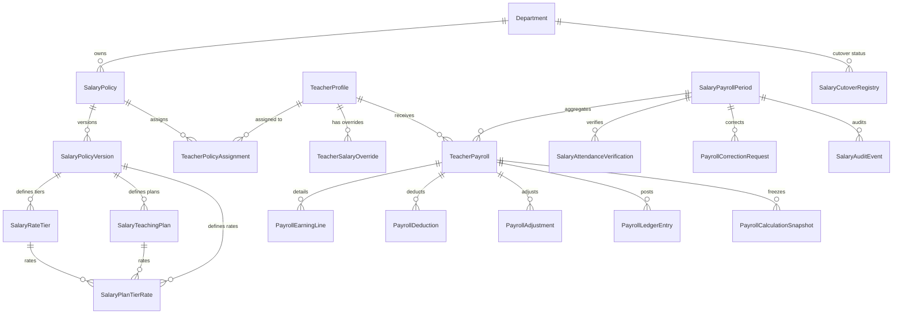
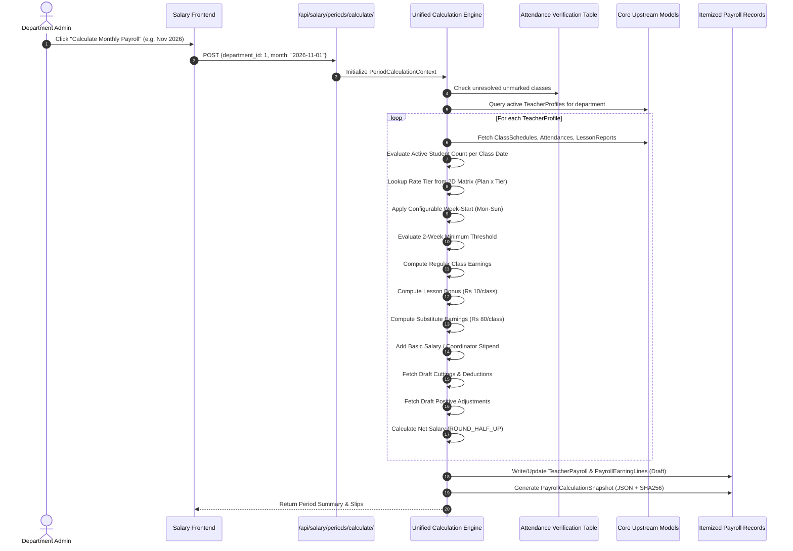
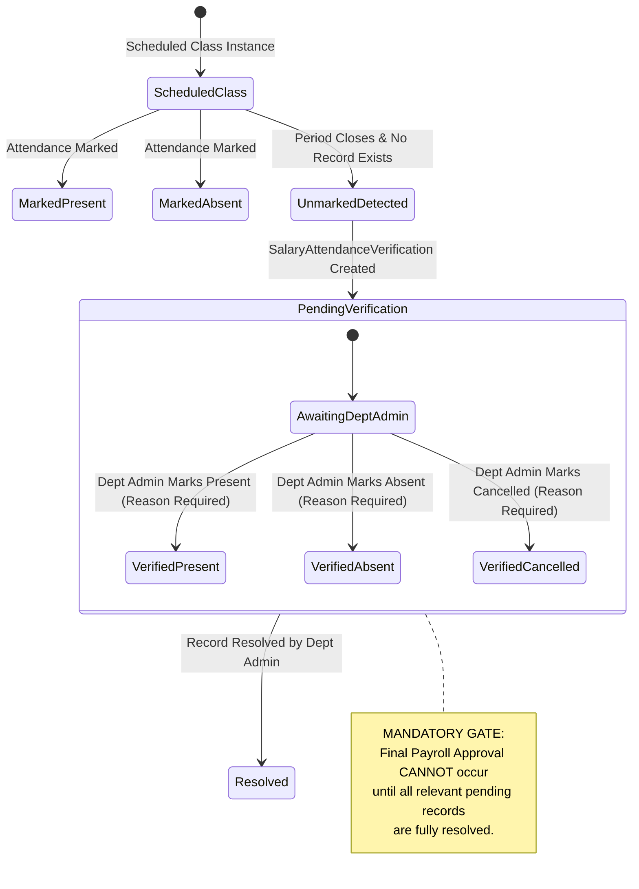
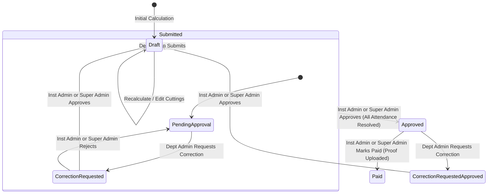
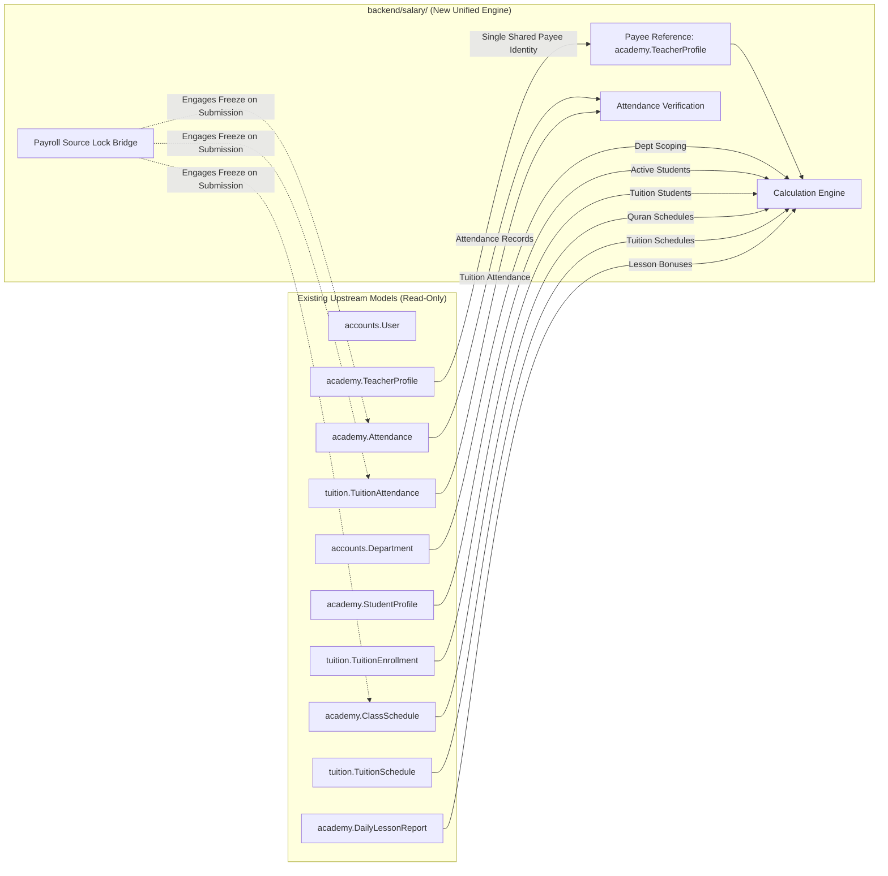
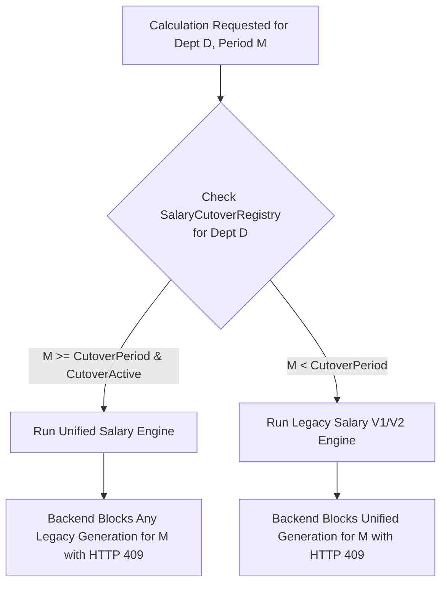
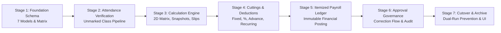

# Unified Salary Management — Corrected Architectural Blueprint & Foundation Readiness Review

> **Document ID**: `18_UNIFIED_SALARY_MANAGEMENT_BLUEPRINT`  
> **Status**: APPROVED ARCHITECTURAL DIRECTION (CLEAN REBUILD) — CORRECTIONS APPLIED — IMPLEMENTATION OF STAGE-1-FOUNDATION AWAITING OWNER AUTHORIZATION  
> **Repository Target**: `quran----1-Role-Based-`  
> **Product Name**: **Unified Salary Management**  
> **Target Departments**: Qur'an Department & Tuition Department (Shared Configurable Engine)  
> **Author**: Antigravity Senior Software Architect & Engineering Audit Team  
> **Date**: 2026-11-03  
> **Review Baseline**: Final Blueprint Correction and Foundation Readiness Review (Owner Mandate)  

---

## Executive Summary & Owner Mandate

Following a comprehensive architectural evaluation and owner direction review, the definitive architectural mandates for **Unified Salary Management** are established as follows:

1. **Complete Clean Rebuild (`backend/salary/`)**: Build an independent, unified salary management application from scratch located in `backend/salary/`. Do not extend Legacy Salary V1 (`TeacherSalarySlip`) or Qur'an Salary V2 (`QuranTeacherMonthlyPayroll`) as the primary calculation engine. Do not introduce further dependencies on the old calculation services (`salary_service.py`, `salary_v2_service.py`).
2. **Absolute Historical Data Safety**: A clean rebuild does **NOT** mean destructive deletion. All historical salary slips, V1 payroll records, V2 payroll records, approved/paid payroll records, ledger entries, adjustment histories, payment proofs, and audit entries must remain fully preserved in read-only status. No legacy tables will be dropped, no migrations deleted, and no legacy functionality disabled until cutover is separately approved and verified.
3. **Product Identity**: The product name is **Unified Salary Management**. Internal identifiers like "V1", "V2", or "V3" are strictly historical code markers and must never be exposed to users.
4. **Single Shared Engine with Department Independence**: Both Qur'an and Tuition departments run on one unified engine. Each department independently configures its policies, 2D rate matrices, weekday rules, cuttings/adjustments, and approval workflows.
5. **Single-Department Teacher Attribution**: Every teacher belongs to exactly one department according to the owner's business rule. The system enforces this constraint.
6. **Zero Code Deployments for Rate Changes**: Changing rate tiers, weekly teaching plans, per-class amounts, eligible days, or policy terms is managed exclusively through the Department Admin UI with structured, validated relational configurations. Arbitrary Python code execution and unvalidated formula strings are strictly forbidden.
7. **Small Foundation Implementation Stage (Stage 1)**: Stage 1 does **not** generate 17 conceptual financial models or modify frontend application routing (`App.tsx`). Stage 1 is restricted strictly to the foundation configuration schema (7 models: `SalaryPolicy`, `SalaryPolicyVersion`, `SalaryRateTier`, `SalaryTeachingPlan`, `SalaryPlanTierRate`, `TeacherPolicyAssignment`, `TeacherSalaryOverride`), core department scoping, strict database constraints, and focused model tests.
8. **Implementation Boundary**: **Implementation of STAGE-1-FOUNDATION is NOT yet authorized**. No application code or database migrations are created during this review.

---

## Table of Contents

1. [Architecture Diagram & System Topology](#1-architecture-diagram--system-topology)
2. [Normalized Django Model Design & Relational Schema](#2-normalized-django-model-design--relational-schema)
3. [REST API Endpoint Design](#3-rest-api-endpoint-design)
4. [UI Workspace, Pages & Component Architecture](#4-ui-workspace-pages--component-architecture)
5. [Configurable Salary Calculation Architecture](#5-configurable-salary-calculation-architecture)
6. [Payroll Ledger, Cuttings & Adjustments Subsystem](#6-payroll-ledger-cuttings--adjustments-subsystem)
7. [Attendance Verification & Multi-Stage Approval Governance](#7-attendance-verification--multi-stage-approval-governance)
8. [Dependency Map: Non-Salary Integrations & Payee Identity](#8-dependency-map-non-salary-integrations--payee-identity)
9. [Legacy Payroll Preservation & Cutover Safety](#9-legacy-payroll-preservation--cutover-safety)
10. [Staged Implementation Roadmap (Stages 1 through 7)](#10-staged-implementation-roadmap-stages-1-through-7)
11. [Migration, Operational & Rollback Risks](#11-migration-operational--rollback-risks)
12. [Stage 1 Implementation Package Specification (Small Foundation)](#12-stage-1-implementation-package-specification-small-foundation)
13. [Final Architecture-Readiness Review (Dedicated Section)](#13-final-architecture-readiness-review)

---

## 1. Architecture Diagram & System Topology

The Unified Salary Management architecture is structured into six discrete, decoupled layers:

```mermaid
flowchart TD
    subgraph ConfigLayer["1. Policy & Configuration Layer (Stage 1 Foundation)"]
        SP[SalaryPolicy<br/>Dept & Type Scoped] --> SPV[SalaryPolicyVersion<br/>Effective-Dated Container<br/>Configurable Week-Start: Mon-Sun]
        SPV --> SRT[SalaryRateTier<br/>Configurable Student Tiers: 1-15, 16-19, 20+]
        SPV --> STP[SalaryTeachingPlan<br/>Plans: 5d, 4d, 3d, 2d, Coord Special]
        SPV --> SPTR[SalaryPlanTierRate<br/>2D Matrix: Plan x Tier -> PKR Rate]
        TPA[TeacherPolicyAssignment<br/>Teacher-to-Policy Mapping] --> SP
        TSO[TeacherSalaryOverride<br/>5-Level Precedence Overrides] --> SPV
    end

    subgraph DataIntegrations["2. Upstream Core Systems (Read-Only to Engine)"]
        ACCOUNTS[accounts.User / accounts.Department<br/>Institution & Dept Scoping]
        TEACHER[academy.TeacherProfile<br/>Unified Payee Foreign Key]
        STUDENT[academy.StudentProfile / tuition.TuitionEnrollment<br/>Student Status & Transfers]
        SCHED[academy.ClassSchedule / tuition.TuitionSchedule<br/>Weekly Timetable & Temporal History]
        ATTEND[academy.Attendance / tuition.TuitionAttendance<br/>Teacher & Student Status]
        LESSONS[academy.DailyLessonReport<br/>Completed Progress Logs]
        COVERAGE[academy.QuranClassCoverage<br/>Substitute Tracking]
    end

    subgraph VerificationLayer["3. Attendance Verification & Audit Pipeline (Stage 2)"]
        UNMARKED[Unmarked Class Detector] --> SAV[SalaryAttendanceVerification<br/>Pending Verification Queue]
        ATTEND --> UNMARKED
        SCHED --> UNMARKED
        DEPT_ADMIN[Department Admin] -->|Resolve with Mandatory Audit Reason| SAV
    end

    subgraph CalculationEngine["4. Unified Salary Calculation Engine (Stage 3)"]
        RESOLVER[Rule & Override Precedence Resolver]
        TIER_ENG[Student-Count Tier Assessor]
        WEEK_ENG[Weekly Eligibility Assessor<br/>Any of 7 Weekday Starts]
        CLASS_ENG[Actual Class Earnings Engine<br/>No 20-Cap Arbitrary Limit]
        BONUS_ENG[Lesson Plan Bonus Engine]
        SUB_ENG[Substitute Compensation Engine]
        BASE_ENG[Basic Salary Evaluator]

        DataIntegrations --> RESOLVER
        ConfigLayer --> RESOLVER
        SAV -->|Verified Records| CalculationEngine
        RESOLVER --> TIER_ENG --> CLASS_ENG
        RESOLVER --> WEEK_ENG --> CLASS_ENG
        RESOLVER --> BONUS_ENG
        RESOLVER --> SUB_ENG
        RESOLVER --> BASE_ENG
    end

    subgraph FinancialLedger["5. Payroll Lifecycle & Ledger Layer (Stages 3-6)"]
        CALC_RUN[Period Calculation Run] --> TP[TeacherPayroll<br/>Monthly Aggregate Slip]
        CalculationEngine --> CALC_RUN
        CALC_RUN --> PEL[PayrollEarningLine<br/>Granular Itemized Class Lines]
        
        CUT_ADJ[Cuttings & Adjustments Section] --> PD[PayrollDeduction<br/>Fixed, Percentage, Advance, Recurring]
        CUT_ADJ --> PA[PayrollAdjustment<br/>Positive Additions]
        
        STATE_MACH[Multi-Stage State Machine<br/>Draft -> Submitted -> Approved -> Paid] --> TP
        STATE_MACH --> PLE[PayrollLedgerEntry<br/>Immutable Itemized Payroll Ledger]
        
        CORR_REQ[PayrollCorrectionRequest<br/>Dept Admin Requests -> Inst/Super Admin Approves] -.-> STATE_MACH
    end

    subgraph LegacyArchive["6. Historical Read-Only Archive Layer (Stage 7)"]
        V1_DATA[(TeacherSalarySlip<br/>V1 Historical Archive)]
        V2_DATA[(QuranTeacherMonthlyPayroll<br/>V2 Historical Archive)]
        HIST_VIEW[Historical Archive Viewer & PDF Service]
        CUTOVER_REG[SalaryCutoverRegistry<br/>Dual-Processing Prevention]
        V1_DATA --> HIST_VIEW
        V2_DATA --> HIST_VIEW
        CUTOVER_REG -.->|Blocks Dual Run| CALC_RUN
    end
```

---

## 2. Normalized Django Model Design & Relational Schema

### 2.1 Entity Relationship Diagram



---

### 2.2 Detailed Model Specifications

All monetary columns utilize `models.DecimalField(max_digits=14, decimal_places=2)` with `ROUND_HALF_UP` arithmetic to eliminate floating-point drift.

#### Stage 1 Foundation Models (Small Initial Implementation)

#### 1. `SalaryPolicy`
Represents the top-level policy container scoped to a specific department.
- `id`: `BigAutoField(primary_key=True)`.
- `institution`: `ForeignKey("accounts.Institution", on_delete=models.CASCADE, related_name="salary_policies")`.
- `department`: `ForeignKey("accounts.Department", on_delete=models.CASCADE, related_name="salary_policies")`.
- `code`: `CharField(max_length=60, db_index=True)`. (e.g. `QURAN_STANDARD_2026`, `TUITION_SECONDARY_2026`).
- `name`: `CharField(max_length=120)`.
- `description`: `TextField(blank=True)`.
- `policy_type`: `CharField(max_length=30, choices=[("standard", "Standard Policy"), ("hifz", "Hifz Special"), ("custom", "Custom Policy")])`.
- `is_active`: `BooleanField(default=True, db_index=True)`.
- `created_by`: `ForeignKey(settings.AUTH_USER_MODEL, null=True, on_delete=models.SET_NULL, related_name="+")`.
- `created_at`: `DateTimeField(auto_now_add=True)`.
- `updated_at`: `DateTimeField(auto_now=True)`.
- **Constraints**: `UniqueConstraint(fields=["department", "code"], name="unique_department_salary_policy_code")`.

#### 2. `SalaryPolicyVersion`
Effective-dated, immutable configuration container for policy parameters.
- `id`: `BigAutoField(primary_key=True)`.
- `policy`: `ForeignKey(SalaryPolicy, on_delete=models.CASCADE, related_name="versions")`.
- `version_number`: `PositiveIntegerField()`.
- `effective_from`: `DateField(db_index=True)`.
- `effective_to`: `DateField(null=True, blank=True, db_index=True)`.
- `status`: `CharField(max_length=20, choices=[("draft", "Draft"), ("published", "Published"), ("archived", "Archived")], default="draft")`.
- `week_start_day`: `CharField(max_length=12, choices=[("monday", "Monday"), ("tuesday", "Tuesday"), ("wednesday", "Wednesday"), ("thursday", "Thursday"), ("friday", "Friday"), ("saturday", "Saturday"), ("sunday", "Sunday")], default="monday")`.
- `min_qualifying_weeks`: `PositiveSmallIntegerField(default=2)`. (Minimum qualified weeks required for ongoing student compensation).
- `lesson_plan_bonus_per_class`: `DecimalField(max_digits=10, decimal_places=2, default=Decimal("10.00"))`.
- `substitute_rate_per_class`: `DecimalField(max_digits=10, decimal_places=2, default=Decimal("80.00"))`.
- `cancellation_rate_per_class`: `DecimalField(max_digits=10, decimal_places=2, default=Decimal("80.00"))`.
- `requires_completed_lesson_for_bonus`: `BooleanField(default=True)`.
- `notes`: `TextField(blank=True)`.
- `published_at`: `DateTimeField(null=True, blank=True)`.
- `published_by`: `ForeignKey(settings.AUTH_USER_MODEL, null=True, on_delete=models.SET_NULL, related_name="+")`.
- `created_at`: `DateTimeField(auto_now_add=True)`.
- **Constraints**:
  - `UniqueConstraint(fields=["policy", "version_number"], name="unique_policy_version_number")`.
  - Clean validation: `effective_to` must be greater than or equal to `effective_from` if provided. Non-overlapping published version dates for the same policy.
  - Immutability rule: Once status is `published`, records are strictly read-only. Rate changes require drafting and publishing a new version.

#### 3. `SalaryRateTier`
Configurable student-count tier boundaries (horizontal axis of rate matrix).
- `id`: `BigAutoField(primary_key=True)`.
- `policy_version`: `ForeignKey(SalaryPolicyVersion, on_delete=models.CASCADE, related_name="rate_tiers")`.
- `tier_name`: `CharField(max_length=60)`. (e.g. `Tier 1 (1–15)`, `Tier 2 (16–19)`, `Tier 3 (20+)`).
- `min_students`: `PositiveIntegerField(default=1)`.
- `max_students`: `PositiveIntegerField(null=True, blank=True)`. (Null indicates upper bound $\infty$, e.g. 20+).
- `sort_order`: `PositiveSmallIntegerField(default=1)`.
- **Constraints**:
  - Strict contiguous tier validation: `min_students <= max_students` (when max is set).
  - Next tier `min_students` must equal previous tier `max_students + 1`. Zero gaps, zero overlaps.
  - `UniqueConstraint(fields=["policy_version", "sort_order"], name="unique_policy_version_tier_order")`.

#### 4. `SalaryTeachingPlan`
Weekly teaching plan definitions (vertical axis of rate matrix).
- `id`: `BigAutoField(primary_key=True)`.
- `policy_version`: `ForeignKey(SalaryPolicyVersion, on_delete=models.CASCADE, related_name="teaching_plans")`.
- `plan_code`: `CharField(max_length=40)`. (e.g. `5_days`, `4_days`, `3_days`, `2_days`, `coordinator_special`).
- `plan_name`: `CharField(max_length=100)`. (e.g. `5 Days / Week`, `4 Days / Week`, `3 Days / Week`, `2 Days / Week`, `Coordinator Special`).
- `days_per_week`: `PositiveSmallIntegerField(null=True, blank=True)`. (e.g. 5, 4, 3, 2; null for non-standard plans like coordinator special).
- `is_coordinator_special`: `BooleanField(default=False)`.
- `sort_order`: `PositiveSmallIntegerField(default=1)`.
- **Constraints**: `UniqueConstraint(fields=["policy_version", "plan_code"], name="unique_policy_version_plan_code")`.

#### 5. `SalaryPlanTierRate`
Two-dimensional rate matrix entry mapping (Teaching Plan × Student Tier -> PKR Rate).
- `id`: `BigAutoField(primary_key=True)`.
- `policy_version`: `ForeignKey(SalaryPolicyVersion, on_delete=models.CASCADE, related_name="plan_tier_rates")`.
- `teaching_plan`: `ForeignKey(SalaryTeachingPlan, on_delete=models.CASCADE, related_name="tier_rates")`.
- `rate_tier`: `ForeignKey(SalaryRateTier, on_delete=models.CASCADE, related_name="plan_rates")`.
- `rate_per_class`: `DecimalField(max_digits=12, decimal_places=2)`. (PKR per eligible class).
- **Constraints**:
  - `UniqueConstraint(fields=["policy_version", "teaching_plan", "rate_tier"], name="unique_plan_tier_rate_entry")`.
  - Rate must be positive (`CheckConstraint(check=Q(rate_per_class__gte=0), name="check_positive_rate_per_class")`).

#### 6. `TeacherPolicyAssignment`
Direct policy binding for individual teachers with date windows.
- `id`: `BigAutoField(primary_key=True)`.
- `department`: `ForeignKey("accounts.Department", on_delete=models.CASCADE, related_name="teacher_salary_assignments")`.
- `teacher`: `ForeignKey("academy.TeacherProfile", on_delete=models.PROTECT, related_name="salary_policy_assignments")`.
- `policy`: `ForeignKey(SalaryPolicy, on_delete=models.PROTECT, related_name="teacher_assignments")`.
- `effective_from`: `DateField(db_index=True)`.
- `effective_to`: `DateField(null=True, blank=True, db_index=True)`.
- `is_active`: `BooleanField(default=True)`.
- `assigned_by`: `ForeignKey(settings.AUTH_USER_MODEL, null=True, on_delete=models.SET_NULL, related_name="+")`.
- `assigned_at`: `DateTimeField(auto_now_add=True)`.
- **Constraints**:
  - Teacher and Policy must belong to the same Department.
  - A teacher cannot have overlapping active assignments within the same department.

#### 7. `TeacherSalaryOverride`
Encapsulates the 5-level override priority hierarchy with strict date ranges.
- `id`: `BigAutoField(primary_key=True)`.
- `department`: `ForeignKey("accounts.Department", on_delete=models.CASCADE, related_name="teacher_salary_overrides")`.
- `teacher`: `ForeignKey("academy.TeacherProfile", on_delete=models.PROTECT, related_name="salary_overrides")`.
- `override_level`: `CharField(max_length=30, choices=[("student_specific", "Level 1: Student Specific"), ("plan_specific", "Level 2: Teaching Plan Specific"), ("teacher_wide", "Level 3: Teacher Wide"), ("coordinator_day", "Level 4: Coordinator Special Day")])`.
- `student`: `ForeignKey("academy.StudentProfile", null=True, blank=True, on_delete=models.PROTECT, related_name="salary_overrides")`.
- `teaching_plan`: `ForeignKey(SalaryTeachingPlan, null=True, blank=True, on_delete=models.PROTECT, related_name="plan_overrides")`.
- `qualifying_weekday`: `CharField(max_length=12, null=True, blank=True, choices=[("monday", "Monday"), ("tuesday", "Tuesday"), ("wednesday", "Wednesday"), ("thursday", "Thursday"), ("friday", "Friday"), ("saturday", "Saturday"), ("sunday", "Sunday")])`.
- `rate_per_class`: `DecimalField(max_digits=12, decimal_places=2)`.
- `effective_from`: `DateField(db_index=True)`.
- `effective_to`: `DateField(null=True, blank=True, db_index=True)`.
- `is_active`: `BooleanField(default=True)`.
- `reason`: `TextField()`. (Mandatory).
- `created_by`: `ForeignKey(settings.AUTH_USER_MODEL, null=True, on_delete=models.SET_NULL, related_name="+")`.
- `created_at`: `DateTimeField(auto_now_add=True)`.
- **Constraints**: Validation that `student` is required if `override_level == 'student_specific'`; `teaching_plan` required if `override_level == 'plan_specific'`.

---

#### Models for Subsequent Stages (Deferred Specification)

The following models are specified architecturally and relational-integrity validated, but will be implemented in later authorized stages:

#### 8. `SalaryAttendanceVerification` (Stage 2)
Resolves unmarked classes prior to payroll finalization.
- `id`: `BigAutoField(primary_key=True)`.
- `department`: `ForeignKey("accounts.Department", on_delete=models.CASCADE, related_name="salary_attendance_verifications")`.
- `teacher`: `ForeignKey("academy.TeacherProfile", on_delete=models.PROTECT, related_name="+")`.
- `student`: `ForeignKey("academy.StudentProfile", null=True, blank=True, on_delete=models.PROTECT, related_name="+")`.
- `schedule_id`: `PositiveIntegerField(null=True, blank=True)`.
- `class_date`: `DateField(db_index=True)`.
- `payroll_month`: `DateField(db_index=True)`. (Normalized to first day of month).
- `status`: `CharField(max_length=25, choices=[("pending", "Pending Verification"), ("verified_present", "Verified Present"), ("verified_absent", "Verified Absent"), ("verified_cancelled", "Verified Cancelled")], default="pending")`.
- `resolution_reason`: `TextField(blank=True)`. (Mandatory on resolution).
- `resolved_by`: `ForeignKey(settings.AUTH_USER_MODEL, null=True, on_delete=models.SET_NULL, related_name="+")`.
- `resolved_at`: `DateTimeField(null=True, blank=True)`.
- `created_at`: `DateTimeField(auto_now_add=True)`.
- **Constraints**: `UniqueConstraint(fields=["department", "teacher", "class_date", "schedule_id"], name="unique_salary_unmarked_attendance_instance")`.

#### 9. `SalaryPayrollPeriod` (Stage 3)
Department-scoped monthly payroll execution container.
- `id`: `BigAutoField(primary_key=True)`.
- `institution`: `ForeignKey("accounts.Institution", on_delete=models.CASCADE, related_name="salary_payroll_periods")`.
- `department`: `ForeignKey("accounts.Department", on_delete=models.CASCADE, related_name="salary_payroll_periods")`.
- `period_month`: `DateField(db_index=True)`. (First day of month).
- `status`: `CharField(max_length=30, choices=[("draft", "Draft Calculation"), ("submitted", "Submitted for Approval"), ("approved", "Approved"), ("paid", "Paid"), ("returned_for_correction", "Returned for Correction"), ("archived", "Archived Read-Only")], default="draft")`.
- `policy_version`: `ForeignKey(SalaryPolicyVersion, on_delete=models.PROTECT, related_name="payroll_periods")`.
- `total_teachers`: `PositiveIntegerField(default=0)`.
- `total_classes_taught`: `PositiveIntegerField(default=0)`.
- `total_gross`: `DecimalField(max_digits=14, decimal_places=2, default=Decimal("0.00"))`.
- `total_cuttings`: `DecimalField(max_digits=14, decimal_places=2, default=Decimal("0.00"))`.
- `total_additions`: `DecimalField(max_digits=14, decimal_places=2, default=Decimal("0.00"))`.
- `total_net`: `DecimalField(max_digits=14, decimal_places=2, default=Decimal("0.00"))`.
- `submitted_at`: `DateTimeField(null=True, blank=True)`.
- `submitted_by`: `ForeignKey(settings.AUTH_USER_MODEL, null=True, blank=True, on_delete=models.SET_NULL, related_name="+")`.
- `approved_at`: `DateTimeField(null=True, blank=True)`.
- `approved_by`: `ForeignKey(settings.AUTH_USER_MODEL, null=True, blank=True, on_delete=models.SET_NULL, related_name="+")`.
- `paid_at`: `DateTimeField(null=True, blank=True)`.
- `paid_by`: `ForeignKey(settings.AUTH_USER_MODEL, null=True, blank=True, on_delete=models.SET_NULL, related_name="+")`.
- `payment_reference`: `CharField(max_length=120, blank=True)`.
- `payment_proof`: `FileField(upload_to="salary_proofs/%Y/%m/", null=True, blank=True)`.
- **Constraints**: `UniqueConstraint(fields=["department", "period_month"], name="unique_department_monthly_payroll_period")`.

#### 10. `TeacherPayroll` (Stage 3)
Monthly aggregate salary slip for an individual teacher.
- `id`: `BigAutoField(primary_key=True)`.
- `payroll_period`: `ForeignKey(SalaryPayrollPeriod, on_delete=models.CASCADE, related_name="teacher_payrolls")`.
- `teacher`: `ForeignKey("academy.TeacherProfile", on_delete=models.PROTECT, related_name="unified_payrolls")`.
- `department`: `ForeignKey("accounts.Department", on_delete=models.CASCADE, related_name="teacher_payrolls")`.
- `policy_version`: `ForeignKey(SalaryPolicyVersion, on_delete=models.PROTECT, related_name="teacher_payrolls")`.
- `active_students_snapshot`: `PositiveIntegerField(default=0)`.
- `total_scheduled_classes`: `PositiveIntegerField(default=0)`.
- `total_conducted_classes`: `PositiveIntegerField(default=0)`.
- `total_student_absent_classes`: `PositiveIntegerField(default=0)`.
- `total_teacher_absent_classes`: `PositiveIntegerField(default=0)`.
- `total_substitute_classes`: `PositiveIntegerField(default=0)`.
- `regular_earnings`: `DecimalField(max_digits=12, decimal_places=2, default=Decimal("0.00"))`.
- `lesson_plan_bonus`: `DecimalField(max_digits=12, decimal_places=2, default=Decimal("0.00"))`.
- `substitute_earnings`: `DecimalField(max_digits=12, decimal_places=2, default=Decimal("0.00"))`.
- `basic_salary`: `DecimalField(max_digits=12, decimal_places=2, default=Decimal("0.00"))`.
- `positive_adjustments`: `DecimalField(max_digits=12, decimal_places=2, default=Decimal("0.00"))`.
- `gross_salary`: `DecimalField(max_digits=12, decimal_places=2, default=Decimal("0.00"))`.
- `total_deductions`: `DecimalField(max_digits=12, decimal_places=2, default=Decimal("0.00"))`.
- `net_salary`: `DecimalField(max_digits=12, decimal_places=2, default=Decimal("0.00"))`.
- **Constraints**: `UniqueConstraint(fields=["payroll_period", "teacher"], name="unique_teacher_payroll_per_period")`.

#### 11. `PayrollEarningLine` (Stage 3)
Granular, itemized audit line for every single scheduled or covered class.
- `id`: `BigAutoField(primary_key=True)`.
- `teacher_payroll`: `ForeignKey(TeacherPayroll, on_delete=models.CASCADE, related_name="earning_lines")`.
- `class_date`: `DateField(db_index=True)`.
- `schedule_id`: `PositiveIntegerField()`.
- `student`: `ForeignKey("academy.StudentProfile", null=True, blank=True, on_delete=models.PROTECT, related_name="+")`.
- `earning_type`: `CharField(max_length=30, choices=[("regular_class", "Regular Class"), ("substitute_cover", "Substitute Class"), ("cancellation_comp", "Official Cancellation"), ("coordinator_special", "Coordinator Special Day")])`.
- `teaching_plan_code`: `CharField(max_length=40)`.
- `active_student_count`: `PositiveIntegerField()`.
- `rate_tier_name`: `CharField(max_length=60)`.
- `rate_applied`: `DecimalField(max_digits=10, decimal_places=2)`.
- `earned_amount`: `DecimalField(max_digits=10, decimal_places=2)`.
- `lesson_bonus_amount`: `DecimalField(max_digits=10, decimal_places=2, default=Decimal("0.00"))`.
- `override_applied`: `CharField(max_length=40, blank=True)`.
- `is_qualified`: `BooleanField(default=True)`.
- `disqualification_reason`: `CharField(max_length=200, blank=True)`.
- **Constraints**:
  - `UniqueConstraint(fields=["teacher_payroll", "schedule_id", "class_date", "earning_type"], name="unique_earning_line_per_class")`.
  - Guarantees zero duplicate class payments across the system.

#### 12. `PayrollDeduction` (Stage 4 - Cuttings & Deductions Subsystem)
All salary cuttings and deductions with explicit categorization and audit tracking.
- `id`: `BigAutoField(primary_key=True)`.
- `teacher_payroll`: `ForeignKey(TeacherPayroll, on_delete=models.CASCADE, related_name="deductions")`.
- `deduction_type`: `CharField(max_length=30, choices=[("fixed_deduction", "Fixed Monetary Deduction"), ("percentage_deduction", "Percentage Deduction"), ("salary_advance", "Salary Advance Recovery"), ("unexcused_absence", "Unexcused Absence Cutting"), ("recurring_deduction", "Recurring Policy Deduction"), ("other", "Other Deduction")])`.
- `amount`: `DecimalField(max_digits=12, decimal_places=2)`.
- `calculation_basis`: `CharField(max_length=30, blank=True, choices=[("gross_earnings", "Gross Earnings"), ("regular_earnings", "Regular Earnings"), ("basic_salary", "Basic Salary")])`. (Required for percentage deductions).
- `percentage_rate`: `DecimalField(max_digits=5, decimal_places=2, null=True, blank=True)`.
- `advance_total_principal`: `DecimalField(max_digits=12, decimal_places=2, null=True, blank=True)`.
- `advance_remaining_balance`: `DecimalField(max_digits=12, decimal_places=2, null=True, blank=True)`.
- `reason`: `TextField()`. (Mandatory).
- `is_draft`: `BooleanField(default=True)`.
- `created_by`: `ForeignKey(settings.AUTH_USER_MODEL, null=True, on_delete=models.SET_NULL, related_name="+")`.
- `created_at`: `DateTimeField(auto_now_add=True)`.
- `updated_at`: `DateTimeField(auto_now=True)`.

#### 13. `PayrollAdjustment` (Stage 4 - Positive Additions)
Positive adjustments and non-class compensation.
- `id`: `BigAutoField(primary_key=True)`.
- `teacher_payroll`: `ForeignKey(TeacherPayroll, on_delete=models.CASCADE, related_name="adjustments")`.
- `adjustment_type`: `CharField(max_length=30, choices=[("arrears", "Arrears / Retroactive Adjustment"), ("reimbursement", "Expense Reimbursement"), ("special_bonus", "Special Performance Bonus"), ("coordinator_stipend", "Coordinator Administrative Stipend"), ("other", "Other Addition")])`.
- `amount`: `DecimalField(max_digits=12, decimal_places=2)`.
- `reason`: `TextField()`. (Mandatory).
- `reference_document`: `CharField(max_length=120, blank=True)`.
- `is_draft`: `BooleanField(default=True)`.
- `created_by`: `ForeignKey(settings.AUTH_USER_MODEL, null=True, on_delete=models.SET_NULL, related_name="+")`.
- `created_at`: `DateTimeField(auto_now_add=True)`.

#### 14. `PayrollLedgerEntry` (Stage 5 - Immutable Itemized Payroll Ledger)
Clarified Architecture: An **immutable itemized payroll ledger** recording itemized earnings (credits) and deductions (debits) posted upon final payroll approval.
- `id`: `BigAutoField(primary_key=True)`.
- `teacher_payroll`: `ForeignKey(TeacherPayroll, on_delete=models.PROTECT, related_name="ledger_entries")`.
- `department`: `ForeignKey("accounts.Department", on_delete=models.PROTECT, related_name="+")`.
- `entry_type`: `CharField(max_length=30, choices=[("regular_earning", "Regular Class Earning"), ("lesson_bonus", "Lesson Plan Bonus"), ("substitute_earning", "Substitute Class Earning"), ("basic_salary", "Basic Salary"), ("manual_addition", "Positive Adjustment"), ("fixed_deduction", "Fixed Deduction"), ("advance_recovery", "Advance Recovery"), ("percentage_deduction", "Percentage Deduction")])`.
- `direction`: `CharField(max_length=10, choices=[("credit", "Credit (Earning)"), ("debit", "Debit (Deduction)")])`.
- `amount`: `DecimalField(max_digits=12, decimal_places=2)`.
- `posted_at`: `DateTimeField(auto_now_add=True, db_index=True)`.
- `posted_by`: `ForeignKey(settings.AUTH_USER_MODEL, null=True, on_delete=models.SET_NULL, related_name="+")`.
- `description`: `CharField(max_length=255)`.
- **Invariants**: Append-only. Updates and deletes are prohibited at both application and database trigger levels.

#### 15. `PayrollCalculationSnapshot` (Stage 3)
Complete cryptographic/JSON snapshot of calculation inputs, formulas, and state.
- `id`: `BigAutoField(primary_key=True)`.
- `teacher_payroll`: `OneToOneField(TeacherPayroll, on_delete=models.CASCADE, related_name="calculation_snapshot")`.
- `snapshot_data`: `JSONField()`.
- `snapshot_hash`: `CharField(max_length=64)`. (SHA-256 digest of normalized payload).
- `created_at`: `DateTimeField(auto_now_add=True)`.

#### 16. `PayrollCorrectionRequest` (Stage 6 - Controlled Return Workflow)
Controlled mechanism for returning submitted or approved payroll for recalculation.
- `id`: `BigAutoField(primary_key=True)`.
- `payroll_period`: `ForeignKey(SalaryPayrollPeriod, on_delete=models.CASCADE, related_name="correction_requests")`.
- `department`: `ForeignKey("accounts.Department", on_delete=models.CASCADE, related_name="+")`.
- `requested_by`: `ForeignKey(settings.AUTH_USER_MODEL, on_delete=models.PROTECT, related_name="requested_payroll_corrections")`.
- `request_reason`: `TextField()`. (Mandatory).
- `status`: `CharField(max_length=20, choices=[("pending", "Pending Review"), ("approved", "Approved"), ("rejected", "Rejected")], default="pending")`.
- `reviewed_by`: `ForeignKey(settings.AUTH_USER_MODEL, null=True, blank=True, on_delete=models.PROTECT, related_name="reviewed_payroll_corrections")`.
- `review_notes`: `TextField(blank=True)`.
- `requested_at`: `DateTimeField(auto_now_add=True)`.
- `reviewed_at`: `DateTimeField(null=True, blank=True)`.
- **Governance Invariants**:
  - Requested by Department Admin.
  - Approved/Rejected by Institution Admin (within their institution) or Super Admin.
  - Department Admin cannot approve their own correction request (`requested_by != reviewed_by`).

#### 17. `SalaryCutoverRegistry` (Stage 7 - Dual-Processing Prevention)
Controls department-level migration from legacy salary to Unified Salary Management.
- `id`: `BigAutoField(primary_key=True)`.
- `department`: `OneToOneField("accounts.Department", on_delete=models.PROTECT, related_name="salary_cutover_status")`.
- `cutover_payroll_period`: `DateField()`. (First calendar month under unified engine, e.g. `2026-12-01`).
- `is_cutover_active`: `BooleanField(default=False)`.
- `legacy_payroll_locked`: `BooleanField(default=True)`.
- `activated_at`: `DateTimeField(null=True, blank=True)`.
- `activated_by`: `ForeignKey(settings.AUTH_USER_MODEL, null=True, on_delete=models.SET_NULL, related_name="+")`.
- `notes`: `TextField(blank=True)`.

#### 18. `SalaryAuditEvent` (Stage 6)
Comprehensive audit trail for every salary policy mutation, calculation trigger, adjustment, and state transition.
- `id`: `BigAutoField(primary_key=True)`.
- `department`: `ForeignKey("accounts.Department", null=True, on_delete=models.CASCADE, related_name="+")`.
- `event_type`: `CharField(max_length=50, db_index=True)`.
- `actor`: `ForeignKey(settings.AUTH_USER_MODEL, null=True, on_delete=models.SET_NULL, related_name="+")`.
- `target_model`: `CharField(max_length=60)`.
- `target_id`: `PositiveBigIntegerField()`.
- `before_state`: `JSONField(null=True, blank=True)`.
- `after_state`: `JSONField(null=True, blank=True)`.
- `ip_address`: `GenericIPAddressField(null=True, blank=True)`.
- `timestamp`: `DateTimeField(auto_now_add=True, db_index=True)`.

---

## 3. REST API Endpoint Design

All endpoints reside under the `/api/salary/` root URL namespace:

| Method | Endpoint | Description | Permissions & Scoping |
|---|---|---|---|
| `GET` | `/api/salary/policies/` | List policies for active department | Dept Admin, Inst Admin, Super Admin |
| `POST` | `/api/salary/policies/` | Create new department policy | Dept Admin, Inst Admin, Super Admin |
| `GET` | `/api/salary/policies/<id>/versions/` | List version history for policy | Dept Admin, Inst Admin, Super Admin |
| `POST` | `/api/salary/policies/<id>/versions/` | Draft new policy version (with 2D rate matrix & week-start) | Dept Admin, Inst Admin, Super Admin |
| `POST` | `/api/salary/policies/versions/<id>/publish/` | Publish version (freezes rates immutably) | Dept Admin, Inst Admin, Super Admin |
| `GET` | `/api/salary/teacher-assignments/` | List teacher-policy assignments | Dept Admin, Inst Admin, Super Admin |
| `POST` | `/api/salary/teacher-assignments/` | Assign teacher to policy version | Dept Admin, Inst Admin, Super Admin |
| `GET` | `/api/salary/overrides/` | List 5-level overrides | Dept Admin, Inst Admin, Super Admin |
| `POST` | `/api/salary/overrides/` | Create 5-level rate override | Dept Admin, Inst Admin, Super Admin |
| `GET` | `/api/salary/attendance-verifications/` | List pending unmarked classes | Dept Admin, Inst Admin, Super Admin |
| `POST` | `/api/salary/attendance-verifications/<id>/resolve/` | Resolve unmarked class (Present/Absent/Cancelled + Reason) | **Only Department Admin** |
| `GET` | `/api/salary/periods/` | List monthly payroll periods | Dept Admin, Inst Admin, Super Admin |
| `POST` | `/api/salary/periods/calculate/` | Trigger draft calculation for period | Dept Admin, Inst Admin, Super Admin |
| `GET` | `/api/salary/periods/<id>/summary/` | Aggregate gross, deductions, additions, net | Dept Admin, Inst Admin, Super Admin |
| `GET` | `/api/salary/periods/<id>/slips/` | List teacher slips for period | Dept Admin, Inst Admin, Super Admin |
| `GET` | `/api/salary/slips/<id>/` | Detailed slip with lines, cuttings & adjustments | Teacher (self), Dept Admin, Inst Admin, Super Admin |
| `POST` | `/api/salary/slips/<id>/deductions/` | Add/edit fixed, percentage, or advance deduction | Dept Admin (Draft status only) |
| `DELETE` | `/api/salary/deductions/<id>/` | Cancel draft deduction | Dept Admin (Draft status only) |
| `POST` | `/api/salary/slips/<id>/adjustments/` | Add manual positive addition | Dept Admin (Draft status only) |
| `DELETE` | `/api/salary/adjustments/<id>/` | Cancel draft adjustment | Dept Admin (Draft status only) |
| `POST` | `/api/salary/periods/<id>/submit/` | Submit period for approval (Engages source lock) | Dept Admin |
| `POST` | `/api/salary/periods/<id>/approve/` | Grant final payroll approval (Writes immutable ledger) | **Institution Admin / Super Admin (Blocked if pending attendance exists)** |
| `POST` | `/api/salary/periods/<id>/mark-paid/` | Mark period paid & upload payment proof | Institution Admin, Super Admin |
| `POST` | `/api/salary/correction-requests/` | Request payroll return for correction (Mandatory reason) | **Department Admin** |
| `POST` | `/api/salary/correction-requests/<id>/action/` | Approve or Reject correction request | **Institution Admin (own inst) or Super Admin (CANNOT approve own request)** |
| `GET` | `/api/salary/legacy/v1/slips/` | Read-only legacy Salary V1 slips archive | Dept Admin, Inst Admin, Super Admin, Teacher (self) |
| `GET` | `/api/salary/legacy/v2/payrolls/` | Read-only legacy Salary V2 payrolls archive | Dept Admin, Inst Admin, Super Admin, Teacher (self) |
| `GET` | `/api/salary/cutover-status/` | Check active cutover status for department | Dept Admin, Inst Admin, Super Admin |

---

## 4. UI Workspace, Pages & Component Architecture

### Workspace Tab Navigation Matrix

Unified Salary Management is hosted under the primary `#salary` route across both Qur'an and Tuition portals:

| Tab Name | Target Audience | Primary Operations & Capabilities |
|---|---|---|
| **Monthly Payroll** | Dept Admin, Inst Admin, Super Admin | Month selector, period status indicator, period aggregate cards, recalculate button, submission/approval action bar, pending attendance warning pill. |
| **Teacher Monthly Salary Slip** | Dept Admin, Inst Admin, Super Admin, Teacher | Itemized class earnings table, student breakdown, lesson plan bonuses, substitute pay, **Dedicated Cuttings & Adjustments Section**, Gross-to-Net live preview, PDF slip download. |
| **Attendance Verification Queue** | Dept Admin | Table of unmarked classes, student/schedule details, quick-action resolution modal (Present / Absent / Cancelled with mandatory audit reason). |
| **Policy & Rates Configuration** | Dept Admin, Inst Admin, Super Admin | Policy switcher, effective-dated versions list, **Two-Dimensional Rate Matrix Editor** (Teaching Plans × Student Tiers), Week-Start selector (Mon–Sun), Auxiliary components, Immutability guards. |
| **Cuttings & Deductions Manager** | Dept Admin, Inst Admin, Super Admin | Multi-teacher deductions overview, salary advance recovery tracker, recurring deduction rules, percentage deduction basis validator. |
| **Teacher Assignments & Overrides** | Dept Admin, Inst Admin, Super Admin | Teacher-to-policy mapping, 5-level override configuration modal (Student, Plan, Teacher, Coordinator Special Day, Dept Default). |
| **Historical Archive (Read-Only)** | All Authorized Roles | Seamless archive browser for legacy Salary V1 slips and Salary V2 records with historical PDF generation and payment receipts. |

---

## 5. Configurable Salary Calculation Architecture

### 5.1 Calculation Pipeline Sequence



---

### 5.2 Core Business Rules & Formulas

#### 1. Two-Dimensional Rate Matrix & Student-Count Tiers
- Regular class earnings are governed by a 2D matrix: **Weekly Teaching Plan × Teacher Active-Student-Count Tier**.
- Tier boundaries are configurable per policy version (e.g., Tier 1: 1–15 students, Tier 2: 16–19 students, Tier 3: 20+ students).
- Initial Quran reference rates:
  | Weekly Teaching Plan | Tier 1 (1–15 students) | Tier 2 (16–19 students) | Tier 3 (20+ students) |
  |---|---:|---:|---:|
  | **5 days / week** | Rs. 80.00 | Rs. 90.00 | Rs. 100.00 |
  | **4 days / week** | Rs. 100.00 | Rs. 112.50 | Rs. 125.00 |
  | **3 days / week** | Rs. 116.00 | Rs. 133.00 | Rs. 166.00 |
  | **2 days / week** | Rs. 175.00 | Rs. 200.00 | Rs. 225.00 |
  | **Coordinator special** | Rs. 200.00 | Rs. 225.00 | Rs. 250.00 |
- **Amounts are PKR per eligible class**. Reference monthly package amounts are illustrative baseline benchmarks, **never payment caps**.
- The student tier is determined dynamically on each class date $D$ based on active assigned students:
  $$\text{TierRate}(D, \text{Plan}) = \text{Lookup2D}(\text{Plan}, \text{ActiveStudentsCount}(D))$$

#### 2. Actual Class Payment (No 20-Cap Limit)
- Regular class earnings are calculated as the sum of actual eligible classes taught:
  $$\text{RegularEarnings} = \sum_{c \in \text{EligibleClasses}} \text{ClassRate}(c)$$
- No arbitrary monthly class cap (e.g. 20-class cap) is imposed.

#### 3. Configurable Teaching Week & Two-Week Qualification Rule
- The Department Admin can choose **ANY of the seven weekdays** as the start of the teaching week:
  $$W_{\text{start}} \in \{\text{Monday}, \text{Tuesday}, \text{Wednesday}, \text{Thursday}, \text{Friday}, \text{Saturday}, \text{Sunday}\} \quad (\text{Default: Monday})$$
- A week qualifies if at least one scheduled class meets eligibility rules:
  $$\text{WeekQualified}(w) = \begin{cases} 1 & \text{if } \exists c \in w \text{ such that } \text{Eligible}(c) = \text{True} \\ 0 & \text{otherwise} \end{cases}$$
- **Partial Weeks**: A partial week (e.g. month beginning mid-week or ending mid-week) may qualify if it contains a qualifying class.
- **Cross-Month Boundary Weeks**: A teaching week spanning two calendar months can count toward weekly eligibility in each month when that month contains a qualifying class.
- **Payment Invariant**: **Every class is paid ONLY in its actual payroll month** based on the calendar date of the class. No class is ever paid twice or shifted to another month.
- **Two-Week Threshold**:
  - Ongoing enrollments must qualify in $\ge 2$ weeks during the month to earn regular class payment for that student.
  - If $\sum_{w} \text{WeekQualified}(w) < 2$, regular earnings for that student are Rs. 0.
  - Prorated exceptions: New enrollments, departures, or official transfers qualify if active weeks meet eligibility.

#### 4. Attendance Eligibility Matrix
- **Student Absence**: Both informed leave and uninformed absence count toward regular class earnings provided teacher availability is verified. (One full week of consecutive absence triggers coordinator review, not automatic dropping).
- **Teacher Absence**: An absent or unexcused teacher does **not** earn class payment for that class.
- **Double-Deduction Prevention**: Unpaid teacher absence already results in 0 class earnings. The system does not automatically apply an additional absence deduction unless explicitly configured as an administrative penalty.

#### 5. Five-Level Override Priority Hierarchy
When resolving the per-class rate for class $c$:
1. **Level 1**: Student-Specific Override (student + teacher specific rate).
2. **Level 2**: Teaching-Plan-Specific Override (teacher + plan specific rate).
3. **Level 3**: Teacher-Wide Override (teacher specific fixed class rate).
4. **Level 4**: Coordinator Special-Day Override (designated special teaching day rate).
5. **Level 5**: Department Default (resolved from 2D Rate Matrix).

#### 6. Auxiliary Compensation Components
- **Lesson Plan Bonus**: Rs. 10.00 per conducted class with verified daily lesson report. Independent of the 2-week threshold.
- **Substitute Coverage**: Rs. 80.00 per covered class paid to the substitute teacher.
- **Coordinator Administrative Stipend**: Configurable fixed addition for administrative duties, strictly separated from teaching class earnings.

---

## 6. Payroll Ledger, Cuttings & Adjustments Subsystem

### 6.1 Dedicated Cuttings & Adjustments Section

Every teacher's monthly salary slip features a dedicated **Cuttings & Adjustments** section:

1. **Fixed Deductions**: Specified PKR amount deducted from gross salary (e.g. equipment fee, administrative fine).
2. **Percentage Deductions**: Explicitly configured basis:
   - `Gross Earnings`
   - `Regular Class Earnings`
   - `Eligible Basic Salary`
   - Dynamic formula: $\text{Deduction} = \text{BasisAmount} \times \frac{\text{Percentage}}{100}$, rounded via `ROUND_HALF_UP`.
3. **Salary Advance Recovery**:
   - Explicit principal tracking, period installment deduction, and remaining balance.
   - **No Silent Rollover**: Uncollected advance balances are not silently mutated; outstanding balances require explicit schedule tracking.
4. **Recurring Deductions**: Configured deduction rule applied across successive periods. Each period evaluates the deduction independently with full audit tracking.
5. **Positive Manual Adjustments**: Positive additions for arrears, special bonuses, or expense reimbursements.
6. **Mandatory Reasons**: Every deduction and adjustment requires a mandatory explanation string.
7. **Draft State Isolation**: Cuttings and adjustments can only be created, edited, or cancelled while payroll is in `draft` or `returned_for_correction` status. Once submitted or approved, adjustments are immutable.

---

### 6.2 Financial Ledger Precision & Rounding Guardrails

1. **Immutable Itemized Payroll Ledger**: The financial ledger (`PayrollLedgerEntry`) is an **immutable itemized payroll ledger**, recording granular credit earnings and debit deductions for each approved teacher slip. It does **not** claim to be a balanced double-entry accounting ledger (which requires matching debit and credit entries balancing to zero across a general chart of accounts).
2. **Decimal Precision**: All currency values use `DecimalField(max_digits=14, decimal_places=2)`. Floating-point arithmetic is strictly forbidden.
3. **Rounding Standard**: All intermediate and final calculations round half-up (`decimal.ROUND_HALF_UP`) to exactly two decimal places:
   $$\text{Gross} = \text{Round}(\text{Regular} + \text{Bonus} + \text{Sub} + \text{Base} + \text{Additions})$$
   $$\text{Net} = \text{Max}(0, \text{Gross} - \text{TotalDeductions})$$
4. **Legal & Policy Guardrails**:
   - Total deductions should not exceed 50% of gross earnings (consistent with the Payment of Wages Act standard) unless specifically authorized for advance recovery.
   - Net salary cannot be negative ($\text{Net} \ge 0$).

---

## 7. Attendance Verification & Multi-Stage Approval Governance

### 7.1 Missing Attendance Resolution Pipeline



#### Attendance Verification Governance Rules:
1. **Unmarked Scheduled Classes**: Automatically captured as `SalaryAttendanceVerification` with status `pending`.
2. **Exclusive Authority**: **Only the responsible Department Admin** can resolve missing attendance for payroll.
3. **Mandatory Final Approval Gate**: **Final payroll approval cannot occur until all relevant pending records are resolved**. Any attempt to approve payroll with pending verifications is rejected by the backend with HTTP 409 Conflict.
4. **Recommended Submission Behavior**: At the submission stage, the UI and API provide prominent warning diagnostics detailing unresolved records. While submission is permitted to proceed for review, final approval remains unconditionally blocked until 100% of pending verifications are resolved.
5. **Audit Trail**: Every resolution logs `resolved_by`, `resolved_at`, previous status, resolution status, and mandatory resolution reason.

---

### 7.2 Multi-Stage Lifecycle & Correction Workflow



#### Corrected Permission Matrix:

| Action | Department Admin | Institution Admin | Super Admin | Governance Invariants |
|---|:---:|:---:|:---:|---|
| **Draft Calculation** | Allowed (own dept) | Allowed (inst depts) | Allowed (all) | Idempotent recalculation permitted in draft. |
| **Edit Cuttings & Deductions** | Allowed (own dept) | Allowed (inst depts) | Allowed (all) | Restricted to `draft` and `returned_for_correction`. |
| **Resolve Unmarked Attendance** | **Allowed (own dept)** | Forbidden | Forbidden | **Only responsible Dept Admin can resolve.** |
| **Submit Payroll for Approval** | Allowed (own dept) | Allowed (inst depts) | Allowed (all) | Engages source lock bridge on attendance. |
| **Request Payroll Correction** | **Allowed (own dept)** | N/A (Approver) | N/A (Approver) | Requires mandatory justification reason. |
| **Approve/Reject Correction Request** | **FORBIDDEN** | **Allowed (own inst)** | **Allowed (all)** | **Dept Admin CANNOT approve own request.** |
| **Final Payroll Approval** | Forbidden | Allowed (own inst) | Allowed (all) | **Strictly blocked if pending attendance exists.** |
| **Mark Paid & Upload Proof** | Forbidden | Allowed (own inst) | Allowed (all) | Writes immutable archive; locks period permanently. |

- **No Silent Modification**: Approved and paid payroll records cannot be silently modified. Any alteration requires an explicit, audited correction workflow that returns the period to draft status for recalculation and resubmission.

---

## 8. Dependency Map: Non-Salary Integrations & Payee Identity



### 8.1 Payee and Teacher Identity Model Verification

1. **Shared Teacher Profile**: In the existing codebase, both Qur'an and Tuition departments anchor their teaching records to `academy.TeacherProfile`:
   - `academy.ClassSchedule.teacher -> academy.TeacherProfile`
   - `academy.Attendance.teacher -> academy.TeacherProfile`
   - `tuition.TuitionTeacherCapability.teacher -> academy.TeacherProfile`
   - `tuition.TuitionEnrollment.teacher -> academy.TeacherProfile`
   - `tuition.TuitionSchedule.teacher -> academy.TeacherProfile`
   - `tuition.TuitionAttendance.teacher -> academy.TeacherProfile`
2. **Single-Department Attribution**:
   - `TeacherProfile` possesses an existing foreign key `department = models.ForeignKey("accounts.Department", null=True, on_delete=models.SET_NULL)`.
   - The business rule mandates **one teacher per department**. The unified salary engine validates that every payee belongs exclusively to the department for which payroll is calculated.
3. **Coordinators Who Teach Classes**:
   - In the existing accounts architecture, a coordinator has a `User` account with role `User.Role.COORDINATOR`.
   - To teach scheduled classes, the coordinator possesses an associated `TeacherProfile` record (`user = models.OneToOneField(settings.AUTH_USER_MODEL, related_name="teacher_profile")`).
   - Under the unified salary engine, **a teaching coordinator is paid for conducted classes via their `TeacherProfile`**.
   - Coordinator special rates apply via the **Coordinator Special** row in the 2D Rate Matrix or Level 4 Coordinator Special-Day Overrides.
   - Any administrative coordinator allowance is handled via a dedicated `PayrollAdjustment` (type `coordinator_stipend`), ensuring teaching class earnings remain 100% verifiable against attended classes.
   - Existing identity models (`User`, `TeacherProfile`, `UserDepartmentRole`) require zero schema modifications.

---

## 9. Legacy Payroll Preservation & Cutover Safety

### 9.1 Data Preservation Mandate
- All historical Salary V1 records (`TeacherSalarySlip`) and Salary V2 records (`QuranTeacherMonthlyPayroll`, `QuranSalaryLedgerEntry`, `QuranSalaryAdjustment`) remain permanently preserved.
- Zero legacy tables dropped; zero migrations removed.
- Historical PDF download endpoints remain fully functional via dedicated read-only routes.

---

### 9.2 Cutover Mechanism & Dual-Processing Prevention



1. **Cutover Registry (`SalaryCutoverRegistry`)**: Explicitly tracks the cutover month (e.g. `2026-12-01`) for each department.
2. **Feasible Prevention Mechanism (No Imaginary SQL Constraints)**:
   - A native database unique constraint cannot span across unrelated tables (`TeacherSalarySlip`, `QuranTeacherMonthlyPayroll`, `TeacherPayroll`).
   - Feasible Enforcement:
     1. **Transactional Application Validation**: Both legacy and unified calculation endpoints query `SalaryCutoverRegistry`. If a department has migrated, legacy endpoints return HTTP 409 Conflict: `"Legacy payroll generation is disabled. Department has migrated to Unified Salary Management."`
     2. **PostgreSQL Guard Triggers**: A conditional database trigger on legacy tables rejects any insert where `(department_id, period_month)` matches an active cutover in `SalaryCutoverRegistry`.
3. **Rollback Procedure**: If a cutover period fails prior to approval, the Department Admin or Super Admin deactivates the `SalaryCutoverRegistry` record, cleanly reverting the department to legacy processing without data corruption.

---

## 10. Staged Implementation Roadmap (Stages 1 through 7)

To ensure zero production risk, the clean rebuild is divided into seven self-contained implementation stages:



- **Stage 1 (Small Foundation)**: Django app creation, 7 configuration models, 2D rate matrix, department scoping, model constraints, unit tests. (AWAITING OWNER AUTHORIZATION).
- **Stage 2**: Attendance verification pipeline and unmarked class detector.
- **Stage 3**: Calculation engine, 2D rate resolver, 7-day week-start logic, earning lines, snapshots.
- **Stage 4**: Dedicated Cuttings & Adjustments subsystem (fixed, percentage, advance recovery, recurring).
- **Stage 5**: Immutable itemized payroll ledger posting upon approval.
- **Stage 6**: Multi-stage approval state machine, corrected correction request workflow, audit log.
- **Stage 7**: Cutover registry, dual-processing locks, legacy read-only archive browser, full UI integration.

---

## 11. Migration, Operational & Rollback Risks

| Risk Category | Potential Impact | Mitigation Strategy |
|---|---|---|
| **Dual Payroll Run** | Same teacher paid by both legacy and unified systems. | `SalaryCutoverRegistry` validation in both legacy and unified endpoints + PostgreSQL rejection trigger. |
| **Attendance Lockout** | Locking source records prevents legitimate attendance marking. | Source lock bridge engages only on submitted/approved periods. Returned periods immediately release source locks. |
| **Coordinator Double-Pay** | Coordinator receives duplicate teaching and admin compensation. | Teaching classes paid strictly via `TeacherProfile` through class schedule. Admin stipend paid via distinct adjustment. |
| **Floating-Point Drift** | Off-by-one cent discrepancy in financial totals. | Strict `DecimalField(max_digits=14, decimal_places=2)` with `ROUND_HALF_UP` arithmetic. |
| **Unresolved Attendance Bypass** | Approving payroll with unmarked classes. | Mandatory backend gate: Final approval is unconditionally blocked if pending attendance verifications exist. |

---

## 12. Stage 1 Implementation Package Specification (Small Foundation)

### Package Identity
- **Package Name**: `STAGE-1-FOUNDATION`
- **Scope**: Foundation Configuration Schema Only (Zero application logic, zero calculation code, zero frontend changes).
- **Status**: **AWAITING OWNER AUTHORIZATION — DO NOT IMPLEMENT NOW**.

### Target Files to Create in Stage 1 (When Authorized)
1. `backend/salary/__init__.py`
2. `backend/salary/apps.py` (SalaryConfig)
3. `backend/salary/models.py` (7 Models: `SalaryPolicy`, `SalaryPolicyVersion`, `SalaryRateTier`, `SalaryTeachingPlan`, `SalaryPlanTierRate`, `TeacherPolicyAssignment`, `TeacherSalaryOverride`)
4. `backend/salary/admin.py` (Admin registration for configuration inspection)
5. `backend/salary/migrations/0001_initial.py` (Initial schema migration)
6. `backend/salary/tests/__init__.py`
7. `backend/salary/tests/test_policy_models.py` (Focused model constraint tests)
8. Register `'salary'` in `backend/config/settings.py` (`INSTALLED_APPS`).

### Files NOT Modified in Stage 1
- `App.tsx` (Untouched — preserve coordinator permissions blank-screen fix).
- All existing `backend/academy/` and `backend/tuition/` models and views (Untouched).

### Acceptance Criteria for Stage 1
1. `python backend/manage.py makemigrations salary` and `migrate` execute with zero errors.
2. Contiguous tier validation prevents overlapping or gapped student tiers.
3. 2D Rate Matrix enforces uniqueness on `(policy_version, teaching_plan, rate_tier)`.
4. Configurable week-start accepts all seven weekdays (`monday` through `sunday`).
5. Teacher policy assignment validates that teacher and policy belong to the same department.
6. 100% passing tests in `backend/salary/tests/test_policy_models.py`.

---

## 13. Final Architecture-Readiness Review

This section provides the definitive, itemized architecture-readiness audit resolving all ten review areas prior to implementation authorization:

### 1. Corrected Business Rules
- **Clean Rebuild Confirmed**: New engine in `backend/salary/`; legacy V1 and V2 remain intact and read-only.
- **Correction Requests**: Department Admin requests correction -> Institution Admin or Super Admin approves/rejects -> Department Admin cannot approve own request -> Returned payroll requires recalculation and resubmission.
- **Attendance Verification**: Unmarked classes create pending verification records. Only responsible Department Admin can resolve with mandatory reason. Final approval is unconditionally blocked until 100% resolved.
- **Configurable Week-Start**: Department Admin can choose any of the 7 weekdays (Mon–Sun; default Mon). Partial weeks qualify. Cross-month boundary weeks can qualify in each month containing a class. Every class is paid only in its actual calendar month.
- **2D Rate Matrix**: Weekly Teaching Plan × Student Tier. Reference monthly package amounts are not caps. 5-level override priority supported.

### 2. Exact Proposed Model Relationships
- Foundation Stage 1 introduces **exactly 7 configuration models**:
  `SalaryPolicy` $\rightarrow$ `SalaryPolicyVersion` $\rightarrow$ (`SalaryRateTier`, `SalaryTeachingPlan`, `SalaryPlanTierRate`).
  `TeacherProfile` $\rightarrow$ `TeacherPolicyAssignment` (scoped to `Department`).
  `TeacherProfile` $\rightarrow$ `TeacherSalaryOverride` (5-level priority).
- All subsequent models (`TeacherPayroll`, `PayrollEarningLine`, `PayrollDeduction`, `PayrollAdjustment`, `PayrollLedgerEntry`, `PayrollCorrectionRequest`, `SalaryCutoverRegistry`) are deferred to Stages 2–7.

### 3. Schema Constraints and Effective-Date Rules
- Strict contiguous tier validation (`tier[i].max + 1 == tier[i+1].min`).
- Non-overlapping effective dates on `SalaryPolicyVersion` and `TeacherPolicyAssignment`.
- Two-dimensional rate uniqueness via composite unique constraint: `UniqueConstraint(fields=["policy_version", "teaching_plan", "rate_tier"])`.
- Immutable published policy versions: Published versions reject in-place updates.

### 4. Department Permission Matrix
- **Department Admin**: Scoped strictly to own department. Calculates draft, resolves attendance, edits draft cuttings, submits payroll, requests correction. Cannot approve correction requests. Cannot approve final payroll.
- **Institution Admin**: Scoped to departments within their institution. Can approve/reject correction requests. Can approve final payroll. Cannot resolve missing attendance.
- **Super Admin**: System-wide authority. Can approve/reject correction requests. Can approve final payroll. Cannot resolve missing attendance.

### 5. Coordinator-as-Teacher Payroll Support
- Shared identity anchor is `academy.TeacherProfile`.
- A coordinator who teaches possesses a `TeacherProfile` linked to their `User`.
- Teaching classes are scheduled via `ClassSchedule` / `TuitionSchedule` and verified through standard attendance.
- Earnings are calculated using the **Coordinator Special** plan in the 2D matrix or Level 4 Coordinator Special-Day overrides.
- Administrative coordinator duties are compensated via a separate `PayrollAdjustment` (type `coordinator_stipend`), preserving strict auditability of teaching class payments.

### 6. Cuttings and Recurring Deduction Behavior
- Dedicated Cuttings & Adjustments section on teacher slip.
- Supports Fixed, Percentage (explicit basis: Gross, Regular, or Basic), Advance Recovery, and Recurring deductions.
- Mandatory reason for all deductions.
- No silent rollover: Uncollected advance balances require explicit schedule tracking.
- No duplicate absence deduction for unpaid teacher absence classes.
- Decimal precision with `ROUND_HALF_UP` arithmetic.
- Draft editing strictly isolated from approved/paid payroll.

### 7. Attendance Verification and Approval Gates
- Unmarked classes create `SalaryAttendanceVerification` rows.
- Only Department Admin can resolve with audit reason.
- **Mandatory Final Approval Gate**: Final approval is strictly blocked if any pending verifications exist.
- Pre-submission diagnostic warnings guide the admin without altering the owner-confirmed final approval gate.

### 8. Duplicate Payment Prevention
- Composite unique constraint on `PayrollEarningLine`: `UniqueConstraint(fields=["teacher_payroll", "schedule_id", "class_date", "earning_type"])`.
- Substitutes earn the substitute rate; scheduled teachers earn 0 for unexcused absence.
- Classes are paid strictly in the payroll period matching their calendar date.
- Transactional locking (`select_for_update()`) during calculation and approval.

### 9. Legacy Salary Cutover
- Explicit cutover registry (`SalaryCutoverRegistry`) tracking cutover date per department.
- Feasible dual-processing prevention: Dual-endpoint validation + PostgreSQL rejection trigger.
- Historical V1/V2 records, PDFs, and evidence remain permanently accessible via read-only endpoints.
- Reversible rollback procedure by deactivating the cutover registry record.

### 10. First Implementation Stage Boundaries
- Stage 1 is restricted strictly to the 7 foundation configuration models and tests.
- Zero financial calculation, attendance verification, ledger posting, or approval state code in Stage 1.
- Zero frontend modifications (`App.tsx` untouched).
- Implementation remains **ON HOLD** awaiting project owner authorization.
