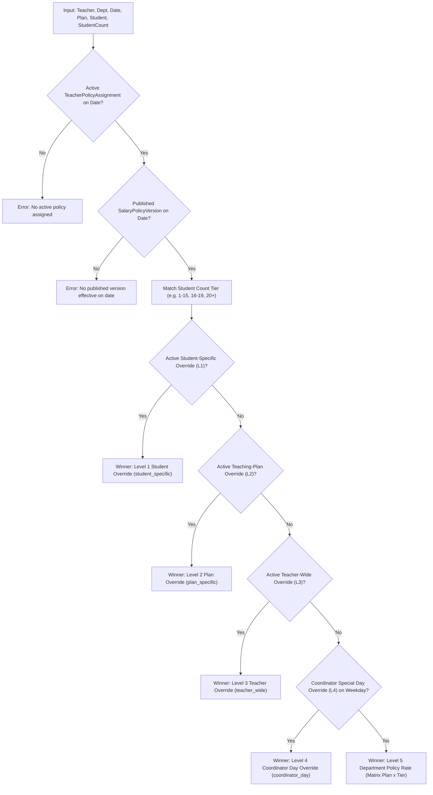

# Unified Salary Management — Stage 3 Implementation Report

> **Document ID**: `20_STAGE_3_SALARY_ASSIGNMENTS_REPORT`  
> **Status**: STAGE 3 COMPLETED (TEACHER SALARY POLICY ASSIGNMENTS, SALARY OVERRIDES, AND DETERMINISTIC RATE PREVIEW)  
> **Repository Target**: `quran----1-Role-Based-`  
> **Backend Package**: `backend/salary/`  
> **Frontend Components**: `components/unified-salary/`  
> **Execution Date**: 2026-11-03  
> **Test Status**: 54/54 Automated Tests Passing (100% across Stage 1 Models, Stage 2 Policy Builder API, and Stage 3 Assignments/Overrides)  
> **Database Status**: Unapplied to Non-Disposable Databases — Tested Exclusively in Isolated Disposable Memory Database  

---

## 1. Executive Summary

In accordance with owner authorization for **Stage 3 Only**, teacher salary policy assignment workflows, individual rate overrides across 4 approved scopes, and deterministic class rate resolution previews have been successfully implemented and verified.

Stage 3 enables Department Administrators to map teachers to published salary policies, establish effective-dated individual rate overrides with mandatory audit justifications, and preview exact class rates deterministically without writing financial ledgers, creating monthly payroll records, or altering legacy payroll calculations.

### Core Objectives Achieved:
1. **Teacher Policy Assignments**: Implemented effective-dated policy assignments (`TeacherPolicyAssignment`) linking teachers to published department policies with interval validation, future scheduling, and overlap prevention.
2. **Individual Rate Overrides**: Implemented the 4 approved override scopes (`student_specific` [L1], `plan_specific` [L2], `teacher_wide` [L3], `coordinator_day` [L4]) with mandatory business reasons, administrator attribution, and non-overlapping equal-priority enforcement.
3. **Deterministic Rate Resolver Engine**: Implemented `backend/salary/resolver.py` executing the strict 5-level precedence hierarchy:
   $$\text{Student Override (L1)} > \text{Plan Override (L2)} > \text{Teacher Override (L3)} > \text{Coordinator Day (L4)} > \text{Department Policy Rate (L5)}$$
4. **Deterministic Rate Preview Service**: API endpoint (`/api/salary/preview-rate/`) providing non-financial rate lookups displaying winning rate, precedence level, selection justification, matched student tier, and published policy effective dates.
5. **Department Admin UI**: Built `components/unified-salary/TeacherSalaryAssignments.tsx` with searchable teacher roster, active policy card, weekly teaching plans viewer, assignment history timeline, overrides manager with status badges, and interactive rate preview calculator.
6. **Strict Non-Financial Safeguards**: Zero ledger postings, zero monthly payroll generation, zero attendance record mutations, and zero modifications to legacy Salary V1 (`TeacherSalarySlip`) or Salary V2 (`QuranTeacherMonthlyPayroll`).
7. **Preservation of Pre-existing Fixes**: Preserved the coordinator blank-screen access fix in `App.tsx` and all working tree modifications.

---

## 2. Stage 2 Acceptance Review Findings

Before implementing Stage 3, the mandatory Stage 2 acceptance criteria were audited:

### A. Salary Policy Editing Authority
- **Finding**: Verified that `IsSalaryPolicyAdminOrReadOnly` in `backend/salary/permissions.py` strictly restricts mutation operations (`POST`, `PUT`, `PATCH`, `DELETE`) to Department Admins of the specific department (`is_user_department_admin_for_department`).
- **Confirmation**: Institution Admins and Super Admins retain read-only access (`SAFE_METHODS`) within their authorized institutional/global scope and cannot create, modify, publish, or clone policies through the Stage 2/3 APIs without department administrative credentials.

### B. Published Policy Preservation
- **Finding**: Evaluated deletion behavior across all configuration entities.
- **Protections Enforced**:
  - `SalaryPolicy`: Enhanced with model-level and ViewSet-level `delete()` protection preventing the deletion of any policy containing published versions or active teacher assignments.
  - `SalaryPolicyVersion`: Enforced model-level `delete()` check raising `ValidationError` on attempts to delete any published version.
  - `SalaryRateTier`, `SalaryTeachingPlan`, `SalaryPlanTierRate`: Verified existing model-level checks preventing deletion of components belonging to published versions.

### C. Concurrent Publishing
- **Finding**: Evaluated concurrency risks where simultaneous requests could attempt to publish conflicting versions with overlapping date ranges.
- **Protection Implemented**: In `SalaryPolicyVersionViewSet.publish_version`, parent policy row locking (`SalaryPolicy.objects.select_for_update().get(pk=version.policy_id)`) was introduced inside the atomic transaction, serializing all publication operations across versions of the same policy and eliminating race conditions.
- **PostgreSQL Recommendation**: Documented that future production deployment on PostgreSQL should consider `EXCLUDE USING gist (policy_id WITH =, daterange(effective_from, effective_to, '[]') WITH &&) WHERE (status = 'published')` using the `btree_gist` extension for database-level exclusion guarantees.

---

## 3. Teacher and Student Identity Verification (Quran vs Tuition)

As required by Section 3, identity and relationship models across both departments were inspected:
- **Teacher Profiles**: Both Quran teachers and Tuition tutors are represented by `academy.TeacherProfile` (`user = models.OneToOneField(settings.AUTH_USER_MODEL)`).
- **Student Profiles**: Both Quran students and Tuition students are represented by `academy.StudentProfile` (`user = models.OneToOneField(settings.AUTH_USER_MODEL)`).
- **Tuition Enrollment**: In `backend/tuition/models.py`, `TuitionEnrollment` references `academy.TeacherProfile` and `academy.StudentProfile`.

### Conclusion on Student-Specific Overrides:
`TeacherSalaryOverride.student` references `academy.StudentProfile`. Because Tuition students are stored as `academy.StudentProfile` records (with `department` set to the Tuition Department), **the existing schema natively supports student-specific overrides for Tuition as well as Quran**. Zero additive migrations or schema alterations were required.

---

## 4. Backend Architecture & Endpoints

### 4.1 REST API Catalog

| HTTP Method | URL Path | View / Action | Description | Permission |
| :--- | :--- | :--- | :--- | :--- |
| `GET` | `/api/salary/assignments/` | `TeacherPolicyAssignmentViewSet.list` | List policy assignments filtered by department, teacher, and active status. | Dept Admin / Inst Admin / Super Admin (Scoped Read) |
| `POST` | `/api/salary/assignments/` | `TeacherPolicyAssignmentViewSet.create` | Assign published salary policy to teacher with effective date interval. | Dept Admin (Own Dept Write Only) |
| `GET` | `/api/salary/assignments/<id>/` | `TeacherPolicyAssignmentViewSet.retrieve` | Detail of a policy assignment. | Scoped Read |
| `PATCH` | `/api/salary/assignments/<id>/` | `TeacherPolicyAssignmentViewSet.partial_update` | Modify assignment interval or notes. | Dept Admin (Own Dept Write Only) |
| `DELETE` | `/api/salary/assignments/<id>/` | `TeacherPolicyAssignmentViewSet.destroy` | Delete or retire an assignment. | Dept Admin (Own Dept Write Only) |
| `GET` | `/api/salary/overrides/` | `TeacherSalaryOverrideViewSet.list` | List overrides filtered by department, teacher, scope, or active status. | Scoped Read |
| `POST` | `/api/salary/overrides/` | `TeacherSalaryOverrideViewSet.create` | Create individual rate override with mandatory reason. | Dept Admin (Own Dept Write Only) |
| `GET` | `/api/salary/overrides/<id>/` | `TeacherSalaryOverrideViewSet.retrieve` | Detail of a salary override. | Scoped Read |
| `PATCH` | `/api/salary/overrides/<id>/` | `TeacherSalaryOverrideViewSet.partial_update` | Update override rate, dates, or reason. | Dept Admin (Own Dept Write Only) |
| `DELETE` | `/api/salary/overrides/<id>/` | `TeacherSalaryOverrideViewSet.destroy` | Delete a salary override. | Dept Admin (Own Dept Write Only) |
| `GET` | `/api/salary/teachers/` | `DepartmentTeachersView.get` | List department teachers with current assignment, plans, and override counts. | Scoped Read |
| `GET` | `/api/salary/students/` | `DepartmentStudentsView.get` | List department students eligible for student-specific overrides. | Scoped Read |
| `POST` | `/api/salary/preview-rate/` | `RatePreviewView.post` | Deterministic non-financial rate resolution and precedence preview. | Scoped Read / Dept Admin |

---

## 5. Rate Resolution Engine & Precedence Rules

The deterministic resolver (`backend/salary/resolver.py`) implements the exact agreed precedence hierarchy:

### Precedence Hierarchy Specification:
1. **Level 1 (Student-Specific)**: Applicable exclusively to the selected student and teacher combination. Overrides all other rates.
2. **Level 2 (Teaching-Plan-Specific)**: Applicable to classes under the designated teaching plan arrangement (e.g. 5 days/week). Overrides teacher-wide and department rates.
3. **Level 3 (Teacher-Wide)**: General rate for the selected teacher where no student or plan override exists. Overrides department policy rate.
4. **Level 4 (Coordinator Special Day)**: Designated special teaching rate applying only on the qualifying weekday (e.g. Sunday) or coordinator special teaching plan.
5. **Level 5 (Department Policy Rate)**: Standard baseline rate resolved from the 2D Rate Matrix (`SalaryPlanTierRate`) for the published version, plan, and student tier.

---

## 6. Frontend Components

### 6.1 Components Created & Integrated
1. **`services/salaryAssignmentService.ts`**:
   - Typed TypeScript API client providing `fetchDepartmentTeachers`, `fetchDepartmentStudents`, `fetchTeacherAssignments`, `createTeacherAssignment`, `deleteTeacherAssignment`, `fetchTeacherOverrides`, `createTeacherOverride`, `deleteTeacherOverride`, and `previewClassRate`.
2. **`components/unified-salary/TeacherSalaryAssignments.tsx`**:
   - Roster Column: Searchable teacher list with policy assignment status badges and override counts.
   - Active Policy Workspace: Displays current policy, code, version, and effective date interval.
   - Assignment History Timeline: Retains previous assignment records.
   - Teaching Plans Viewer: Displays applicable weekly teaching plans and matrices under the assigned policy.
   - Overrides Management: Interactive table with scope badges, rates, effective dates, mandatory reasons, and deletion controls.
   - Assign Policy Modal: Select from published policies with date picker and notes.
   - Add Override Modal: Scope selector (Levels 1–4), conditional student/plan/weekday pickers, rate input, and mandatory reason.
   - Rate Preview Tool: Non-financial interactive rate calculator with winning rate, precedence level, reason, and tier breakdown.
3. **`components/TeacherSalaryManagement.tsx`**:
   - Integrated tab: `"Teacher Assignments & Overrides (Stage 3)"` alongside `"Salary Policy Builder (Stage 2)"` and `"Active Payroll (Salary V2)"`.
   - Preserved coordinator permissions and blank-screen fix in `App.tsx`.

---

## 7. Automated Test Results

A dedicated automated test suite (`backend/salary/tests/test_assignments_and_overrides.py`) was executed in the isolated SQLite in-memory runner alongside Stage 1 models and Stage 2 API tests:

| Test Identifier | Test Description | Result |
| :--- | :--- | :---: |
| `test_01_assign_valid_published_policy` | Assigning a valid published policy to a department teacher. | **PASS** |
| `test_02_reject_draft_policy_assignment` | Rejecting policy assignments when policy has no published versions. | **PASS** |
| `test_03_reject_cross_department_assignment` | Rejecting cross-department policy assignment attempts. | **PASS** |
| `test_04_reject_overlapping_active_assignments` | Rejecting overlapping active assignments for the same teacher. | **PASS** |
| `test_05_future_dated_policy_assignment` | Scheduling future policy assignments without conflicting with current. | **PASS** |
| `test_06_historical_assignment_preservation` | Retrieving past assignments and verifying historical dates remain intact. | **PASS** |
| `test_07_teacher_wide_override` | Creating and validating a Level 3 teacher-wide rate override. | **PASS** |
| `test_08_teaching_plan_override` | Creating and validating a Level 2 teaching-plan rate override. | **PASS** |
| `test_09_student_specific_override` | Creating and validating a Level 1 student-specific rate override. | **PASS** |
| `test_10_override_precedence` | Proving strict 5-level precedence (L1 > L2 > L3 > L5). | **PASS** |
| `test_11_effective_date_boundaries` | Verifying override applies only within `[effective_from, effective_to]`. | **PASS** |
| `test_12_coordinator_day_precedence` | Verifying Level 4 coordinator override applies on qualifying weekday. | **PASS** |
| `test_13_equal_priority_overlap_rejection` | Rejecting overlapping overrides of equal priority and scope. | **PASS** |
| `test_14_unauthorized_mutation_rejection` | Rejecting mutations from teachers, coordinators, students, and cross-dept admins. | **PASS** |
| `test_15_invalid_foreign_key_combinations` | Rejecting invalid student or plan foreign keys in overrides. | **PASS** |
| `test_16_policy_version_compatibility` | Ensuring rate resolver resolves effective published version over time. | **PASS** |
| `test_17_rate_preview_api_correctness` | Verifying API preview endpoint returns all expected diagnostic fields. | **PASS** |
| `test_18_missing_applicable_policy_behavior` | Returning clear 422 error when no policy assignment exists on date. | **PASS** |

### Suite Total:
- Stage 1 Models: **18/18 Passed (100%)**
- Stage 2 API: **18/18 Passed (100%)**
- Stage 3 Assignments & Overrides: **18/18 Passed (100%)**
- **Total Unified Salary Tests**: **54/54 Passed (100%)**
- **TypeScript Typecheck (`npm run typecheck`)**: **0 Errors (100% Type-Safe)**
- **Vite Production Build (`npm run build`)**: **Built Successfully (0 Errors)**

---

## 8. Files Created & Modified

### Created:
- `backend/salary/resolver.py`: Deterministic rate preview and precedence resolution service.
- `backend/salary/tests/test_assignments_and_overrides.py`: 18 focused test cases.
- `services/salaryAssignmentService.ts`: TypeScript API client.
- `components/unified-salary/TeacherSalaryAssignments.tsx`: Department Admin UI component.
- `docs/antigravity-audit/20_STAGE_3_SALARY_ASSIGNMENTS_REPORT.md`: This comprehensive implementation report.

### Modified:
- `backend/salary/models.py`: Added model-level published policy deletion guards on `SalaryPolicy` and `SalaryPolicyVersion`.
- `backend/salary/serializers.py`: Added serializers for assignments, overrides, teacher rosters, students, and rate previews.
- `backend/salary/views.py`: Added assignment and override ViewSets, roster views, preview view, and parent policy locking.
- `backend/salary/urls.py`: Registered assignments, overrides, teachers, students, and preview-rate endpoints.
- `backend/salary/tests/run_tests.py`: Added `test_assignments_and_overrides` to the test suite runner.
- `components/TeacherSalaryManagement.tsx`: Added Stage 3 tab navigation and view rendering.
- `docs/antigravity-audit/00_INDEX.md`: Updated with Stage 3 deliverable links.
- `docs/antigravity-audit/SESSION_HANDOFF.md`: Updated project milestone state.

---

## 9. Known Limitations & Stage 4 Prerequisites

1. **Non-Financial Scope**: Stage 3 produces deterministic class rate previews only. It does not calculate monthly payroll totals, evaluate attendance locks, or generate financial ledger entries.
2. **Attendance Verification**: Real effective student counts and attended class qualifications belong to **Stage 4: Attendance Verification & Unmarked Class Pipeline**.
3. **Database Readiness**: Migrations for `backend/salary/` have been verified using isolated SQLite runners and have deliberately **not** been applied to non-disposable databases (`ivs_academy_db`).
4. **Mandatory Stop**: Work is paused awaiting owner authorization before Stage 4 begins.
