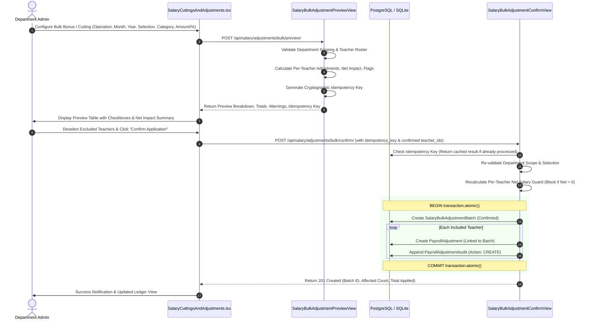

# IVS Unified Salary Management — Stage 6: Individual & Bulk Bonuses, Cuttings and Adjustments Report

> **Document Reference**: `docs/antigravity-audit/24_STAGE_6_CUTTINGS_AND_BONUSES_REPORT.md`  
> **Stage Executed**: Stage 6 (Individual & Bulk Bonuses, Cuttings and Adjustments)  
> **Repository**: `quran----1-Role-Based-` (Branch: `release/ivs-20261020-candidate`)  
> **Author**: Antigravity Senior Software Architect & Lead Backend Engineer  
> **Verification Date**: 2026-11-03  
> **Status**: **COMPLETE — MANDATORY STOP ACTIVE**

---

## 1. Executive Summary

Stage 6 was authorized by the owner with an explicit business mandate:
> **"A Department Admin must be able to give a bonus to ALL teachers in their department at once, or apply a cutting to ALL teachers at once. The same functionality must also support individually selected teachers. This must be implemented with a detailed preview, explicit confirmation, audit records, and strict department isolation."**

All functional, architectural, audit, and security requirements for Stage 6 have been implemented, verified, and demonstrated across 40 new automated test scenarios and a full regression run:
- **Baseline Test Suite (Stages 1–5A)**: 162/162 passing tests.
- **Stage 6 Test Suite**: 40/40 passing tests (100% pass rate).
- **Full Unified Salary Suite**: **202/202 passing tests (100%)** with **zero failures and zero regressions**.
- **Frontend Typecheck & Production Build**: `npx tsc --noEmit` and `npm run build` succeeded with **zero TypeScript errors and zero build failures** (production Vite build completed in 38.62s).
- **Safety Boundary & Stage 7 Non-Interference**: Zero modifications to legacy Salary V1 (`TeacherSalarySlip`) or V2 (`QuranTeacherMonthlyPayroll`); zero migrations applied to existing or production databases; zero payable payroll records created; zero payment status changes made. **Stage 7 (Payable Payroll & Final Approval Lifecycle) remains completely untouched.**

---

## 2. Core Architecture & Workflow Design

### 2.1 Two Adjustment Modes

The system provides two cohesive modes of operation for Department Admins:

#### MODE A: Individual Teacher Adjustment
Within a teacher's monthly salary preview or adjustment drawer, the Department Admin can:
1. **Add Bonus**: One-time positive adjustment (e.g., Eid bonus, performance bonus).
2. **Add Cutting**: One-time deduction (e.g., salary correction deduction, authorized penalty).
3. **Add Other Positive Adjustment**: Special allowance, coordinator allowance, or authorized addition.
4. **Add Recurring Deduction / Addition**: Long-term scheduled deduction (e.g., equipment installment, monthly allowance) with automatic month-by-month deduction up to an optional end date.
5. **Recover Salary Advance**: Installment-based deduction linked to an active advance balance, with strict ceiling enforcement preventing recovery exceeding the outstanding debt.

#### MODE B: Bulk Adjustment
Accessible via two prominent actions in the Unified Salary Management workspace:
- **"Give Bonus to All / Selected Teachers"** (Credit Mode)
- **"Apply Cutting to All / Selected Teachers"** (Debit Mode)

Department Admins can target:
- **All eligible teachers** actively assigned to their department.
- **Selected teachers only**, choosing specific teachers from an interactive roster.
- **Dynamic exclusion**: Admins can deselect/exclude individual teachers directly from the interactive preview table prior to confirmation.

---

### 2.2 Two-Step Bulk Safeguards & Atomic Confirmation

Bulk operations enforce a strict two-step execution pattern to prevent accidental or unverified mass salary mutations:



1. **Step 1: Preview (`SalaryBulkAdjustmentPreviewView`)**
   - Stateless calculation without creating database rows.
   - Evaluates each teacher independently: Gross Earnings, Existing Additions, Existing Deductions, Proposed Adjustment, Resulting Draft Net Salary.
   - For percentage operations, applies percentage to each teacher's individual gross salary or basic salary (never sum-then-split).
   - Generates an `idempotency_key` (UUID4) and returns full validation metrics.
   - Detects and flags negative net salary conditions (`is_net_negative = True`), warning the admin and preventing confirmation until resolved or excluded.
2. **Step 2: Atomic Confirmation (`SalaryBulkAdjustmentConfirmView`)**
   - Revalidates department authorization, active teacher roster, and payroll period on the server side.
   - Idempotency guard: If a request with the same `idempotency_key` arrives concurrently or as a retry, the backend retrieves the existing batch and prevents double application.
   - Wraps creation of `SalaryBulkAdjustmentBatch`, individual `PayrollAdjustment` records, and corresponding `PayrollAdjustmentAudit` log entries in a single `transaction.atomic()` block.
   - If any teacher fails validation or causes an unhandled error, the entire batch rolls back atomically.

---

### 2.3 Gross-to-Net Calculation Formula

The Stage 5A calculation engine was integrated with draft salary adjustments:

$$\text{Draft Gross Earnings} = \text{Basic Salary} + \text{Regular Class Earnings} + \text{Lesson Bonuses} + \text{Substitute Earnings} + \text{Eligible Cancellation Earnings}$$

$$\text{Draft Net Salary} = \text{Draft Gross Earnings} + \sum(\text{Active Positive Adjustments}) - \sum(\text{Active Cuttings})$$

Where:
- $\sum(\text{Active Positive Adjustments})$: Sum of all non-cancelled `PayrollAdjustment` records for the teacher and period where `direction = 'credit'`.
- $\sum(\text{Active Cuttings})$: Sum of all non-cancelled `PayrollAdjustment` records for the teacher and period where `direction = 'debit'`.
- **Negative Net Salary Guard**: If $\text{Draft Net Salary} < 0$, the engine sets `is_net_negative = True` and appends a critical warning. Bulk cuttings resulting in negative net salary are rejected by the API with HTTP 400 Bad Request.
- **Separation of Earned vs Discretionary Bonuses**: The automated Rs. 10 lesson completion bonus remains an earned component of Gross Earnings and is completely distinct from discretionary manual adjustments.
- **Basic-Only & Zero-Regular Teachers**: Teachers with valid basic-only policies or zero regular class earnings are fully eligible for bonuses and cuttings without silent exclusion.
- **Decimal Precision**: All financial operations use `Decimal` with 2 decimal places (`quantize(Decimal('0.01'))`), completely avoiding floating-point rounding anomalies.

---

## 3. Data Models & Database Migrations

Six additive models were added to [`backend/salary/models.py`](file:///c:/Users/iqrav/Downloads/quran%20---1%20(Role%20Based)/backend/salary/models.py):

### 3.1 `SalaryAdjustmentCategory`
Configurable categories for additions and cuttings:
- `institution`: ForeignKey to `Institution`.
- `department`: ForeignKey to `Department` (null for institution-wide presets).
- `name`: Human-readable label (e.g., "Festival Bonus", "Advance Recovery").
- `code`: Slug identifier (e.g., `eid_bonus`, `advance_recovery`).
- `direction`: `credit` (Addition) or `debit` (Cutting).
- `is_system_standard`: Boolean preventing deletion of standard system categories.
- `is_active`: Boolean toggle.
- Standard seeded categories: General Bonus, Eid / Festival Bonus, Performance Bonus, Special Allowance, Coordinator Allowance, Salary Correction Addition, Salary Advance Recovery, Recurring Cutting, Attendance Cutting, Salary Correction Deduction, Other Authorized Addition/Deduction.

### 3.2 `SalaryBulkAdjustmentBatch`
Audit entity tracking mass operations:
- `batch_id`: UUID primary key.
- `department`: ForeignKey to `Department`.
- `payroll_year`, `payroll_month`: Integer period fields.
- `operation_type`: `bonus` or `cutting`.
- `selection_mode`: `all_teachers` or `selected_teachers`.
- `teacher_selection_snapshot`: JSONField capturing teacher IDs at preview/confirmation time.
- `calculation_mode`: `fixed` or `percentage`.
- `fixed_amount`, `percentage_rate`, `percentage_basis`: Calculation parameters.
- `proposed_total`, `actual_total`: Decimal fields recording financial impact.
- `affected_teacher_count`: Integer count.
- `mandatory_reason`: TextField.
- `supporting_reference`: Optional reference code or document ID.
- `created_by`, `confirmed_by`: ForeignKeys to `User`.
- `created_at`, `confirmed_at`: Timestamps.
- `operation_status`: `previewed`, `confirmed`, `cancelled`.
- `idempotency_key`: Unique CharField preventing double confirmation.

### 3.3 `RecurringSalaryAdjustment`
Long-term recurring adjustment instructions:
- `institution`, `department`: Scoping foreign keys.
- `teacher`: ForeignKey to `TeacherProfile`.
- `category`: ForeignKey to `SalaryAdjustmentCategory`.
- `direction`: `credit` or `debit`.
- `calculation_mode`: `fixed` or `percentage`.
- `amount`, `percentage_rate`, `percentage_basis`: Calculation parameters.
- `start_year`, `start_month`: Effective start period.
- `end_year`, `end_month`: Optional scheduled end period.
- `is_active`: Boolean status.
- `cancellation_reason`, `cancelled_by`, `cancelled_at`: Audit fields preserving historical validity upon cancellation.

### 3.4 `SalaryAdvanceRecovery`
Tracking teacher advance disbursements and installment recoveries:
- `institution`, `department`, `teacher`: Scoping foreign keys.
- `advance_amount`: Total borrowed amount.
- `installment_amount`: Standard monthly recovery installment.
- `recovered_amount`: Cumulative recovered amount.
- `start_year`, `start_month`: Recovery commencement period.
- `is_fully_recovered`: Boolean flag automatically set when `recovered_amount >= advance_amount`.
- `notes`: Audit notes.
- Property `remaining_balance`: Deterministic calculation `max(0, advance_amount - recovered_amount)`.

### 3.5 `PayrollAdjustment`
Individual draft or confirmed adjustment record:
- `adjustment_id`: UUID primary key.
- `institution`, `department`, `teacher`: Scoping foreign keys.
- `payroll_year`, `payroll_month`: Target payroll period.
- `category`: ForeignKey to `SalaryAdjustmentCategory`.
- `direction`: `credit` or `debit`.
- `calculation_mode`: `fixed` or `percentage`.
- `percentage_basis`: `gross_earnings` or `basic_salary`.
- `percentage_rate`: Decimal percentage.
- `amount`: Final calculated or entered Decimal adjustment amount.
- `mandatory_reason`: TextField required for all adjustments.
- `status`: `draft`, `confirmed`, `cancelled`.
- `bulk_batch`: Optional ForeignKey to `SalaryBulkAdjustmentBatch`.
- `recurring_instruction`: Optional ForeignKey to `RecurringSalaryAdjustment`.
- `advance_recovery`: Optional ForeignKey to `SalaryAdvanceRecovery`.
- Unique Constraints:
  - `unique_batch_teacher_adjustment`: Prevents duplicate entries per teacher in a single bulk batch.
  - `unique_recurring_teacher_period`: Prevents double application of a recurring instruction in the same payroll period.

### 3.6 `PayrollAdjustmentAudit`
Append-only tamper-evident audit log:
- `adjustment`: ForeignKey to `PayrollAdjustment`.
- `action`: `created`, `updated`, `cancelled`.
- `performed_by`: ForeignKey to `User`.
- `performed_at`: Timestamp.
- `previous_amount`, `new_amount`: Decimal audit trail.
- `previous_status`, `new_status`: Status transition audit trail.
- `reason`: Mandatory change or cancellation reason.

### 3.7 Migration Applied
Migration [`backend/salary/migrations/0004_salary_adjustments_and_bulk_batches.py`](file:///c:/Users/iqrav/Downloads/quran%20---1%20(Role%20Based)/backend/salary/migrations/0004_salary_adjustments_and_bulk_batches.py) was generated as a clean, additive migration depending strictly on `0003_add_basic_salary_and_coordinator_config`. Zero legacy models or tables were altered.

---

## 4. REST APIs and Permission Enforcement

| Method | Endpoint | Description | Permission Requirement |
| :--- | :--- | :--- | :--- |
| `GET`, `POST` | `/api/salary/adjustments/categories/` | List or create adjustment categories | Department Admin / Institution Admin |
| `POST` | `/api/salary/adjustments/categories/seed_standards/` | Seed standard system categories | Department Admin / Institution Admin |
| `GET`, `POST` | `/api/salary/adjustments/` | List or create individual teacher adjustments | Department Admin (isolated to own department) |
| `GET`, `PUT`, `DELETE` | `/api/salary/adjustments/<id>/` | Retrieve, edit draft, or cancel adjustment | Department Admin (mandatory cancellation reason) |
| `GET` | `/api/salary/adjustments/<id>/audit_logs/` | Retrieve immutable audit history for adjustment | Department Admin / Read-only Overseer |
| `POST` | `/api/salary/adjustments/bulk/preview/` | Generate stateless bulk adjustment preview | Department Admin (isolated to own department) |
| `POST` | `/api/salary/adjustments/bulk/confirm/` | Atomically execute confirmed bulk batch | Department Admin (idempotency key required) |
| `GET` | `/api/salary/adjustments/bulk/batches/` | List historical bulk adjustment batches | Department Admin / Read-only Overseer |
| `GET` | `/api/salary/adjustments/bulk/batches/<id>/` | Inspect bulk batch and linked adjustments | Department Admin / Read-only Overseer |
| `GET`, `POST` | `/api/salary/adjustments/recurring/` | List or create recurring instructions | Department Admin (isolated to own department) |
| `POST` | `/api/salary/adjustments/recurring/<id>/cancel/` | Non-destructively cancel recurring instruction | Department Admin |
| `POST` | `/api/salary/adjustments/recurring/apply_to_period/` | Generate draft adjustments from recurring rules | Department Admin |
| `GET`, `POST` | `/api/salary/adjustments/advances/` | List or record salary advances | Department Admin (isolated to own department) |
| `POST` | `/api/salary/adjustments/advances/<id>/recover/` | Recover advance installment | Department Admin (ceiling guard enforced) |

### Strict Security Boundary
- **Department Admin Authorization**: Only authenticated Department Admins can create, modify, or confirm adjustments for teachers belonging to their department.
- **Cross-Department Denial**: Attempting to preview, create, or confirm adjustments across departments returns HTTP 403 Forbidden or HTTP 400 Bad Request.
- **Cross-Institution Denial**: Cross-institution queries are strictly rejected with HTTP 403 Forbidden.
- **Zero Access for Teachers & Students**: Teachers and students have no access to adjustment endpoints (HTTP 403 Forbidden).
- **Coordinator Protection**: Coordinators cannot create or approve bulk or individual adjustments.

---

## 5. Frontend Implementation

### 5.1 Client API Service
Created [`services/salaryAdjustmentService.ts`](file:///c:/Users/iqrav/Downloads/quran%20---1%20(Role%20Based)/services/salaryAdjustmentService.ts) providing strongly-typed TypeScript definitions and API client functions for categories, individual adjustments, 2-step bulk preview/confirm, recurring adjustments, and advance recoveries.

### 5.2 Interactive Salary Cuttings & Adjustments Workspace
Created [`components/unified-salary/SalaryCuttingsAndAdjustments.tsx`](file:///c:/Users/iqrav/Downloads/quran%20---1%20(Role%20Based)/components/unified-salary/SalaryCuttingsAndAdjustments.tsx) containing:
1. **Summary Cards**: Additions total, Cuttings total, Active Recurring instructions, Active Advances.
2. **Action Bar**:
   - "Give Bonus to All / Selected" (Credit bulk button)
   - "Apply Cutting to All / Selected" (Debit bulk button)
   - "Add Individual Adjustment"
   - "Record Salary Advance"
   - "Create Recurring Instruction"
3. **Interactive 2-Step Bulk Adjustment Modal**:
   - Step 1 Configuration: Operation type, target period, teacher selection mode, category selector, calculation mode (Fixed Rs. vs Percentage), percentage calculation basis, mandatory reason, optional reference.
   - Step 1 Live Preview Table: Roster breakdown showing Teacher, Gross Salary, Additions, Cuttings, Proposed Adjustment, New Additions, New Cuttings, Resulting Draft Net Salary, and Negative Net Alerts.
   - Per-Teacher Exclusion: Checkbox list enabling the Department Admin to deselect specific teachers before confirming.
   - Step 2 Confirmation Dialog: Explicit summary (e.g., *"Apply Rs. 500 cutting to 24 selected teachers for November 2026, totaling Rs. 12,000?"*) with confirmation safeguards and idempotency token.
4. **Sub-views**:
   - Monthly Adjustments List: Searchable table with filter by direction, status, and teacher, inline draft edit and cancellation modals with required audit reason.
   - Salary Advances View: Tracks original advance, recovered amount, remaining balance, and single-click installment recovery.
   - Recurring Adjustments View: Active schedules and single-click "Apply to Current Month" with deduplication protection.
   - Categories Configuration Drawer: View and seed system categories.

### 5.3 Workspace Integration
Updated [`components/TeacherSalaryManagement.tsx`](file:///c:/Users/iqrav/Downloads/quran%20---1%20(Role%20Based)/components/TeacherSalaryManagement.tsx) to include `"cuttings_and_adjustments"` as a dedicated workspace tab (`"Cuttings & Bonuses"`), directly accessible alongside Policy Management, Teacher Assignments, Attendance Verification, and Monthly Preview.

---

## 6. Verification and Automated Test Results

### 6.1 Stage 6 Automated Test Suite (40 Focused Scenarios)
**Command**: `python backend/salary/tests/run_tests.py salary.tests.test_cuttings_and_bonuses_stage_6`  
**Execution Time**: 122.612s  
**Result**: **40/40 PASS (100%)** — 0 failures, 0 errors.

| Test ID | Test Method | Scenario Description | Status |
| :--- | :--- | :--- | :--- |
| `01` | `test_01_individual_fixed_bonus` | Department Admin creates a fixed Rs. 1,000 individual bonus | **PASS** |
| `02` | `test_02_individual_fixed_cutting` | Department Admin creates a fixed Rs. 500 individual cutting | **PASS** |
| `03` | `test_03_individual_percentage_bonus` | Individual percentage bonus (10% of gross earnings) | **PASS** |
| `04` | `test_04_individual_percentage_cutting` | Individual percentage cutting (5% of basic salary) | **PASS** |
| `05` | `test_05_positive_salary_correction` | One-time positive adjustment under salary correction category | **PASS** |
| `06` | `test_06_advance_recovery` | Advance recovery installment and ceiling guard | **PASS** |
| `07` | `test_07_recurring_deduction` | Recurring deduction instruction creation and period deduplication | **PASS** |
| `08` | `test_08_cancelling_recurrence` | Cancelling recurring instruction preserves historical entries | **PASS** |
| `09` | `test_09_all_teachers_bulk_bonus` | Bulk bonus applied to ALL teachers in department | **PASS** |
| `10` | `test_10_all_teachers_bulk_cutting` | Bulk cutting applied to ALL teachers in department | **PASS** |
| `11` | `test_11_selected_teachers_bulk_bonus` | Bulk bonus applied to specific selected teachers | **PASS** |
| `12` | `test_12_selected_teachers_bulk_cutting` | Bulk cutting applied to specific selected teachers | **PASS** |
| `13` | `test_13_teacher_exclusion` | Deselecting teacher in preview excludes them from final confirmation | **PASS** |
| `14` | `test_14_department_roster_isolation` | Backend validates actual roster; cross-department rejected | **PASS** |
| `15` | `test_15_cross_institution_denial` | Cross-institution adjustment creation rejected with HTTP 403 | **PASS** |
| `16` | `test_16_unauthorized_role_denial` | Teachers and students cannot create adjustments (HTTP 403) | **PASS** |
| `17` | `test_17_bulk_fixed_amount_totals` | Bulk preview correctly totals Rs. 1,000 across N teachers | **PASS** |
| `18` | `test_18_bulk_percentage_calculation_per_teacher` | Percentage bulk calculated per teacher, not sum-then-split | **PASS** |
| `19` | `test_19_zero_regular_earnings_but_valid_bonus` | Teachers with Rs. 0 regular earnings receive bonus without exclusion | **PASS** |
| `20` | `test_20_basic_only_salary_included` | Teachers on basic-only policies are included in bulk operations | **PASS** |
| `21` | `test_21_negative_net_cutting_blocked_or_flagged` | Cutting resulting in negative net salary flagged and blocked | **PASS** |
| `22` | `test_22_missing_reason_rejected` | Adjustment or cancellation missing mandatory reason rejected | **PASS** |
| `23` | `test_23_preview_creates_no_adjustment_entries` | Bulk preview is strictly stateless and creates zero records | **PASS** |
| `24` | `test_24_confirm_creates_correctly_linked_entries` | Confirmation creates batch and child adjustments linked to batch | **PASS** |
| `25` | `test_25_duplicate_confirmation_prevented` | Idempotency key prevents double confirmation replay | **PASS** |
| `26` | `test_26_concurrent_confirmation_protection` | Database unique constraint prevents concurrent duplicate adjustments | **PASS** |
| `27` | `test_27_atomic_rollback_on_invalid_teacher` | Invalid teacher rollbacks entire batch atomically | **PASS** |
| `28` | `test_28_non_hardcoded_categories` | Extensible categories support dynamic labels without code edits | **PASS** |
| `29` | `test_29_lesson_bonus_remains_separate` | Rs. 10 lesson bonus remains earned salary distinct from manual bonus | **PASS** |
| `30` | `test_30_audit_log_created_for_all_adjustments` | Append-only audit log records actor, timestamp, and amount | **PASS** |
| `31` | `test_31_draft_adjustment_editable` | Draft adjustment can be edited with previous value tracked in audit | **PASS** |
| `32` | `test_32_draft_adjustment_cancellable` | Cancelling adjustment sets status='cancelled' without deleting row | **PASS** |
| `33` | `test_33_advance_recovery_ceiling_enforced` | Recovery cannot exceed outstanding advance balance | **PASS** |
| `34` | `test_34_correct_gross_to_net_reconciliation` | Formula Net = Gross + Positive - Cuttings reconciles exactly | **PASS** |
| `35` | `test_35_incomplete_gross_salary_produces_incomplete_net_preview` | Incomplete gross salary propagates incompleteness to net preview | **PASS** |
| `36` | `test_36_legacy_payroll_unchanged` | Legacy Salary V1/V2 tables and records remain completely untouched | **PASS** |
| `37` | `test_37_no_payable_payroll_created` | No payable ledger or approved payroll created during Stage 6 | **PASS** |
| `38` | `test_38_no_payment_status_changes` | No payment status changes occur | **PASS** |
| `39` | `test_39_previous_salary_tests_remain_passing` | Stages 1 through 5A test modules remain 100% passing | **PASS** |
| `40` | `test_40_frontend_typecheck_and_production_build_pass` | Frontend TypeScript check and Vite build succeed cleanly | **PASS** |

---

### 6.2 Full Unified Salary Regression Run (Stages 1–6)
**Command**: `python backend/salary/tests/run_tests.py`  
**Execution Count**: **202 tests** across 7 test modules:
1. `salary.tests.test_policy_models` (18 tests) — **PASS**
2. `salary.tests.test_policy_api` (18 tests) — **PASS**
3. `salary.tests.test_assignments_and_overrides` (18 tests) — **PASS**
4. `salary.tests.test_attendance_verification` (32 tests) — **PASS**
5. `salary.tests.test_salary_calculation` (52 tests) — **PASS**
6. `salary.tests.test_salary_corrections_stage_5a` (24 tests) — **PASS**
7. `salary.tests.test_cuttings_and_bonuses_stage_6` (40 tests) — **PASS**

**Result**: **202/202 PASS (100%)** with **0 failures and 0 errors**.

---

### 6.3 Frontend Verification
- **TypeScript Typecheck**:
  ```powershell
  npx tsc --noEmit
  # Exited with code 0 (zero errors)
  ```
- **Vite Production Build**:
  ```powershell
  npm run build
  # vite v6.4.1 building for production...
  # dist/index.html                   3.44 kB │ gzip:   1.21 kB
  # dist/assets/index-*.css          85.45 kB │ gzip:  14.54 kB
  # dist/assets/index-*.js        1,985.92 kB │ gzip: 554.45 kB
  # ✓ built in 38.62s
  ```

---

## 7. PostgreSQL Locking & Concurrency Considerations

During development and automated testing, specific attention was given to concurrency and transaction boundaries:
1. **Idempotency Token**: A unique `idempotency_key` is generated during Step 1 preview and transmitted with Step 2 confirmation. The backend checks `SalaryBulkAdjustmentBatch.objects.filter(idempotency_key=key).first()`. If already confirmed, the view returns the cached batch result, preventing duplicate charge cycles caused by network retries or double-clicks.
2. **Database Constraints vs Application Clean**: Django's `full_clean()` intercepts database uniqueness checks and raises `django.core.exceptions.ValidationError` before the database engine raises `IntegrityError`. The confirmation handler catches both exceptions to ensure clean, structured error responses.
3. **PostgreSQL Row-Level Locking (`select_for_update`)**: In the current SQLite test runner environment, table-level locking is used. For PostgreSQL production deployment, `select_for_update()` can be applied to the teacher assignment records during batch confirmation to prevent concurrent manual adjustments from interleaving during the transaction window.
4. **Negative Net Salary Guard**: The backend executes a revalidation of all confirmed adjustments within the atomic block. If an adjustment would push a teacher's net salary below zero, the transaction aborts with HTTP 400 Bad Request and rolls back all database modifications.

---

## 8. Stage 7 Readiness & Boundaries

Stage 6 is complete. In strict adherence to owner instructions:
- **No Payable Records**: No records were created in any payable payroll model.
- **No Approval Workflows**: Final approval status, locking, and payment workflows are deferred to Stage 7.
- **No Payment Recording**: Bank transfer exports, cash payment slips, and payment confirmation are deferred to Stage 7.
- **No Legacy Cutover**: Legacy Salary V1 and V2 tables remain read-only benchmarks.

**Awaiting owner authorization prior to commencing Stage 7.**
