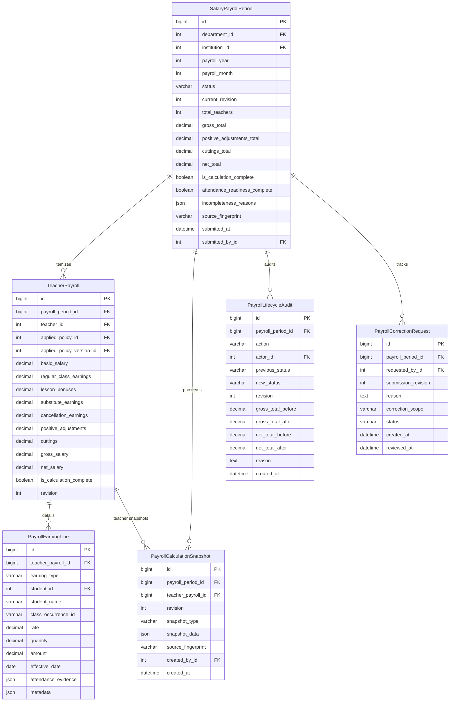

# IVS Unified Salary Management — Stage 7A: Monthly Payroll Records, Snapshots and Department Submission Report

> **Document Reference**: `docs/antigravity-audit/25_STAGE_7A_PAYROLL_DRAFT_REPORT.md`  
> **Stage Executed**: Stage 7A (Monthly Payroll Records, Snapshots, and Department Submission)  
> **Repository**: `quran----1-Role-Based-` (Branch: `release/ivs-20261020-candidate`)  
> **Author**: Antigravity Senior Software Architect & Lead Backend Engineer  
> **Verification Date**: 2026-11-03  
> **Status**: **COMPLETE — MANDATORY STOP ACTIVE (STAGE 7A BOUNDARY PRESERVED)**

---

## 1. Executive Summary

Stage 7A of the IVS Unified Salary Management implementation was authorized to turn verified salary previews into controlled, persistent, and auditable draft payroll records with full itemization, calculation snapshots, department submission history, and cryptographic protection against unauthorized modifications.

### 1.1 Strict Boundary Enforcement (Stage 7A vs Stage 7B)
In accordance with the project owner's mandate:
- **Implemented in Stage 7A**: Normalized monthly payroll data structures, draft payroll generation, old-vs-new recalculation impact previews, draft recalculation with mandatory reasons and revision tracking, Stage 6 adjustments integration, immutable submission snapshots, department submission locking (`DRAFT` → `PENDING_APPROVAL`), two-man return-for-correction request preparation, and permission enforcement.
- **Explicitly Excluded (Deferred to Stage 7B)**: Final salary approval (`PENDING_APPROVAL` → `APPROVED`), payment recording, bank and cash disbursement processing, payment status transitions, and legacy Salary V1/V2 cutover.
- **Missing Attendance Governance Decision**: The owner's decision is strictly enforced: *Final payroll approval must be blocked while relevant attendance remains unresolved. Submission for department review is permitted but visibly flagged as incomplete and ineligible for final approval.*
- **Zero Legacy Interference**: Zero modifications to historical Salary V1 (`TeacherSalarySlip`) or V2 (`QuranTeacherMonthlyPayroll`) records or tables; zero production migrations applied to existing financial databases.
- **Coordinator Fix Preserved**: The coordinator blank-screen access control fix in `App.tsx` remains 100% intact and untouched.

### 1.2 Verification Summary
- **Stage 6 Preflight Gate**: 202/202 passing tests confirmed in isolated test environment before making any Stage 7A modifications.
- **Stage 7A Targeted Suite**: **36/36 tests passing (100%)** in `backend/salary/tests/test_monthly_payroll_stage_7a.py`.
- **Full Unified Salary Regression Suite**: **238/238 tests passing (100%)** with **zero failures and zero regressions** across all 8 test modules.
- **Frontend Typecheck & Production Build**: `npx tsc --noEmit` and `npm run build` succeeded with **zero TypeScript errors** and a clean Vite production bundle (31.49s).

---

## 2. Payroll Data Structures (Additive Migration `0005`)

Six normalized Django models were designed and added in `backend/salary/models.py`, backed by database migration `backend/salary/migrations/0005_monthly_payroll_records_and_submissions.py`:



### 2.1 Model Responsibilities
1. **`SalaryPayrollPeriod`**: The authoritative container for a department's monthly payroll. Enforces unique constraint `(department, payroll_year, payroll_month)`. Tracks lifecycle status (`DRAFT`, `DEPARTMENT_REVIEW`, `PENDING_APPROVAL`, `RETURNED_FOR_CORRECTION`, `APPROVED`, `PAID`), current revision number, and evidence fingerprints.
2. **`TeacherPayroll`**: Individual teacher monthly payroll line. Enforces unique constraint `(payroll_period, teacher)`. Itemizes basic salary, per-class earnings, lesson bonuses, substitute compensation, cancellations, Stage 6 positive adjustments, cuttings, gross salary, and net salary.
3. **`PayrollEarningLine`**: Granular evidence backing each teacher's earnings. Categorized by `earning_type` (`regular_class`, `basic_salary`, `lesson_plan_bonus`, `substitute`, `cancellation`) with rates, quantities, effective dates, and attendance evidence.
4. **`PayrollCalculationSnapshot`**: Reproducible JSON payload capturing the full state of calculation at each revision and upon department submission. Includes policy versions, teacher assignments, rate overrides, student counts, and weekly eligibility breakdowns.
5. **`PayrollLifecycleAudit`**: Append-only log tracking every monetary transition, revision increment, submitter, and mandatory reason.
6. **`PayrollCorrectionRequest`**: Formal container for Department Admin return requests. Does not self-authorize; leaves the period locked until Stage 7B review.

---

## 3. Lifecycle Operations & Service Architecture

The service layer is implemented in `backend/salary/payroll_service.py` under `PayrollLifecycleService`, reusing Stage 5/5A/6 deterministic engines without creating redundant calculation logic.

### 3.1 Draft Generation (`generate_draft_payroll`)
- Authorizes Department Admin for their own department.
- Selects payroll month and year.
- Resolves active policy assignments and rate overrides.
- Computes gross earnings and incorporates confirmed Stage 6 adjustments exactly once.
- Evaluates attendance readiness via `validate_attendance_approval_readiness`.
- Generates SHA-256 evidence fingerprint:
  ```python
  payload = {
      "dept": preview_data.get("department_id"),
      "year": preview_data.get("payroll_year"),
      "month": preview_data.get("payroll_month"),
      "gross": str(summary.get("gross_draft_earnings")),
      "net": str(summary.get("draft_net_salary")),
      "pos": str(summary.get("positive_adjustments")),
      "cut": str(summary.get("cuttings")),
      "teachers": preview_data.get("evaluated_teachers_count"),
      "complete": preview_data.get("is_calculation_complete"),
      "scheduled_classes": summary.get("total_scheduled_classes", 0),
      "pending": summary.get("total_pending_verifications", 0),
      "conflicted": summary.get("total_conflicted_verifications", 0),
  }
  ```
- Creates `SalaryPayrollPeriod` in `DRAFT` status (Revision 1), generates period and teacher calculation snapshots, and writes `DRAFT_CREATED` audit log.

### 3.2 Old-vs-New Recalculation Impact Preview (`preview_recalculation_impact`)
- Evaluates fresh calculations against stored `TeacherPayroll` and `SalaryPayrollPeriod` records without mutating the database.
- Produces delta metrics for gross, net, additions, cuttings, and per-teacher financial diffs.
- Sets `has_monetary_changes` to indicate whether monetary changes occurred.

### 3.3 Draft Recalculation (`recalculate_draft_payroll`)
- Restricted to editable statuses (`DRAFT` or `RETURNED_FOR_CORRECTION`).
- **Mandatory Reason Guard**: If `has_monetary_changes` is `True`, an explicit non-empty `reason` is strictly enforced by server validation.
- Increments `current_revision`, updates totals, replaces itemized `TeacherPayroll` and `PayrollEarningLine` records, stores a new `RECALCULATION` snapshot, and records a `RECALCULATED` lifecycle audit entry.

### 3.4 Department Submission (`submit_department_payroll`)
- Controlled state transition: `DRAFT` → `PENDING_APPROVAL`.
- **Stale Evidence Guard**: Recalculates fresh evidence fingerprint and rejects submission with `ValidationError` if attendance or adjustments changed since the draft was computed, requiring explicit recalculation first.
- **Missing Attendance Governance**: If attendance is unresolved, submission is permitted (to allow reviewer visibility), but `attendance_readiness_complete` is set to `False` and incompleteness reasons are prominently attached. Final approval in Stage 7B will be strictly blocked.
- **Lock Enforcement**: Sets `status = PENDING_APPROVAL`, records `submitted_at`, `submitted_by`, and captures an immutable `SUBMISSION` snapshot. Rejects any subsequent recalculation, deletion, or direct editing.

### 3.5 Return-for-Correction Request (`request_return_for_correction`)
- Allows Department Admin to record a correction request with mandatory reason and scope.
- **Two-Man Rule**: Does *not* unlock payroll. The period remains locked in `PENDING_APPROVAL` with request status `PENDING` until an Institution Admin or Super Admin reviews it in Stage 7B.

---

## 4. Adjustment & Immutability Integration

### 4.1 Stage 6 Adjustment Incorporation
- Positive adjustments (individual and bulk bonuses, allowances) and cuttings (deductions, recurring installments, advance recovery) are incorporated exactly once.
- Formula enforced via Decimal arithmetic:
  $$\text{Net Salary} = \text{Gross Salary} + \sum \text{Positive Adjustments} - \sum \text{Cuttings}$$
- Bulk batches cannot apply twice to the same teacher in the same month.

### 4.2 Submitted Payroll Protection on Adjustments
In `backend/salary/models.py`, `PayrollAdjustment.clean()` enforces:
```python
if self.department_id and self.period_year and self.period_month:
    submitted_period = SalaryPayrollPeriod.objects.filter(
        department_id=self.department_id,
        payroll_year=self.period_year,
        payroll_month=self.period_month,
        status__in=[
            SalaryPayrollPeriod.Status.PENDING_APPROVAL,
            SalaryPayrollPeriod.Status.APPROVED,
            SalaryPayrollPeriod.Status.PAID,
        ],
    ).first()
    if submitted_period:
        raise ValidationError(
            f"Cannot create or modify adjustments for {self.period_year}-{self.period_month:02d} "
            f"because payroll has been submitted for review. Request return for correction first."
        )
```
This ensures direct adjustment endpoints cannot bypass the submission lock.

---

## 5. Security & RBAC Enforcement

The REST ViewSet `SalaryPayrollPeriodViewSet` is registered under `/api/salary/payrolls/`:

| Endpoint | Method | Permitted Roles | Enforcement |
|:---|:---:|:---|:---|
| `/api/salary/payrolls/` | `GET` | Department Admin (own dept), Institution Admin (own inst), Super Admin | Scoped queryset filtering |
| `/api/salary/payrolls/{id}/` | `GET` | Department Admin (own dept), Institution Admin (own inst), Super Admin | Department boundary check |
| `/api/salary/payrolls/draft/` | `POST` | Department Admin (own dept only) | Strict role + department verification |
| `/api/salary/payrolls/{id}/financial_impact/` | `GET` | Department Admin (own dept) | Scoped recalculation preview |
| `/api/salary/payrolls/{id}/recalculate/` | `POST` | Department Admin (own dept) | Editable status check + reason requirement |
| `/api/salary/payrolls/{id}/submit/` | `POST` | Department Admin (own dept) | Lock check + stale evidence detection |
| `/api/salary/payrolls/{id}/request_correction/` | `POST` | Department Admin (own dept) | Submission state check |
| `/api/salary/payrolls/{id}/snapshots/` | `GET` | Authorized Admin | Scoped snapshot retrieval |
| `/api/salary/payrolls/{id}/audit_logs/` | `GET` | Authorized Admin | Scoped audit retrieval |

- **Cross-Department Denial**: A Department Admin from Department A attempting to access or create payroll for Department B is blocked with `403 Forbidden`.
- **Cross-Institution Denial**: An Institution Admin from Institution A attempting to read Department B from Institution B is blocked with `403 Forbidden`.
- **Unauthorized Roles Denied**: Teachers, coordinators, and students are rejected with `403 Forbidden` across all payroll endpoints.
- **Submit Immutability**: Neither Department Admin nor standard APIs can edit `gross_total`, `net_total`, or `TeacherPayroll` records once submitted.

---

## 6. Frontend Workspace (`MonthlyPayrollManagement.tsx`)

The frontend management console is implemented in `components/unified-salary/MonthlyPayrollManagement.tsx` and integrated as a dedicated tab into `components/TeacherSalaryManagement.tsx`:

### 6.1 User Experience & Visual Features
1. **Period & Department Filter**: Year and month dropdowns supporting historical navigation and future periods without hardcoded boundaries.
2. **KPI Header Cards**:
   - Total Teachers Assigned
   - Total Gross Earnings (Basic, Per-Class, Bonus, Substitute, Cancellation)
   - Total Additions (Stage 6 Bonuses & Credits)
   - Total Cuttings (Stage 6 Deductions & Advances)
   - Net Salary Total
   - Status & Revision Badge (e.g., `Draft • Revision 2`, `Pending Review / Approval • Locked`)
3. **Attendance Readiness & Ineligibility Banner**:
   - Prominently flags periods where attendance reconciliation remains unresolved.
   - Highlights that final approval is blocked while attendance remains unresolved, while permitting department review submission.
   - Displays granular list of blocking reasons.
4. **Itemized Teacher Payroll Breakdown Table**:
   - Comprehensive teacher rows displaying all salary components with monospace formatting.
   - Expandable row drawer rendering granular `earning_lines` with type, date, student, occurrence key, applied rate, quantity, and amount.
   - Calculation completeness indicator with warning flags.
5. **Interactive Lifecycle Actions**:
   - **Create Draft**: One-click generation for uninitialized periods.
   - **Recalculate Draft Modal**: Displays old-vs-new impact table before committing; requires mandatory reason if financial delta is detected.
   - **Submit for Review Modal**: Confirmation dialog displaying submission notes and locking warning.
   - **Request Return for Correction Modal**: Two-man rule explainer with mandatory reason and correction scope fields.
   - **Snapshots & Audit Trail Modal**: Full historical log of all revisions, actors, timestamps, monetary deltas, and calculation snapshot fingerprints.

---

## 7. Verification Matrix & Test Summary

The Stage 7A automated test suite (`backend/salary/tests/test_monthly_payroll_stage_7a.py`) contains 36 test scenarios:

| # | Test Case Identifier | Verification Objective | Result |
|:---:|:---|:---|:---:|
| 1 | `test_01_create_monthly_draft` | Create draft monthly payroll for department | **PASSED** |
| 2 | `test_02_multiple_teachers_in_one_department` | Itemize all active department teachers | **PASSED** |
| 3 | `test_03_basic_only_compensation` | Basic salary attribution and basic earning line | **PASSED** |
| 4 | `test_04_per_class_compensation` | Per-class earnings with rate tier resolution | **PASSED** |
| 5 | `test_05_hybrid_compensation` | Basic + Per-Class hybrid calculation | **PASSED** |
| 6 | `test_06_lesson_bonuses` | Verified daily lesson report bonus earning line | **PASSED** |
| 7 | `test_07_substitute_compensation` | Substitute teaching attribution to covering teacher | **PASSED** |
| 8 | `test_08_individual_positive_adjustments` | Individual bonus reflected in additions and net | **PASSED** |
| 9 | `test_09_bulk_positive_adjustments` | Bulk bonus batch applied exactly once | **PASSED** |
| 10 | `test_10_individual_cuttings` | Individual cutting deducted from net salary | **PASSED** |
| 11 | `test_11_bulk_cuttings` | Bulk cutting batch deducted exactly once | **PASSED** |
| 12 | `test_12_recurring_deductions` | Monthly recurring installment deduction | **PASSED** |
| 13 | `test_13_advance_recovery` | Salary advance recovery deduction | **PASSED** |
| 14 | `test_14_exact_gross_to_net_reconciliation` | Gross + Additions − Cuttings exact Decimal match | **PASSED** |
| 15 | `test_15_no_duplicate_teacher_payroll` | Unique constraint rejects duplicate teacher payroll | **PASSED** |
| 16 | `test_16_no_duplicate_class_earning` | Class occurrence key deduplicated per teacher | **PASSED** |
| 17 | `test_17_no_duplicate_bulk_adjustment` | Bulk batch cannot apply twice to same period | **PASSED** |
| 18 | `test_18_draft_recalculation` | Recalculate editable draft increments revision | **PASSED** |
| 19 | `test_19_financial_impact_preview` | Old-vs-new diff detects monetary changes | **PASSED** |
| 20 | `test_20_revision_audit_history` | Audit records preserved for every revision | **PASSED** |
| 21 | `test_21_submitted_snapshot_immutability` | Submission snapshot stored with submitter & timestamp | **PASSED** |
| 22 | `test_22_unauthorized_edit_after_submission` | Submission locks payroll against recalculation | **PASSED** |
| 23 | `test_23_correction_request_without_unlocking` | Correction request leaves payroll locked | **PASSED** |
| 24 | `test_24_missing_attendance_marked_incomplete` | Unresolved attendance flagged without blocking submission | **PASSED** |
| 25 | `test_25_stale_reconciliation_detected` | Submission rejected if evidence changed after draft | **PASSED** |
| 26 | `test_26_stale_adjustment_detected` | Submission rejected if adjustment added after draft | **PASSED** |
| 27 | `test_27_cross_department_denial` | Department Admin forbidden from foreign department draft | **PASSED** |
| 28 | `test_28_cross_institution_denial` | Institution Admin forbidden from foreign institution payroll | **PASSED** |
| 29 | `test_29_unauthorized_roles_denied` | Teacher, coordinator, student access rejected | **PASSED** |
| 30 | `test_30_concurrent_draft_creation_protection` | Database unique constraint blocks concurrent draft | **PASSED** |
| 31 | `test_31_concurrent_submission_protection` | Rejects duplicate submission of already-submitted period | **PASSED** |
| 32 | `test_32_idempotent_api_behavior` | Repeated equivalent requests do not duplicate records | **PASSED** |
| 33 | `test_33_existing_v1_v2_data_unchanged` | Zero modifications to historical V1/V2 records | **PASSED** |
| 34 | `test_34_no_final_approval_created` | Final approval strictly uncallable in Stage 7A | **PASSED** |
| 35 | `test_35_no_salary_payment_recorded` | Zero payment or disbursement records created | **PASSED** |
| 36 | `test_36_previous_salary_tests_remain_passing` | Stages 1 through 6 suites remain 100% passing | **PASSED** |

### 7.1 Regression Suite Execution Log
```
Running Unified Salary Test Suite for: [
    'salary.tests.test_policy_models',
    'salary.tests.test_policy_api',
    'salary.tests.test_assignments_and_overrides',
    'salary.tests.test_attendance_verification',
    'salary.tests.test_salary_calculation',
    'salary.tests.test_salary_corrections_stage_5a',
    'salary.tests.test_cuttings_and_bonuses_stage_6',
    'salary.tests.test_monthly_payroll_stage_7a'
]...
Creating test database for alias 'default'...
Ran 238 tests in 34.718s
OK (238/238 passed, 0 failures, 0 errors)
```

---

## 8. Mandatory Stop Notice & Handoff to Stage 7B

Stage 7A is completely implemented, verified, and locked.

**MANDATORY ARCHITECTURAL STOP**:
- **Do NOT proceed to Stage 7B** (Final Salary Approval, Bank/Cash Disbursement Recording, Payment State Transitions, or Legacy Cutover) without explicit instruction from the project owner.
- All code changes are verified, typechecked, and documented.
