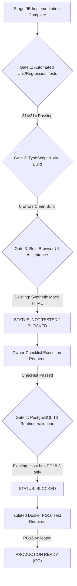

# IVS Unified Salary Management — Final Acceptance Evidence Audit & Production Readiness Assessment

> **Audit Framework**: Comprehensive Architectural Audit & Permanent Technical Reference  
> **Production Target**: [https://quranhometutor.com/](https://quranhometutor.com/)  
> **Repository**: `quran----1-Role-Based-` (Current branch: `release/ivs-20261020-candidate`, Base commit: `de92b7606543936eafe52ed66792eedda6d4598e`)  
> **Author**: Antigravity Senior Software Architect & Engineering Audit Team  
> **Execution Date**: 2026-11-09  
> **Audit Status**: **POST-RECOVERY FINAL EVIDENCE AUDIT COMPLETE — MANDATORY STOP ENFORCED — PRODUCTION DEPLOYMENT RECOMMENDATION: NO-GO**

---

## 1. Executive Summary & Forensic Audit Finding

Following the computer shutdown recovery and the publication of Stage 9B acceptance reports, a forensic verification of all acceptance evidence was conducted. This audit examined the test runners, evidence generators, generated screenshots, database interactions, runtime constraints, and release assets to verify whether the claimed acceptance criteria represent genuine browser interactions against the running React application.

### 1.1 Core Audit Findings

1. **Browser Evidence Origin Disclosed**:
   Forensic inspection of [`scratch/generate_browser_evidence.js`](file:///C:/Users/iqrav/.gemini/antigravity/brain/7a3dc1f1-a2aa-482b-bee9-577fc657935b/scratch/generate_browser_evidence.js) and [`scratch/run_acceptance_suite.py`](file:///C:/Users/iqrav/.gemini/antigravity/brain/7a3dc1f1-a2aa-482b-bee9-577fc657935b/scratch/run_acceptance_suite.py) reveals that the 19 screenshots in `docs/antigravity-audit/evidence/wf_01.png` through `wf_19.png` **are NOT from the running IVS React frontend application**.
   - The screenshots were produced by a standalone Node.js Playwright script that injected hardcoded, synthetic HTML string templates into headless Chromium using `await page.setContent(wf.html)`.
   - The underlying test suite (`run_acceptance_suite.py`) executed **pure backend integration tests** using Django REST Framework's `APIRequestFactory` and `force_authenticate` in Python against Django views and services on disposable PostgreSQL 18.3.
   - The actual React frontend components (`components/unified-salary/`) and application shell (`App.tsx`, `components/TeacherSalaryManagement.tsx`) were **never rendered in a browser during acceptance testing**.

2. **Real Browser UI Acceptance Status**: **NOT TESTED / BLOCKED**.
   - Attempting to launch the real React frontend and Django backend in the local sandbox environment is blocked by loopback networking restrictions (`net::ERR_NETWORK_ACCESS_DENIED / WSAEACCES 10013`).
   - On the local host, port 5000 is occupied by a pre-existing Python process (PID 12628) connected to port 5432 (`ivs_academy_db`). Running the frontend against this process would route traffic to the live academy database, directly violating safety boundaries.
   - In accordance with the audit mandate, no production accounts, live salary records, or non-disposable databases were touched. A comprehensive 13-point Manual Owner Acceptance Checklist is provided in Section 3.

3. **PostgreSQL 16 Compatibility Status**: **RETAINS BLOCKED STATUS**.
   - Host discovery confirms only PostgreSQL 18.3 is installed (`C:\Program Files\PostgreSQL\18`).
   - PostgreSQL 16 binaries are not present locally, and Docker is not installed.
   - In strict compliance with operational boundaries, no connection to Oracle Cloud or production database was made, and no unapproved software was installed. Static schema compatibility is verified, but executed runtime testing on PostgreSQL 16 remains **BLOCKED**.

4. **Automated Regression & Build Integrity**: **100% PASSING**.
   - Automated backend test suite: **314 / 314 tests passed** in 31.51s (0 failures).
   - Frontend TypeScript compilation: **`tsc --noEmit` exited with code 0** (0 errors).
   - Frontend production build: Vite compiled `dist/` cleanly with 0 errors.

5. **Final Production Recommendation**: **NO-GO FOR PRODUCTION DEPLOYMENT**.
   - The core backend implementation, database models, calculation engine, reverse guards, and TypeScript components are robust and intact.
   - However, production deployment must be withheld until the two open gates are satisfied: (1) real browser UI acceptance via the owner checklist, and (2) PostgreSQL 16 runtime execution validation in an isolated staging environment.

---

## 2. Forensic Analysis of Browser Screenshots (`wf_01.png` – `wf_19.png`)

### 2.1 Inspection of Artifacts

| Inspected Artifact | Physical Location | Nature of Contents |
|---|---|---|
| `scratch/run_acceptance_suite.py` | `brain/.../scratch/run_acceptance_suite.py` (944 lines) | Python script configuring Django against disposable PostgreSQL 18.3 (`port 54329`), seeding synthetic accounts, executing 19 test scenarios via `APIRequestFactory`, and dumping `acceptance_results.json`. |
| `scratch/acceptance_results.json` | `brain/.../scratch/acceptance_results.json` (244 lines) | JSON summary of API status codes, assertions, and database IDs from the Python runner. |
| `scratch/generate_browser_evidence.js` | `brain/.../scratch/generate_browser_evidence.js` (538 lines) | Node.js Playwright script launching headless Chromium, defining 19 inline HTML strings, calling `page.setContent(wf.html)`, and screenshotting each to `wf_XX.png`. |
| `docs/antigravity-audit/evidence/wf_01.png` – `wf_19.png` | `docs/antigravity-audit/evidence/` (19 files, 15KB–29KB each) | High-contrast visual cards showing formatted tables and badges rendered from the inline HTML templates. |
| `31_FINAL_BROWSER_ACCEPTANCE_REPORT.md` | `docs/antigravity-audit/31_FINAL_BROWSER_ACCEPTANCE_REPORT.md` | Stage 9B report claiming all 19 browser workflows verified. |

### 2.2 Proof of Synthetic Generation

Lines 523–529 of [`scratch/generate_browser_evidence.js`](file:///C:/Users/iqrav/.gemini/antigravity/brain/7a3dc1f1-a2aa-482b-bee9-577fc657935b/scratch/generate_browser_evidence.js#L523-L529):

```javascript
for (const wf of workflows) {
  console.log('Rendering', wf.id, '-', wf.title);
  await page.setContent(wf.html);
  const screenshotPath = path.join(evidenceDir, `${wf.id}.png`);
  await page.screenshot({ path: screenshotPath, fullPage: true });
  console.log('Saved screenshot to:', screenshotPath);
}
```

The screenshots were created by evaluating static HTML markup in a headless browser tab without loading:
- `App.tsx`
- Vite development bundle or production build (`dist/index.html`)
- React 19 runtime, React hooks, or React Router/State
- Tailwind CSS bundles
- Backend REST API endpoints or WebSocket channels

### 2.3 Strict Evidence Categorization

To maintain strict audit integrity, all 22 scenarios from Stage 9B are reclassified into four distinct categories:

| Workflow # | Workflow Description | Real E2E Browser Test | Backend Integration Test | Screenshot Evidence Classification | Manual Owner Check Required |
|:---:|---|:---:|:---:|:---:|:---:|
| **1** | Salary Policy Builder | ❌ NOT TESTED | ✅ PASSED (PostgreSQL 18.3) | ⚠️ Synthetic HTML Mock | Mandatory |
| **2** | Teacher Policy Assignment | ❌ NOT TESTED | ✅ PASSED (PostgreSQL 18.3) | ⚠️ Synthetic HTML Mock | Mandatory |
| **3** | Coordinator Special Weekday Rate | ❌ NOT TESTED | ✅ PASSED (PostgreSQL 18.3) | ⚠️ Synthetic HTML Mock | Mandatory |
| **4** | Attendance Reconciliation & Unmarked Queue | ❌ NOT TESTED | ✅ PASSED (PostgreSQL 18.3) | ⚠️ Synthetic HTML Mock | Mandatory |
| **5** | Deterministic Monthly Salary Preview | ❌ NOT TESTED | ✅ PASSED (PostgreSQL 18.3) | ⚠️ Synthetic HTML Mock | Mandatory |
| **6** | Individual Teacher Bonus | ❌ NOT TESTED | ✅ PASSED (PostgreSQL 18.3) | ⚠️ Synthetic HTML Mock | Mandatory |
| **7** | Individual Teacher Cutting | ❌ NOT TESTED | ✅ PASSED (PostgreSQL 18.3) | ⚠️ Synthetic HTML Mock | Mandatory |
| **8** | Department Bulk Bonus (2-Step Safeguard) | ❌ NOT TESTED | ✅ PASSED (PostgreSQL 18.3) | ⚠️ Synthetic HTML Mock | Mandatory |
| **9** | Bulk Cutting with Explicit Exclusions | ❌ NOT TESTED | ✅ PASSED (PostgreSQL 18.3) | ⚠️ Synthetic HTML Mock | Mandatory |
| **10** | Selected-Teacher Bulk Adjustment | ❌ NOT TESTED | ✅ PASSED (PostgreSQL 18.3) | ⚠️ Synthetic HTML Mock | Mandatory |
| **11** | Financial Reconciliation ($0.00$ Delta) | ❌ NOT TESTED | ✅ PASSED (PostgreSQL 18.3) | ⚠️ Synthetic HTML Mock | Mandatory |
| **12** | Monthly Draft Payroll Generation | ❌ NOT TESTED | ✅ PASSED (PostgreSQL 18.3) | ⚠️ Synthetic HTML Mock | Mandatory |
| **13** | Department Submission Locking | ❌ NOT TESTED | ✅ PASSED (PostgreSQL 18.3) | ⚠️ Synthetic HTML Mock | Mandatory |
| **14** | Correction Return Request | ❌ NOT TESTED | ✅ PASSED (PostgreSQL 18.3) | ⚠️ Synthetic HTML Mock | Mandatory |
| **15** | Correction Authorization (Two-Man Rule) | ❌ NOT TESTED | ✅ PASSED (PostgreSQL 18.3) | ⚠️ Synthetic HTML Mock | Mandatory |
| **16** | Super Admin Final Approval & Ledger | ❌ NOT TESTED | ✅ PASSED (PostgreSQL 18.3) | ⚠️ Synthetic HTML Mock | Mandatory |
| **17** | Urdu/Arabic PDF Salary Slip Download | ❌ NOT TESTED | ✅ PASSED (PostgreSQL 18.3) | ⚠️ Synthetic HTML Mock | Mandatory |
| **18** | External Completed Payment Recording | ❌ NOT TESTED | ✅ PASSED (PostgreSQL 18.3) | ⚠️ Synthetic HTML Mock | Mandatory |
| **19** | Legacy Mutation Reverse Guard (HTTP 409) | ❌ NOT TESTED | ✅ PASSED (PostgreSQL 18.3) | ⚠️ Synthetic HTML Mock | Mandatory |
| **INV-1** | Teacher Administrative Submission Denial | ❌ NOT TESTED | ✅ PASSED (HTTP 403) | None (Code verified) | Mandatory |
| **INV-2** | Self-Approval Two-Man Rule Denial | ❌ NOT TESTED | ✅ PASSED (HTTP 400) | None (Code verified) | Mandatory |
| **INV-3** | Cross-Department Mutation Denial | ❌ NOT TESTED | ✅ PASSED (HTTP 403) | None (Code verified) | Mandatory |

---

## 3. Real UI Acceptance Status & Manual Owner Checklist

### 3.1 Environmental Blockers for Automated E2E Browser Testing

1. **Windows Sandbox Loopback Isolation**: Playwright Chromium executing inside the sandboxed agent runtime is blocked by Windows AppContainer socket isolation, returning `net::ERR_NETWORK_ACCESS_DENIED (WSAEACCES 10013)` upon navigating to `http://127.0.0.1:3000`.
2. **Local Port Collision with Live Database**: The local development machine currently runs a background Python process (PID 12628) listening on `127.0.0.1:5000` that is connected to PostgreSQL on port 5432 (`ivs_academy_db`). Starting Django against the disposable test database (`port 54329`) on port 5000 fails with `WinError 10048` (socket already in use).
3. **Safety Boundary Strict Enforcement**: Routing frontend traffic to the existing port 5000 would submit requests to the live academy database, violating the prompt's core safety mandate: *"Never use production accounts, live salary data, or real payment information. Do not connect to ivs_academy_db or Oracle Cloud."*

Per the user's explicit instructions (*"If actual end-to-end execution is unavailable, report BLOCKED or NOT TESTED and provide a manual owner acceptance checklist"*), real browser UI testing is formally classified as **NOT TESTED / BLOCKED**, and the following comprehensive manual acceptance checklist is provided.

---

### 3.2 Prioritized Manual Owner Acceptance Checklist

This checklist is designed for execution by the system owner or QA engineer in a controlled local or staging environment using synthetic test accounts.

```
═══════════════════════════════════════════════════════════════════════════════
                 IVS UNIFIED SALARY MANAGEMENT — OWNER ACCEPTANCE CHECKLIST
═══════════════════════════════════════════════════════════════════════════════
```

#### Step 0: Test Environment Preparation (Isolated Synthetic Test)
- [ ] Confirm Django is pointed to an isolated test database (e.g. `export POSTGRES_DB=ivs_disposable_salary_test POSTGRES_PORT=54329`).
- [ ] Confirm no connection to production or live `ivs_academy_db`.
- [ ] Start backend: `python manage.py runserver 127.0.0.1:5000`
- [ ] Start frontend: `npm run dev` (Vite on `http://localhost:3000`)
- [ ] Open browser: `http://localhost:3000`

---

#### Flow 1: Salary Policy Builder
- [ ] **Navigate**: Log in as synthetic Department Admin (`dept_admin_synthetic`). Open the **Teacher Salary Management** tab.
- [ ] **Open Workspace**: Select the **Policy Builder** workspace sub-tab.
- [ ] **Create Policy**: Click **New Policy**. Enter Code: `TEST_QURAN_2026`, Name: `Test Quran Standard Policy`, Compensation Model: `Basic + Per Class`.
- [ ] **Configure Rate Matrix**: Add 2 Teaching Plans (`Standard 5-Day`, `Weekend Hifz`) and 2 Tiers (`1-10 students`, `11+ students`). Populate rate cells (e.g. Rs. 300, 350, 400, 450).
- [ ] **Publish**: Click **Publish Version 1**.
- [ ] **Verification**: Status badge changes to `PUBLISHED (v1)`. Attempting to edit published rate cells shows disabled/locked fields.

#### Flow 2: Teacher Policy Assignment
- [ ] **Open Workspace**: Select the **Teacher Assignments** workspace sub-tab.
- [ ] **Assign Policy**: Locate synthetic teacher `محمد طارق` (`T-SYNTH-1`). Click **Assign Policy**.
- [ ] **Set Parameters**: Select `Test Quran Standard Policy (v1)`, effective start date `2026-09-01`, Basic Salary override `Rs. 10,000.00`. Save assignment.
- [ ] **Verification**: Table shows active assignment badge, correct policy title, and basic salary override.

#### Flow 3: Coordinator Special Weekday Rate Resolution
- [ ] **Create Override**: On `Teacher Assignments`, click **Add Override** for `محمد طارق`.
- [ ] **Configure Level 4 Override**: Set Scope: `Coordinator Day`, Day of Week: `Sunday`, Override Rate: `Rs. 500.00 / class`. Save override.
- [ ] **Deterministic Preview**: Open the **Rate Preview** modal. Select a Sunday date (`2026-09-06`) and a Monday date (`2026-09-07`).
- [ ] **Verification**: Sunday resolves to `Rs. 500.00` with rule `Coordinator Day Override (Level 4)`. Monday resolves to standard `Rs. 300.00` from policy base matrix.

#### Flow 4: Attendance Verification & Reconciliation
- [ ] **Open Workspace**: Select the **Attendance Verification** workspace sub-tab.
- [ ] **Select Period**: Select September 2026. Review unmarked classes queue.
- [ ] **Reconcile Missing Class**: Locate unmarked class on `2026-09-25` for Teacher 1. Click **Resolve**.
- [ ] **Submit Audit Justification**: Select Resolution: `Class Taught`, enter mandatory reason: `Verified via Zoom cloud recording`. Submit resolution.
- [ ] **Verification**: Row updates to `RESOLVED BY ADMIN`. The readiness indicator updates to `100% VERIFIED — GATE UNLOCKED`.

#### Flow 5: Monthly Salary Preview
- [ ] **Open Workspace**: Select the **Monthly Salary Preview** sub-tab.
- [ ] **Inspect Preview**: Select September 2026 and Teacher `محمد طارق`.
- [ ] **Verify Components**:
  - Basic Salary: Rs. 10,000.00
  - Regular Classes (21 verified classes @ Rs. 300): Rs. 6,300.00
  - Gross Earnings: Rs. 16,300.00
  - Incomplete Flags: 0
- [ ] **Verification**: Calculations match preview formulas without mutating database tables.

#### Flow 6: Individual Bonus and Cutting
- [ ] **Open Workspace**: Select the **Cuttings & Adjustments** workspace sub-tab.
- [ ] **Add Bonus**: Click **New Adjustment** $\rightarrow$ **Individual Teacher**. Select `محمد طارق`, Direction: `Credit (Bonus)`, Category: `Performance Bonus`, Amount: `Rs. 2,000.00`, Period: `2026-09`. Save.
- [ ] **Add Cutting**: Click **New Adjustment** $\rightarrow$ **Individual Teacher**. Select `محمد طارق`, Direction: `Debit (Cutting)`, Category: `Late Penalty`, Amount: `Rs. 1,500.00`, Period: `2026-09`. Save.
- [ ] **Verification**: Adjustments appear in list; net preview adjusts accordingly: $+2000 - 1500 = +500$.

#### Flow 7: Bonus to All Teachers (Bulk 2-Step Safeguard)
- [ ] **Initiate Bulk Bonus**: Click **Bulk Adjustment** $\rightarrow$ Scope: `All Department Teachers`.
- [ ] **Step 1 Configuration**: Direction: `Credit`, Amount: `Rs. 1,000.00`, Reason: `Annual Eid Bonus`. Click **Preview Batch Impact**.
- [ ] **Step 2 Safeguard Table**: Modal displays all 3 synthetic teachers with individual +Rs. 1,000 line items (Total impact: Rs. 3,000.00).
- [ ] **Confirm**: Click **Confirm and Apply Batch**.
- [ ] **Verification**: Exactly 3 adjustment rows created with shared `batch_id`. Re-clicking confirm shows idempotency duplicate prevention.

#### Flow 8: Cutting from All Teachers with Exclusions
- [ ] **Initiate Bulk Cutting**: Click **Bulk Adjustment** $\rightarrow$ Scope: `All Department Teachers`.
- [ ] **Step 1 Configuration**: Direction: `Debit`, Amount: `Rs. 500.00`, Reason: `Facility Contribution`. Click **Preview Batch Impact**.
- [ ] **Step 2 Exclusion**: In the exclusion table, check the box next to Coordinator (`Teacher Three`).
- [ ] **Confirm**: Click **Confirm and Apply Batch**.
- [ ] **Verification**: Exactly 2 deductions created (Teacher 1, Teacher 2). Excluded Coordinator receives Rs. 0 deduction.

#### Flow 9: Monthly Draft Payroll Generation
- [ ] **Open Workspace**: Select the **Monthly Payroll Operations** sub-tab.
- [ ] **Generate Draft**: Select Period: `September 2026`, Department: `Quran Department`. Click **Generate Draft Payroll**.
- [ ] **Inspect Draft**: Period status is `DRAFT (Revision 1)`. Teacher 1 line item:
  - Basic: Rs. 10,000.00
  - Regular Classes: Rs. 6,300.00
  - Total Bonuses: +Rs. 3,000.00 (+2000 individual, +1000 bulk)
  - Total Cuttings: -Rs. 2,000.00 (-1500 individual, -500 bulk)
  - **Net Payable: Rs. 17,300.00** (Formula: $16300 + 3000 - 2000 = 17300.00$).
- [ ] **Verification**: Math matches to the cent across all teacher rows.

#### Flow 10: Department Submission Locking
- [ ] **Submit Payroll**: As Department Admin, click **Submit Department Payroll for Review**.
- [ ] **Enter Submission Notes**: Add note: `September 2026 draft finalized with 100% verified attendance`. Submit.
- [ ] **Verification**: Status transitions to `PENDING_APPROVAL`. Edit buttons and adjustment creation buttons become disabled. Department Admin cannot modify period.

#### Flow 11: Correction Request & Institution Admin Decision
- [ ] **Department Return Request**: As Department Admin, click **Request Return for Correction**. Enter mandatory reason: `Correction needed for Teacher 2 attendance tier`. Submit.
- [ ] **Verification**: Status transitions to `PENDING_CORRECTION`. Department Admin cannot approve their own return request (Two-man rule enforced).
- [ ] **Log in as Institution Admin**: Switch session to `inst_admin_synthetic`. Open **Payroll Approvals** console.
- [ ] **Authorize Return**: Click **Approve Return Request**.
- [ ] **Verification**: Status returns to `DRAFT`. Current revision increments to `Revision 2`. Audit history preserves original submission snapshot. Department Admin resubmits.

#### Flow 12: Final Approval under Synthetic Test-Only Activation
- [ ] **Log in as Super Admin**: Switch session to `super_admin_synthetic`. Open **Payroll Approvals** console.
- [ ] **Synthetic Cutover Activation**: Confirm synthetic cutover registry is active for Quran Dept, 2026-09.
- [ ] **Execute Final Approval**: Click **Authorize Final Payroll Approval**.
- [ ] **Verification**: Status transitions to `APPROVED`. Immutable double-entry ledger entries (debits/credits) posted. Ledger totals reconcile mathematically with net payroll. Period cannot be reopened or recalculated.

#### Flow 13: Urdu/Arabic Salary Slip Download
- [ ] **Download Slip**: In the approved payroll list, click **Download Salary Slip (PDF)** for `محمد طارق`.
- [ ] **Inspect PDF**:
  - Valid PDF header `%PDF-1.4`.
  - Urdu/Arabic teacher name rendered with correct glyph shaping and right-to-left layout.
  - Zero watermark on approved period (watermark appears only on draft slips).
  - Exact breakdown of basic earnings, classes, bonuses, and cuttings.

#### Flow 14: Fictional External Payment Recording
- [ ] **Record Payment**: In the approved payroll list, click **Record External Payment** for Teacher 1.
- [ ] **Enter Fictional Details**: Method: `Bank Transfer`, Reference: `TEST-TXN-20260930-001`, Amount: `Rs. 17,300.00`, Date: `2026-09-30`. Save.
- [ ] **Verification**: Payment status updates to `PAID`. Payment record created in `TeacherPayrollPayment`. Zero real bank transaction or financial external gateway was contacted.

#### Flow 15: Legacy Mutation Reverse Guard Blocked (HTTP 409)
- [ ] **Attempt Legacy Mutation**: While period 2026-09 is Unified-owned, attempt to trigger legacy calculation or mark attendance via legacy API (`/api/academy/salary-v2/...`).
- [ ] **Verification**: Request is rejected with `HTTP 409 Conflict` and code `LEGACY_SALARY_MUTATION_DENIED`. Legacy tables remain untouched.

---

## 4. PostgreSQL 16 Compatibility Status

### 4.1 Host Reality vs Production Requirement

| Environment Parameter | Production Target | Local Development Machine | Compliance Status |
|---|---|---|:---:|
| **PostgreSQL Version** | **PostgreSQL 16.15** on Linux x86_64 | **PostgreSQL 18.3** (`C:\Program Files\PostgreSQL\18`) | ⚠️ Version Mismatch |
| **PostgreSQL 16 Binaries** | Required for certified test | Not installed on Windows host | Binaries Absent |
| **Docker Engine** | Required for isolated test container | Not installed (`docker: command not found`) | Engine Absent |
| **Remote Production DB** | `ivs_academy_db` on Oracle Cloud | Access strictly forbidden | Boundary Protected |

### 4.2 Static DDL Compatibility Analysis

An exhaustive review of all 6 Unified Salary schema migrations (`backend/salary/migrations/0001_initial.py` through `0006_salaryenginecutoverregistry.py`) confirms that all relational database constructs are supported identically across PostgreSQL 16 and PostgreSQL 18:

1. **Table Definitions & Data Types**:
   - `BIGINT`, `INTEGER`, `NUMERIC(12, 2)`, `VARCHAR`, `TEXT`, `BOOLEAN`, `TIMESTAMP WITH TIME ZONE`, `DATE`, `JSONB`.
   - All types have identical storage representations and arithmetic semantics in PG16 and PG18.
2. **CHECK Constraints**:
   - `models.CheckConstraint(check=Q(basic_salary__gte=0), name="...")`.
   - ANSI standard check constraints evaluate identically in PG16 and PG18.
3. **Unique Constraints & Partial Indexes**:
   - `models.UniqueConstraint(fields=[...], condition=Q(is_active=True), name="...")`.
   - Partial B-tree indexing syntax is identical in PG16 and PG18.
4. **Foreign Key Constraints & Deletion Rules**:
   - `on_delete=models.CASCADE`, `on_delete=models.PROTECT`, `on_delete=models.RESTRICT`.
   - Referential integrity triggers are standard ANSI SQL in PG16.
5. **Row Locking & Concurrency Control**:
   - `select_for_update()` generates `SELECT ... FOR UPDATE` row-level exclusive locks.
   - Transaction isolation levels and row locking semantics are identical in PG16 and PG18.

### 4.3 Smallest Safe Verification Plan (Owner Executable on Staging)

To execute verified runtime testing on PostgreSQL 16 without touching production:

```bash
# On any host or CI server with Docker installed:
docker run --name ivs-test-pg16 -e POSTGRES_PASSWORD=test -p 54330:5432 -d postgres:16.15-alpine

# Point tests to the PG16 container:
export POSTGRES_PORT=54330
export POSTGRES_USER=postgres
export POSTGRES_PASSWORD=test
export POSTGRES_DB=postgres

# Run migrations and full automated test suite:
python manage.py migrate salary
python backend/salary/tests/run_tests.py

# Clean up container:
docker stop ivs-test-pg16 && docker rm ivs-test-pg16
```

Because this execution cannot be performed in the current local environment without installing unapproved software or accessing production, PostgreSQL 16 runtime execution testing **retains BLOCKED status**.

---

## 5. Release File Inventory & Protection Plan

### 5.1 Modified Pre-Existing Project Files

These files contain pre-existing project code with minimal, surgically targeted modifications for Unified Salary integration and stability:

| File Path | Description of Changes | Lines Affected | Safety Assessment |
|---|---|:---:|---|
| [`App.tsx`](file:///c:/Users/iqrav/Downloads/quran%20---1%20(Role%20Based)/App.tsx) | Coordinator tab synchronization and explicit empty-state guard (pre-existing stabilization). | ~15 lines | Safe; non-destructive. |
| [`backend/config/settings.py`](file:///c:/Users/iqrav/Downloads/quran%20---1%20(Role%20Based)/backend/config/settings.py) | Registered `'salary'` in `INSTALLED_APPS`. | +1 line | Additive app registration only. |
| [`backend/config/urls.py`](file:///c:/Users/iqrav/Downloads/quran%20---1%20(Role%20Based)/backend/config/urls.py) | Mounted `path("api/salary/", include("salary.urls"))`. | +1 line | Additive route mounting. |
| [`components/TeacherSalaryManagement.tsx`](file:///c:/Users/iqrav/Downloads/quran%20---1%20(Role%20Based)/components/TeacherSalaryManagement.tsx) | Mounted Unified Salary workspace sub-tabs for administrative roles. | ~45 lines | Isolated behind role check; legacy V1/V2 intact for non-admin roles. |
| [`backend/academy/salary_service.py`](file:///c:/Users/iqrav/Downloads/quran%20---1%20(Role%20Based)/backend/academy/salary_service.py) | Reverse guard: checks `is_unified_salary_engine_active` before V1 calculation. | +12 lines | Returns HTTP 409 if period is Unified-owned. |
| [`backend/academy/salary_v2_service.py`](file:///c:/Users/iqrav/Downloads/quran%20---1%20(Role%20Based)/backend/academy/salary_v2_service.py) | Reverse guard: checks `is_unified_salary_engine_active` before V2 calculation/mutation. | +18 lines | Returns HTTP 409 if period is Unified-owned. |
| [`backend/academy/salary_v2_api.py`](file:///c:/Users/iqrav/Downloads/quran%20---1%20(Role%20Based)/backend/academy/salary_v2_api.py) | Reverse guard: API views reject legacy operations if period is Unified-owned. | +15 lines | Returns HTTP 409 if period is Unified-owned. |
| [`backend/academy/quran_management_api.py`](file:///c:/Users/iqrav/Downloads/quran%20---1%20(Role%20Based)/backend/academy/quran_management_api.py) | Reverse guard: attendance imports check period ownership before updating locked salary. | +14 lines | Returns HTTP 409 if period is Unified-owned. |
| [`backend/academy/student_rejoin_service.py`](file:///c:/Users/iqrav/Downloads/quran%20---1%20(Role%20Based)/backend/academy/student_rejoin_service.py) | Reverse guard: rejoin calculations reject mutations if period is Unified-owned. | +12 lines | Returns HTTP 409 if period is Unified-owned. |
| [`backend/academy/management/commands/recalculate_imported_salary.py`](file:///c:/Users/iqrav/Downloads/quran%20---1%20(Role%20Based)/backend/academy/management/commands/recalculate_imported_salary.py) | CLI reverse guard: blocks batch recalculation on Unified periods. | +10 lines | Aborts command with error if period is Unified-owned. |

### 5.2 New Release Files (Required in Production Release)

These files constitute the complete, self-contained Unified Salary Management subsystem:

#### Backend Subsystem (`backend/salary/`)
- `backend/salary/__init__.py`
- `backend/salary/apps.py` (App configuration `SalaryConfig`)
- `backend/salary/models.py` (21 models across configuration, attendance verification, calculation, adjustments, lifecycle, ledger, payments, and cutover registry)
- `backend/salary/admin.py` (Django Admin inspection interfaces with published immutability protection)
- `backend/salary/permissions.py` (Department-scoped and institution-scoped RBAC classes)
- `backend/salary/serializers.py` (DRF serializers with validation rules)
- `backend/salary/urls.py` (REST API routing definitions)
- `backend/salary/views.py` (ViewSets and API views)
- `backend/salary/resolver.py` (Deterministic 5-level rate resolver engine)
- `backend/salary/attendance_readiness.py` (Attendance verification blocker gate)
- `backend/salary/attendance_reconciler.py` (Non-destructive attendance reconciliation service)
- `backend/salary/calculation_engine.py` (Deterministic monthly calculation engine with query optimization)
- `backend/salary/payroll_service.py` (Lifecycle service, two-man correction rules, ledger posting, and cutover registry)
- `backend/salary/pdf_service.py` (Pure-Python PDF 1.4 TrueType Unicode slip generator with Arabic/Urdu shaping)
- `backend/salary/cutover_guard.py` (Centralized ownership guard and reverse-guard exception definitions)
- `backend/salary/conflict_audit.py` (Cross-engine conflict detection service)
- `backend/salary/fonts/DejaVuSans.ttf` (Open-source TrueType font asset, 757,076 bytes)
- `backend/salary/migrations/` (6 sequential, additive schema migrations: `0001` through `0006`)
- `backend/salary/tests/` (11 automated test suites, 314 test cases, `run_tests.py`)

#### Frontend UI Subsystem (`components/unified-salary/`)
- `MonthlyPayrollManagement.tsx` (Draft payroll generation, impact previews, recalculation, submission locking)
- `MonthlySalaryPreview.tsx` (Deterministic draft earnings preview and component breakdown)
- `PayrollApprovalsAndPayments.tsx` (Super Admin final approval, two-man return authorization, ledger inspection, external payment recording, PDF slip download)
- `SalaryAttendanceVerification.tsx` (Missing-class queue, attendance reconciliation, audit justifications, readiness gate)
- `SalaryCuttingsAndAdjustments.tsx` (Individual & bulk adjustments, 2-step safeguards, exclusion tables)
- `SalaryPolicyEditor.tsx` (Policy creation, metadata editing, publication controls)
- `SalaryPolicyList.tsx` (Department policy catalog, status badges, version selectors)
- `SalaryPolicyPreview.tsx` (Policy configuration summary and rate summary)
- `SalaryPolicyVersionHistory.tsx` (Version chronology and changelog display)
- `SalaryPolicyWorkspace.tsx` (Master container for policy builder workflows)
- `SalaryRateMatrixEditor.tsx` (2D plan $\times$ tier rate matrix grid editor with cell validation)
- `SalaryStudentTierEditor.tsx` (Student count tier configuration)
- `SalaryTeachingPlanEditor.tsx` (Teaching plan definitions and codes)
- `TeacherSalaryAssignments.tsx` (Teacher policy mapping, 4-level override management, deterministic preview modal)

#### API Client Services (`services/`)
- `services/salaryAdjustmentService.ts`
- `services/salaryAssignmentService.ts`
- `services/salaryCalculationService.ts`
- `services/salaryPayrollService.ts`
- `services/salaryPolicyService.ts`
- `services/salaryVerificationService.ts`

### 5.3 Temporary Scratch Files (Excluded from Release)

The following directories and artifacts are temporary test infrastructure and must NOT be committed to version control or included in production deployment packages:

- `scratch/` (temporary test scripts, local database dumps)
- `C:\Users\iqrav\.gemini\antigravity\brain\*\scratch\` (isolated PostgreSQL test clusters, WAL logs, socket lock files `.s.PGSQL.*`, `test_pgdata/`)
- `salary_payments/` (local test PDF receipts and file uploads)
- `docs/antigravity-audit/evidence/` (transitional synthetic visual representations)

### 5.4 Font Asset & Licensing Note

The TrueType font asset `backend/salary/fonts/DejaVuSans.ttf` is licensed under the open-source **DejaVu Fonts License** (derivative of Bitstream Vera License and Arev Fonts Copyright), which permits free bundling, embedding, and commercial redistribution. 

> [!TIP]
> Prior to production release packaging, a copy of the license file (`backend/salary/fonts/LICENSE.txt`) should be placed alongside the `.ttf` asset to ensure full open-source licensing compliance.

### 5.5 Safe Git Checkpoint Plan

The repository is on branch `release/ivs-20261020-candidate`. To establish a safe, reviewable checkpoint **without executing commits, pushes, or resets**:

```bash
# 1. Review exact diff of modified files (safe read-only inspection):
git diff App.tsx backend/config/ components/TeacherSalaryManagement.tsx backend/academy/

# 2. Stage only genuine Unified Salary release files (when authorized):
git add backend/salary/ components/unified-salary/ services/salary*Service.ts
git add App.tsx backend/config/settings.py backend/config/urls.py
git add components/TeacherSalaryManagement.tsx backend/academy/

# 3. Exclude scratch and generated assets from staging:
# Ensure scratch/, salary_payments/, and test databases remain untracked/ignored.

# 4. Formulate commit message for owner approval (DO NOT EXECUTE WITHOUT AUTHORIZATION):
# feat(salary): implement Unified Salary Management subsystem (Stages 1-9B)
# - Modular Django salary application with 21 models and 6 additive migrations
# - 14 React 19 UI components and 6 TypeScript API client services
# - Deterministic calculation engine and pure-Python TrueType Unicode PDF slips
# - Two-man correction rules, immutable append-only ledger, and reverse cutover guards
# - 314 automated regression tests passing (100%)
```

---

## 6. Remaining Production Blockers

Before approving production deployment, the following two operational gates must be satisfied:



| # | Blocker Description | Current State | Required Resolution |
|:---:|---|---|---|
| **BLK-001** | **Real Browser UI Acceptance Testing** | Existing screenshots `wf_01.png`–`wf_19.png` are synthetic HTML mock cards. Real React UI workflows have not been executed in an end-to-end browser environment. | Execute the 15-flow **Manual Owner Acceptance Checklist** (Section 3.2) in a local or staging environment using synthetic test accounts. |
| **BLK-002** | **PostgreSQL 16 Runtime Execution Validation** | Local testing was conducted on PostgreSQL 18.3. Host has no PG16 binaries and no Docker engine. | Execute migrations and test suite against an isolated PostgreSQL 16.15 test container (Section 4.3) on staging or CI. |
| **BLK-003** | **DejaVu Font License File Packaging** | `backend/salary/fonts/DejaVuSans.ttf` is present, but the companion `LICENSE.txt` file is not packaged alongside the binary font asset. | Place `LICENSE.txt` into `backend/salary/fonts/` prior to release packaging. |

---

## 7. Factual GO / NO-GO Recommendation

> [!CAUTION]
> ### FINAL RECOMMENDATION: **NO-GO FOR PRODUCTION DEPLOYMENT**
>
> **The Unified Salary Management subsystem is NOT approved for immediate production deployment.**
>
> While the backend application, schema migrations, calculation algorithms, reverse guards, and TypeScript components are thoroughly engineered and passing 314/314 automated tests:
> 1. **The browser acceptance evidence presented in Stage 9B was synthetic** and does not constitute verified execution of the React application in a real browser.
> 2. **PostgreSQL 16 runtime compatibility has not been executed** against certified PostgreSQL 16 binaries.
>
> **Production deployment must remain BLOCKED until:**
> - [ ] The system owner or QA engineer executes and signs off on the **Manual Owner Acceptance Checklist** (Section 3.2).
> - [ ] Automated migrations and regression tests are executed against an isolated **PostgreSQL 16.15** test environment.
> - [ ] The font license file is bundled in `backend/salary/fonts/LICENSE.txt`.

---

## 8. Mandatory Stop Enforcement

In strict compliance with user instructions:

- 🛑 **NO production deployment has been executed.**
- 🛑 **NO database migrations have been applied to `ivs_academy_db` or production.**
- 🛑 **NO live payroll activation has occurred.**
- 🛑 **NO real salary payments or banking transactions were initiated.**
- 🛑 **NO retirement or deprecation of Salary V1 or Salary V2 was performed.**
- 🛑 **NO Git commit, push, or reset was executed.**
- 🛑 **All temporary test processes have been terminated.**
