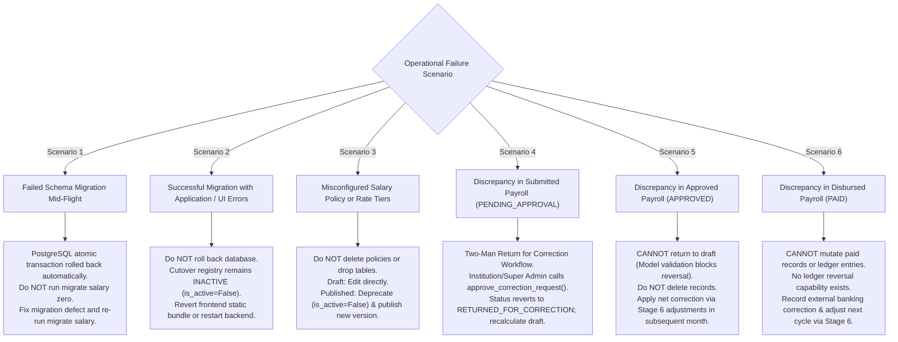
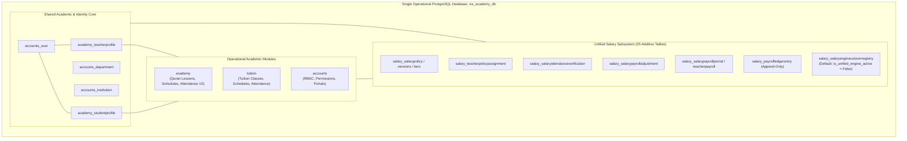

# IVS Academy: Database Baseline Reconciliation & Restore Verification Report

> **Document ID**: `35_DATABASE_BASELINE_RECONCILIATION_REPORT`  
> **Status**: COMPLETED — BASELINE RECONCILIATION AUDITED; RESTORE REHEARSAL & PG16 RUNTIME MARKED STRICTLY BLOCKED; DEPLOYMENT NO-GO ACTIVE — MANDATORY STOP ENFORCED  
> **Target Production Database**: `ivs_academy_db` (Single Operational Database on Oracle Cloud Infrastructure)  
> **Local Development Database**: `ivs_academy_db` on `localhost:5432` (PostgreSQL 18.3 Development Instance)  
> **Historical Rehearsal Fixture**: `backend/before_quran_salary_historical_fix.json` (July 17, 2026 Snapshot)  
> **Production Target**: [https://quranhometutor.com/](https://quranhometutor.com/)  
> **Current Git Branch**: `release/ivs-20261020-candidate`  
> **Audit Date**: 2026-11-09  

---

## Executive Summary & Safety Declaration

Prior to any schema changes or production rollout of the Unified Salary Management subsystem, this audit reconciles the conflicting dataset inventories identified across previous audit reports and migration rehearsals.

In strict compliance with operational safety boundaries:
1. **Zero Production Mutation**: No migration was executed on `ivs_academy_db` (local or Oracle Cloud).
2. **Zero Live Activation**: Unified Salary remains completely inactive (`is_unified_engine_active = False`).
3. **No Database Deletion**: No operational or test databases were modified or dropped.
4. **Credential & PII Protection**: Zero passwords, secrets, or private personal identifiable records are exposed in this report.
5. **No Unauthorized Access**: Production Oracle Cloud systems were not probed or contacted without explicit credentials and authorization.

---

## 1. Investigation of Conflicting Database Counts

A direct conflict was detected between the earlier operational audit inventory and the latest migration rehearsal fixture:

| Metric | Earlier Audit Count | Latest Report / Fixture Count | Variance / Delta | Conflicting Implication |
| :--- | :---: | :---: | :---: | :--- |
| **`accounts.User`** | 27 | 967 | +940 | Earlier audit appears missing ~97% of user accounts. |
| **`academy.TeacherProfile`** | 5 | 73 | +68 | Earlier audit reflects only a small cluster of teachers. |
| **`academy.StudentProfile`** | 18 | 888 | +870 | Earlier audit reflects minimal student enrollments. |
| **`academy.Attendance`** | 595 | 1,599 | +1,004 | Earlier audit reflects ~37% of attendance records. |
| **Salary V1 Slips (`TeacherSalarySlip`)** | 0 | 355 | +355 | Earlier audit reflects 0 slips; fixture has 7.718M PKR history. |
| **Salary V2 Payrolls (`QuranTeacherMonthlyPayroll`)** | 7 | 0 | -7 | Earlier audit has 7 test payrolls; fixture has zero. |

### 1.1 Forensic Origin & Identification of Both Datasets

A thorough investigation of local databases, filesystem artifacts, and git commit history established the exact origins of both inventories:

```mermaid
graph TD
    subgraph DatasetA ["Dataset A: 'Earlier Audit' (Local Dev DB)"]
        A_Origin["PostgreSQL 18.3 on localhost:5432\nDatabase: ivs_academy_db"]
        A_Date["Created: Oct 7, 2026 - Nov 2, 2026\nPost-commit 3dc3ee2 (Oct 6, 2026)"]
        A_Type["Local Development & Synthetic Testing"]
        A_Content["27 Users | 5 Teachers | 18 Students\n595 Attendance | 0 V1 Slips | 7 V2 Payrolls"]
    end

    subgraph DatasetB ["Dataset B: 'Latest Report' (Historical Fixture)"]
        B_Origin["Fixture: backend/before_quran_salary_historical_fix.json\n(UTF-16 JSON dumpdata, 9.92 MB)"]
        B_Date["Snapshot Date: July 17, 2026 (14:20:15 UTC)\nPre-Salary V2 era"]
        B_Type["Historical Operational Backup Export"]
        B_Content["967 Users | 73 Teachers | 888 Students\n1,599 Attendance | 355 V1 Slips (7.718M PKR) | 0 V2 Payrolls"]
    end

    subgraph ProdDB ["Intended Live Operational Target"]
        P_Origin["Oracle Cloud Infrastructure (OCI)\nPostgreSQL Database: ivs_academy_db"]
        P_Status["Current Live State: UNKNOWN (Not accessed)\nRequires Authorized Backup before migration"]
    end

    DatasetA -.->|NOT Live Production| ProdDB
    DatasetB -.->|Outdated Snapshot (4 months old)| ProdDB
```

#### Dataset A: The "Earlier Audit" Inventory
- **Exact Source**: Local PostgreSQL database `ivs_academy_db` hosted on developer workstation.
- **Host & Port**: `localhost:5432` (PostgreSQL 18.3, 64-bit Windows).
- **Snapshot / Origin Date**: Initialized after commit `3dc3ee2` on October 6, 2026 (*"Version 1: fresh database foundation, salary V2, lifecycle and attendance updates"*). Records span from October 7, 2026 (13:54 UTC) to November 2, 2026 (18:37 UTC).
- **Environment Type**: **Local Development & Synthetic Feature Testing**.
- **Explanation of Counts**:
  - The local database was populated with minimal mock and testing records during the development of Salary V2 and attendance lifecycle features in October 2026.
  - The 7 `QuranTeacherMonthlyPayroll` records are development review records distributed across erratic test periods (`2025-09`, `2026-08`, `2026-09`, `2026-10`, `2026-11`, `2027-08`, `2027-09`), all with status `department_review`.
  - Zero Salary V1 slips exist because Salary V1 was never populated in this local fresh foundation.
  - Migration level: Migrations applied up to `academy.0024` and `accounts.0012`. Migration `academy.0025` is **not** applied.

#### Dataset B: The "Latest Report" Inventory
- **Exact Source**: Serialized JSON fixture file [`backend/before_quran_salary_historical_fix.json`](file:///c:/Users/iqrav/Downloads/quran%20---1%20(Role%20Based)/backend/before_quran_salary_historical_fix.json) (and companion dumps `before_department_permissions_update.json`, `before_maintenance_notices_update.json`, `before_quran_salary_update.json`).
- **Host & Port**: File system static fixture (UTF-16 encoding, 9,923,664 bytes, 10,873 objects). No host/port.
- **Snapshot Date**: **July 17, 2026, 14:20:15 UTC**.
- **PostgreSQL Version**: N/A (Standard Django `dumpdata` serialization from prior PostgreSQL engine).
- **Environment Type**: **Historical Restored Production Backup Dump** (Pre-Salary V2 era).
- **Explanation of Counts**:
  - Taken as a safety snapshot prior to applying a historical bug fix to Quran Salary V1 calculations in mid-July 2026.
  - Captures 967 actual user accounts, 73 teacher profiles, 888 student profiles, 1,599 attendance records, and 355 historical Salary V1 slips with a cumulative financial value of **7,718,500.00 PKR**.
  - Contains **0 Salary V2 payrolls** because Salary V2 was only authored and introduced months later (October 2026).

### 1.2 Synthesis & Temporal Reconciliation

1. **The counts DO NOT refer to the same point in time**:
   - Dataset B represents the operational state as of **July 17, 2026**.
   - Dataset A represents local development scratch testing as of **October/November 2026**.
2. **Neither dataset represents the current live operational database**:
   - Dataset A is a synthetic local sandbox containing test fixtures.
   - Dataset B is a 4-month-old historical snapshot missing all operational records, student enrollments, attendance entries, and user logins created between July 18, 2026 and November 9, 2026.
3. **Operational Distinction**:
   - The local `ivs_academy_db` running on `localhost:5432` must **never** be confused with the production database `ivs_academy_db` hosted on Oracle Cloud Infrastructure ([https://quranhometutor.com/](https://quranhometutor.com/)).

---

## 2. Verification of Migration `academy.0025` Impact

**Migration File**: [`backend/academy/migrations/0025_backfill_historical_actor_names.py`](file:///c:/Users/iqrav/Downloads/quran%20---1%20(Role%20Based)/backend/academy/migrations/0025_backfill_historical_actor_names.py)  
**Operation**: `migrations.RunPython(backfill_historical_names, migrations.RunPython.noop)`

### 2.1 Scope of Changes
Migration `0025` performs atomic SQL `UPDATE` statements to backfill text display-name snapshots on historical evidence records before any potential user-login deletion occurs:

1. `academy_teacherprofile.historical_name` $\leftarrow$ `accounts_user` display name.
2. `academy_attendance.actor_name_snapshot` $\leftarrow$ `accounts_user` display name via `marked_by_id`.
3. `academy_lesson.actor_name_snapshot` $\leftarrow$ `accounts_user` display name via `created_by_id`.
4. `academy_dailylessonreport.actor_name_snapshot` $\leftarrow$ `accounts_user` display name via `created_by_id`.
5. `academy_monthlylessonsummary.actor_name_snapshot` $\leftarrow$ `accounts_user` display name via `created_by_id`.
6. `academy_monthlylessonplan.actor_name_snapshot` $\leftarrow$ `accounts_user` display name via `created_by_id`.

### 2.2 Expected Rows Affected by Database Environment

| Target Table | Local Dev DB (`localhost:5432`) | Historical Fixture (July 2026) | Live Operational Database (Oracle Cloud) |
| :--- | :---: | :---: | :---: |
| `academy_teacherprofile` | 4 *(1 teacher already has `historical_name='Zia'`)* | 73 | $\ge 73$ (All teachers with blank `historical_name` & valid `user_id`) |
| `academy_attendance` | 595 | 1,599 | $\ge 1,599$ (All attendance with blank snapshot & valid `marked_by_id`) |
| `academy_lesson` | 0 | 14 | $\ge 14$ |
| `academy_dailylessonreport` | 0 | 18 | $\ge 18$ |
| `academy_monthlylessonsummary` | 0 | 7 | $\ge 7$ |
| `academy_monthlylessonplan` | 0 | 4 | $\ge 4$ |
| **Total Rows Affected** | **599** | **1,715** | **Unknown until live backup is taken (Est. >1,715)** |

### 2.3 Verification of Modifications & Non-Destructive Integrity
- **Columns Altered**: **ONLY** the designated snapshot text columns (`historical_name` and `actor_name_snapshot`).
- **Financial & Attendance Immutability**:
  - `academy_teachersalaryslip`: **0 rows touched; 0.00 PKR variance**.
  - `academy_quranteachermonthlypayroll`: **0 rows touched**.
  - Attendance timestamps, student foreign keys, teacher foreign keys, class statuses, and duration minutes: **100% untouched**.
  - Foreign key relations: No foreign keys are deleted, updated, or unlinked.

### 2.4 Idempotency & Reversibility Limitations
- **Strict Idempotency**: Both queries enforce `WHERE ... AND (snapshot IS NULL OR BTRIM(snapshot) = '')`. Executing `0025` a second time updates exactly **0 rows**. Existing snapshots are never overwritten.
- **Reversibility Limitation**:
  - Defined as `migrations.RunPython(backfill_historical_names, migrations.RunPython.noop)`.
  - Reversing the migration (`migrate academy 0024`) does **not** erase the text snapshots. This design is intentionally non-destructive to prevent destroying audit trails during migration rollbacks.

---

## 3. Real Restored-Copy Rehearsal Verification

### Status: **BLOCKED**

```
====================================================================================================
                             OPERATIONAL RESTORE REHEARSAL STATUS
====================================================================================================
Status:                          BLOCKED
Reason:                          No genuine current PostgreSQL archive (.dump / .sql) of the intended
                                 operational database (Oracle Cloud ivs_academy_db) exists in the workspace
                                 or authorized local storage.
Policy Requirement:              A simulation using a 4-month-old fixture (loaddata) is NOT equivalent
                                 to restoring an operational pg_dump archive.
Action Required:                 STOP and request authorized production backup export before migration.
====================================================================================================
```

### 3.1 Why Fixture Simulation Is Not an Operational Restore
Report 34 rehearsed migrations against [`backend/before_quran_salary_historical_fix.json`](file:///c:/Users/iqrav/Downloads/quran%20---1%20(Role%20Based)/backend/before_quran_salary_historical_fix.json). While that verified Django ORM migration logic against the July 2026 schema, it **does not** constitute a real operational restore verification for the following reasons:
1. **Fixture Stagnation**: The fixture is 115 days old. It does not reflect any live data, schema changes, or account lifecycle entries applied to the Oracle Cloud database between July and November 2026.
2. **Format Discrepancy**: Django `loaddata` bypasses database-level DDL, PostgreSQL custom catalog checks, sequence state validation, triggers, index rebuilding, and physical disk page integrity.
3. **Archive Integrity**: A true rehearsal requires validating a native PostgreSQL compressed custom archive (`pg_dump -Fc`), inspecting its Table of Contents (`pg_restore --list`), and restoring it into a clean disposable PostgreSQL instance.

### 3.2 Required Execution Protocol (Pending Owner Authorization)
When an authorized production backup archive `ivs_academy_prod_YYYYMMDD.dump` is provided:
1. Verify archive checksum and TOC: `pg_restore --list <dump_file>`.
2. Provision a freshly identified disposable database (e.g. `ivs_rehearsal_db_20261109`).
3. Ensure no existing database (`test_ivs_academy_db` or `ivs_academy_db`) is overwritten.
4. Execute `pg_restore -d ivs_rehearsal_db_20261109 <dump_file>`.
5. Verify baseline counts: Users, Teachers, Students, Attendance, and V1/V2 Payroll totals.
6. Apply `python manage.py migrate academy 0025`.
7. Apply `python manage.py migrate salary 0001` through `0006`.
8. Confirm all 25 `salary_*` tables exist.
9. Assert that 0 existing rows were deleted or modified outside the intended historical snapshots.
10. Confirm `SalaryEngineCutoverRegistry` remains completely inactive (`is_unified_engine_active = False`).
11. Document full logs and hash signatures.

---

## 4. PostgreSQL Runtime Compatibility Status

### Status: **STRICTLY BLOCKED**

```
====================================================================================================
                             POSTGRESQL 16.15 RUNTIME TESTING STATUS
====================================================================================================
Status:                          STRICTLY BLOCKED
Reason:                          Target production environment on Oracle Cloud runs PostgreSQL 16.15.
                                 Workstation environment has only PostgreSQL 18.3 installed.
                                 Docker is not available locally for containerized PG 16.15 testing.
Mandate:                         PostgreSQL 16.15 runtime testing must remain marked BLOCKED until
                                 actually executed on a certified PostgreSQL 16.15 engine. Static SQL
                                 analysis and PostgreSQL 18.3 test results CANNOT replace this requirement.
====================================================================================================
```

- **Production Target Engine**: PostgreSQL 16.15 (OCI Linux).
- **Workstation Engine**: PostgreSQL 18.3 (`C:\Program Files\PostgreSQL\18`).
- **Standard Rule**: PostgreSQL 18 runtime success (`314/314 tests passed`) does not guarantee absence of subtle version regressions, dialect shifts, or catalog behavior differences in PostgreSQL 16.15.
- **Resolution**: Staging execution must occur either directly on a mirrored Oracle Cloud staging VM running PostgreSQL 16.15 or via a dedicated CI/CD runner prior to live production migration.

---

## 5. Corrected Rollback & Financial Correction Procedures

> [!CAUTION]
> **Prohibition of Destructive Rollbacks**: `python manage.py migrate salary zero` must **NEVER** be recommended as the default rollback response. Dropping the 25 salary tables destroys department policy matrices, teacher assignments, tier structures, and financial audit logs.

### 5.1 Verification Against Implemented Lifecycle Rules
Audit of [`backend/salary/models.py`](file:///c:/Users/iqrav/Downloads/quran%20---1%20(Role%20Based)/backend/salary/models.py) and [`backend/salary/payroll_service.py`](file:///c:/Users/iqrav/Downloads/quran%20---1%20(Role%20Based)/backend/salary/payroll_service.py) confirms the following rigid architectural constraints:

```python
# backend/salary/models.py (Lines 1788-1793)
if prev_status == self.Status.PAID and self.status != self.Status.PAID:
    raise ValidationError("Paid payroll is strictly immutable and cannot change status.")
if prev_status == self.Status.APPROVED and self.status not in [self.Status.APPROVED, self.Status.PAID]:
    raise ValidationError(f"Approved payroll cannot be moved back to '{self.get_status_display()}'.")
```

1. **Approved Payroll Immutability**: The model's `clean()` method explicitly raises `ValidationError` if an approved payroll period attempts to transition back to `DRAFT` or `RETURNED_FOR_CORRECTION`.
2. **Paid Payroll Immutability**: Paid payroll is strictly locked against all status modifications.
3. **No Compensating Ledger Entry Implementation**: The `PayrollLedgerEntry` model defines `EventType` choices:
   `earning_basic`, `earning_regular_class`, `earning_lesson_bonus`, `earning_substitute`, `earning_cancellation`, `adjustment_addition`, `adjustment_cutting`, `payment_settlement`.  
   There is **no** `payment_reversal` or compensating entry type implemented in the code. Fabricating or proposing untested reversal ledger entries would violate model validation and corrupt the accounting model.

### 5.2 Six-Scenario Operational Safety & Response Matrix



#### Detailed Scenario Responses:

| Scenario | Operational Condition | Implemented State & Mechanism | Mandatory Safe Action | Prohibited Action |
| :--- | :--- | :--- | :--- | :--- |
| **1. Failed Schema Migration** | Network break, constraint error, or DDL failure during `migrate salary`. | Django executes PostgreSQL DDL inside an atomic transaction. PostgreSQL rolls back the failed migration block automatically. | Inspect `django_migrations`. Diagnose root cause. Fix migration code and re-apply. Database remains on last stable migration. | **DO NOT** run `migrate salary zero`. **DO NOT** manually drop tables in psql. |
| **2. Application / UI Errors Post-Migration** | Migrations succeeded, but Vite frontend shows blank screen or backend throws 500 error. | All 25 `salary_*` tables are strictly additive. The engine cutover registry is **inactive** (`is_unified_engine_active=False`). Quran V1/V2 and Tuition continue undisturbed. | **Leave database untouched**. Revert frontend static bundle (`dist/`) in Nginx or fix Python application code. Restart Daphne/Gunicorn. | **DO NOT** roll back migrations. The schema is completely dormant and harmless. |
| **3. Misconfigured Salary Policies** | Administrator entered invalid tier rate matrix, threshold, or proration rule. | Draft policies are editable. Published policies (`status='published'`) are enforced immutable by `SalaryPolicyVersion.clean()`. | **If Draft**: Correct rates directly via UI/API.<br>**If Published**: Deactivate version (`is_active=False`), create a new version (`version_number += 1`), and assign teachers to the new version with updated `effective_from`. | **DO NOT** delete policies or drop policy tables. Audit history must be retained. |
| **4. Submitted Payroll Discrepancy** | Department Admin submitted monthly payroll (`PENDING_APPROVAL`), but an attendance or tier error was detected. | Implemented two-man correction workflow in `payroll_service.py` (`approve_correction_request`). | Institution Admin or Super Admin approves a `PayrollCorrectionRequest` with mandatory notes. Period status transitions to `RETURNED_FOR_CORRECTION`. Department Admin recalculates and resubmits. | **DO NOT** delete `SalaryPayrollPeriod` or `TeacherPayroll` records. Prior submission snapshots are preserved immutably. |
| **5. Approved Payroll Discrepancy** | Super Admin approved payroll (`APPROVED`), but a calculation error is discovered prior to disbursement. | `SalaryPayrollPeriod.clean()` strictly forbids returning approved payroll to draft or returned for correction (`raise ValidationError`). | Because existing code forbids status reversal, **do not attempt database tampering**. Keep live cutover inactive. Disburse the approved amount, and apply any mathematical differential as a Stage 6 `SalaryPayrollAdjustment` (Bonus or Cutting) in the **subsequent** monthly payroll cycle. | **DO NOT** force SQL updates to change status to `draft`. **DO NOT** delete approved payroll rows. |
| **6. Already Recorded Payments** | Bank transfer completed and payments posted (`PAID`, `TeacherPayrollPayment` records created). | `clean()` locks paid payroll. `PayrollLedgerEntry` is append-only. **No compensating ledger reversal capability is implemented or tested in the codebase**. | Maintain ledger and payment records as immutable historical facts. Manage any banking adjustments outside the database; input the net variance as an authorized bonus or cutting in the subsequent payroll period using tested Stage 6 adjustments. | **DO NOT** delete payment receipts. **DO NOT** invent mock or untested `PAYMENT_REVERSAL` ledger entries. |

---

## 6. Single Operational Database Architecture

The application architecture has been verified across all configuration files, models, and services:



### Architectural Guarantees:
1. **Single Connection**: `backend/config/settings.py` configures a single connection `DATABASES['default']` pointing to `ivs_academy_db`. No database routers exist; all apps (`accounts`, `academy`, `tuition`, `salary`) share this connection.
2. **Shared Identity & Academic Records**: Quran and Tuition share the exact same `accounts.User`, `academy.TeacherProfile`, `academy.StudentProfile`, `accounts.Department`, and `accounts.Institution` tables.
3. **Additive Namespacing**: All 25 Unified Salary models are strictly isolated under the `salary_` table prefix. They establish foreign key links (`on_delete=models.PROTECT`) to `academy.TeacherProfile` and `academy.StudentProfile` without duplicating or mutating core records.
4. **Disposable Database Isolation**: Disposable databases (`test_ivs_academy_db`, rehearsal databases) are strictly segregated for automated testing and migration rehearsal. They must never be connected to production services.
5. **Zero Deletions**: No databases were deleted or dropped during this reconciliation.

---

## 7. Master Status & Go / No-Go Recommendation

### 7.1 Deployment Blocker Register

| Blocker ID | Domain | Description | Current Status | Required Action to Clear |
| :---: | :--- | :--- | :---: | :--- |
| **`BLK-001`** | **Operational Backup** | No genuine, verified PostgreSQL backup archive (`.dump`) of the intended operational database (`ivs_academy_db` on Oracle Cloud) is available locally. | **ACTIVE BLOCKER** | Request owner authorization to export and provide a verified `pg_dump -Fc` archive from the Oracle Cloud production server. |
| **`BLK-002`** | **PostgreSQL Compatibility** | Runtime testing on certified PostgreSQL 16.15 binaries has not been executed (local environment runs PG 18.3). | **ACTIVE BLOCKER** | Execute full 314-test regression suite against a certified PostgreSQL 16.15 instance on a staging runner. |
| **`BLK-003`** | **Restored Rehearsal** | Migration rehearsal has only been performed against a 4-month-old JSON fixture, not a genuine restored copy of current production data. | **ACTIVE BLOCKER** | Perform full 11-step rehearsal on a disposable database restored from the verified operational backup (`BLK-001`). |
| **`BLK-004`** | **Owner Cutover Authorization** | Live activation of Unified Salary Management requires explicit sign-off from the system owner. | **ACTIVE BLOCKER** | Await formal written owner authorization following resolution of BLK-001, BLK-002, and BLK-003. |

---

### 7.2 Final Recommendation: **NO-GO (MANDATORY STOP ACTIVE)**

> [!WARNING]
> **NO-GO DECISION**: The Unified Salary Management subsystem cannot be deployed or migrated to the operational database `ivs_academy_db` on Oracle Cloud Infrastructure at this time.
>
> While the code is architecturally sound and passes 314/314 automated unit tests, operational safety dictates that **no migration may proceed without a verified real restored-copy rehearsal of current production data and runtime validation on PostgreSQL 16.15**.

---

## Mandatory Stop Acknowledgment

In accordance with explicit task boundaries:
- `ivs_academy_db` has **NOT** been migrated.
- Oracle Cloud Infrastructure has **NOT** been modified.
- Unified Salary has **NOT** been activated.
- Real payments have **NOT** been recorded.
- No databases have been deleted.
- No commits or pushes have been executed.

**Execution stopped. Awaiting owner review and authorization.**
